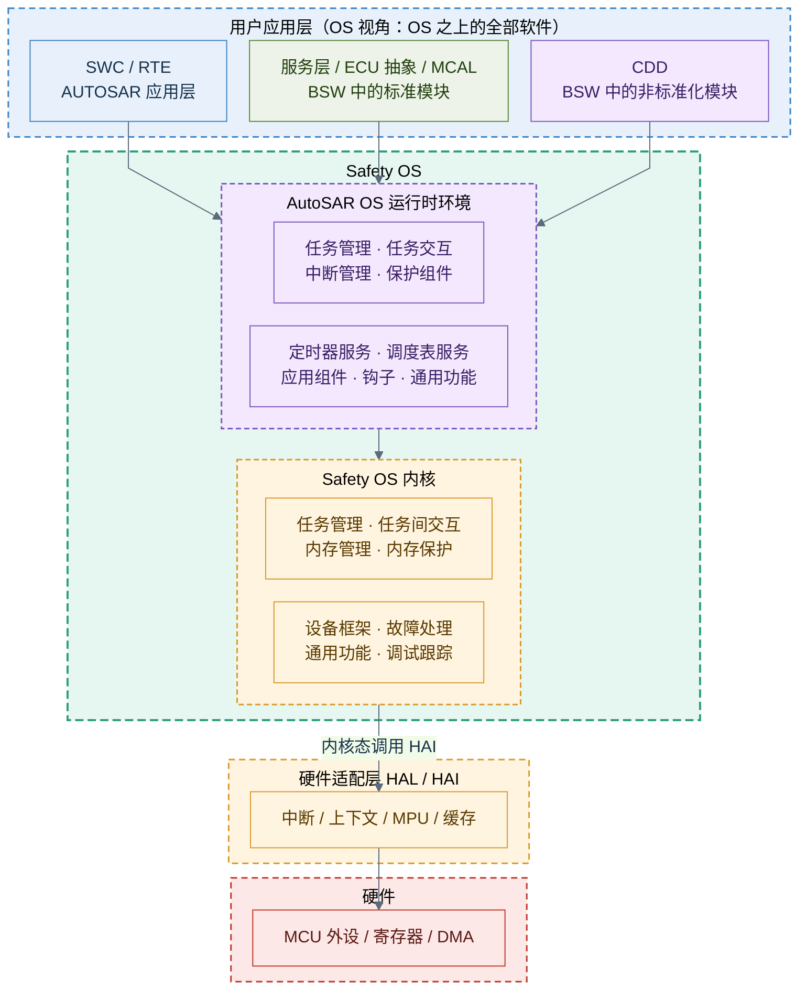
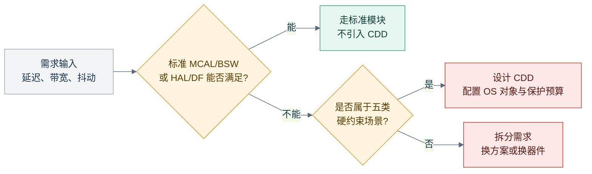
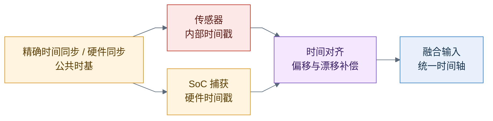
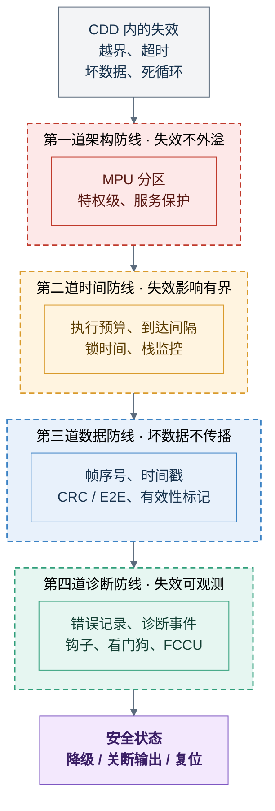

概述：CDD 是 AUTOSAR 里被允许绕开标准分层路径的模块。但绕开的只是调用路径，不是 OS 的调度规则，也不是安全论证责任。本文先划清这条边界，再用五类传感器说明 CDD 具体做什么，最后给出从四道防线到审核问答的功能安全路径。

## 1. 结论与架构基线

### 1.1 结论

CDD 不是 Safety OS 的一部分。它是构建在 OS 之上的外部 BSW/应用组件：任务、ISR、报警器、调度表、保护预算由 OS 配置和管理；CDD 只提供入口函数、硬件访问逻辑和数据处理。

四条判断可以先记住：

1. **OS 是物理法则**：CDD 可以绕过 BSW/RTE 的分层调用路径，但不能绕过 OS 的调度、优先级、资源和保护规则。
2. **OS 对象不能自建**：CDD 的任务、ISR、计数器、报警器和调度表，必须作为 Safety OS 的配置对象存在。不能在代码里私接中断向量，也不能自建调度器。
3. **数据路径可以绕，硬件访问不能乱来**：CDD 可以不走标准 CP 的分层调用。但寄存器访问要走 OS 的外设访问服务或设备框架。用户态裸指针访问会被 MPU 拦住，HAL 也不是 CDD 能直接调用的层。
4. **只在硬约束下使用**：标准 MCAL/BSW、设备框架或 HAL 能满足时序、带宽和安全要求时，不引入 CDD；满足不了时，CDD 是受控的直达通道。

把 CDD 放到传感器接入的语境里，核心问题不是"驱动怎么写"，而是三件事。数据从哪里进来？时间戳在哪里打？缓冲区的所有权归谁？激光雷达、毫米波雷达、IMU、可见光模组和红外模组的物理链路各不相同。但这三件事可以抽象成同一套模型。

本文的 OS 口径以采购的 Safety OS 交付件为准，涵盖架构分层、API 清单和安全使用假设。

### 1.2 Safety OS 架构基线

Safety OS 的整个运行环境分为 4 层，从下到上依次是：

1. **硬件（Hardware）**：运行操作系统所需的硬件。
2. **硬件适配层（HAL，Hardware Adaptive Layer）**：操作系统与硬件之间的桥梁，负责基本封装并建立运行环境。OS 内核通过硬件抽象接口（HAI，Hardware Abstraction Interface）调用这一层。
3. **Safety OS**：由 AutoSAR OS 运行时环境和 Safety OS 内核两部分组成。
4. **用户应用层（User Application Layer）**：用于实现用户应用功能。这里的"用户"是 OS 视角，指 OS 之上的全部软件，RTE、SWC、BSW 和 CDD 都在这一层。



*图 1：Safety OS 的四层运行环境与子系统划分。顶层虚线框是 OS 视角的"用户应用层"，框内再按 AUTOSAR CP 视角区分应用层、BSW 和 CDD。Safety OS 内部按运行时环境与内核两层展开。CDD 向下只有进入 Safety OS 这一条路；HAL/HAI 是 OS 的依赖接口，由内核调用，CDD 不能绕过 OS 直接调用。*

图 1、图 3、图 5 用不同颜色和虚线框表示层级；图 2、图 4、图 6 表示流程或关系，不强行分层。

Safety OS 对外提供两套软件 API，另有一组 HAL/HAI 依赖接口：

| API 族 | 提供者 | 典型用途 | CDD 的选择 |
|---|---|---|---|
| AutoSAR/OSEK API | AutoSAR OS 运行时环境，通过操作系统抽象层（OSAL）实现 | AUTOSAR 项目、可移植的任务/ISR/报警器/调度表 | AUTOSAR CDD 优先使用 |
| 内核 API | Safety OS 内核 | 非 AUTOSAR 组件、遗留代码、设备框架 | 纯内核组件使用 |
| HAL/HAI（依赖接口） | 硬件适配层实现，由 OS 内核调用 | 中断控制、上下文切换、MPU、缓存维护 | CDD 不直接调用；硬件能力经 OS 服务间接使用 |

OS 子系统很多，CDD 真正会碰到的只有下面八项。完整划分见图 1。

| 子系统 | 所属 | CDD 用得上什么 |
|---|---|---|
| 任务管理 | 运行时 / 内核 | 建任务、定优先级与栈；扩展任务靠事件等待 |
| 中断管理 | 运行时 | 一类 / 二类中断的选择、优先级与入口 |
| 任务交互 | 运行时 / 内核 | 资源锁保护独占区，事件唤醒任务 |
| 定时器服务 | 运行时 | 计数器提供时基，报警器做周期触发与超时 |
| 调度表服务 | 运行时 | 多个到期点的确定性序列，用于多传感器同步 |
| 保护组件 | 运行时 | 执行预算、MPU 分区、栈监控、服务保护 |
| 通用功能 / 设备框架 | 运行时 / 内核 | 外设访问服务的区域编号，设备的打开与控制 |
| 钩子功能 / 故障处理 | 运行时 / 内核 | 启动关闭钩子、错误与保护异常、安全状态 |

本文会反复用到一些缩写，先统一口径。

| 术语 | 通俗解释 |
|---|---|
| SWC | 软件组件，实现一个具体功能的应用代码单元，例如点云滤波 |
| RTE | 运行时环境，连接 SWC 与 BSW 的通信胶水层，由工具生成 |
| BSW | 基础软件，OS 之上、应用之下的通用服务集合 |
| MCAL | 微控制器抽象层，BSW 最底层的芯片驱动 |
| CDD | 复杂设备驱动，BSW 中被允许不走标准分层路径的特例模块 |
| 一类 / 二类中断 | 两类中断服务程序，区别在于能否调用 OS 服务，详见 4.3 |
| MPU | 内存保护单元，用硬件限制某段代码或数据能被谁读写 |
| DMA | 直接内存访问，让外设不经过 CPU 直接搬运数据 |
| 错误记录 / 诊断事件 | 开发期错误跟踪与运行期诊断事件管理 |
| SEooC | 脱离上下文开发的安全要素，附带使用假设交付 |
| ASIL | 汽车安全完整性等级，从 A 到 D，D 最严格 |
| 时间同步 | 车载以太网的时间同步机制，给多路传感器建立同一条时间轴 |
| HAI | 硬件抽象接口，OS 内核调用硬件适配层的入口 |
| 硬件在环 / 失效分析 | 硬件在环测试，以及失效模式影响及诊断分析 |

### 1.3 CDD 在架构中的位置

在 AUTOSAR CP 项目中，RTE、SWC 和 BSW 位于 OS 之上；CDD 作为 BSW 模块，也位于 OS 之上。它不是 OS 的子系统，而是 OS 的一个使用者。

层归属要从两个视角看，这是最容易争论的一点：

- **OS 视角**：Safety OS 只区分 OS 自己和 OS 之上的用户应用。RTE、SWC、BSW 和 CDD 全部落在用户应用层，因为对 OS 来说，它们都是被调度、被保护、被检查的使用者。图 1 采用的是这个视角。
- **AUTOSAR CP 视角**：应用层专指 SWC 加 RTE，BSW 是单独的一层，CDD 属于 BSW 中的非标准化模块，不属于应用层。

两种说法不冲突，冲突的只是"应用层"这个词的定义。本文说 CDD 位于 OS 之上，指 OS 视角；说 CDD 是 BSW 模块，指 CP 视角。CDD 不会因为是 BSW 模块就成为 OS 的一部分，也不会因为在 OS 之上就变成 SWC。

| 事项 | OS/BSW 责任 | CDD 责任 |
|---|---|---|
| Task/ISR 配置 | 任务管理、中断管理静态配置优先级、栈、上下文 | 提供入口函数，声明执行预算 |
| 计数器/报警器/调度表 | 定时器服务、调度表服务配置周期和到期点 | 声明采样周期，处理回调或事件 |
| 保护预算 | 保护组件配置执行时间、资源锁定、中断锁定、到达间隔 | 提供最坏执行时间、临界区长度、栈需求 |
| MPU 分区 | 保护组件/MP 与 OS 应用配置 | 把代码、数据、栈放入指定分区 |
| 外设访问 | 外设访问服务（通用功能）或设备框架 DF | 使用区域编号或设备句柄，不裸指针访问 |
| 故障处理 | 内核故障处理与钩子提供故障流程 | 实现钩子，映射到诊断事件管理/错误记录 |
| 独占区 | 任务交互的资源锁 | 使用资源锁，不假设独占访问 |
| 启动与关闭 | 钩子功能 | 对齐启动、休眠、唤醒序列 |

交付边界要分清：Safety OS 交付包只覆盖 AutoSAR OS 运行时环境和 Safety OS 内核，不含 MCAL 和 BSW 通信栈。后面这些由集成商或第三方提供，CDD 与它们的接口在项目层定义。

这里有一个容易混淆的边界：**"CDD 可以直接访问硬件"在 MPU 架构下要打折扣**。Safety OS 的用户应用在启用 MPU 时运行在非特权模式，MPU 隔离内核和其他应用。CDD 如果作为普通用户应用运行，直接写寄存器可能触发 MPU 异常。推荐做法是：

1. 寄存器访问走外设访问服务的 `Os_Sys_ReadPeripheral8/16/32`、`Os_Sys_WritePeripheral8/16/32`、`Os_Sys_ModifyPeripheral8/16/32`，用配置好的 `AreaId` 标识外设区域。
2. DMA、缓存维护、中断控制器等底层能力由 HAL 实现，但调用方是内核。CDD 通过 OS 服务或设备框架间接使用，不自己调 HAL。
3. 只有在受信的特权分区或 HAL 驱动内部，才允许直接指针访问寄存器，并且要在安全分析中说明理由。

```c
/* AreaId is configured in the peripheral area table. */
uint32 status = Os_Sys_ReadPeripheral32(CDD_LIDAR_AREA_STATUS);

if ((status & CDD_LIDAR_FIFO_EMPTY) == 0U) {
    Os_Sys_WritePeripheral32(CDD_LIDAR_AREA_IRQ_CLR, CDD_LIDAR_IRQ_MASK);
}
```

外设访问服务不只是"换一种读写方式"。它会检查 `AreaId` 是否有效、当前应用是否有访问权限、当前上下文是否允许操作。对 CDD 来说，这比在代码里保存一个裸指针更符合 Safety OS 的保护模型。

还有一条更硬的约束：**CDD 不能绕过 OS 直接调用 HAL**。HAL/HAI 是 OS 的依赖接口，调用方是运行在特权模式的内核。用户应用运行在非特权模式，很多寄存器和修改这些寄存器的指令在该模式下不可访问。因此 CDD 到硬件只有一条路：CDD 调用 OS 服务，内核代为完成寄存器操作，内核再通过 HAI 调用 HAL。确需裸指针访问，只能把 CDD 放进受信的特权分区，或让它成为 HAL 驱动的一部分，两者都要在安全分析中说明理由。

### 1.4 CDD 与 CP 框架的关系

CDD 与 CP 框架的关系是"栖身其中，特例运行"。它作为 BSW 模块存在于 CP 架构内，对外可以通过标准接口交互。但 OS 的调度、优先级和资源保护必须遵守；CP 关于"必须逐层抽象、必须标准化接口、必须由 RTE 控制执行"的分层规范，被允许作为例外绕开。

必须服从 OS 的理由有三条：

1. **任务调度由 OS 定义**：CDD 周期任务的周期、优先级和栈大小全部在 OS 配置中定义，不是开发者可以随意设定。优先级盲目设为最高会扰乱系统实时性，甚至触发看门狗。
2. **关键资源依赖 OS 保护**：访问共享资源或进入临界区时，必须使用 OS 的资源锁等资源机制。不能自行假设独占访问。
3. **生命周期受 OS 管理**：启动初始化、休眠唤醒等状态转换要与 OS 的启动关闭序列和钩子对齐。不能游离在系统电源管理之外。

一句话概括：OS 是 CDD 运行的物理法则。CDD 可以绕过 BSW/RTE 的路，但不能绕过 OS 的交通规则。

不必遵循 CP 分层的理由也有三条：

1. **非标准化实体**：AUTOSAR 对 CDD 的定义强调它是不受 AUTOSAR 标准化约束的软件实体。代码结构和内部实现没有 CP 标准模块那样的固定范式，只受少量通用集成要求约束。
2. **允许直接触及硬件**：标准 CP 路径要求经 RTE → BSW → MCAL 逐层访问硬件，CDD 被允许直接访问微控制器外设、寄存器或中断。在 Safety OS 下，这条自由要经外设访问服务或特权分区落地，见 1.3。
3. **RTE 控制之外的存在**：CDD 可以拥有不在 RTE 控制下的代码实体，例如二类中断和 BSW 主处理函数。同时它仍可选择性使用 RTE API 与应用通信。

"绕过 AUTOSAR"这个说法容易把 CDD 理解成违规后门。准确的区分是三层：

| 层面 | CDD 绕开的 | CDD 必须保留的 |
|---|---|---|
| 调用路径 | RTE → BSW → MCAL 的逐层转发 | 归属 BSW、受 OS 和配置管理、向上提供明确接口，不能变成谁都能调的裸代码 |
| 通用抽象 | 标准模块的固定范式和统一接口 | 时序论证、故障可观测、接口定义和验证证据；获得直接控制硬件的自由，就承担自证可靠性的代价 |
| 适用边界 | 无，边界不可绕 | 仅在标准模块满足不了时序、带宽、专有硬件或安全机制时使用；反之用 CDD 只会增加负担 |

### 1.5 五类适用场景

判断标准只有一条。标准分层栈、设备框架或 HAL 的通用能力，是否以不可接受的代价牺牲了时序、带宽或直接控制力？AUTOSAR 的价值在于对所有人公平，代价是每一层都增加调度开销和代码路径。CDD 是为"公平的慢"不可接受的场景准备的。

| 场景 | 硬约束 | 典型实现 | 不该用 CDD 的信号 |
|---|---|---|---|
| 专有硬件协议与时序 | 私有命令序列、微秒级时序、非标帧结构 | SBC/PMIC 私有命令、步进电机、非标传感器 | 标准 SPI/CAN/LIN 时序已够用 |
| 高带宽数据通路 | 单路 1080p30、12 bit 原始像素约 0.75 Gbit/s，按 16 bit 容器或加包头后接近 1 Gbit/s | 摄像头、雷达、激光雷达；DMA + frame buffer + 中断 | 数据率低、延迟容忍度高，标准模块可以搬运 |
| SafetyLib/安全包集成 | 周期自检、故障响应敏感、需访问安全寄存器 | STL、FCCU/ECC 故障处理、NMI 安全事件 | 厂商 MCAL 方案已满足安全论证 |
| 硬实时闭环 | 控制周期几十微秒，跨层调用吃掉预算 | FOC 电流环、PWM 与 ADC 同步采样 | 控制周期在毫秒级 |
| 遗留代码封装 | 已验证代码需合规纳入架构，AUTOSAR 尚未覆盖 | 把既有驱动包成有明确接口的 CDD | 可重构为 SWC 或标准 BSW 模块 |

芯片厂商的 SafetyLib 几乎总是以 CDD 身份集成：在 OS 任务中完成初始化，在中断服务程序中处理各类安全事件。ST 的 Stellar safety CDD、英飞凌的 SafeTlib 走的都是这条路径。



*图 2：CDD 的引入决策。先证明标准模块不满足硬约束，再判断是否属于五类场景。*

## 2. CDD 的 OS 接入模型

### 2.1 三种接入形态

| 形态 | OS 基础 | 适用 | 关键约束 |
|---|---|---|---|
| AutoSAR OS 应用 | 任务/中断/任务交互/定时器/调度表/保护/应用组件 | AUTOSAR CDD、周期采样、需要 OS 保护 | OS 对象静态配置，受保护预算约束 |
| 内核线程 + DF | TM、TI、DF | 非 AUTOSAR 或遗留代码、中低速设备 | 不与 AutoSAR API 混用，设备独占 |
| 特权分区 CDD | 受信 OS 应用、外设访问服务、设备框架 | 高带宽、硬时序、专用外设 | MPU 配置和安全论证成本最高 |

选择顺序是：先用标准 MCAL/BSW；其次用 AutoSAR OS 应用；再次用内核线程加设备框架；最后才考虑特权分区 CDD。接入形态越靠下，控制力越强，验证责任也越重。三种形态都在 OS 之上，没有哪一种可以绕开 OS 直接调 HAL。

AutoSAR OS 应用是 AUTOSAR CDD 的推荐形态。应用组件把任务、ISR、报警器、调度表、计数器组合成一个应用，支持终止和重启；同一 OS 应用内的任务和 ISR 可以通过共享内存机制交换数据，其他应用不可访问。CDD 作为独立 OS 应用时，故障可以被隔离和恢复，不会拖垮同一处理器上的其他应用。

### 2.2 统一数据通路

不管传感器是激光雷达、毫米波雷达、IMU、可见光模组还是红外模组，CDD 的接入都可以抽象成同一条链路：

```mermaid
%%{init: {'theme':'base','flowchart':{'nodeSpacing':26,'rankSpacing':40,'curve':'linear','subGraphTitleMargin':{'top':8,'bottom':8}},'themeVariables':{'primaryColor':'#E8F1FB','primaryTextColor':'#17324D','primaryBorderColor':'#3B82C4','lineColor':'#5B6B7C'}}}%%
flowchart LR
  subgraph L1["硬件层"]
    S["传感器<br/>LiDAR / 雷达 / IMU / 相机"]
  end
  subgraph L2["硬件适配层"]
    H["DMA 搬运"]
  end
  subgraph L3["Safety OS"]
    I["中断管理<br/>ISR 入口与优先级"]
    T["任务管理<br/>任务调度"]
  end
  subgraph L4["应用层（CDD 所在的 OS 应用）"]
    P["CDD 中断处理函数<br/>清中断源 / 打时间戳"]:::cdd
    B["静态缓冲<br/>生产者写、消费者读"]:::cdd
    K["CDD 任务函数<br/>重组 / 校验 / 发布"]:::cdd
  end
  R["RTE / SWC<br/>另一个 OS 应用"]

  S --> H
  H --> I
  I -- "调用" --> P
  P --> B
  B --> K
  T -. "调度" .-> K
  K -- "发布帧" --> R

  style L1 fill:#FDE8E8,stroke:#C0392B,stroke-width:1.5px,stroke-dasharray: 6 4
  style L2 fill:#FFF4E0,stroke:#D99A2B,stroke-width:1.5px,stroke-dasharray: 6 4
  style L3 fill:#E6F6F1,stroke:#2F9E7A,stroke-width:2px,stroke-dasharray: 8 4
  style L4 fill:#F3E8FD,stroke:#7E57C2,stroke-width:1.5px,stroke-dasharray: 6 4
  classDef hw fill:#FDE8E8,stroke:#C0392B,color:#5A1A14
  classDef hal fill:#FFF4E0,stroke:#D99A2B,color:#5A3B00
  classDef os fill:#E6F6F1,stroke:#2F9E7A,color:#123F33
  classDef cdd fill:#F3E8FD,stroke:#7E57C2,color:#3B1F66
  classDef app fill:#E8F1FB,stroke:#3B82C4,color:#17324D
  class S hw
  class H hal
  class I,T os
  class R app
```



*图 3：传感器接入的统一链路。OS 只提供中断入口和任务调度，函数体与缓冲区属于 CDD。中断只做最短路径，任务完成重组、校验和发布。*

先读懂图 3 里 OS 与 CDD 的分界。中断管理和任务管理是 OS 的机制，负责"什么时候执行"；中断处理函数、任务函数和静态缓冲是 CDD 的代码和数据，负责"执行什么"。同一个 ISR，入口由 OS 按静态配置分发，函数体由 CDD 实现。周期触发与帧超时来自定时器服务和调度表服务，选型见 4.5。

这条链路的三组接口，设计时不要混在一起：

| 接口类别 | 数据特征 | 典型接口 | 设计要点 |
|---|---|---|---|
| 控制类 | 低频、小数据量 | Init、Start、Stop、Control | 追求可配置、可恢复 |
| 数据类 | 高频、大带宽 | GetFrame、ReleaseFrame、回调 | 追求确定性和吞吐：DMA、零拷贝、缓冲所有权、丢帧策略 |
| 诊断类 | 低频、事件驱动 | 错误记录、诊断事件管理、GetStatus | 追求可观测、可追溯 |

把诊断逻辑塞进高速中断，或者把大数据拷贝放进控制接口，都会破坏实时性。

## 3. CDD 在五类传感器上的差异

第 2 章的统一模型对五类传感器都成立。本章不重复模型，只回答一个问题：面对这类传感器，CDD 存在的理由是什么。判断方法五类一致——先看标准模块能做到哪一步，再看卡在哪个硬约束上，最后才知道 CDD 该接管哪一段。

### 3.1 CDD 在这几类传感器上做了什么

这张表只回答一个问题：面对这类传感器，标准模块缺什么能力，缺了会出什么事。

| 传感器 | 标准模块做不到的事 | 所以会怎样 |
|---|---|---|
| 激光雷达 | 认不出帧边界；不能在 DMA 中断里打时间戳；不能零拷贝直写应用缓冲 | 时间戳只能落到应用层，延迟 5 ms。100 km/h 下这 5 ms 等于 13 厘米位置误差，点云和图像对不上 |
| 毫米波雷达 | 产生微秒级调频触发；搬运每秒 5 MB 的原始数据立方 | 只能拿到目标列表；要做原始信号处理就必须自己搬，且触发时刻无法保证 |
| IMU | 批量读 FIFO；在数据就绪中断里打时间戳 | 每样本一次中断，1 kHz 采样就是每秒 1000 次进内核，时间戳还只能软件补打 |
| 可见光模组 | 私有 ISP 配置；多相机曝光同步；全程零拷贝 | 每次拷贝多 124 MB/s 内存流量，三处拷贝就是 372 MB/s，DDR 带宽被吃掉一块 |
| 红外模组 | 非均匀性校正、快门时序、无效帧标记 | 只能裸写寄存器；换一颗探测器就要重写一遍，且无版本可追溯 |

表里第二列列的每条"做不到"，就是 CDD 要实现的一个函数或一段流程。换句话说，CDD 的职责范围不是设计出来的，是被标准模块的能力边界框出来的。

接下来是第二个问题：这些活为什么不能交给别的模块。三个候选都试过，各卡在一条上。

**交给标准 MCAL 不行，它只抽象到字节流。** MCAL 提供的是"读一个寄存器、发一帧 CAN、收一个以太网包"这个粒度。它不认识"一帧点云已经收齐了"，也不提供在中断里打时间戳的语义。帧边界、时间戳、校准，这些都得有人在外层做。

**交给标准 BSW 通信栈不行，它的模型是逐层缓冲加拷贝。** 每过一层都有自己的队列和复制，这是为了解耦和可移植。低带宽场景这点开销无所谓，每秒 124 MB 的图像流经不起。零拷贝要求网口或 CSI 的 DMA 直接写进应用缓冲区，标准模块没有这条路径。

**交给 SWC 不行，它没有中断上下文，也拿不到 DMA 缓冲。** SWC 跑在 RTE 之上，收发都要经过端口，由 RTE 做 copy-in / copy-out。中断属于 OS 和 BSW，SWC 既不能在中断里执行，也无法持有物理地址去配置 DMA。

三条卡点合起来就是判据。一件事同时满足三条，才非 CDD 不可：需要在中断或 DMA 上下文直接接触硬件；需要打破逐层缓冲和拷贝；硬件协议或时序不标准。只满足其中一条的，用标准模块就够，硬上 CDD 只会增加负担——这也是第 1 章那条判断标准在传感器层面的展开。

### 3.2 时间对齐

多传感器融合的前提不是"都有数据"，而是"数据在同一时间轴上"。时间戳打错位置，后面的融合算法再复杂也无法补救。

对 CDD 来说，要回答的是"时间戳打在我这条链路的哪一步"。原则只有一条：打在物理事件发生的最近位置。能在传感器内部或 DMA 入口捕获，就不要在应用层补打。

| 时间戳来源 | 适用传感器 | 典型精度 | 注意事项 |
|---|---|---|---|
| 传感器内部时间戳 | 激光雷达、毫米波雷达、IMU | 微秒到毫秒 | 需要估计时钟偏移和漂移 |
| 精确时间同步（gPTP/802.1AS） | 以太网激光雷达、雷达、相机 | 亚微秒到微秒 | 需要硬件时间戳和正确的同步配置 |
| 硬件触发/同步线 | 相机、雷达、红外模组 | 纳秒到微秒 | 注意线缆延迟和触发偏斜 |
| SoC 捕获时间戳 | CSI、LVDS、SPI | 微秒级 | 受中断延迟和排队影响 |

软件在应用层调用 `GetTickCount()` 打的时间戳，通常只能算"收到时间"，不能算"采样时间"。对 30 fps 的相机，33 ms 帧周期内几毫秒的软件延迟就会影响运动补偿。



*图 4：多传感器统一时基。传感器时间戳和 SoC 捕获时间戳进入 CDD 后，做偏移与漂移补偿，再交给融合 SWC。*

工程上要维护三样东西。时间基，即精确时间同步域或硬件同步线。偏移，启动时估计、运行中监测。漂移，源于晶振随温度变化，需要周期性更新。

三个典型组合可以说明时间同步的作用：

- **可见光/红外模组 + IMU**：相机曝光开始产生硬件触发，IMU 在触发沿附近采样。融合时按时间戳插值，补偿曝光期间的运动。
- **激光雷达 + IMU**：点云每点时间戳与 IMU 时间戳对齐，按扫描周期做运动畸变校正。时间戳偏差会直接表现为点云拖影。
- **毫米波雷达 + 相机**：外参标定决定空间对齐，硬件触发或精确时间同步决定时间对齐，两者缺一不可。

### 3.3 帧描述符与数据一致性

时间对齐解决"同一时刻"，帧描述符解决"这一帧能不能用"。CDD 交出去的每一帧，至少要让上层判断四件事：完不完整、新不新鲜、时间对不对、可不可信。

| 机制 | 作用 | 放在哪里 |
|---|---|---|
| 帧 ID/序号 | 识别丢帧、乱序、重复帧 | CDD 帧描述符 |
| 时间戳 | 对齐不同传感器 | CDD 采集点 |
| E2E 保护 | 检测传输过程中的数据损坏 | RTE 或通信栈 |
| CRC | 检测存储或链路错误 | CDD 或硬件 |
| 丢帧计数 | 评估数据完整性 | CDD 状态接口 |
| 缓冲区所有权 | 防止生产者覆盖消费者正在读的数据 | CDD 缓冲管理 |

丢帧策略要提前定义：丢最旧帧、丢最新帧，还是阻塞生产者。车载感知通常不能阻塞生产者，常见做法是保留最新帧并增加丢帧计数，由上层决定是否降级。

## 4. CDD 的共性设计约束

第 3 章讲的是不同传感器带来的差异。本章反过来，讲五类传感器共用的约束，分三组：数据怎么管（4.1、4.2）、什么时候跑（4.3 至 4.5）、出问题怎么发现和论证（4.6 至 4.8）。

### 4.1 缓冲区所有权

高带宽传感器接入最容易犯的错误，是"收到数据就拷贝一份给应用"。拷贝一次，带宽和延迟都翻倍；拷贝多次，实时性无法保证。

推荐使用"生产者写入、消费者只读、释放后归还"的模型：

| 状态 | 生产者 | 消费者 | 规则 |
|---|---|---|---|
| FREE | 可写 | 不可读 | 生产者取走并写入 |
| FULL | 不可写 | 可读 | 消费者取走只读指针 |
| IN_USE | 不可写 | 可读 | 消费者释放后回到 FREE |

实现上使用静态分配的环形队列或三缓冲。队列里存的是描述符或指针，不是整帧数据；描述符包含帧 ID、时间戳、长度、状态和缓冲区索引。缓冲区放在 CDD 所属的 OS 应用分区，由保护组件/MP 配置访问权限。运行期不申请堆内存；必须使用 MM 内存池时只能分配固定大小块，且分配和释放只能在线程上下文执行。

### 4.2 接口模式

| API | 语义 | 调用上下文 |
|---|---|---|
| `Cdd_<Sensor>_Init` | 配置、自检、加载标定参数 | 启动任务或启动钩子 |
| `Cdd_<Sensor>_Start` / `_Stop` | 启动或停止采集、使能或关闭中断 | 任务 |
| `Cdd_<Sensor>_GetFrame` | 获取只读帧所有权 | 任务 |
| `Cdd_<Sensor>_ReleaseFrame` | 归还缓冲区 | 任务 |
| `Cdd_<Sensor>_GetStatus` | 健康状态、计数器、温度 | 任务或诊断 |
| `Cdd_<Sensor>_Control` | 模式、参数、触发 | 任务 |

帧描述符建议包含以下字段：

```c
typedef struct {
    uint32 FrameId;
    uint64 TimestampNs;
    uint16 Width;
    uint16 Height;
    uint8  Format;
    uint8  Status;
    const uint8 *Data;
    uint32 DataLen;
} Cdd_SensorFrameType;
```

`Data` 指向 CDD 管理的缓冲区。消费者不得修改内容，也不得在 `ReleaseFrame` 之后继续访问。

接口设计有一条硬规则：**不要混用 AutoSAR API 和内核 API**。AUTOSAR CDD 用 `Os_Sys_*`、`OsApplication*` 等 AutoSAR/OSEK 接口；纯内核组件用内核线程、互斥量、设备接口。混用会让执行上下文、错误码和生命周期语义变得不可验证。

### 4.3 中断与任务的分工

中断服务程序（ISR）是硬件中断到来时立即执行的一段代码。Safety OS 的中断管理把 ISR 分成两类，区别只有一条：能不能调用 OS 服务。

- **一类中断**：不能调用任何 OS 服务，中断来了直接执行、执行完直接返回。开销最小、延迟最低，但只能做不依赖 OS 的事，例如清中断标志、读一个寄存器、记一个时间戳。
- **二类中断**：由 OS 托管，可以调用 OS 服务，因此能唤醒任务、申请资源、设置事件。代价是进出 OS 有额外开销，而且退出前必须释放占用的资源，否则触发保护警告。

选择规则很简单：只需要记录事实用一类中断，需要通知任务接着干活用二类中断。按上下文分工如下：

| 上下文 | 能否调用 OS 服务 | 做什么 | 不做什么 |
|---|---|---|---|
| 一类中断 | 不能 | 清中断源、捕获时间戳、置标志 | 操作计数器/报警器/调度表、唤醒任务 |
| 二类中断 | 可以 | 搬运描述符、更新索引、设置事件唤醒任务 | 大块拷贝、解析协议、调用阻塞服务、退出时不释放资源 |
| CDD 任务 | 可以 | 校验帧、重组、发布到 RTE、更新诊断 | 长时间关中断、死等硬件 |
| 诊断任务 | 可以 | 读取计数器、上报诊断事件管理、触发恢复 | 高频轮询 |

两条硬约束。定时器服务和调度表服务的操作必须在任务或二类中断上下文执行，一类中断中不允许操作；ISR 的执行时间要可测量，用 GPIO 翻转配合示波器，或用保护组件的时间保护预算记录最坏执行时间，不要只看平均值。

### 4.4 内存与保护

保护组件提供四类保护，CDD 要主动配合：

| 保护 | 作用 | CDD 要做什么 |
|---|---|---|
| 内存保护 | 隔离任务/ISR 的代码、数据、栈 | 代码段只读可执行，常量段只读，数据段限越界，共享段按生产者/消费者配权 |
| 时间保护 | 限制执行时间、资源锁定时间、中断锁定时间、到达间隔 | 提供最坏执行时间、临界区长度、采样周期预算 |
| 栈监控 | 检测任务/ISR 栈溢出 | 配置足够栈，回读栈水位 |
| 服务保护 | 阻止非法 OS 服务调用 | 使用当前上下文允许的 API，不在一类中断调用 OS 服务 |

HAL/HAI 的实现也要满足 ASIL D 要求，厂商的低层驱动库可以作为 HAL/HAI 的实现细节。CDD 不得直接依赖厂商库的私有接口：要么把厂商库封装进 HAL 由内核调用，要么把 CDD 放进受信的特权分区并说明理由。

### 4.5 调度与定时机制

CDD 用哪套机制触发，取决于"触发是否需要与其他活动保持固定相位关系"。

| 机制 | 用途 | CDD 示例 |
|---|---|---|
| 计数器与报警器 | 单任务周期触发、超时 | IMU 周期采样、LiDAR 帧超时 |
| 调度表 | 多个激活点的确定性序列 | 多相机同步曝光、雷达调频周期序列 |

能用调度表就不要用报警器。调度表的到期点可以同时激活多个任务或设置多个事件，时间同步性更好，相位漂移也更可控。报警器更适合单任务的周期触发和超时判断。

需要说明的是，本文按单核形态展开。Safety OS 安全默认配置里，OS 管理的核心数默认为 1，且这份默认配置不可修改。所以跨核调用和跨核锁这类机制不在本文讨论范围内。CDD 的设计不要依赖跨核数据通路。中断与处理任务落在同一个核上，共享数据的保护用资源锁就够了。

### 4.6 故障处理与诊断

Safety OS 的内核故障处理把故障分为可恢复和不可恢复两类。可恢复故障包括参数错误、执行条件错误、资源不足等，通过错误码和日志处理；不可恢复故障包括硬件错误、非法指令、MPU 保护异常等。出现这类故障时系统进入内核故障处理流程：保存现场，执行用户钩子，然后恢复、复位或挂起。

钩子功能提供启动钩子、关闭钩子、错误钩子、保护钩子等钩子。钩子高于所有任务，不被二类中断抢占，只能使用允许的 API 子集。CDD 的接入方式：

1. 早期初始化放在启动钩子，只做无阻塞动作；耗时初始化放到任务管理的任务。
2. 关闭和去初始化放在关闭钩子。
3. 错误处理放在错误钩子或保护钩子，映射到错误记录 / 诊断事件管理，并触发安全状态。
4. 传感器专属诊断通过 `Cdd_<Sensor>_GetStatus` 暴露，由诊断任务周期读取。

| 传感器 | 关键诊断 | 故障反应 |
|---|---|---|
| 激光雷达 | 丢包率、遮挡、窗口污染、温度、电机转速 | 降低置信度、关闭点云、上报诊断事件管理 |
| 毫米波雷达 | 干扰、校准失效、RF 故障、天线故障、温度 | 标记目标不可信、切换备用通道 |
| IMU | 自检失败、饱和、零偏超限、缓冲溢出、数据龄期 | 使用冗余 IMU、降级融合 |
| 可见光模组 | 帧丢失、CSI ECC/CRC、链路失锁、曝光超时 | 冻结检测、降低帧率、切换备用相机 |
| 红外模组 | 快门故障、非均匀性校正失效、探测器温度超限、图像冻结 | 重新校正、关闭测温、上报安全状态 |

### 4.7 功能安全的实现路径

先纠正一个常见期待：CDD 不能"保证"功能安全。安全是系统级属性，由整车安全目标逐层分解。CDD 能做的是把自身风险控制到可接受水平，并给出证据。还要说清一件事。Safety OS 是在不知道具体车型的前提下开发的，交付的是这种条件下的安全论证。它的认证边界只到 OS 运行时和内核，证书不会自动覆盖 CDD。

在这个前提下，CDD 的功能安全靠四道防线加一条证据链。

**第一道是架构防线**，解决"失效会不会外溢"。MPU 分区、特权级和服务保护把 CDD 关在自己的格子里，越界写和野指针在触发瞬间被硬件拦住。

**第二道是时间防线**，解决"影响有没有界"。执行预算、到达间隔、资源锁定时间、中断锁定时间和栈监控共同给 CDD 划上限。死循环或长期持锁会在预算耗尽时被打断。

**第三道是数据防线**，解决"坏数据会不会传播"。帧序号、时间戳、CRC 或 E2E、有效性标记让坏帧在进入融合之前被丢弃，不依赖功能本身是否正确。

**第四道是诊断防线**，解决"失效能不能被看见"。契约违反写进错误记录，运行期故障写进诊断事件管理。钩子捕获启动、关闭与保护异常，看门狗与 FCCU 兜住任务失控和硬件故障。这一道的输出是安全状态：降级、关断输出或复位。



*图 5：CDD 的功能安全四道防线。失效依次经过隔离、限时、检数据、可观测四层，最终导向安全状态。*

失效模式与防线的对应关系：

| 失效模式 | 主要防线 | 要点 |
|---|---|---|
| 越界写、野指针、非法指令 | 架构 | MPU 分区、特权级、服务保护 |
| 死循环、长时间持锁、任务饿死、栈溢出 | 时间 | 四类时间预算加栈监控 |
| 帧损坏、丢帧、乱序、数据陈旧 | 数据 | CRC/E2E、帧序号、时间戳、数据龄期 |
| 传感器还在出数但不可信 | 诊断 | 有效性标记、校准状态、温度与自检 |
| 任务失控、硬件故障 | 诊断 | 看门狗、钩子、FCCU 与故障引脚 |

**CDD 特有的论证负担**

标准 BSW 模块能直接引用厂商证据，CDD 不行。绕开标准模块换来直接控制力，代价是四份论证要自己做。

| 论证 | 要回答的问题 | 交付物 |
|---|---|---|
| 时序 | 最坏情况下 CDD 占用 CPU 多久，会不会挤掉安全任务 | 最坏执行时间分析、预算配置、测量报告 |
| 内存 | 会不会越界、有没有动态分配、栈够不够深 | 静态分配清单、栈深度分析、MPU 分区表 |
| 故障响应 | 从失效到进入安全状态要多久，是否落在故障处理时间间隔内 | 故障树、时序测量、故障注入记录 |
| 接口 | 前置条件、错误码、调用上下文有没有被契约约束 | 接口规范、需求追踪矩阵、单元测试 |

Safety OS 对保护错误给出的指标是故障处理时间间隔 100 ms、故障响应时间间隔 10 μs。保护错误涵盖内存违规、时间故障、非法服务调用和软件陷阱。CDD 的故障响应要在这个量级内留余量。

**从设计到审核的六步**

功能安全评审看的是流程证据，不是代码写得漂不漂亮。CDD 要跑通这六步。

1. **接住 ASIL**：CDD 的等级从系统层继承，由它支撑的安全目标决定，不能自己定。
2. **拆需求**：把安全目标分解成 CDD 的软件安全需求，每条都要能追到代码和测试。
3. **定机制**：按四道防线确定具体机制，并写下每道防线的检测时间和响应动作。
4. **控实现**：遵循 MISRA 编码规范，禁止动态分配、禁止递归、所有循环有界，保证最坏执行时间可分析。
5. **做验证**：单元测试覆盖到修正条件判定覆盖，故障注入覆盖已知失效模式，最坏执行时间必须实测而非估算。
6. **算指标**：用失效模式影响及诊断分析算出单点与潜伏故障度量，达不到目标就回去加机制。

**审核会问的十个问题**

| 问题 | CDD 的答法 |
|---|---|
| ASIL 从哪来 | 系统安全目标编号，附完整追溯链 |
| 最坏执行时间多少，怎么得的 | 实测值、预算配置、剩余余量 |
| 栈多深，怎么算的 | 静态深度分析、实测水位、余量 |
| 中断最长关多久 | 临界区清单与实测值 |
| 数据坏了怎么发现 | CRC、E2E、范围检查、帧序号 |
| 发现后多久进安全状态 | 故障树与响应时序，对照故障处理时间间隔 |
| 有没有动态内存 | 静态分配清单，明确零动态分配 |
| 单点与潜伏故障怎么覆盖 | 每条安全机制与其覆盖的失效模式对照 |
| 标定参数怎么保证完整 | 存储校验、版本号、启动时校验 |
| 测到什么程度 | 覆盖率、故障注入项、未覆盖部分的理由 |

三件事不能做。不能拿 OS 认证覆盖 CDD，这份证书只证明 OS 在给定假设下可信。不能只靠测试代替分析，测试能证明缺陷存在，不能证明最坏情况。不能在安全路径上用未认证的库，厂商私有库要么封装进 HAL，要么放进特权分区单独论证。

### 4.8 与 Safety OS 的合规约束

集成到安全系统前，必须满足 Safety OS 作为"脱离上下文安全要素"交付时声明的使用假设。

1. **HAL/HAI 实现要满足 ASIL D**。CPU 架构支持接口和板级支持接口由集成商实现，不能把未认证的 HAL 直接放进安全路径。
2. **安全默认配置不能修改**。时间片轮转、对称多处理、内存保护、线程私有内存保护、硬件栈保护等裁剪开关默认开启；OS 管理的核心数默认为 1，任务优先级数默认为 32。确需修改任何一项，必须重新评估并记录安全影响。
3. **优先级假设要满足**。使用假设是 32 个优先级足够，确定性要求高的任务独占优先级。CDD 不要动态改优先级，也不要把多个硬实时任务压在同一优先级。
4. **IPC、内存、保护、设备、故障模块要正确使用**。这些都被列为使用假设；CDD 如果绕过任务交互、保护组件、DF 和 FP，等于绕过了 OS 的安全论证。
5. **看门狗和故障汇总要接上**。在安全点喂狗，不在长循环中喂狗；FCCU 或故障引脚汇总的硬件故障，在 NMI/ISR 中读取故障源并上报。

功能安全认证的对象是具体的安全机制和证据链，不是 AUTOSAR 架构本身。不使用 MCAL 并不自动违反 ISO 26262，但需要以同等强度的论证替代标准模块已有的证据。

## 5. 工程落地与总结

### 5.1 五步流程

CDD 的落地不是"写一个驱动文件"，而是从需求判定到安全论证的完整链路。


*图 6：CDD 的五个工程步骤。*

| 步骤 | 产出 | 验证项 |
|---|---|---|
| 1 判定 | 硬约束清单：延迟、带宽、抖动、专有寄存器、安全响应时间 | 标准模块可行性评审；指标可量化、可测量 |
| 2 预留 | 任务、ISR、计数器/报警器、调度表、保护预算、MPU 分区、外设访问服务的区域编号 | 资源冲突检查；与 OS 配置一致 |
| 3 设计 | 头文件、RTE 端口、错误码、MemMap、执行上下文、API 族 | 接口评审；需求到接口的双向追踪 |
| 4 实现 | 静态内存、一类/二类中断、外设访问服务、设备框架、配置表 | MISRA/静态分析；栈分析；ISR 时长测量 |
| 5 验证 | 硬件在环报告、故障注入记录、时序报告、失效模式影响及诊断分析 | 通过/失败准则明确；安全论证闭环 |

五步里最容易走过场的是第一步和第三步。

判定要把"标准模块不够快"变成数字：控制周期 50 μs 而标准任务路径最坏 35 μs，或摄像头单路 1 Gbit/s 而标准模块拷贝只有 300 Mbit/s。没有数字，就证明不了 CDD 的必要性。

设计要同时覆盖正常路径和故障路径，至少回答四个问题：初始化失败如何上报？缓冲区溢出如何处理？ISR 与任务如何同步？掉电重启后状态如何恢复？

另两步只需要盯住一句话。实现阶段最容易翻车的是中断和临界区，ISR 只做最短路径，所有硬件等待都要有超时。验证阶段要看保护机制是否真的触发，即 MPU 越界、栈溢出和时间预算违规能否按设计走到保护钩子。

### 5.2 常见反模式

| 反模式 | 后果 | 正确做法 |
|---|---|---|
| 把 CDD 当 OS 的一部分 | 模块归属混乱，配置责任不清 | CDD 是 OS 之上的外部组件 |
| 自建中断向量或绕过中断管理 | 中断优先级、栈、保护不受 OS 管理 | 用中断管理配置 ISR |
| 在一类中断调用 OS 服务 | 未定义行为或保护异常 | 一类中断只做时间戳、清源、置标志 |
| 用户态 CDD 直接写寄存器或直接调 HAL | MPU 异常，绕过内核特权检查 | 用外设访问服务或设备框架；确需裸指针就放进受信特权分区并论证 |
| 盲目设最高优先级 | 挤占控制和安全任务，触发看门狗 | 按时序预算分配优先级 |
| 动态申请内存、加通用抽象层 | 运行期不确定性，代码膨胀 | 静态分配，按需实现，不做框架 |
| 混用 AutoSAR API 和内核 API | 上下文和错误码不可验证 | 一个模块只用一套 API |
| 不做时间保护预算 | 超时任务拖垮系统 | 配置保护组件执行时间和锁时间预算 |
| 不接错误记录 / 诊断事件管理 | 故障不可观测 | 参数错误走错误记录，故障事件走诊断事件管理 |

### 5.3 总结

CDD 的本质是 AUTOSAR 在"标准化"和"可控性"之间留出的受控出口。在 Safety OS 架构下，它首先是 OS 的使用者，不是 OS 的一部分。

判断一个 CDD 设计是否站得住，看三条就够了。归属是否清楚：它是 OS 之上的外部组件，不是 OS 的子系统。路径是否诚实：绕开的是分层调用，不是安全论证。硬约束是否量化：有数字说明标准模块满足不了，否则用 CDD 只是多一层负担。
