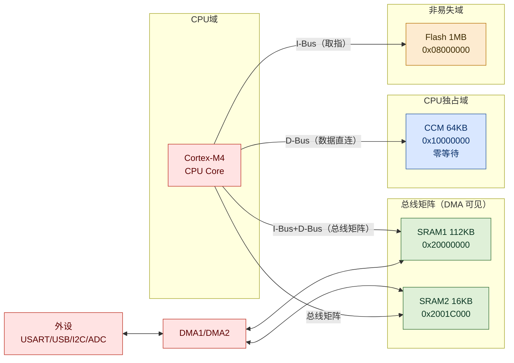
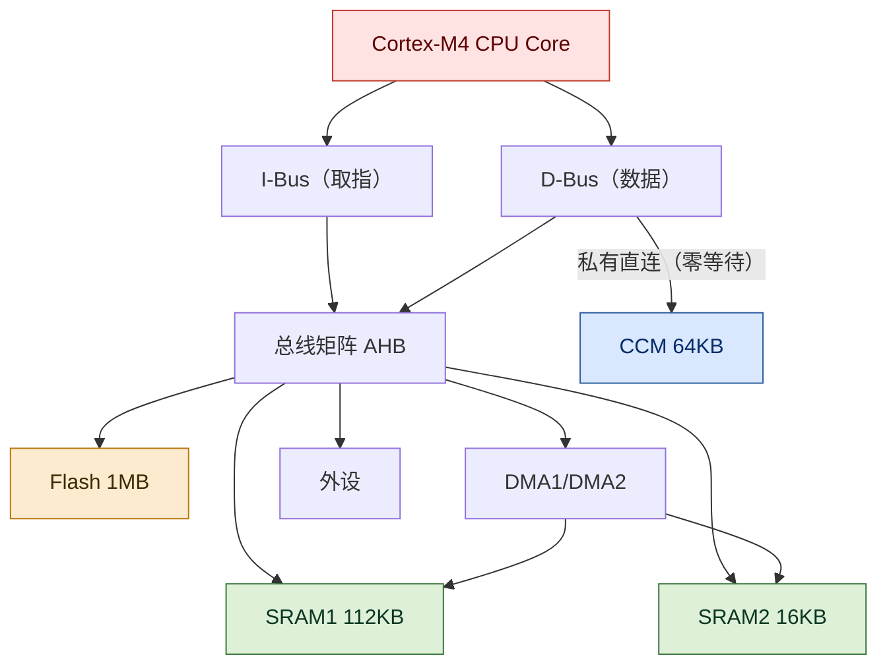
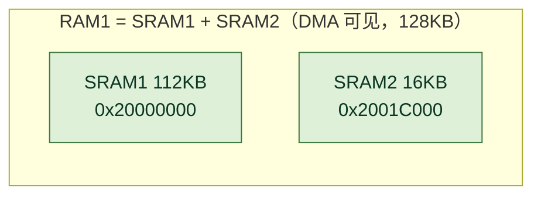
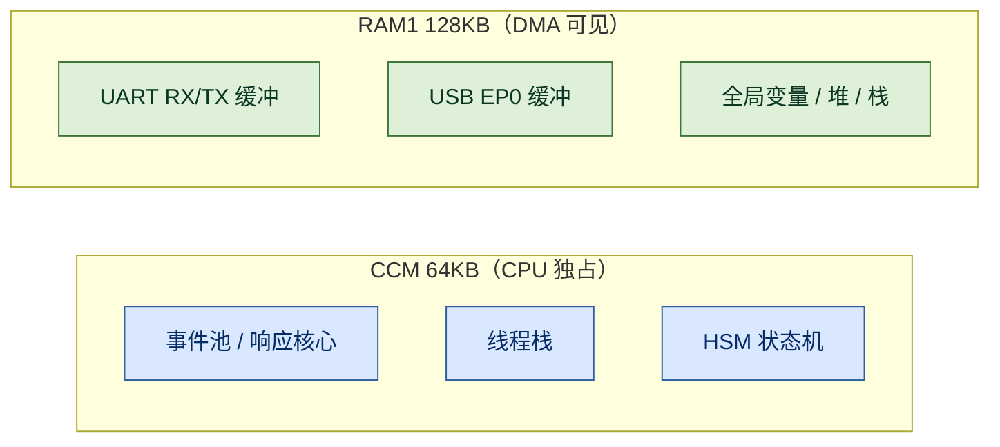

> 适用:STM32F407(RM0090)、Cortex-M4、RT-Thread / 裸机均可
> 图例:本文图为 Mermaid 彩色图,支持 GitHub / Typora / VuePress mermaid 插件等渲染

**一句话结论:STM32F407 的 RAM 并不是"一块大内存",而是两块总线不同、能力不同的物理区：128KB 的 DMA 可见 SRAM(链接脚本合并为 RAM1)与 64KB 的 CPU 独占 CCM。选内存的本质是回答一个问题:"谁需要访问这块数据?"外设与 DMA 可能触碰的放 SRAM;只有 CPU 才碰的纯热数据放 CCM。**



## 1. 内存全景与访问层次

### 全景:一块物理片,两条总线通路

参考手册 RM0090 给 STM32F407 列出的 RAM 与 Flash 如下:

| 名称 | 地址 | 大小 | DMA 可见 | 可执行代码 | 访问路径 |
| --- | --- | ---: | --- | --- | --- |
| SRAM1 | `0x2000_0000` | 112 KB | 是 | 是 | 总线矩阵 |
| SRAM2 | `0x2001_C000` | 16 KB | 是 | 是 | 总线矩阵 |
| **RAM1(链接合并)** | `0x2000_0000` | **128 KB** | 是 | 是 | 总线矩阵 |
| **CCM** | `0x1000_0000` | **64 KB** | **否** | **否** | 内核 D-Bus 私有 |
| Flash | `0x0800_0000` | 1 MB | 否 | 是 | I-Bus + ART 加速 |

注意:SRAM1 与 SRAM2 物理独立、但地址连续,链接脚本把它们合并成一个 128KB 区(通常命名为 RAM1)。这解释了为什么很多工程里"RAM1 = 128KB"：它不是一块物理内存,而是两块 SRAM 的链接别名。

### 层次:Cortex-M4 的三条通路与一堵"看不见的墙"



Cortex-M4 有两类总线,决定了"谁能摸到谁":

- **I-Bus**:取指令专用,连 Flash 与 SRAM 代码区。SRAM 上的代码能被取指执行;**CCM 没有挂 I-Bus,因此 CCM 里放代码是无效的**(复位/跳转进 CCM 会直接 HardFault)。
- **D-Bus**:数据读写。D-Bus 分出一条**私有直连**到 CCM：这就是 CCM"零等待"的来源:它不经过总线矩阵仲裁,CPU 独占,不与 DMA/外设抢总线。
- **总线矩阵**:CPU、DMA、外设、SRAM、Flash 在此交汇。SRAM 的访问要经过矩阵,与 DMA 并发时有总线仲裁延迟：比 CCM 慢的差距就在这里。

这堵"墙"就是:**CCM 只对 CPU 数据可见,对 DMA 和外设完全不可见**。任何想通过 DMA 直接往 CCM 写数据的设计(串口 DMA 收包缓冲放 CCM)都会失败。

## 2. SRAM、CCM 与系统分工

### SRAM1、SRAM2 与 RAM1:物理分开、链接合一



要点:

1. **物理独立**:SRAM2 与 SRAM1 是两块独立的 SRAM 阵列,共用总线矩阵,但可以并行访问,减少 CPU 与 DMA 的仲裁冲突。工程上常见的做法是把高频 DMA 缓冲与 CPU 热数据分开放到两块。
2. **地址连续**:`0x2000_0000` 起,SRAM1 到 `0x2001_BFFF`,SRAM2 接续到 `0x2001_FFFF`,合计 128KB。
3. **链接合并**:链接脚本通常写成一个区,例如本项目:

```
RAM1 (rw) : ORIGIN = 0x20000000, LENGTH =  128k /* DMA-visible SRAM */
CCM  (rw) : ORIGIN = 0x10000000, LENGTH =   64k /* CPU-only CCM SRAM */
```

合并的好处是全局变量分配时自动填满整块 SRAM;代价是"哪些落在 SRAM1、哪些落在 SRAM2"默认不可控,需要的人可以用 `__attribute__((section(...)))` 手动分流。

### CCM:CPU 的私有零等待高速区

CCM(Core Coupled Memory,内核耦合存储器)是这次讨论的主角:

- **零等待**:挂在 D-Bus 私有通路,不经过总线矩阵,CPU 访问无需仲裁,延迟最低。
- **CPU 独占**:DMA 与所有外设无法访问。UART/USB/I2C/ADC 的缓冲放进 CCM,等于"信号送不进去也读不出来"。
- **不能执行代码**:只接数据总线,PC 取指到 CCM 无效。
- **典型用途**:CPU 热数据、线程栈、事件池、中断频繁读写的结构体。

实测案例(RT-Thread 5.2.2 + cmdfw 框架,STM32F407):

| CCM 对象 | 大小 | 冷热 | 是否应留 CCM |
| --- | ---: | --- | --- |
| 响应核心(response core) | 15.9 KB | 热 | 留 |
| HSM/AO 装配(assembly) | 11.4 KB | 热 | 留 |
| 事件存储池(3 个) | 12.2 KB | 热 | 留 |
| Dispatcher 栈 | 4.4 KB | 热 | 留 |
| runtime 实例 | 2.7 KB | 热 | 留 |
| 日志线程(log_thread) | 5.4 KB | 冷 | 迁出到 RAM1(production) |
| 传输任务栈 | 4.0 KB | 半冷 | 迁出到 RAM1(production) |

把两个冷对象(日志线程、传输任务栈)迁出后,production 的 CCM 占用从 56,280 B(85.88%)降到 46,856 B(71.50%)：**这是"先量化归属、再迁移冷对象"的标准做法**,而不是盲目堆优化。注意:若测试固件(test-profile)的静态占用已挤占 RAM1 堆,冷对象需按口径条件编译(测试留 CCM、生产迁 RAM1),避免压垮内核堆。

### 四块内存的作用分工

前面讲的是拓扑与特性,这一节说清楚一件事:**每块内存在系统里到底负责什么**。

| 内存块 | 大小 | 作用 | 典型对象 |
| --- | --- | --- | --- |
| SRAM1 | 112 KB | **主数据区**：系统运行的默认归宿 | 全局/静态变量(.data/.bss)、栈、堆、RT-Thread 内核对象、串口/SPI 缓冲 |
| SRAM2 | 16 KB | **辅助数据区**：与 SRAM1 并行的补充容量 | 第二路 DMA 缓冲、低频数据结构,与 SRAM1 分离以分散总线访问 |
| RAM1(合并) | 128 KB | **DMA 可见数据域**：所有外设可访问内存的统一边界 | UART/USB/SPI/ADC 收发缓冲、任何需要 DMA 搬运的结构体 |
| CCM | 64 KB | **CPU 专用热区**：纯 CPU 高频数据的零等待存储 | 线程栈、事件池、中断频繁读写的结构体、实时控制状态 |

一句话分工:

- **SRAM1 = 主仓库**:容量大、DMA 可见,啥都能放,默认全放这里。
- **SRAM2 = 辅仓库**:容量小,和主仓库错峰,减轻与 DMA 的总线争抢。
- **RAM1 = 两个仓库的合称(链接层)**:对外设可见的内存边界就在这 128KB 里。
- **CCM = CPU 的私人保险柜**:又快又独占,但外设和 DMA 进不来。

作用视角的三个"为什么":

1. **为什么 UART 缓冲必须进 RAM1?** 因为串口 DMA 要直接写它：整个系统中只有 RAM1 对外设可见。
2. **为什么线程栈可以进 CCM?** 栈只被 CPU 压栈/弹栈,DMA 从不触碰;放 CCM 还能让每次进出栈更快。
3. **为什么代码不能放 CCM?** 执行代码必须过 I-Bus 取指,而 CCM 只接了数据总线;数据放 CCM 没问题,代码不行。

结合本项目(cmdfw + STM32F407)的实际分工:

- **CCM**:事件池、响应核心、HSM 状态机、Dispatcher 栈：全是 CPU 热路径,放零等待区。
- **RAM1**:UART RX/TX 缓冲、USB EP0 缓冲：外设/DMA 可见;日志线程、传输任务栈：非热对象不占 CCM。

## 3. Flash 对比与工程放置

### 与 Flash 对比:易失性决定一切

| 特性 | SRAM1/SRAM2 | CCM | Flash |
| --- | --- | --- | --- |
| 易失 | 是(掉电丢失) | 是(掉电丢失) | 否(非易失) |
| 写方式 | 任意字节随机写 | 任意字节随机写 | 必须先擦后写、页对齐 |
| 执行代码 | 可以 | **不可以** | 可以(主流位置) |
| DMA 访问 | 可以 | **不可以** | 不可以 |
| 掉电后 | 丢失 | 丢失 | 保留 |
| 典型用途 | 栈/堆/全局/DMA 缓冲 | CPU 热数据 | 程序 + 只读常量 + bootloader |

低功耗提醒:STOP 模式下 SRAM(含 SRAM2)内容保留;Standby 模式整块掉电,所有 RAM 归零。若做低功耗唤醒保留现场,数据要放 Flash 或重新初始化。

### 工程实践:数据到底放哪?

决策矩阵：拿到一块数据,先回答三个问题:

| 问题 | 答案 | 放置 |
| --- | --- | --- |
| 会被 DMA/外设访问吗? | 是(串口缓冲、USB FIFO、ADC 数组) | **SRAM(必经 DMA 可见区)** |
| 需要被 CPU 取指执行吗? | 是(bootloader、RAM 常驻 ISR) | **SRAM** |
| 纯 CPU 数据、访问极频繁? | 是(事件池、热线程栈) | **CCM(零等待)** |
| 低频、容量大、凑热闹? | 是(日志缓冲、冷配置) | **SRAM(别浪费 CCM)** |

工程口诀:**"DMA 能碰、要执行,去 SRAM;只有 CPU 碰、又热,进 CCM;冷对象一律不进 CCM。"**

在代码里用链接属性显式分流(本项目实践):

```cpp
// CPU 热对象 → CCM
#define CMDFW_CCM_SECTION __attribute__((section(".ccm_bss")))
// DMA 可见对象 → 默认 SRAM
static CMDFW_CCM_SECTION EventPool pool;      // 事件池,CPU 热
static CMDFW_DDR_SECTION  UartRing rx_ring;   // UART 缓冲,可能被 DMA/ISR 写
```

对应关系:



## 4. 工程踩坑清单

### 踩坑清单

1. **CCM 不能 DMA** ： 串口/USB DMA 缓冲放进 CCM,数据永远不到达。串口收发缓冲必须 SRAM。
2. **CCM 不能执行代码** ： 把函数/ISR 放 CCM 会 HardFault。CCM 只放数据。
3. **"RAM1=128KB"是合并区** ： 它包含 SRAM2 的 16KB;写 SRAM 时不要以为只剩 SRAM1。
4. **CCM 扩容空间有限** ： 64KB 的 CCM 一旦满,链接直接报 overflow;没有"页扩展"一说。扩容前先做对象级占用审计,把冷对象迁走。
5. **总线仲裁延迟** ： SRAM 与 DMA 并发时 CPU 访问可能被插等待周期;对时间敏感的热循环可考虑把数据挪进 CCM 避开仲裁。
6. **低功耗陷阱** ： STOP 模式 SRAM 保留,Standby 模式全部归零;唤醒后需要重新初始化 RAM 中的现场。
7. **链接脚本是最终裁决** ： 宏名(如 `CMDFW_CCM_SECTION`)只是把对象放进指定 section,真正能否落位由 `link.lds` 的 `MEMORY` 与 `SECTIONS` 决定;改宏不改脚本等于没改。

## 5. 结论

### 小结

STM32F407 的 RAM 是"一块 CPU 独占的快内存 + 一块各方共享的通用内存":CCM 用速度换独占,SRAM 用可见性换通用。写嵌入式代码时,先问"谁要访问它",再决定放哪：这比任何内存优化技巧都更能避免踩坑,也是把 64KB CCM 用出 100% 价值的第一步。
