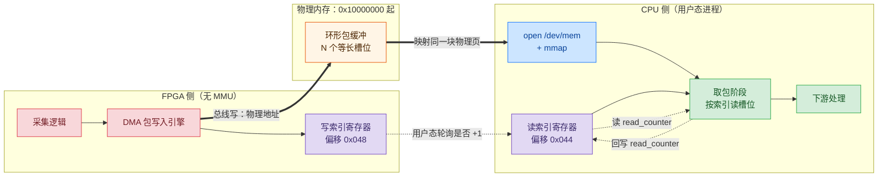
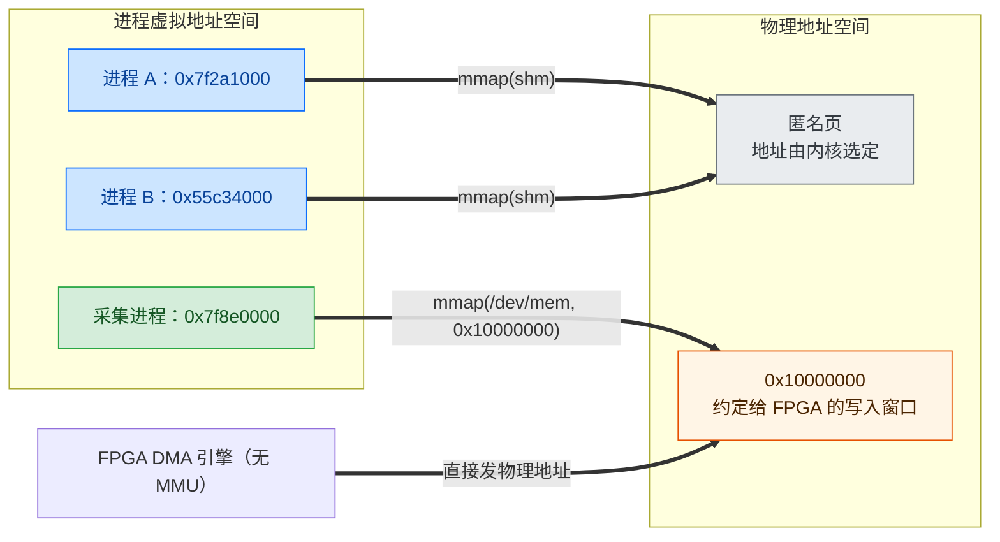
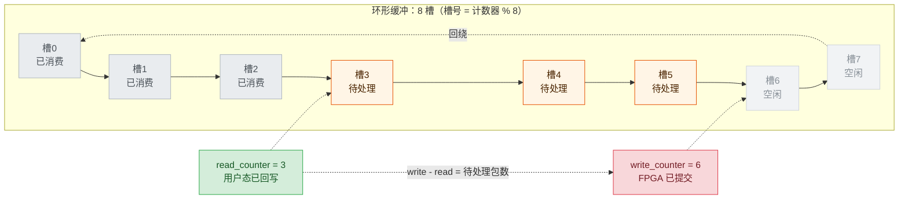
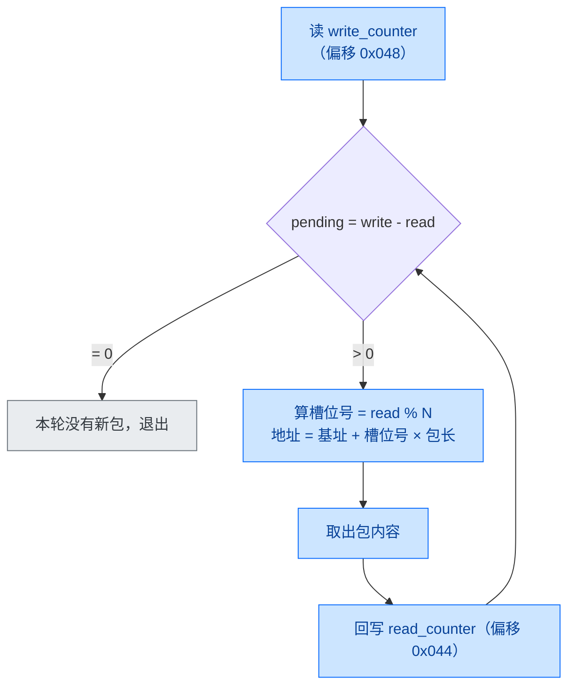
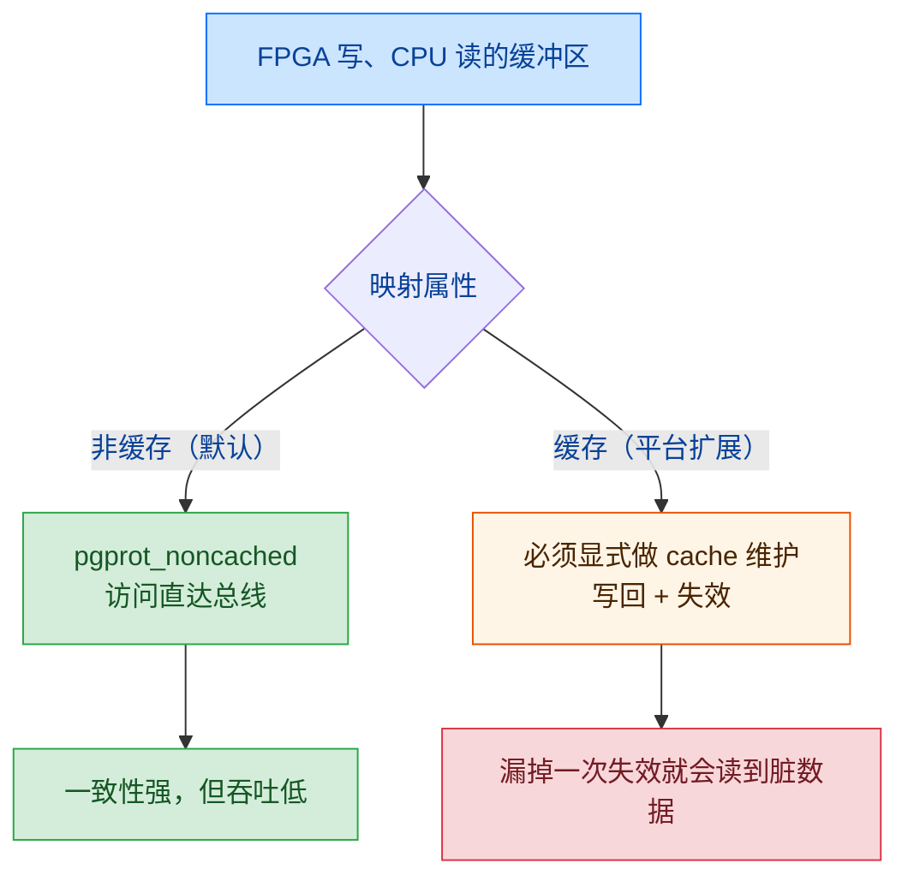

FPGA 采集到的数据由 DMA 写进 DDR，用户态程序用 /dev/mem 映射同一块物理内存把它读出来。这条通路上没有数据拷贝，双方能对上靠的是事先约定的物理地址。无锁则来自另一处设计：环形队列把读写状态拆成两个各自单向递增的计数器，锁就没有存在的必要。

下文以一套 SoC 平台为背景：FPGA 逻辑与 DDR 控制器在片上，CPU 侧跑 Linux，用户态有一个采集进程，其中的某个流水级（下称取包阶段）负责从 DMA 缓冲区里取数据。文中出现的地址与寄存器偏移均为示意值。

## 1. 数据通路：FPGA 写内存，用户态读内存

「取包阶段能从 DMA 里读到 FPGA 的数据」这种说法容易让人以为 DMA 有一个把数据交付出去的动作。实际过程要简单一些：DMA 作为总线主设备，按物理地址把数据写进内存；数据落在内存里之后，谁想读它，谁就得先能寻址这块内存。

同一块缓冲区，三个角色的认知并不相同。

| 角色 | 地址形态 | 它如何指代这块缓冲区 |
|---|---|---|
| FPGA / DMA 引擎 | 物理地址 | 引擎配置里的基址，如 0x10000000 |
| 用户态进程 | 虚拟地址 | /dev/mem 映射后得到的指针 |
| Linux 内核 | 物理地址 + 页表 | remap_pfn_range() 建立的页表项 |



*图 1：数据与两个计数器的流向。实线是数据，虚线是索引读写。FPGA 与用户态进程之间没有直接通道，两者的交点是物理内存。*

FPGA 侧与 CPU 侧各自的常量体现了这个约定：

```cpp
// 包缓冲的物理基址（示意）
static const uint64_t PACKET_START_ADDR = 0x10000000UL;

// DMA 寄存器块内的两个索引偏移（示意）
static const uint32_t DMA_READ_INDEX_REG  = 0x044U;
static const uint32_t DMA_WRITE_INDEX_REG = 0x048U;
```

FPGA 每提交一个包就递增写索引，用户态每消费一个包就回写读索引。索引值本身很小，只用于判断缓冲区里还有多少包待处理。至于两个索引对应的槽位地址，则由索引对槽位数取模再乘包长算出来。

严格说，「FPGA 的数据同步到 DMA」表达的是两边约定了同一段物理地址，映射只是让 CPU 侧获得寻址能力。数据只在 FPGA 写内存时被总线搬运一次，此后 CPU 侧全程零拷贝，这是 DMA 在此处的第一项收益；第二项收益是无锁，来自第 3 节的环形队列。

## 2. /dev/mem 与共享内存的区别：物理地址是否可见

### 2.1 共享内存不暴露物理地址

shm_open 加 mmap 得到的共享内存，物理页由内核分配，再映射进各参与方的页表。两个进程拿到的虚拟地址可以相差很远，页表项指向的却是同一个物理页。

物理地址由内核决定，进程既无法指定，也不需要知道。共享内存的契约是「同一物理页」，至于这一页落在哪个物理地址上，与使用者无关。

### 2.2 /dev/mem 的映射偏移量就是物理地址

/dev/mem 换了一份契约：mmap 的 offset 参数不再是文件偏移，而是物理地址。

```cpp
int fd = open("/dev/mem", O_RDWR | O_SYNC);

// 映射属性默认取非缓存；具体标志位由平台扩展定义
void *base = mmap(nullptr, length, PROT_READ | PROT_WRITE | MMAP_NOCACHE,
                  MAP_SHARED, fd, physical_base);
```

内核侧的路径不长。mmap_mem() 先把 vma->vm_pgoff 左移 PAGE_SHIFT 还原成物理地址，再交给 remap_pfn_range() 逐级建表（pgd、pud、pmd、pte），同时把这段 vma 标记为 VM_IO | VM_PFNMAP | VM_DONTEXPAND | VM_DONTDUMP。其中 VM_PFNMAP 表示这段映射背后是裸 PFN，没有 struct page 参与管理，因此它不参与换出，也走不到缺页处理。

页属性也在这一步被改写。以主线的 phys_mem_access_prot() 为例，/dev/mem 映射出的页面默认被设为 non-cached。这样既避免 CPU 缓存留下过期的设备数据，也避免 CPU 的预取触发不该发生的总线访问。



*图 2：两种共享方式。共享内存的物理页由内核挑，/dev/mem 的物理地址由调用者指定，FPGA 只能站在 /dev/mem 这一侧。*

### 2.3 为什么 FPGA 必须走这条路

MMU 是集成在 CPU 里的部件，负责虚拟地址到物理地址的翻译。FPGA 侧的逻辑没有这个部件，它发起总线访问时给出的就是物理地址，也无力理解虚拟地址。

双方能够共用的地址形式因此只剩物理地址一种：CPU 写寄存器告诉 FPGA 数据放在哪里，FPGA 把数据写到约定的物理地址，CPU 再通过 /dev/mem 映射同一段内存去读。

反过来说，如果 CPU 侧本身就能按物理地址访存（不带 MMU 的 MCU、裸机环境），这层中转就不需要了，双方本来就处在同一个地址空间里。/dev/mem 补的是有 MMU 的操作系统缺的那一块能力。

### 2.4 前置条件

这条路对使用环境有要求，三点都满足才能映射成功。

| 条件 | 说明 | 常见处理 |
|---|---|---|
| 页对齐 | mmap 的 offset 必须是页大小整数倍 | 基址按 4 KB 对齐，长度向上取整 |
| 权限 | open("/dev/mem") 需要 CAP_SYS_RAWIO | 进程以 root 运行 |
| 区域限制 | 内核开启 CONFIG_STRICT_DEVMEM 时，映射只能落在 iomem 区域 | 放开该配置，或改用内核保留内存 |

## 3. 环形队列与两个计数器

### 3.1 状态拆分

读写共享缓冲通常要用锁，是因为双方都要修改同一份状态：读端移动读指针，写端移动写指针，一旦交错就会互相覆盖。

环形队列把状态拆成了互不重叠的几份：

| 状态 | 谁写 | 谁读 |
|---|---|---|
| write_counter | FPGA 单方递增 | 用户态只读 |
| read_counter | 用户态单方递增 | FPGA 只读 |
| 包数据 | FPGA 写已提交的槽位 | 用户态读已提交的槽位 |

没有任何一个变量会被两侧同时写，锁自然就不需要了。判空判满只用一个差值：pending = write_counter - read_counter。



*图 3：两个计数器界定出「已消费」「待处理」「空闲」三段，槽位通过取模复用，槽 7 之后回绕到槽 0。*

### 3.2 取包循环

用户态这一侧的逻辑很短：读一次写索引，算出差值，把差值内的包依次取走。



*图 4：pending 是唯一的判据，循环里没有加锁，也没有等待唤醒。*

读索引必须在数据取走之后再回写。如果先回写再取数据，FPGA 可能在数据还没读完时就复用该槽位。读数据与读计数器之间的顺序则依赖映射类型提供的访存顺序保证；在普通非缓存（Normal Non-cacheable）映射上，ARM 允许访存重排，需要在两者之间补一条内存屏障。

### 3.3 多读端就不成立

上面的设计成立的前提是单生产者单消费者。FPGA 侧天然只有一个写端，问题出在读端。

一旦出现第二个读端，read_counter 就变成了两方都要写的共享状态：两个读端都要「取出一个包并推进索引」，必须用原子操作（例如 CAS 循环）或把缓冲按读端分区，否则两个读端可能取到同一个包，也可能一起跳过若干包。

用户态把 read_counter 回写进共享内存，是为了让它成为两侧都能观察到的状态。在多读端场景里，这份可观察就变成了要同步，无锁的前提随之消失。

## 4. 写映射细节与使用边界

### 4.1 长度与地址对齐

```cpp
memory_length += 4095;
memory_length &= ~static_cast<uint64_t>(4095);
if (memory_length < 4096) {
    memory_length = 4096;
}
```

mmap 以页为最小单位，长度不是页大小整数倍时内核会向上取整。显式对齐的好处是映射范围与后续 cache 维护的区间完全一致，同时避免长度落进 0 这种边界被内核直接拒绝。物理基址同理，必须页对齐，示例中的 0x10000000 天然满足。

### 4.2 缓存属性

默认走非缓存映射，CPU 每次读写直达总线，FPGA 的写入立刻可见，但访问慢，也用不上突发与缓存行。

若改成缓存映射，就必须自己承担 cache 维护，通常做法是由平台驱动提供一个 ioctl，对指定区间做写回与失效。

```cpp
struct MemRegion {
    const void *region_addr;   // 映射后的虚拟地址
    uint64_t    region_size;   // 区间长度
};

// 自定义的 cache 维护命令，命令号由平台驱动定义
ioctl(fd, MEMCHAR_CACHE_FLUSH, &region);
```

主线的 /dev/mem 只提供 open、read、write、mmap、llseek，没有 ioctl，也不认识 PROT_CACHEABLE 这样的扩展属性位。而这里能对同一个 fd 发出该命令，说明这个设备节点由平台定制的字符设备驱动接管，缓存属性与维护动作都由它实现。

缓存映射用在 DMA 缓冲上是高风险做法。FPGA 写内存时不会去失效 CPU 的 cache，如果 CPU 之前读过同一区域，就可能一直读到过期数据；反过来，CPU 还留在 cache 里没落盘的脏行，也可能被 FPGA 的写入覆盖。因此失效时机要精确到每一次传输。



*图 5：两种映射属性的取舍。非缓存省事，缓存则要把 cache 维护当成协议的一部分。*

### 4.3 volatile

```cpp
uint32_t read_reg(uint32_t offset) const {
    auto *addr = reinterpret_cast<volatile uint32_t *>(base + offset);
    return *addr;
}
```

映射出来的内存对编译器来说是普通内存。不加 volatile，重复读同一个寄存器可能被折叠成一次读，寄存器里的新值就永远看不到。volatile 在这里声明的是「每次访问都有副作用，不能优化」。

### 4.4 寄存器与缓冲共用访问原语

读索引寄存器与读包数据用的是同一套访问函数，区别只在偏移量。寄存器视图与缓冲视图可以来自同一个映射实例（同窗口时），也可以由两个分别覆盖寄存器基址与缓冲基址的实例提供。

/dev/mem 把物理内存暴露给用户态，方便的另一面是内核原本承担的保护随之失效。

| 维度 | 表现 | 影响 |
|---|---|---|
| 权限 | 需要 CAP_SYS_RAWIO，映射后可读写任意物理地址 | 进程一旦越界写，破坏的是内核数据 |
| 错误检测 | VM_PFNMAP 映射没有 struct page，不产生缺页 | 越界访问不会崩，会静默写坏其他内存 |
| 地址契约 | 基址与寄存器偏移是跨侧约定 | 换 FPGA 版本或换项目需同步修改 |
| 缓存一致性 | 非缓存无额外开销，缓存需手工维护 | 漏一次维护就得到脏数据 |
| 扩展性 | 只支持单生产者单消费者 | 多读端需引入原子操作或分区 |
| 可移植性 | 缓存标志位与 cache 维护 ioctl 均为平台扩展 | 换内核或换平台需重新确认 |

若后续要减少这些代价，常见的替代路径有三类：

- 内核保留内存加自研驱动：由启动参数划出 reserved 区域，驱动只暴露这一小段，并附带 cache 维护与权限检查；
- udmabuf 或 DMA-BUF：由内核分配并导出可映射内存，一致性处理与生命周期管理都由框架承担；
- VFIO 之类带 IOMMU 的通道：需要安全隔离时使用，但要额外配置 IOMMU。

它们的共同点是把物理地址的知识收回内核，只通过一个有约束的接口对外暴露。/dev/mem 的做法相反，它把地址约定的自由度交给用户态，换来最短的路径和最少的胶水代码。

## 参考资料

- Linux 内核 drivers/char/mem.c：mem_fops、mmap_mem()、read_mem()、write_mem()、phys_mem_access_prot()
- Linux 内核 mm/memory.c：remap_pfn_range()
- arnoldlu，/dev/mem 操作物理地址，https://www.cnblogs.com/arnoldlu/p/10721614.html
