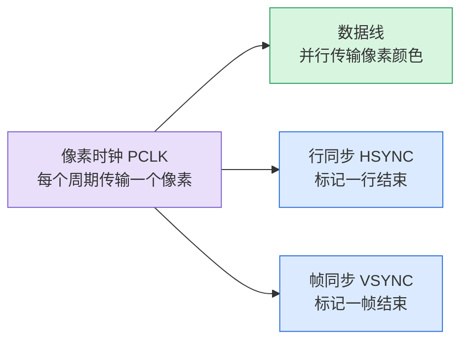
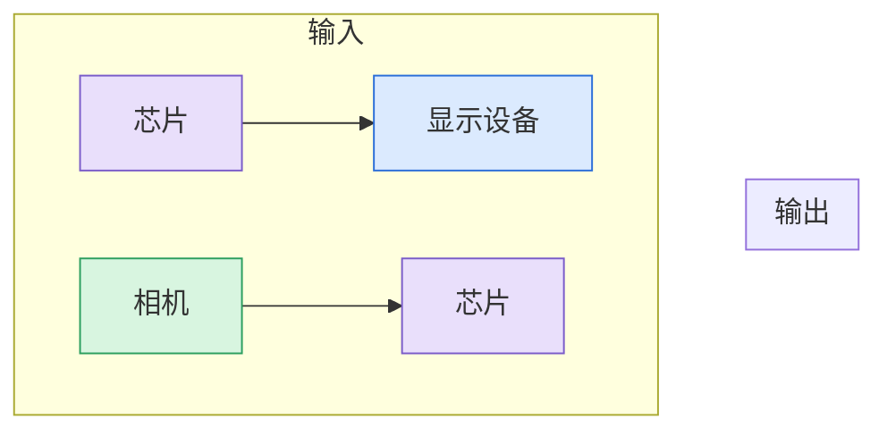
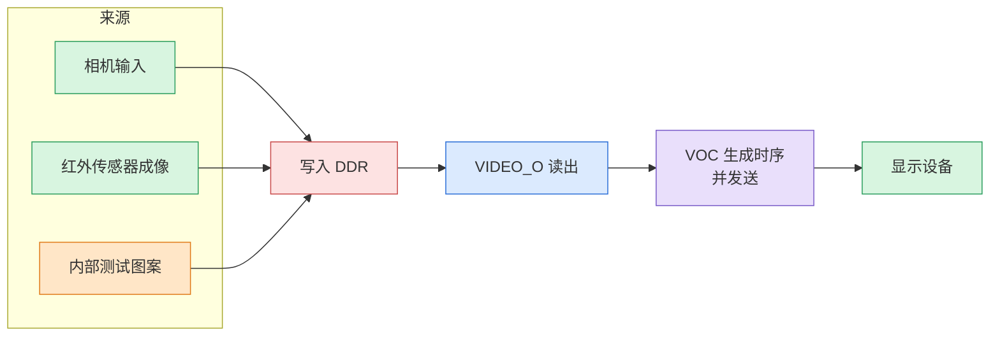
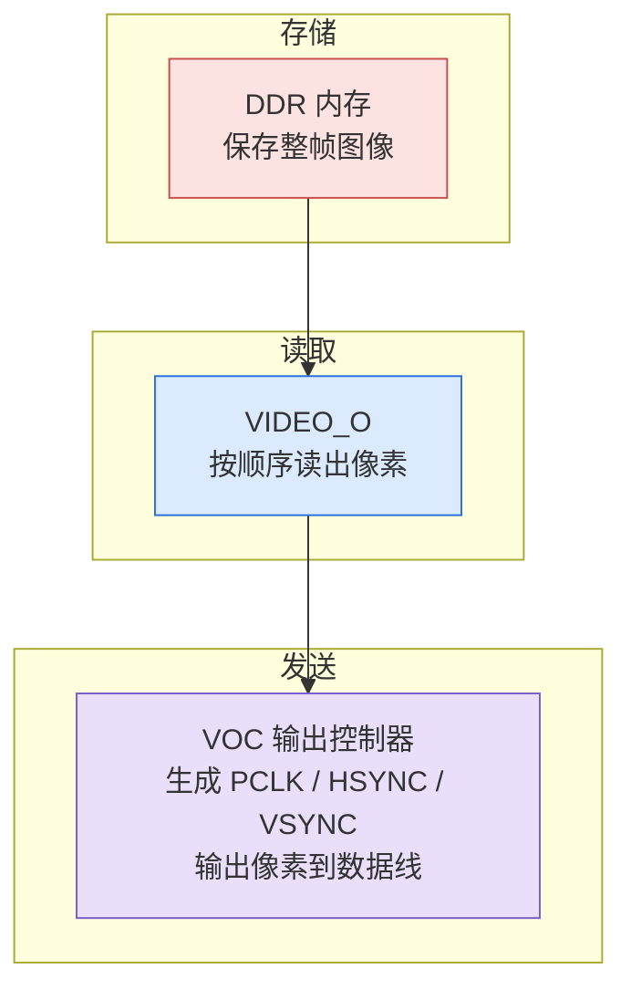
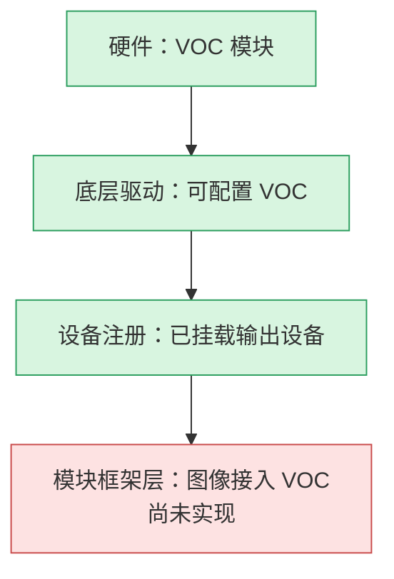
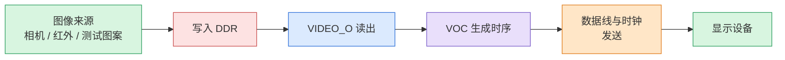

> 原文链接: [CSDN](https://blog.csdn.net/stallion5632/article/details/164045426)

结论先行：DVP 输出不是把一块图像内存直接送到引脚，而是由 `VIDEO_O` 顺序读取 DDR 中的像素，再由 VOC 生成 PCLK、HSYNC、VSYNC 和并行数据。硬件与底层驱动就绪并不等于链路可用，模块框架还必须把待输出图像接入 VOC。

## DVP 信号与输出时序

### 像素矩阵如何变成数据流

显示设备上的一幅图像，由**像素**构成矩阵。以 640×480 为例，即每行 640 个点、共 480 行。

芯片输出图像的实质，是按行、按列将每个像素的颜色值依序发送给接收方。这一依序发送的过程，即为**图像输出**。

### 数据线与三类同步信号

像素颜色值需配合同步信号，接收方才能判断当前数据对应第几行、第几列。数据线与同步信号共同构成 DVP（Digital Video Port，数字视频口）。

| 信号 | 说明 |
| --- | --- |
| PCLK（像素时钟） | 每个时钟周期，数据线更新一个像素值 |
| HSYNC（行同步） | 发送完一行像素后翻转，标记换行 |
| VSYNC（帧同步） | 发送完一帧图像后翻转，标记一帧结束 |
| 数据线（Data） | 并行传输一个像素的颜色，数据线越多，颜色精度越高 |

### 接口方向由发送方决定

DVP 是一套信号约定，本身不限定方向。发送像素与时钟的一方为「输出方」。

* 相机模组经 DVP 向芯片发送图像，相机为输出方，芯片为接收方。
* 芯片经 DVP 向外接显示设备发送图像，芯片为输出方。

本文讨论后者：芯片作为输出方，经 DVP 发送图像。

## 从图像来源到外接显示设备

DDR 内存中的图像需先被写入。图像来源主要有三类：相机输入、红外传感器成像、芯片内部生成的测试图案（用于调试）。

完整链路为：来源写入 DDR → VIDEO\_O 读出 → VOC 生成同步时序并发送 → 显示设备接收。

链路各环节：

1. 来源：相机或红外传感器写入图像，或芯片生成测试图案。
2. 存储：图像写入 DDR 内存。
3. 读取：VIDEO\_O 按顺序从内存读出像素。
4. 输出：VOC 生成同步时序并按正确节奏发送。

其中，相机输入为「输入」方向，与 VOC 的输出方向相反。调试场景通常使用内部测试图案，可不接入相机即验证输出链路。

## 硬件模块分工与软件接入状态

### DDR、VIDEO_O 与 VOC 的职责

### 当前缺口位于模块框架层

VOC 输出链路的硬件与底层驱动均已就绪，但模块框架层的接入代码尚未完成，该处代码被注释，返回「不支持」状态。

即底层「如何配置 VOC 输出」的能力已存在，而「何时将某一帧图像交给 VOC 输出」的接入逻辑尚未接通，代码返回「未实现」。若要使用 DVP 输出图像，需补全的是该层接入代码，而非硬件。

## 完整链路与实现边界

整个 DVP 输出链路如下：

要点：

1. DVP 输出即芯片按行、按列发送像素，并配合同步信号对齐。
2. 图像先由来源写入 DDR，再由 VIDEO\_O 读出。
3. 负责输出的硬件模块为 VOC，底层驱动已就绪。
4. 模块框架层的图像接入代码尚未完成，需补全该部分方可实际输出。
