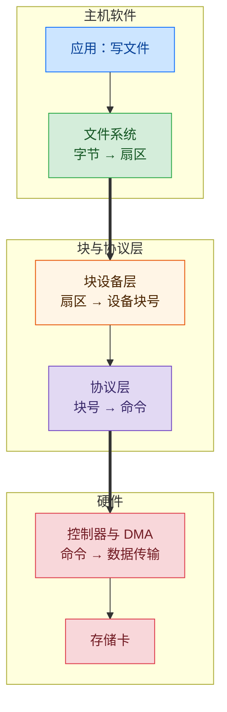
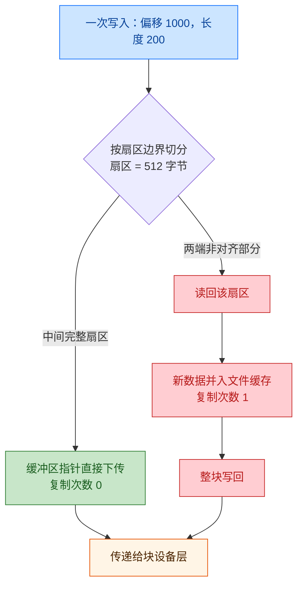
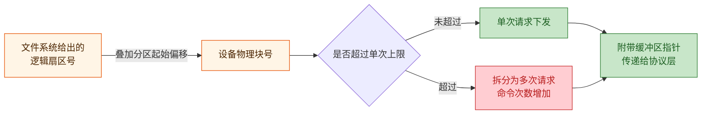
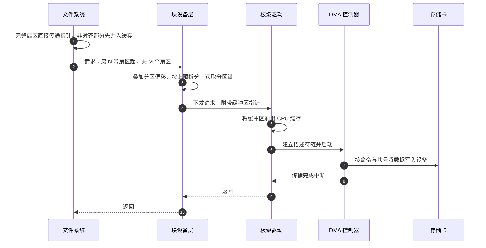

> 概述：一次写入要经过四层地址翻译：字节偏移、扇区、设备块号、命令。多数人以为数据在这四层里被拷了四遍，实际一次都没有。

本文讨论的是**嵌入式 SoC 平台**上的写入路径：片上带 DMA 控制器与存储控制器，跑 RTOS，通过 SDIO 接口外接 SD 卡。工业相机、行车记录仪、数据采集设备等需要本地存盘的场合，走的都是这条路径。

它与通用计算机的存储栈有两点差别，值得先说明。一是 RTOS 侧没有页缓存，应用的一次写入不会先累积进内核缓冲，而是直接落到文件系统，因此对齐与请求拆分的行为在应用层就能感受到。二是这些环节由板级驱动直接实现，没有内核块层负责请求合并与重排。

如果平台是没有 RTOS 的裸机，或通过 SPI 接口接卡、没有 DMA 支持，本文的路径会有出入：裸机通常不经过文件系统这一层，SPI 接法也不存在描述符链。但分层的思路是一致的。

## 1. 分层结构与各层职责

存储卡不认识「文件」，也不认识「偏移」。它只认一件事：把第若干个固定大小的块读出来或写进去。这个固定大小叫扇区，SD 卡通常是 512 字节。

「文件」是文件系统在块之上搭起来的一层抽象，并不是卡上的物理概念。一个文件由若干簇串成，簇号记在文件分配表（FAT）里，文件名、起始簇号、大小记在目录项里。要把「文件偏移 1000 处的 200 字节」写到卡上，得先查目录项找到起始簇，沿 FAT 链一段段走到目标簇，再换算成扇区。

这些工作既不该由调用写接口的应用承担，也不适合塞进驱动，于是分成了四层：

| 层 | 它理解的语言 | 它传递给下层的内容 | 是否复制数据 |
|---|---|---|---|
| 文件系统 | 文件名、字节偏移 | 缓冲区指针 + 扇区范围 | 仅非对齐部分 |
| 块设备层 | 扇区号、扇区数 | 缓冲区指针 + 设备块号 | 否 |
| 协议层 | 块号、读写方向 | 缓冲区指针 + 命令 | 否 |
| 控制器与 DMA | 内存地址 | 无（直接执行传输） | 是（硬件传输） |

四层的分工有一个共同点：它们交换的信息里，数据始终只是一个指针，反复被加工的是地址和计数。

*图 1：四层的翻译链。粗线是缓冲区指针的交接点，指针从文件系统一路下传到控制器，中间不复制内容。*

四层里有两层完全属于软件，也正是数据唯一可能被复制的地方。先看这两层。

## 2. 软件侧两层：两次翻译，一次复制

### 2.1 文件系统层：唯一的软件复制点

文件系统拿到的是「文件偏移 + 长度」，交出去的是「扇区号 + 扇区数」。中间要解决定位与对齐两件事。

定位方面，文件偏移和簇号之间没有直接对应关系。目录项只记着起始簇号，后面的簇要沿 FAT 表一段段找出来。写入位置超出文件当前长度时，还得先分配新簇并追加到簇链末尾。

对齐方面，偏移可以是任意字节，扇区却只能整块操作。一段写入的两头多半不落在扇区边界上，只有中间那部分是完整扇区。

对齐的处理方式分成两条路：完整扇区直接把应用传进来的缓冲区指针往下传，不复制；两头的非对齐部分则必须先把该扇区整块读回来，把新数据覆盖到正确位置，再整块写回去。文件系统为此给每个打开的文件留了一块扇区大小的缓存，非对齐部分先并进这块缓存再写出。这是整条路径上唯一由软件执行的数据复制。

*图 2：文件系统层的两条分支。本图颜色表示是否产生复制，与层次无关：绿色路径不复制数据，红色路径是全文唯一的软件复制点。*

举个具体例子。向文件偏移 1000 处写 200 字节，扇区 512 字节。这 200 字节跨在扇区 1 和扇区 2 上，两头各占一部分，于是实际发生的是：读回扇区 1、读回扇区 2、分别修改、再写回两个扇区。应用看到一次写入，卡上产生两次读加两次写。

同一位置若改成写 4096 字节且对齐到扇区边界，8 个扇区可以连续写下去，一次读回都不需要。

决定复制与否的是对齐，不是数据量。

### 2.2 块设备层：只翻译，不复制

扇区范围一旦确定，请求就离开文件系统，进入块设备层。块设备层收到的是「第几号扇区、连续几个扇区、数据在哪」。向协议层下发之前，它要做三件事，全都与数据内容无关。

一是叠加分区偏移。卡上通常不止一个分区，文件系统看到的第 0 号扇区未必是设备的物理第 0 号扇区。

二是限制单次请求的大小。一次请求能带多少扇区有上限，超出的部分拆成多次下发。上限取两个条件的较小值：主机侧 DMA 一次能描述的字节数，以及卡依据规范声明的单次最大块数。DMA 描述能力由板级硬件配置决定，单次最大块数来自卡的寄存器。拆分对上层是透明的，但总线上的命令次数会成倍增加。

三是保证访问互斥。同一分区的请求必须按序下发，交叉下发会让命令和数据错位。

*图 3：块设备层的两项处理，全部作用于地址与计数。绿色路径只改写地址，不接触数据内容。*

到这里为止，数据仍然只是一个被传递的指针。

## 3. 协议层与硬件：DMA 是唯一的搬运者

到了这一层才开始和卡直接打交道。存储卡和内存有一个根本区别：内存可以直接按地址写入，存储卡必须下命令、等响应。每次读写都得走一遍「发命令、收响应、传数据」。

按一次操作涉及的块数，用的命令不同：

| 一次操作 | 写命令 | 读命令 | 补充说明 |
|---|---|---|---|
| 单块 | CMD24 | CMD17 | 无 |
| 多块 | CMD25 | CMD18 | 结束后再发 CMD12 通知设备停止 |

命令的参数就是块地址。有一处兼容点容易忽略：并非所有卡都用块号寻址。高容量卡用块号，早期的标准容量卡用字节地址，得先把块号乘 512 再下发，否则地址会偏。

协议层仍然只组装命令，不碰数据。数据随后由控制器通过 DMA 传输，这是整条路径上唯一真正搬运数据的环节。与它配套的两项维护由软件负责。

写入会让卡进入忙状态，此时它不接受新命令。下一次请求前必须先确认卡已退出忙状态，否则命令会被直接忽略。

缓存一致性的处理方向相反。CPU 访问内存经过缓存，DMA 绕过缓存直接读写内存，两者不一致就出错：写数据前要先把缓冲区刷出缓存，否则 DMA 可能读到缓存里的旧内容；读数据前要先让缓存行失效，否则 CPU 随后读到的是缓存里的旧值。这两步的顺序不能调换。

*图 4：一次写入的完整时序。同一个缓冲区指针从第一行传递到最后，虚线为返回路径，编号对应执行顺序。*

路径走到这里就结束了。回到开头那个问题：这条路上软件真的没碰过数据吗。

## 4. 结论的应用

写入慢的时候，先看对齐与命令次数，不必去找「哪儿多拷了一次」。前面那个例子已经说明，一次 200 字节的写入会变成两次读加两次写，这个代价远超任何一次内存复制。

缓冲区按扇区对齐、长度取扇区整数倍，文件系统的非对齐分支就永远不会进入，全链路复制次数为零。数据采集类应用比较容易做到这一点。

连续大块写入是效率最高的形态：每层只翻译一次，命令最少，也不产生读回。

缓存一致性和忙状态检测属于硬件约束，不是实现选择。它们只在特定时序下暴露，不能因为测试通过就删掉，顺序也不能调。

还有一点常被忽略：上位机看到的一次调用，在总线上未必是一次命令。超限会被拆分，不对齐会引入读回，真实的命令次数要用总线上的观测来确认。

> 一句话：这四层都在做地址翻译，唯一传输数据的是控制器。软件只在两种情况下直接处理数据：拼接不足一个扇区的部分，以及为 DMA 维护缓存一致性。
