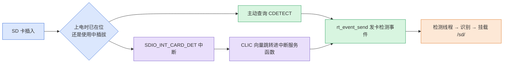
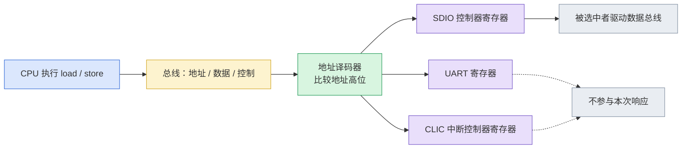
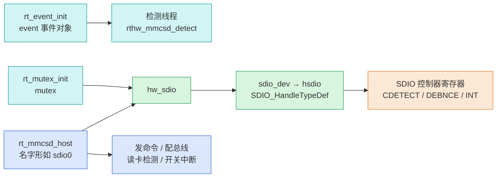
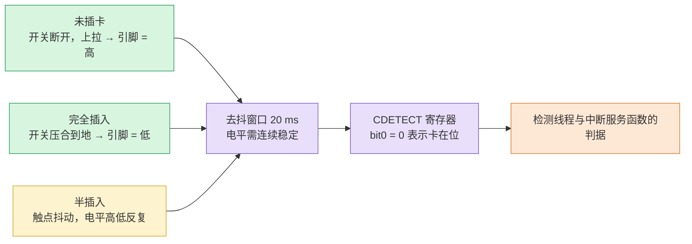
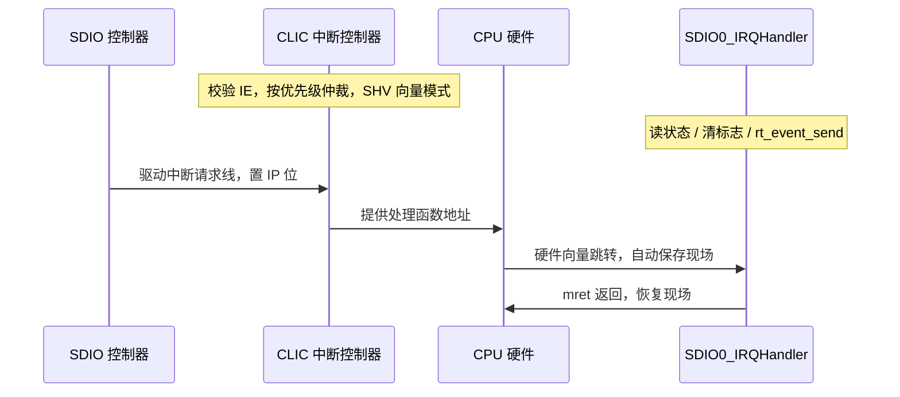
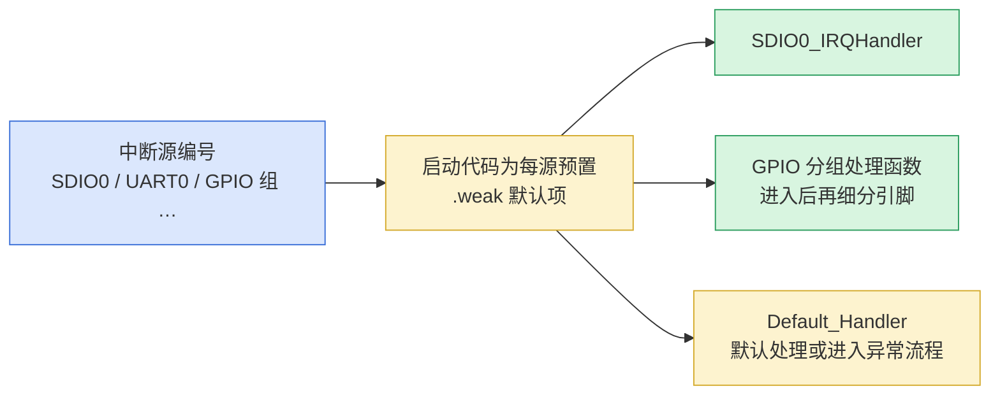
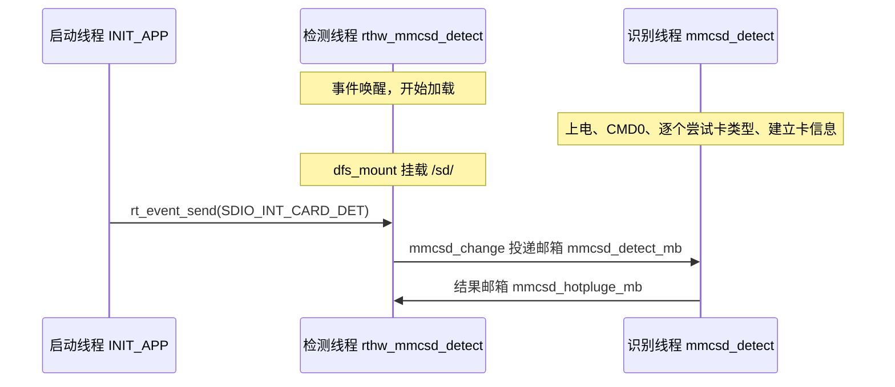
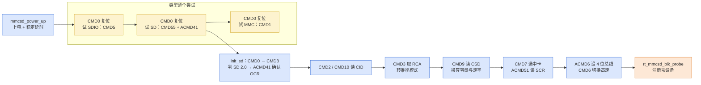
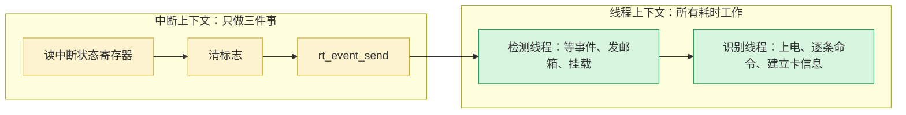
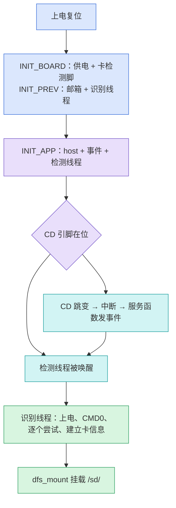

> 原文链接: [CSDN](https://blog.csdn.net/stallion5632/article/details/166140289)

结论先行：上电时已经插着的卡不会触发卡检测中断，因为 CD 引脚电平稳定，没有跳变可供触发。驱动应在创建 host 后主动读取一次 `CDETECT`，确认卡在位便发送检测事件；使用过程中的插拔跳变才交给 `SDIO_INT_CARD_DET` 中断处理。

本文讨论上电阶段 SD 卡驱动从无到有、最终挂载 `/sd/` 的过程，不涉及读写性能。过程分四段，章节顺序与之一致：

| 阶段 | 回答的问题 | 涉及机制 | 章节 |
| --- | --- | --- | --- |
| 寄存器访问 | 软件如何操作外设寄存器 | 地址译码、MMIO、D 触发器锁存 | 2.1、2.2 |
| 驱动初始化 | 驱动何时被调用、建了哪些对象 | 自动初始化等级、`rt_mmcsd_host`、事件对象 | 2.3、2.4 |
| 卡检测 | 插入状态如何判定、中断如何进入 | CD 引脚、去抖窗口、`CDETECT`、CLIC 向量跳转 | 3.1 至 3.6 |
| 挂载 | 事件如何变成可读写的 `/sd/` | 检测线程、识别线程、命令序列、`dfs_mount` | 4.1 至 4.4 |

## 上电查询与热插拔中断

### 两条触发路径如何汇合



两条路径的区别不在卡是否存在，而在电平是否变化：卡是否在位是一个状态，中断针对的是这个状态的跳变。

### 上电阶段为何不能等待中断

| 维度 | 上电时已插卡 | 使用中热插拔 |
| --- | --- | --- |
| 触发源 | 软件主动查询 | 硬件中断 |
| 是否走中断 | 否 | 是 |
| 触发机制 | 创建 host 时读一次 `CDETECT` | CD 引脚跳变后由 CLIC 向量跳转 |
| 时序前提 | 发生在卡检测中断使能之前 | 发生在中断使能之后 |
| 后续路径 | 发事件 → 检测线程 → 识别 → 挂载 | 与左列相同 |

上电这次查询发生在 host 创建函数的末尾，先于卡检测中断的使能：

```
rthw_sdio_irq_update(host, 0);

    if (0x01 == rthw_sd_detect(host))                        /* Read CDETECT once. */
{
    rt_event_send(&hw_sdio->event, SDIO_INT_CARD_DET);   /* Send the event when present. */
}
```

驱动使能卡检测中断时的顺序是先清除该中断标志、再开放中断，而上面的查询发生在这两步之前。因此上电阶段不必依赖中断：CD 电平没有变化，把当前状态直接告知检测线程即可。

接下来要问的是，这次查询凭什么能读到一个寄存器，以及驱动为什么会在这一刻被执行。下一章先说明这两件事。

## 寄存器访问与驱动初始化

### 地址译码与 MMIO

CPU 执行读写指令时，只负责把目标地址放到地址总线上，并用控制信号声明本次是读还是写。CPU 不区分地址背后是内存、CLIC 还是 SDIO 寄存器，区分工作由总线上的地址译码器完成：它比较地址高位，判断本次访问落在哪台设备的地址区间，只对该设备发出有效的片选信号。



这就是内存映射输入输出（MMIO，Memory-Mapped I/O）：外设寄存器以内存地址的形式暴露，软件用普通读写指令即可操作。代码里表现为一个基地址加一个结构体指针，此后 `XXX->REG = value` 等价于向该寄存器写入。

```
#define SDIO0_BASE  0x????0000UL     /* Defined by the chip address map. */
#define SDIO0_REG   ((SDIO_Type *)SDIO0_BASE)
```

### 写寄存器如何保持状态

寄存器由多个 D 触发器（Flip-Flop）构成，每个触发器保存 1 bit：时钟有效沿到来时，把输入端的数据写入并保持；时钟不来则维持原值。由此，写寄存器的含义是触发目标触发器的时钟，把数据总线上的值锁存进存储单元并保持。


写入的 0/1 会持续保持，直到下次改写，因此写寄存器是状态设定，不是一次性数据传递。这也解释了为什么软件写一次中断使能位之后，该中断会一直可用。

### 自动初始化的先后关系

RT-Thread 的驱动不靠上电后手工调用，而由自动初始化机制完成：内核按等级顺序执行各级 `INIT_*_EXPORT` 宏注册的函数。等级值写在链接段的名字里，数字越小越早。


其中有两条先后关系容易被弄反。一是识别线程比 SD 驱动更早创建：`rt_mmcsd_core_init()` 以 `INIT_PREV_EXPORT` 注册，它建好邮箱 `mmcsd_detect_mb`、`mmcsd_hotpluge_mb` 和识别线程 `mmcsd_detect`；SD 驱动以 `INIT_APP_EXPORT` 注册，执行更晚。顺序写反，驱动发出的邮箱消息就没有接收者。二是卡供电与卡检测引脚在板级初始化中配置，驱动只使用这些配置。

### host、事件对象与检测线程

host 指 `rt_mmcsd_host` 结构体，描述一个 SDIO 控制器及其所接卡片。`rt_hw_sdio_init` 为每个控制器调用 `sdio_host_create`，该阶段只建立数据结构与回调，不访问卡片：



对应的关键行：

```
host->ops      = &ops;        /* Callbacks: request / iocfg / detect / irq_update. */
host->freq_min = 400000;      /* SD startup clock: 400 kHz. */
host->valid_ocr= VDD_30_31 | VDD_31_32 | VDD_32_33 | VDD_33_34;

hw_sdio->detect_thread =
    rt_thread_create(name, rthw_mmcsd_detect, host,
                     RT_MMCSD_DETECT_STACK_SIZE, 25, 10);
rt_thread_startup(hw_sdio->detect_thread);
rt_event_init(&hw_sdio->event, name, RT_IPC_FLAG_PRIO);
```

检测线程优先级为 25，创建后立即启动，随后阻塞在事件上等待卡检测，上电阶段不占用 CPU 时间。

到这里 host、事件对象与检测线程都已就绪，但还没有代码去读卡座的开关。下一章说明插入状态如何被判定，以及它如何变成一次中断。

## 卡检测与中断进入路径

### CD 引脚与信号路由

SD 卡座内有一个随插卡动作通断的机械行程开关，它引出一根卡检测线（CD，Card Detect）。板级把该引脚的功能选择（pad 复用）切到 GPIO，并将方向设为输入：

```
/* GPIO configuration in board initialization. */
Hal_PadMux_Set(HAL_PAD_MUX_FUNC_GPIO, HAL_PAD_MUX_CTRL_EN, HAL_GPIO_64);
Hal_Gpio_DirSet(HAL_GPIO_64, HAL_GPIO_DIR_INPUT);
```

驱动再把该 GPIO 号写入 `GPIO_SEL2` 的 `SD0_CDN_SEL` 字段，把它路由为 SDIO 控制器的卡检测输入：

```
HAL_GPIO_SD0_CDN_SEL(SDIO0_CDN_PIN);   /* GPIO 64 on this board. */
```

卡检测因此不是控制器自带的一根引线，而是普通 GPIO 经开关矩阵接到控制器的 CD 输入端。配置完成后软件不再读 GPIO 电平，而是读控制器内部的 `CDETECT` 寄存器，所以定位问题时看 `CDETECT` 即可，读 GPIO 输入值容易误判。

### 插入状态与硬件去抖

开关与上拉电阻共同决定引脚电平，三种插入状态的结果如下：



去抖由控制器内的计数窗口完成，不是软件延时：

```
/* Typical debounce is 5-25 ms; configure 20 ms here. */
HAL_SDIO_DEBNCE_SET(&sdio_dev[sdioIndex].hsdio, (Hal_Sys_AhbClkGet() / 50u));
```

`AhbClk / 50` 等于 `AhbClk × 0.02 s`，即以 AHB 时钟计数的 20 ms。只有 CD 引脚电平连续稳定 20 ms，控制器才更新 `CDETECT` 位。半插入时触点持续抖动，稳定计数不断被清零，判决无法通过，抖动在控制器内部被过滤掉，驱动层不需要再写去抖代码。

### 卡在位判定

驱动层的判定收敛在两级调用里：

```
/* rthw_sd_detect(): driver side. */
if ((Hal_Sdio_CardIsPresent(&hsdio)) || (host->flags & MMCSD_SUP_NONREMOVABLE))
{
    ret = 0x01;      /* Card present. */
}

/* Hal_Sdio_CardIsPresent(): HAL side. */
if (0 == (Hal_RegRead(SDIO_REG(hsdio->Index, CDETECT), REG_MASK_ALL, 0u)))
{
    isPresent = TRUE;    /* CDETECT bit0 = 0 means card present. */
}
```

即 `CDETECT.bit0 == 0` 判为在位。板级自查输出的对照是 `CDETECT bit0=0 -> card present`；未插卡的控制器则不注册块设备。

### CLIC 向量中断

中断发生时执行的那段代码称为中断服务函数（ISR，Interrupt Service Routine）。本节说明它是如何被调用的。

该 SoC 的 CPU 是 RISC-V 内核，自带 CLIC（Core-Local Interrupt Controller，内核本地中断控制器）。外设中断请求汇入 CLIC，仲裁后进入 CPU。CLIC 初始化时把所有中断源设为向量中断模式：

```
for (i = 0; i < MAX_IRQn; i++)
{
    CLIC->CLICINT[i].IP = 0;       /* Clear pending status. */
    CLIC->CLICINT[i].ATTR |= 1;    /* SHV = 1 enables vector jumps. */
}
```

SHV（Selectable Hardware Vector）位的作用是：中断被判定有效后，CLIC 依据中断源编号直接向 CPU 提供处理函数地址，CPU 据此跳转，不经过软件查表。



`SDIO0_IRQHandler` 通过 `ATTRIBUTE_ISR` 声明，由编译器生成机器模式中断的现场保存、恢复与 `mret` 返回：

```
ATTRIBUTE_ISR void SDIO0_IRQHandler(void)
{
    rt_interrupt_enter();
    if (RT_NULL != host[HAL_SDIO_INDEX_0])
    {
        rthw_sdio_irq_process(host[HAL_SDIO_INDEX_0]);
    }
    rt_interrupt_leave();
}
```

该函数不由软件调用，而是由 CLIC 硬件跳转进入；函数体内的 `rt_interrupt_enter` 与 `rt_interrupt_leave` 只用于通知内核当前处于中断上下文。

### 电平触发与边沿触发

外设向 CLIC 发出中断请求，物理上不是发送数据，而是驱动一根专用请求线的电平。两种触发方式的差异解释了两条路径的分工：

| 触发方式 | 有效条件 | 撤销方式 | 上电时已插卡的行为 |
| --- | --- | --- | --- |
| 电平触发 | 请求线保持有效电平 | 软件清除标志后才撤销 | 标志已在中断使能前清除，且电平无变化，无待处理请求 |
| 边沿触发 | 请求线出现电平跳变 | 自动 | 无跳变，不产生请求 |

SD 卡检测属于电平触发型：标志由软件主动清除（`__HAL_SDIO_CLEAR_INT`），清除前请求线持续有效。驱动使能该中断时的顺序是先清除标志、再开放中断，所以上电时已插着的卡不会留下一个待处理请求，这也是上电必须由驱动主动查询一次的原因。中断信号本身只表示有事件发生，不携带事件内容；具体是哪类事件，例如卡插入、数据传输完成或超时，由 CPU 进入中断服务函数后读中断状态寄存器逐位判断得出。

### 中断向量表与处理函数

该 SoC 的中断源覆盖内核定时器与十余类外设，数量上百，但并非每个中断源都有专属处理函数：



启动代码为每个中断源预置 `.weak` 默认项，驱动以强符号覆盖其中一部分。有专属函数的只有驱动实现过的那些；GPIO 采用分组中断，每 16 根引脚共用一个中断源，进入处理后还需读引脚状态做细分。

中断服务函数内部只做三件事：读中断状态寄存器、清除标志、发送事件。卡片识别与文件系统挂载都不在这里，它们由线程负责，下一章说明这一分工。

## 从检测事件到文件系统挂载

### 三条线程的分工

加载由三条线程配合完成，它们之间只传信号，不传数据：



检测线程的主体是等待事件、确认结果、执行挂载的循环：

```
while (1)
{
    rt_event_recv(&hw_sdio->event, SDIO_INT_CARD_DET,
                  RT_EVENT_FLAG_AND | RT_EVENT_FLAG_CLEAR,
                  RT_WAITING_FOREVER, RT_NULL);

    mmcsd_change(host);                  /* Notify the identify thread. */
    ret = mmcsd_wait_cd_changed(300);    /* Wait up to 300 ticks. */

    if ((MMCSD_HOST_PLUGED == ret) && (0x01 == rthw_sd_detect(host)))
    {
        /* Find the block device and mount it at /sd/. */
        dfs_mount(name, "/sd/", "elm", 0, 0);
        mmcsd_mount_over();
    }
    else if ((MMCSD_HOST_UNPLUGED == ret) && (0x00 == rthw_sd_detect(host)))
    {
        Hal_Sdio_DeInit(&hw_sdio->sdio_dev->hsdio);   /* Deinitialize after removal. */
    }
}
```

`mmcsd_change` 不识别卡片，它只向 `mmcsd_detect_mb` 投一条消息。识别是否成功的判据是 `mmcsd_wait_cd_changed` 的返回值，它按 `host->card` 是否为空返回已插入或已拔出，不再读一次 CD 引脚。

### 卡类型识别与命令序列

卡的类型无法凭外观判断，识别线程按 SDIO、SD、MMC 的顺序逐个尝试：每个分支先发 CMD0 复位，再发对应的探测命令，先应答成功者即按该类型处理。SD 卡分支的关键命令是 ACMD41，其响应携带卡支持的工作电压范围（OCR，Operating Conditions Register，工作条件寄存器）。确认类型后再读取卡标识与参数（CID 卡标识、CSD 卡参数、SCR 配置、RCA 相对地址），据此注册块设备。



`init_sd` 走完这套命令后调用 `rt_mmcsd_blk_probe`，按卡上是否存在分区表走 MBR 或 GPT 分支注册块设备：整卡设备名取自 host 名，有分区时另注册形如 `sdio00`、`sdio01` 的分区设备。检测线程挂载时先找分区设备名，找不到再回退到整卡设备名。

### 挂载与实测记录

块设备就绪后，检测线程执行 `dfs_mount(name, "/sd/", "elm", 0, 0)`，把块设备以 elm（Elm-Chan FatFs）文件系统挂到 `/sd/`，此后上层可读写 `/sd/` 下的文件。

板级启动日志与自查输出可作为上述各环节的对照：

```
[I/sd]: SD card capacity 30535680 KB.
found part[0], begin: 4194304, size: 29.120GB
[I/sdio]: card pluged!
[I/sdio]: sdmmc mount to /sd/ !
```

| 本文结论 | 实测对照 |
| --- | --- |
| 卡在位判据是 `CDETECT.bit0 == 0` | 自查输出 `CDETECT bit0=0 -> card present` |
| 无卡控制器不注册块设备 | 未插卡控制器在设备列表中 not found |
| 上电路径以主动查询完成挂载 | 启动日志出现 `sdmmc mount to /sd/ !`，容量 29.1 GiB |
| 插拔跳变由中断路径处理 | 热插拔 5 轮均正常完成，其中一轮插回后约 800 ms 检出、100 ms 内挂载成功 |

### 中断与线程的职责边界



中断上下文只做读状态、清标志、发事件三件事，识别与挂载这类耗时数十毫秒的工作全部在线程上下文完成。这样既保证中断响应及时，也不会让命令序列长时间占用 CPU。一次从插卡到可读写，先后经过下列阶段：



上电插卡与使用中插拔在这里汇合：触发方式不同，识别与挂载的步骤相同。
