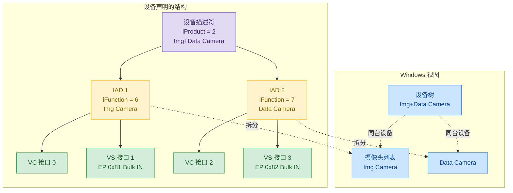
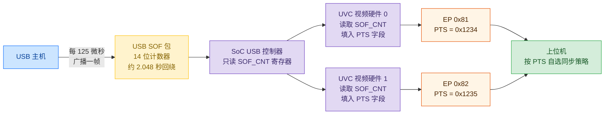

> 结论先行：一台嵌入式设备通过 USB 同时输出两路视频流，并不是变成了两个 USB 设备。设备借助复合设备描述符与 IAD（Interface Association Descriptor，接口关联描述符），让 Windows 在摄像头列表里注册为两个条目。两路数据的同步靠两件事：固件为每帧打上的 PTS（Presentation Time Stamp，显示时间戳），以及硬件内部的 3 帧环形缓冲区。

本文讨论的对象是工业相机、行车记录仪这类**单芯片嵌入式设备**：SoC 直接接 USB 控制器，运行 RTOS，对外只通过 USB 供电并传视频。它的硬件资源有限、实时性要求高，与 PC、服务器上的多摄像头场景并不一样。

## 1. 一个 USB 设备如何变成 Windows 上的两个摄像头

要理解这一步，先要认清一件事：USB 设备对应的是一份描述符，而不是一个应用程序。设备要告诉主机自己是什么、能干什么，主机按描述符建出视图。

主机读完 `GET_DESCRIPTOR(CONFIGURATION)` 后会得到一组结构。关键不是「有多少个接口」，而是**如何把若干接口声明为同一个功能**。UVC（USB Video Class）的一路视频本来需要两个接口：VC（Video Control，视频控制）用来协商格式，VS（Video Streaming，视频流）用来传数据。这两个接口必须配对才能工作。

设备侧用 IAD 完成配对。IAD 是一段 8 字节的描述符，里面写着「我下面的连续 2 个接口属于同一个功能，功能类编号是 0x0E」。一台设备要提供两路视频，就在配置描述符集合里放两组「IAD + VC + VS」，主机的 UVC 驱动每识别到一组就在摄像头列表里注册一项。两组在物理上是同一个 USB 设备、同一根 USB 线缆，但 Windows 看到的视图是两个独立的摄像头条目。这就是 IAD 拆分。

设备端点分配也很直接：每组功能各占一个 Bulk IN（批量输入）端点，用于把视频数据上传到主机。两路端点共用同一条 USB 链路。

*图 1：IAD 拆分。一个设备描述符通过两个 IAD 把四接口声明为两个功能，主机把它拆成两个摄像头条目。物理上是同一台设备、同一条 USB 线。*

## 2. 为什么 USB 协议本身不能同步两路

USB 协议没有「跨接口同步」这一概念。每个端点独立传输，主机不保证它们之间有任何时序关系。设备描述符里没有同步字段，UVC 规范里也没有强制要求。

要让两路码流有可比性，固件必须为每帧打上时间戳。这就是 PTS：每帧数据前若干字节是 UVC payload header，里头含有一个 32 位字段标记这帧应该何时被显示。

时间戳的来源是 SOF（Start of Frame，帧起始包）：USB 主机每 125 微秒广播一次，所有 USB 设备都能收到。SoC 内嵌的 USB 控制器把这个计数暴露给视频硬件，视频硬件在每帧输出时把当前计数写进 PTS 字段。两个视频通道挂在同一个 USB 控制器上，PTS 因此落在同一个时基轴上。

但要明确：共同时基不等于自动同步。PTS 只是给上位机一把比较两路帧的尺子，决定哪一帧等哪一帧、哪一帧丢弃的逻辑都在上位机的应用里。固件的责任到此为止：保证两路都能独立、稳定地把带 PTS 的帧推到各自的端点上。

*图 2：SOF 时基。主机每 125 微秒广播一次 SOF 计数，两个视频硬件实例各自读取并填进 PTS。两路 PTS 落在同一计数轴上，但实际配对仍由上位机按 PTS 自行处理。*

还有一个容易忽略的事实：两路共用一条 480 Mbps 链路。高速模式下的批量传输实际可承载上限约 300 多 Mbps，两路同时跑高分辨率高帧率时必须用工具实测带宽余量，不能只算像素率。

## 3. 硬件内部的 3 帧环形缓冲区

视频数据从 ISP（Image Signal Processor，图像信号处理器）出来到达 USB 之前，要经过 SoC 内部的一段共享内存。生产者（ISP）写一帧就切换到下一槽，消费者（USB 视频硬件）读到当前帧就切到上一槽，三槽轮转直到再次覆盖最旧那一帧。这就是 3LOOP（three-loop）缓冲：三帧大小的环形队列。

为什么是 3 帧而不是 2 帧或 4 帧：写一帧切换槽位的状态寄存器只有 2 位，4 个状态里实际只用 3 个（命名 S0/S1/S2），硬件位宽就是硬约束。2 帧容差为 0，会被生产与消费的速率抖动立即打穿；4 帧需要更多位寄存器，硬件没预留。3 帧在「留 1 帧容差」与「不增位宽」之间取了平衡。

它要处理的是「生产者与消费者速率不齐」。ISP 按传感器节拍出帧，可能快也可能慢；USB 视频硬件按主机节奏搬运，可能积压可能空闲。两者中间用三个槽位解耦：写一帧后切到下一槽，写满三帧回到最旧槽覆盖，硬件始终从当前槽读、读完自动切。

3LOOP 缓冲区存在于 SoC 内部 DDR 上，**进出 SoC 后就不存在**。USB 链路上的字节流没有槽位概念，PTS 在 USB 视频硬件读取环形缓冲区那一刻才被打进 payload header。两者的边界在这里。

## 4. MCU 需要为「同时两路」额外做什么

要做的事是让两路各自独立地跑起来。流程按五步推进：

视频源准备。每路需要独立的视频流（如红外一帧、温度一帧）和独立的 3LOOP 缓冲槽位。两路参数（分辨率、帧率、像素格式）可以不同，必须各自配置。

起两套 USB 视频硬件实例。这套 SoC 的硬件上限就是两个视频通道实例，分别记为实例 0 和实例 1。它们各占一组寄存器、共用一个 USB 控制器。

源与硬件的映射。每个实例要绑定一个视频源，绑定哪个端点地址，绑定哪组寄存器。绑定关系写在系统信息结构里，由驱动层在初始化时完成。

独立的启停。一路打开或关闭不能影响另一路。每路有自己的提交回调，只有 Windows 协商好那一路的格式后，对应实例才会启动。

溢出处理。两路共用同一条链路，任何一路的瞬时速率超出链路承载都可能让硬件 FIFO（First In First Out，先入先出队列）溢出。固件有两种策略：检测到溢出就丢弃整帧并记一次计数，或者让硬件自动补偿。当前嵌入式产品的常见配置是前者：宁可丢帧也不能让传输卡死。

## 5. 三件容易混淆的事

端点号和通道号是两套编号。固件内部用「视频通道 1/2」标记两条数据通路，对外的 USB 端点地址可能是 0x81 和 0x82，两套编号之间没有数值对应关系，只是固件在配置时把内部某路映射到了某个端点。

设备名和摄像头名是两套名称。Windows 设备管理器里的「XXX 摄像头设备」是设备级的名称，来源于设备的 iProduct 字段；摄像头列表里看到的「红外一/红外二」是功能级名称，来源于每个 IAD 的 iFunction 字段。同一台设备出现在两个位置是正常的，它们读的是不同的描述符字段。

IAD 不能省略。如果只放两组「VC + VS」而不用 IAD 关联，主机不会把它们当作同一个功能，UVC 驱动无法确定控制接口与数据接口的对应关系，Windows 下表现为「识别到设备但无法打开预览」。

> 一句话：嵌入式设备的双路 USB 视频输出，靠 IAD 让一个设备变成 Windows 视图里的两个摄像头，靠 PTS 让两路数据可比较，靠 3LOOP 缓冲让生产与消费解耦。拆分在枚举期完成、节拍在传输期维持、解耦在片内完成，三件事各管一段。
