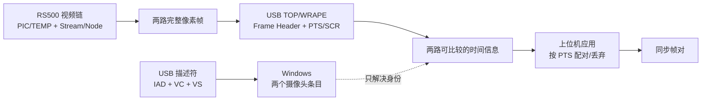
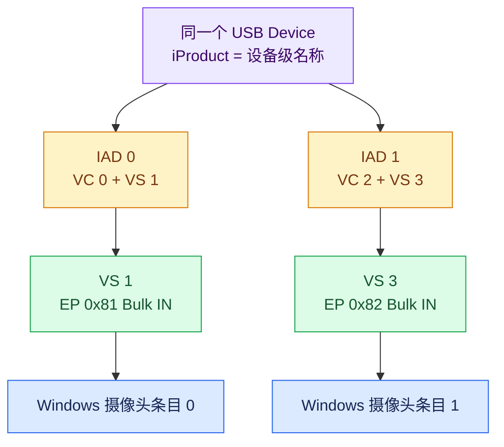
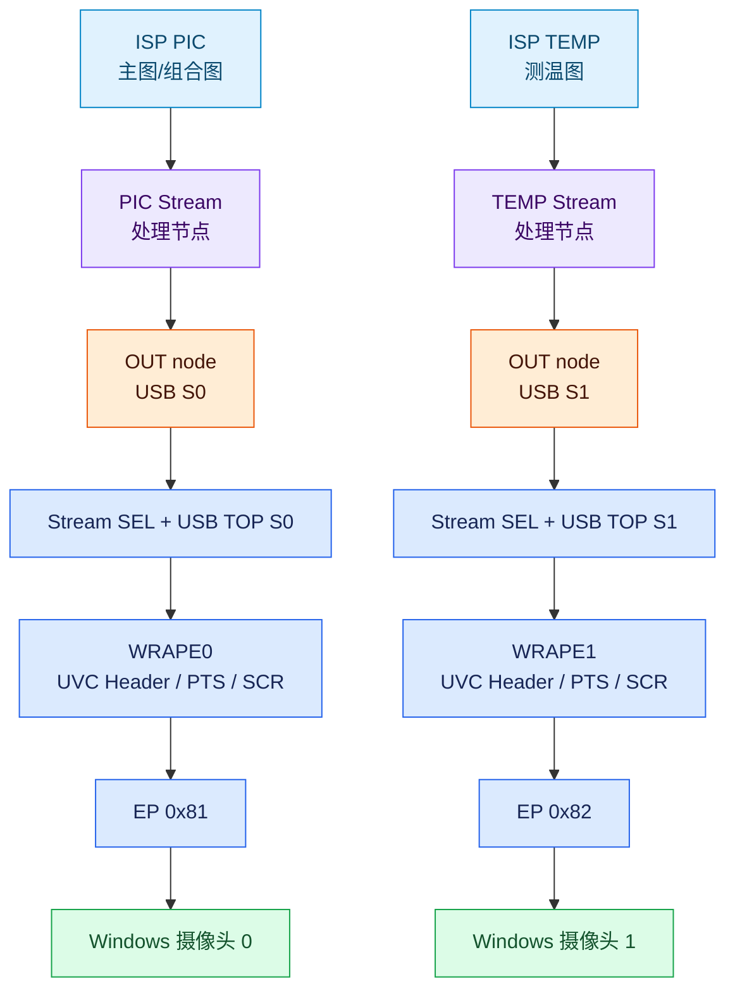
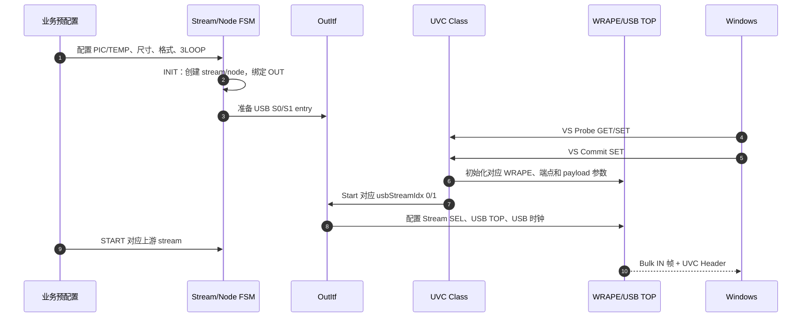
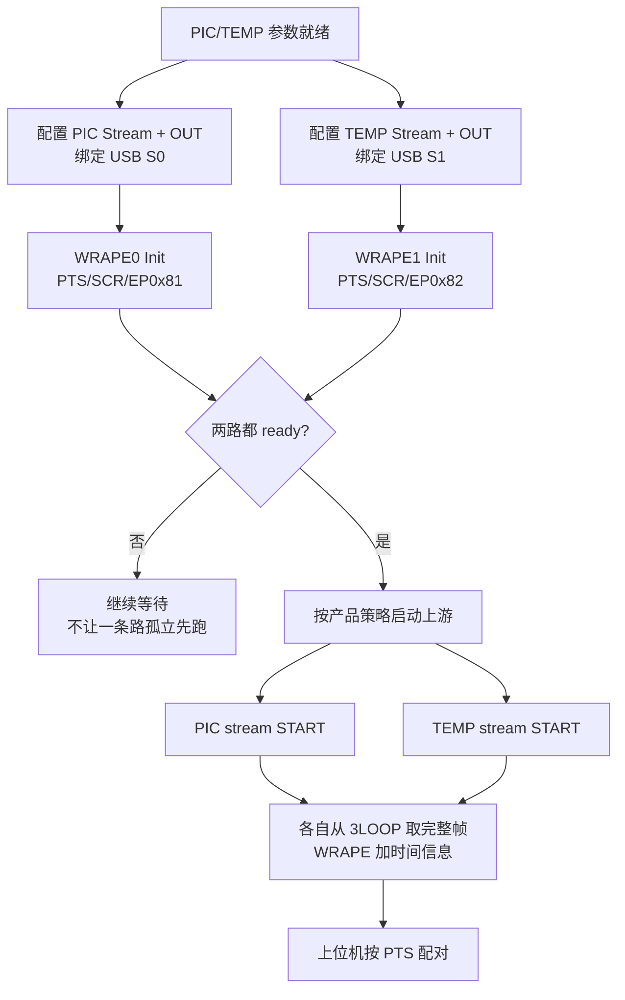

> 概述：双路 USB 视频不是“打开两个端点”这么简单。设备首先要用两组 UVC 接口和 IAD 把一个 USB 设备声明成两个视频功能；然后在芯片内部分别准备两条 Stream/Node/OutItf 图像链，分别接到 USB S0/S1、WRAPE0/1 和两个 Bulk IN 端点；最后由 WRAPE 给帧加上可比较的时间信息，由上位机决定两路帧如何配对。枚举、出图、时间比较和帧配对，属于四个不同层次。

本文以 RS500 这类 **SoC 直接接 USB 控制器、运行 RTOS 的嵌入式设备**为对象。重点不是介绍 UVC 规范本身，而是把“一个设备为什么能显示两个摄像头”“两条流在芯片里怎样走到 USB”“PTS 和三帧缓冲分别解决什么问题”串成一条可以落到代码和寄存器的链路。

本文只讨论 USB 输出。USB 与 CSI-2 在流标识、格式声明、物理链路和接收对象上的对比，见已发的 [UVC 与 CSI-2 图像输出通路](/tech-notes/posts/architecture/uvc_vs_csi2_output_paths/)。

## 1. 先建立四层模型：不要把“两个摄像头”当成一个问题

读者容易把下面四件事混在一起：

| 问题 | 负责层 | RS500 中的主要对象 | 解决的事情 |
|---|---|---|---|
| 主机为什么看到两个摄像头 | USB 描述符层 | IAD、VC、VS、端点 | 功能拆分和设备枚举 |
| 芯片怎样产生两路像素 | 视频业务层 | PIC/TEMP、Stream、Node、OutItf | 两条内部图像处理链 |
| 两路帧怎样带着时间出 USB | USB 视频硬件层 | USB TOP、WRAPE、PTS/SCR、SOF | 封装、帧边界和时间信息 |
| 上位机怎样把两路帧配成一对 | 应用层 | PTS 队列、匹配窗口、丢帧策略 | 实际的跨路配对 |

这四层之间有先后关系，但没有谁能替代谁：

- IAD 能让 Windows 注册两个条目，但不能让 ISP 产生第二路图像。
- 两条 Stream 能各自出图，但没有共同时间信息时，上位机不能可靠地判断哪两帧属于同一时刻。
- PTS 能让时间值可比较，但不会自动把两路帧合并成一个应用对象。
- 3LOOP 能保护单路帧的完整性和出帧连续性，但它不是跨摄像头的同步器。



后文按这四层展开。这样读者不会在“设备枚举”和“图像同步”之间跳跃。

## 2. 一个 USB 设备为什么能显示两个摄像头

### 2.1 设备、功能、接口不是一回事

USB 设备对应一份设备描述符和配置描述符。配置描述符下面可以挂多个接口；接口再按照功能被主机驱动组合。**Windows 显示两个摄像头，不代表设备插了两根 USB 线，也不代表固件创建了两个 USB 设备对象。**它表示主机在同一份配置描述符中识别到了两个独立的 UVC 功能。

一路 UVC 视频至少要把两个接口配成一组：

- **VC（Video Control）接口**：负责视频控制和格式协商的控制面；
- **VS（Video Streaming）接口**：负责视频流配置和数据传输的数据面。

IAD（Interface Association Descriptor）告诉主机：“从某个接口开始，连续若干个接口属于同一个视频功能。”在本文对应的双路 Full 配置中，可以抽象为两组：

```text
IAD 0 → VC 0 + VS 1 → Bulk IN 0x81 → 视频功能 0
IAD 1 → VC 2 + VS 3 → Bulk IN 0x82 → 视频功能 1
```

IAD 的作用是**关联接口**，不是搬运像素。像素最终仍由 VS 对应的端点进入 USB 链路；IAD 只在枚举期帮助主机正确分组。

### 2.2 描述符结构与 Windows 视图



图 1：一个设备描述符下面挂两组 UVC 功能。IAD 负责分组，VS 端点负责传输，Windows 最终把两组功能呈现为两个摄像头条目。

主机读完 `GET_DESCRIPTOR(CONFIGURATION)` 后，只能知道设备声明了哪些功能和传输能力；它还不知道芯片内部哪条 ISP 流会接到哪一个端点。因此，枚举完成只说明“主机看见了两个入口”，不说明“两个入口已经有有效图像”。接下来必须转入 RS500 的视频数据链。

### 2.3 端点分配解决“走哪条线”，不解决“是否同一时刻”

两路通常各占一个 Bulk IN 端点，例如 `0x81` 和 `0x82`。它们共用 USB 控制器、USB 时钟和物理链路，但主机调度两个端点时不承诺跨端点的帧边界关系。

因此：

```text
IAD / VC / VS / endpoint  → 解决“哪一路是什么”
PTS / SOF / 应用匹配       → 解决“哪两帧属于同一时刻”
```

这也是本文后面必须把“枚举”和“同步”分开讲的原因。

## 3. RS500 内部怎样形成两条视频输出链

### 3.1 不是两条 USB 线程，而是两条 Stream/Node 图像链

RS500 的视频框架采用静态 Stream/Node 资源。`streams.json` 中定义了 PIC、TEMP、VS1、VS2、VS3 等 stream 及其节点序列；业务层选择 stream 和参数，Stream/Node 框架负责生命周期，driver/HAL 负责寄存器，硬件 IP 负责实时像素处理。

双路 USB 的一个典型映射是：

```text
PIC stream
  → ISP_CUT_ZOOM
  → VIDEO_CUT_ZOOM
  → PSD / OSD / SOUT
  → OUT node
  → OUT_ITF_USB_S0
  → USB TOP S0 → WRAPE0 → EP 0x81

TEMP stream
  → ISP_CUT_ZOOM
  → VIDEO_CUT_ZOOM
  → PSD / SOUT
  → OUT node
  → OUT_ITF_USB_S1
  → USB TOP S1 → WRAPE1 → EP 0x82
```

当前配置中的 PIC/TEMP 节点可能还包含 DLM、REMAP、CBS3D 等可选或构建相关节点，不能把上面的链路当成所有产品 profile 的固定清单。稳定不变的是职责顺序：**源流 → Stream/Node 处理 → OUT node → USB 输出接口 → UVC 封装 → 端点。**



图 2：两路在芯片内部从源头就分开。它们共享 USB 控制器和总线，但不应共享同一组源流、DMA 地址、WRAPE 状态或端点 FIFO。

### 3.2 三条交互面：命令、数据、事件

RS500 的代码和文档中，至少要区分三条方向不同的链：

| 交互面 | 方向 | 典型内容 | 是否承载像素 |
|---|---|---|---|
| 命令面 | 上层 → Stream/Node → driver/HAL | 尺寸、格式、源选择、启停、寄存器配置 | 否 |
| 数据面 | ISP/Video → DMA/SOUT → USB TOP/WRAPE → EP FIFO | 原始或处理后的帧数据 | 是 |
| 事件面 | ISR → driver → event/callback → 上层 | DONE、IDLE、OVERFLOW、SOF、FPS change | 否 |

事件面只能说明硬件发生了什么，不能代替数据面。比如收到 WRAPE overflow 事件，只能说明某一路遇到了传输压力；它不等于固件已经自动恢复，也不等于另一条路必然停止。


图 3：命令面、数据面和事件面必须分开。命令面配置数据面，事件面反馈状态，但事件不会把像素向上搬运。

### 3.3 一路完整出图必须经过两个条件

对某一路来说，至少要满足：

1. **业务侧条件**：对应的 Stream、Node、DMA、OutItf 和上游源已经准备好；
2. **UVC 侧条件**：主机完成该路 Probe/Commit，WRAPE 和 USB 接口按照协商参数初始化。

只满足其中一个条件，都会出现“枚举成功但无图”或“硬件有数据但主机无法按期望解码”。这两个条件的汇合过程，是下一节的重点。

## 4. 从 Windows Commit 到第一帧：双路启动的真实顺序

### 4.1 当前 RS500 的两条控制面

业务预配置控制面决定“输出哪条图像、经过哪些节点、送到哪个物理接口”；UVC Class 控制面决定“主机需要哪种宽高、帧率和格式”。两者最终在同一个 USB 输出硬件上汇合。



当前构建文档明确指出，`RT_USB_DEVICE_VIDEO_AUTO_START` 未打开：

- Commit 不负责创建完整 Preview pipeline；
- 非 MJPEG 路径进入 `Svc_Uvc_ItfStart()`；
- 业务侧必须先准备 OutItf entry 和上游数据源；
- Commit 成功不等于 PIC/TEMP 的整个视频链已经建立。

这条边界很关键。若把 Commit 解释成“自动启动所有视频业务”，就会把 UVC Class 和 Stream Manager 的职责混在一起。

### 4.2 Stream/Node 初始化顺序

RS500 Stream/Node 框架的典型生命周期是：

```text
stream.init
→ node.init（正序）
→ stream.init_drv
→ node.init_drv（正序）
→ stream.start
→ 对应 ISP stream enable
```

反初始化则按逆序释放。OUT node 的 `init_drv` 会把物理输出接口接入视频组件，因此“Stream 进入 READY”和“USB 物理接口已经配置”不是完全相同的状态。

建议把一路的状态拆成四项观察，而不是只看一个 `started`：

| 状态项 | 代表什么 | 不能推出什么 |
|---|---|---|
| Stream/Node READY | 软件资源和节点参数基本准备好 | 不代表主机已 Commit |
| OutItf READY/BUSY | 物理输出接口已经配置或被占用 | 不代表上游一定有新帧 |
| WRAPE INIT | UVC 头、payload、端点相关参数已写入 | 不代表长期带宽足够 |
| ISP stream RUNNING | 上游开始生产帧 | 不代表主机已经正确配对两路 |

### 4.3 每一路必须独立维护的映射表

双路最容易出错的地方不是 IAD，而是“内部路由映射错了一项”。建议把以下关系作为一张明确的配置表维护：

| 内部对象 | 路 0 示例 | 路 1 示例 |
|---|---|---|
| 业务 Stream | PIC | TEMP |
| OutItf | `OUT_ITF_USB_S0` | `OUT_ITF_USB_S1` |
| `usbStreamIdx` | `0` | `1` |
| USB TOP | S0 | S1 |
| WRAPE | WRAPE0 | WRAPE1 |
| Bulk IN | `0x81` | `0x82` |
| 空闲事件 | `VIDEO_FLOW_IDLE_EVENT` for WRAPE0 | `VIDEO_FLOW_IDLE_EVENT` for WRAPE1 |
| 3LOOP 地址 | PIC 独立地址组 | TEMP 独立地址组 |

`usbStreamIdx`、WRAPE 索引和 endpoint 地址不是同一套编号，不能根据数值大小直接推断对应关系；但在产品配置中必须保持一一对应。错映射的症状可能是一路无图、两路串图、停止一路却停止另一条，甚至只有在重配后才出现。

### 4.4 两路同时启动：可以有启动栅栏，但没有总线级同步

如果产品要求两路尽量从同一时刻开始，应先分别完成两路的配置和 Commit，再在两路都 ready 后启动上游。这个“启动栅栏”只减少启动偏差，不等价于帧同步。



## 5. 三帧环形缓冲：它保证单路稳定，不负责跨路配对

### 5.1 3LOOP 在链路中的位置

3LOOP 位于 SoC 内部 DDR 的视频数据面，连接“帧生产者”和“帧消费者”：

```text
ISP/Video 写入 address0/1/2
→ 硬件按 3LOOP 模式轮转
→ USB TOP/WRAPE 读取可用帧
→ WRAPE 生成 UVC Header 后写 EP FIFO
```

它不在 USB 线缆上。帧离开 SoC 后只剩 USB payload，不再携带“第 0 槽、第 1 槽、第 2 槽”的概念。

RS500 的地址通常来自固定的 `ISP_DDR` 区域，三帧地址按输入或输出尺寸计算，不通过动态内存池临时创建。两路必须使用各自的地址组；温度流误用图像流地址，属于会直接导致覆盖和花屏的配置错误。

### 5.2 为什么是三个槽

RS500 的写帧索引由 2 位字段承载，硬件实际使用 0、1、2 三个有效索引，并对应三组地址寄存器。产品路径采用 `3LOOP`，写侧在与读侧冲突时使用“跳过当前帧”的策略，避免覆盖读侧正在使用的槽。

因此，3LOOP 的主要保证是：

- 读侧尽量拿到完整帧，而不是半新半旧的撕裂帧；
- 生产者和消费者短时速率不齐时，先用槽位吸收抖动；
- 生产者暂时追上消费者时，优先丢一个完整帧，而不是破坏当前帧。

它不是以下任何一种机制：

- 不是两个摄像头共用的同步锁；
- 不是 USB 总线调度器；
- 不是上位机帧配对队列；
- 不是分辨率动态重配的安全窗口。

### 5.3 三帧缓冲与 PTS 的关系

WRAPE 在从视频数据链取帧并组织 UVC payload 时，才把 PTS/SCR 等头部信息带入 USB 输出。3LOOP 先解决“拿到哪一帧、这帧是否完整”，PTS 再解决“这帧在共同时间轴上的位置”。因此两者的关系是串联而不是并列竞争：

```text
3LOOP：保护帧内容和出帧节奏
        ↓
WRAPE：为已取出的帧添加 UVC Header / PTS / SCR
        ↓
主机：根据 PTS 判断两路帧的时间关系
```

这就回答了一个常见疑问：为什么文章既要讲 3LOOP，又要讲 PTS？因为它们解决的是不同阶段的问题。没有 3LOOP，PTS 序列可能因丢帧、重复或撕裂而失去业务价值；没有 PTS，两个端点即使都稳定出帧，也没有可靠的共同时间标尺。

## 6. PTS、SOF 和“同步”到底分别是什么

### 6.1 RS500 能确认到哪一层

RS500 的 WRAPE 寄存器和服务文档可以确认：

- WRAPE 支持 UVC Header 中的 PTS/SCR 配置；
- USB WRAPE 有 `USB_PTS_EN`、`USB_SCR_EN` 等使能字段；
- WRAPE 暴露 `USB_SOF_CNT` 和 SOF 相关配置字段；
- 两个 WRAPE 实例挂在同一个 USB 控制器和 USB 时基上。

因此，可以确定两路硬件具备把时间信息写入 UVC 输出的条件，并且有共同的 USB 时基来源。

但“PTS 字段的数值是否直接等于某个应用可见的 SOF 计数、上位机是否按 125 微秒换算”，必须以当前固件 profile、UVC 头解析方式和上位机实现为准。文章不能只凭寄存器名字，把硬件内部计数自动等同于应用层时间单位。

### 6.2 三种“同步”必须分开说

| 说法 | 是否能由当前机制直接保证 | 准确含义 |
|---|---|---|
| 两路同时被枚举 | 可以 | 主机注册两个 UVC 功能 |
| 两路使用同一 USB 时基 | 硬件具备条件 | 两个 WRAPE 可参考共同 SOF 来源 |
| 两路同一时刻采样 | 不能仅由 USB 保证 | 需要传感器触发或上游采集同步 |
| 两路帧能在主机配成一对 | 需要上位机算法 | 使用 PTS、帧序列和超时窗口 |
| 一路丢帧不影响另一路 | 设计上可以隔离 | 需要独立 FIFO、状态和错误处理 |

所以本文标题中的“同步”，更准确地说是**可比较、可配对的时间同步**，不是“两个传感器一定在同一曝光时刻采样”。如果产品要求曝光级同步，需要另外讨论传感器触发、FSYNC、共享时钟或上游硬件同步。

### 6.3 上位机的最小配对逻辑

上位机至少要维护两条队列：

```text
queue0：{frame0, timestamp0}
queue1：{frame1, timestamp1}
```

当两队列都有帧时，可以按以下规则处理：

1. 取两队列头部时间戳的差值；
2. 差值在允许窗口内，组成一对并同时消费；
3. 差值过大，丢弃时间更早的一帧或等待另一队列；
4. 超过超时窗口仍没有匹配帧，记录缺帧，不阻塞整条视频链；
5. 处理计数回绕，不能直接用有符号整数比较裸值。

如果一路 30 fps、另一路 9 fps，配对策略应以低帧率路为节拍基准，而不是强行让两路帧数相等。高帧率路可以为低帧率路提供最近邻候选，但不能把多余帧误认为新的同步事件。

## 7. 格式、宽高和带宽：双路能否长期稳定的硬约束

### 7.1 逻辑宽高不等于每个硬件字段

在 RS500 的 USB 初始化中，至少要区分以下参数：

| 参数 | 说明 | 常见误解 |
|---|---|---|
| 逻辑宽高 | UVC 协商和业务看到的输出尺寸 | 直接等于所有寄存器的宽高 |
| 输出格式 | Y16、Y8、YUV422、NV12 等 | 只决定 Windows 的 FourCC |
| payload width | 某些格式在 USB 侧使用的硬件有效宽度 | 永远等于逻辑宽度 |
| `streamVldNum` | Stream SEL/USB 输出看到的有效数据计数 | 等于 Bulk 事务大小 |
| `transactionSize` | 单次 USB 事务数据量 | 等于一帧大小 |
| `transferSize` | 单次 Bulk 传输大小 | 能修复错误帧几何 |

NV12 等格式可能使用不同的 payload 宽度和有效数据计数。T37 的 X2 提前封帧问题说明：输入模式变化后，如果下游仍沿用旧的帧几何或有效计数，设备可能枚举正常、也能发数据，但主机在错误位置收到 `ERR+EOF`。这类问题不能简单归结为 USB 带宽不足。

### 7.2 两路带宽预算

两路端点虽然逻辑独立，但物理上争用同一条 USB 2.0 高速链路。最低预算可以写成：

```text
总需求 ≈ Σ（单帧有效字节数 × 帧率）
       + 两路 UVC Header
       + USB Bulk/协议开销
       + 主机和设备端缓冲余量
```

应按实际像素格式计算，而不是只相加宽度 × 高度 × 帧率。Y16、Y8、YUV422 和 NV12 的单帧字节数不同；两路分辨率和帧率也可以不同。

带宽验证不能只看理论值，至少应同时观察：

- 两路实际帧率；
- 每路 PTS 间隔和缺口；
- WRAPE/FIFO overflow 计数；
- 主机抓包中的 `ERR`、`EOF` 和短帧；
- Windows 应用收到的帧数和时间戳队列长度。

## 8. 启停、重配和溢出：必须按路处理

### 8.1 独立启停

一路启动或停止，不能默认复位整个 USB 控制器。RS500 的 UVC 服务使用 `usbStreamIdx` 区分 USB S0/S1，并等待对应 WRAPE 的 `VIDEO_FLOW_IDLE_EVENT`。

推荐的单路停止边界是：

```text
停止对应 WRAPE 的帧流
→ 等待对应 VIDEO_FLOW_IDLE_EVENT
→ 释放该路 OutItf 状态
→ 停止/反初始化对应 Stream
→ 保留另一条路继续运行
```

只把软件状态改成 STOPPED，而没有等硬件进入 idle，可能留下正在写 FIFO 或正在取 DMA 槽的硬件活动。反过来，直接清公共 USB 状态，又可能误伤另一条路。

### 8.2 分辨率和帧格式重配

分辨率、像素格式或帧率变化不能只修改 UVC 描述符。若 DMA 帧长度、行长度或三帧地址发生变化，通常需要：

```text
停止目标路
→ 等待帧边界/idle
→ 重新计算一级和二级 DMA 布局
→ 重建目标 Stream/Node/OutItf 参数
→ 重新初始化 WRAPE/USB TOP
→ 重新 Commit/Start
```

RS500 文档已经区分了“停流重配”和“电子变倍动态重配”：变倍可以使用专门的 Frame DMA reconfig 路径，不代表所有分辨率或格式变化都能不停流。不要把三帧缓冲提供的短时容差误写成动态重配窗口。

### 8.3 溢出处理

双路系统应按 WRAPE 实例分别统计 overflow。当前硬件配置可以选择带宽不足时的帧处理策略，例如在帧边界丢弃，避免 FIFO 卡死；但事件线程的计数、日志和回调不能扩写成“自动重启 Stream FSM”，除非代码中确实存在这样的闭环。

正确的工程结论是：

- 一路持续 overflow，先检查该路格式、帧率、payload 参数和端点消费；
- 两路同时 overflow，优先检查总线预算和 USB 时钟；
- 只有一路 overflow，不能直接宣布双路整体失败；
- 丢帧后 PTS 序列会出现缺口，上位机必须有超时和丢弃策略。

## 9. 推荐验证闭环

把“能看到两个摄像头”作为验收标准是不够的。建议按以下顺序验证：

1. **枚举验证**：确认一个 USB 设备下出现两组 VC/VS、两个摄像头条目和两个 Bulk IN 端点。
2. **单路 S0 验证**：只开路 0，确认完整帧、宽高、格式、PTS/Frame Header 和无持续 overflow。
3. **单路 S1 验证**：只开路 1，使用同样指标确认源流和端点映射正确。
4. **双路同时验证**：同时开两路，记录每路帧率、PTS 差值、FIFO/WRAPE overflow 和主机队列长度。
5. **隔离验证**：停止路 0，确认路 1 仍持续出帧；再反向测试。
6. **重配验证**：只修改一路的格式或分辨率，确认停流、DMA 重算、Commit 和恢复没有影响另一条路。
7. **长稳验证**：反复插拔、Commit、Stop、Start，检查 endpoint、WRAPE、OutItf 和 Stream 状态是否串路。

最终要验证的不是某一个函数返回成功，而是下面这条闭环是否成立：

```text
描述符把功能拆开
→ Stream/Node 分别产生两路像素
→ OutItf 分别绑定 USB S0/S1
→ USB TOP/WRAPE 分别封装两路帧
→ 3LOOP 保证每路读到完整帧
→ PTS 提供共同时间参照
→ 上位机按窗口配对并处理缺帧
```

## 10. 三件最容易混淆的事

### 10.1 设备名和摄像头名

设备管理器里的产品名是设备级名称，通常来自设备描述符的 `iProduct`；摄像头列表中的功能名来自对应功能或接口字符串。一个设备同时出现在设备树和两个摄像头条目下是正常现象。

### 10.2 通道号、Stream index、WRAPE index、端点号

它们属于不同编号空间：

```text
PIC/TEMP        → 业务 Stream
USB S0/S1       → 芯片输出接口
usbStreamIdx    → UVC 服务索引
WRAPE0/1        → UVC 硬件实例
EP 0x81/0x82    → USB 端点地址
```

不能因为某一路是“通道 1”就推断它一定是 `EP 0x81`。真正的依据是初始化映射和描述符配置。

### 10.3 “同步”与“同时采样”

本文说的同步是：两路帧具有可比较的时间信息，主机可以按窗口进行配对。它不自动保证两个传感器在同一个曝光时刻采样。曝光级同步需要另外的传感器触发或硬件同步设计。

## 11. 一句话总结

一台嵌入式设备要同时输出两路 USB 视频，必须把四件事接起来：**IAD 把一个设备声明成两个 UVC 功能；Stream/Node/OutItf 把两个源流分别接到 USB S0/S1；3LOOP 保证每一路稳定地产生完整帧；WRAPE 提供可比较的时间信息，主机再按 PTS 完成配对。** IAD 解决“看见谁”，视频链解决“送出什么”，3LOOP 解决“帧是否完整”，PTS 和上位机解决“哪两帧应该放在一起”。
