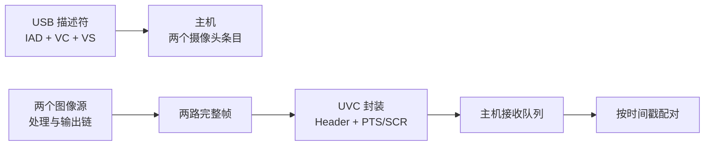
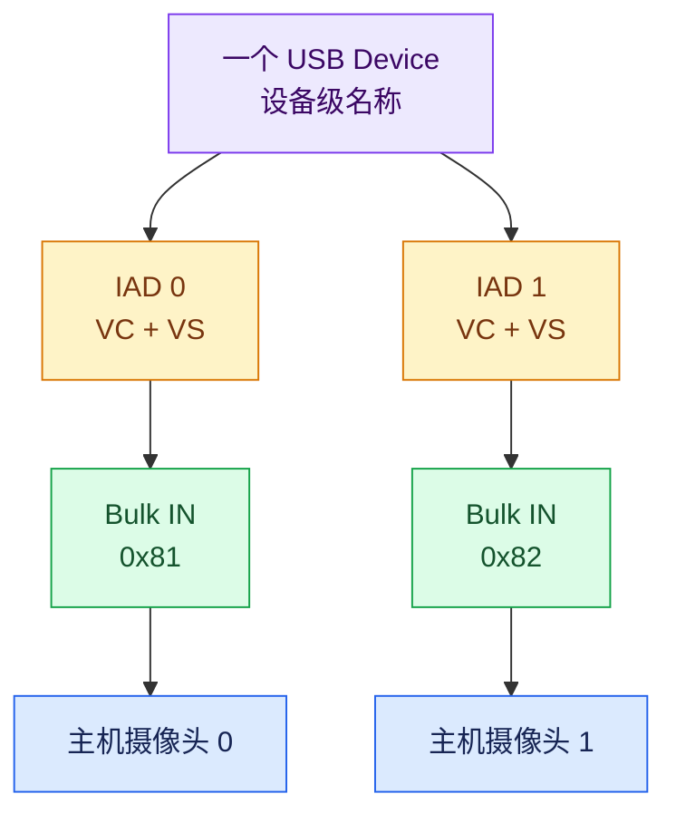
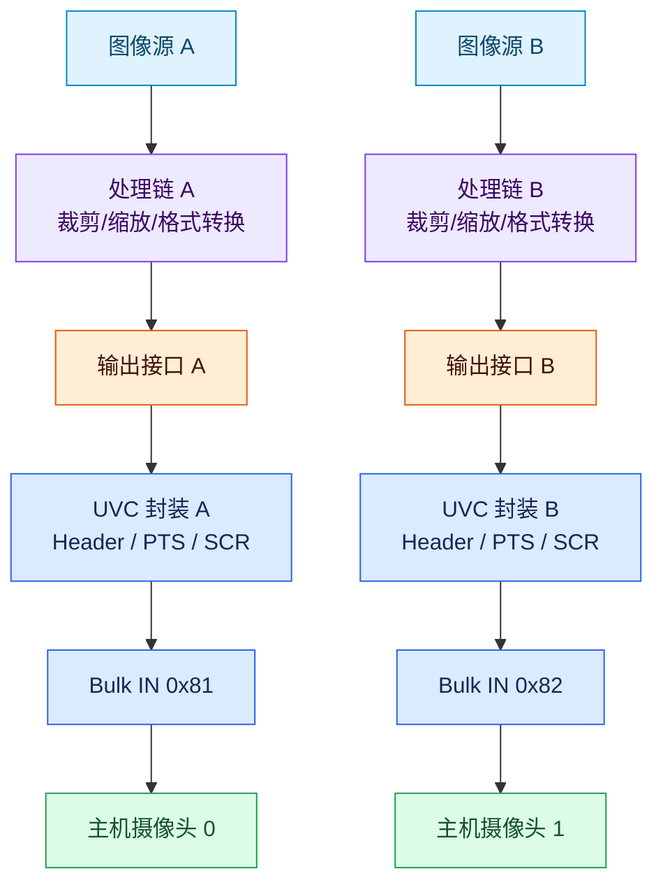
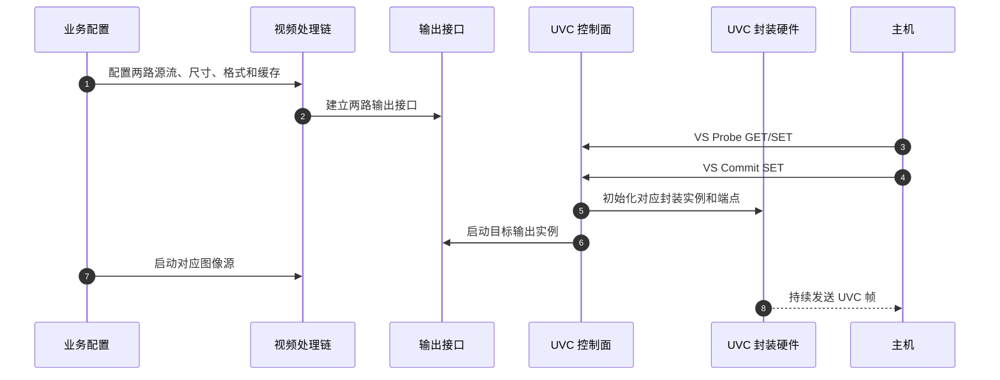
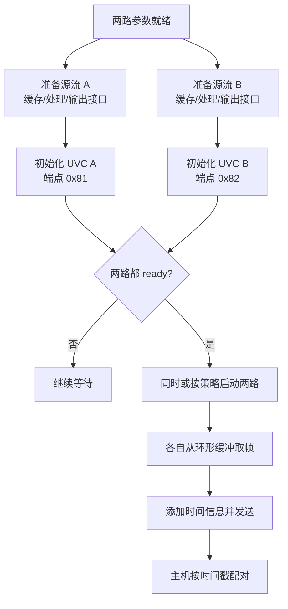
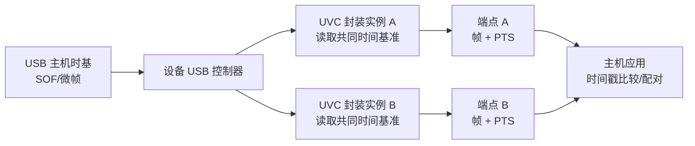

> 概述：双路 USB 视频不是“打开两个端点”这么简单。设备要先用两组 UVC 接口和 IAD 把一个 USB 设备声明成两个视频功能，再分别准备两条图像处理链，把它们接到两个 USB 输出实例。环形缓冲解决生产和传输之间的速率波动，PTS 为两路帧提供可比较的时间信息，真正的帧配对仍由上位机完成。

本文讨论一种常见的嵌入式方案：SoC 直接连接 USB 控制器，内部从两个图像源产生视频，设备端运行 RTOS 或轻量固件，主机端使用标准 UVC 驱动。文章不绑定某个芯片型号，重点提炼可以迁移到其他图像 SoC、MCU+视频协处理器或 USB 摄像头桥接设备的设计方法。

## 1. 先建立四层模型

“一个设备、两个摄像头、同步输出”实际上包含四个问题。把它们分开，后面的链路才容易理解。

| 问题 | 负责层 | 解决的事情 |
|---|---|---|
| 主机为什么看到两个摄像头 | USB 描述符层 | 把接口组合成两个 UVC 功能 |
| 芯片怎样产生两路视频 | 视频业务层 | 为两路源分别建立处理和输出链 |
| 两路帧怎样带着时间出 USB | USB 视频硬件层 | 组织帧、添加 Header、写入端点 |
| 上位机怎样把两路帧配成一对 | 应用层 | 使用时间戳、队列和超时窗口配对 |

这四层不能互相替代：

- IAD 能让主机注册两个摄像头，但不能产生第二路像素。
- 两条视频链能各自出图，但没有共同时间信息时，主机无法可靠配对。
- 时间戳能让两路帧可比较，但不会自动把两帧合成一个应用对象。
- 三帧缓冲能保护单路帧的完整性，但不是跨摄像头同步锁。



全文按这个顺序展开：先讲“主机看到什么”，再讲“设备送出什么”，最后讲“主机如何对齐”。

## 2. 一个 USB 设备为什么能显示两个摄像头

### 2.1 设备、功能和接口不是一回事

USB 设备对应一份设备描述符和配置描述符。配置描述符下面可以包含多个接口，主机驱动再按照接口之间的关联关系，把它们组合成具体功能。

一路 UVC 视频通常至少包含两个接口：

- **VC（Video Control）接口**：负责控制请求和格式协商；
- **VS（Video Streaming）接口**：负责视频流配置和数据传输。

IAD（Interface Association Descriptor，接口关联描述符）告诉主机：连续的若干接口属于同一个功能。一台设备提供两路视频时，可以抽象为：

```text
IAD 0 → VC 0 + VS 1 → Bulk IN 0x81 → 视频功能 0
IAD 1 → VC 2 + VS 3 → Bulk IN 0x82 → 视频功能 1
```

IAD 只负责“分组”，不负责搬运像素。真正的视频字节仍通过 VS 接口对应的端点进入 USB 链路。

### 2.2 描述符结构与主机视图



图 1：一个设备描述符下面挂两组 UVC 功能，主机最终显示两个摄像头条目。

主机完成枚举后，只能确认设备声明了两个功能和两个数据入口。它还不知道芯片内部哪条图像源会接到哪个端点。因此，“两个摄像头能被看到”只证明描述符正确，不证明视频链已经出图。

### 2.3 端点解决传输分路，不解决时间同步

两个端点共用同一个 USB 控制器和物理链路，但主机调度两个端点时，不会自动保证它们的帧边界一致。

可以先记住这组对应关系：

```text
IAD / VC / VS / endpoint  → 解决“哪一路是什么”
PTS / SOF / 应用队列     → 解决“哪两帧时间接近”
```

所以，枚举完成后，下一步不是继续修改描述符，而是检查设备内部是否真正建立了两条独立的视频数据链。

## 3. 设备内部怎样形成两条视频链

### 3.1 两路视频从源头就应分开

典型的数据路径如下：

```text
图像源 A
  → 采集/处理节点
  → 输出接口 A
  → UVC 封装实例 A
  → 端点 0x81

图像源 B
  → 采集/处理节点
  → 输出接口 B
  → UVC 封装实例 B
  → 端点 0x82
```

中间可以包含裁剪、缩放、格式转换、叠加、缓存和 DMA 等节点。不同芯片的模块名称会变化，但职责顺序基本一致：

**源流 → 图像处理 → 输出接口 → UVC 封装 → USB 端点。**



图 2：两路在设备内部独立产生、独立封装、独立进入端点；它们只在 USB 控制器和总线上共享资源。

### 3.2 命令面、数据面和事件面

一个可靠的双路实现，至少要区分三条方向不同的链路：

| 交互面 | 方向 | 典型内容 | 是否承载像素 |
|---|---|---|---|
| 命令面 | 上层 → 视频驱动 → 硬件 | 尺寸、格式、源选择、启停 | 否 |
| 数据面 | 图像处理 → DMA/缓存 → UVC 封装 → 端点 | 原始或处理后的帧数据 | 是 |
| 事件面 | 中断 → 驱动 → 事件/回调 | 帧完成、空闲、溢出、错误 | 否 |

事件面只能反馈硬件状态，不能代替数据面。例如收到 FIFO 溢出事件，只能说明某一路受到传输压力，不代表固件已经自动恢复，也不代表另一条路必然停止。


图 3：命令面配置数据面，事件面反馈状态，三者不能混为一谈。

### 3.3 一路真正出图需要两个条件

每一路都必须同时满足：

1. **设备侧准备完成**：源流、处理节点、DMA 缓冲和输出接口已经配置；
2. **主机侧协商完成**：该路完成 UVC Probe/Commit，设备按协商结果初始化封装和端点。

只满足一个条件时，常见结果是：设备能枚举但无图，或者硬件已经有数据但主机无法按期望组帧。

## 4. 从主机协商到第一帧

### 4.1 两个控制面在输出硬件处汇合

业务配置决定“输出什么、经过哪些处理、送到哪一路”；UVC 控制面决定“主机需要什么宽高、帧率和格式”。两者最终在对应的输出实例处汇合。



这里的关键边界是：**UVC Commit 通常只负责主机侧协商和该路 UVC 输出的初始化，不应被默认理解为自动创建完整的图像处理链。**业务侧必须提前准备源流和输出接口，或者明确实现“Commit 触发业务启动”的自动化路径。

### 4.2 推荐的初始化顺序

设备侧可以采用下面的通用顺序：

```text
1. 确定两路源流、分辨率、帧率和像素格式
2. 为两路分别计算 DMA 和环形缓冲地址
3. 初始化图像处理节点和输出接口
4. 等待主机完成对应路的 UVC Probe/Commit
5. 初始化 UVC Header、端点和传输参数
6. 两路都 ready 后，再按产品策略启动图像源
7. 检查首帧、帧率、时间戳和错误计数
```

如果两路不要求同时开始，可以分别启动；如果应用需要较小的启动偏差，建议先完成两路配置，再使用一个“启动栅栏”同时放行两路源流。



这个启动栅栏只能减少两路的启动偏差，不能把 USB 传输变成硬件级同步。

### 4.3 每一路都要有明确的映射关系

双路系统最容易出现的错误不是描述符错误，而是内部映射错了一项。建议维护一张类似下表的配置表：

| 对象 | 路 0 | 路 1 |
|---|---|---|
| 图像源 | 源 A | 源 B |
| 输出实例 | 输出 A | 输出 B |
| UVC 封装实例 | 实例 0 | 实例 1 |
| Bulk IN 端点 | `0x81` | `0x82` |
| DMA 地址组 | 地址组 A | 地址组 B |
| 空闲/错误事件 | 事件组 A | 事件组 B |

内部通道号、输出实例号、封装实例号和端点号通常不是同一套编号。它们不能按数值直接推断，但在初始化配置中必须一一对应。错映射可能导致一路无图、两路串图，或者停止一路时误伤另一条路。

## 5. 三帧环形缓冲解决什么问题

### 5.1 它位于哪里

三帧环形缓冲位于设备内部的 DDR 或片内共享内存中，连接帧生产者和帧消费者：

```text
图像处理模块写入 address0/1/2
→ 硬件按环形模式轮转
→ 输出模块读取可用帧
→ UVC 封装后写入端点 FIFO
```

帧离开设备后只剩 USB payload，不再携带“第 0 槽、第 1 槽、第 2 槽”的概念。

两路必须使用各自的地址组。若两路错误地使用同一组 DMA 地址，生产者会互相覆盖，典型结果是花屏、撕裂或两路画面内容异常。

### 5.2 三个槽位怎样保护完整帧

三帧缓冲的目标不是让两路“锁步”，而是隔离生产者和消费者的短时速率差：

- 生产者按图像源节拍写入下一槽；
- 消费者读取已经写完的槽；
- 读写即将冲突时，优先跳过一帧或重复上一帧，避免覆盖正在读取的槽；
- 三个槽位为短时抖动提供有限容差。

常见的“三帧”实现使用两个比特保存槽位索引，但只使用三个有效值。槽位数量是硬件资源约束，不代表系统拥有无限缓存。

它不是以下机制：

- 不是两个摄像头的同步锁；
- 不是 USB 总线调度器；
- 不是主机端配对队列；
- 不是任意格式重配的安全窗口。

### 5.3 三帧缓冲和时间戳是串联关系

可以把两者放在同一条数据链上理解：

```text
环形缓冲：保证取到一帧相对完整的数据
        ↓
UVC 封装：为这帧添加 Header、PTS/SCR 等信息
        ↓
主机应用：根据时间信息比较和配对两路帧
```

没有环形缓冲，输出可能出现撕裂、重复或不稳定的帧间隔，时间戳的业务价值会下降；没有时间戳，两路即使都稳定出帧，主机也缺少共同的比较尺度。

## 6. PTS、SOF 和同步边界

### 6.1 PTS 解决的是“可比较”，不是“自动配对”

PTS（Presentation Time Stamp）通常写在 UVC Payload Header 中，用来描述帧在时间轴上的位置。设备为两路帧使用同一个时基来源后，主机才能比较它们的时间差。

USB 高速模式下，主机以微帧节拍驱动总线；设备中的 UVC 硬件可以读取或跟随该时基，将相关时间信息写入视频头部。具体 PTS 单位、位宽和回绕规则应以设备的 UVC 实现和主机解析方式为准，不能只根据“存在 PTS 字段”就假设所有平台的换算方式相同。



图 4：共同时间基准让两路帧“可比较”，但最终配对仍由主机应用完成。

### 6.2 必须区分四种“同步”

| 说法 | 是否能仅靠双路 UVC 保证 | 准确含义 |
|---|---|---|
| 两路同时被枚举 | 可以 | 主机注册两个 UVC 功能 |
| 两路使用共同 USB 时基 | 通常可以 | 两个封装实例参考同一总线时基 |
| 两路在同一曝光时刻采样 | 不能 | 需要传感器触发、共享时钟或硬件同步 |
| 两路帧能在主机配成一对 | 需要应用逻辑 | 使用时间戳、帧队列和超时窗口 |

因此，本文所说的“同步”主要是**可比较、可配对的时间同步**，不是曝光级同步。

### 6.3 一个最小的主机配对算法

主机端至少维护两条队列：

```text
queue_a：{frame_a, timestamp_a}
queue_b：{frame_b, timestamp_b}
```

当两条队列都有数据时：

1. 比较队首帧的时间戳差值；
2. 差值在允许窗口内，组成一对并同时消费；
3. 差值过大，丢弃较早的帧，或等待另一条队列；
4. 等待超过超时窗口仍未匹配，记录缺帧并继续运行；
5. 正确处理时间戳回绕，不直接比较未经处理的裸计数值。

如果一路是 30 fps、另一路是 9 fps，应以 9 fps 的帧作为配对节拍。高帧率路为低帧率路提供最近邻候选，但多出来的帧不应被误判为新的同步事件。

## 7. 格式、帧长和带宽约束

### 7.1 不要把所有“长度”当成同一个量

双路视频中至少有四类容易混淆的参数：

| 参数 | 含义 | 不能替代什么 |
|---|---|---|
| 逻辑宽高 | UVC 协商和应用看到的尺寸 | 不能替代 DMA 行长 |
| 单帧有效字节数 | 一帧像素数据的实际大小 | 不能替代 USB 事务大小 |
| 事务/传输大小 | 一次 USB 搬运的数据量 | 不能修复错误的帧几何 |
| 有效数据计数 | 输出模块认为当前帧有多少有效数据 | 不能简单等同于分辨率乘法 |

不同格式的单帧字节数不同。Y16、Y8、YUV422、NV12 等格式还可能使用不同的行布局和有效数据计数。特别是切换分辨率或像素格式时，不能只修改 UVC 描述符而保留旧的 DMA 和输出参数。

如果帧几何、有效数据计数和封装参数不一致，主机可能表现为：

- 设备能枚举，但图像只有局部区域；
- 每帧在固定错误位置提前结束；
- 出现 `ERR`、`EOF` 或短帧；
- 两路画面偶发串行或撕裂。

### 7.2 双路共享总线，必须做总带宽预算

两个端点逻辑独立，但仍争用同一条 USB 链路。可以先用下面的公式估算：

```text
总需求 ≈ Σ（单帧有效字节数 × 帧率）
       + UVC Header
       + USB 协议开销
       + 设备和主机缓冲余量
```

不要只计算像素数量。应按实际格式计算每路单帧大小，并通过抓包和板测确认可持续帧率。

## 8. 启停、重配和溢出必须按路处理

### 8.1 独立启停

一路停止时，不应默认复位整个 USB 控制器。推荐的边界是：

```text
停止目标路的帧发送
→ 等待目标路进入 idle
→ 释放目标路的输出状态
→ 停止或反初始化目标路的图像链
→ 保留另一条路继续运行
```

只修改软件状态而不等待硬件 idle，可能留下正在写 FIFO 或读取 DMA 槽的活动；反过来，清空公共 USB 状态又可能误伤另一条路。

### 8.2 分辨率和格式重配

如果改变了 DMA 帧长、行长、缓冲地址、像素格式或输出几何，通常需要：

```text
停止目标路
→ 等待帧边界或 idle
→ 重新计算 DMA 和环形缓冲布局
→ 重建目标路的处理和输出参数
→ 重新初始化 UVC 封装和端点
→ 重新协商并启动
```

某些芯片支持在不停流的情况下动态修改裁剪或变倍参数，但这是硬件明确支持的特例，不能推广为所有格式和分辨率都可以在线修改。

### 8.3 溢出处理

溢出应按封装实例或端点分别统计。排查顺序建议是：

- 只有一路溢出：检查该路格式、帧率、帧长和主机消费速度；
- 两路同时溢出：优先检查总线预算、USB 时钟和端点调度；
- 出现丢帧：检查时间戳队列是否能处理缺口；
- 事件只被记录没有恢复闭环：不要把日志和回调描述成“自动重启”。

硬件可以选择在带宽不足时丢弃完整帧，以避免 FIFO 卡死。丢帧会造成时间戳序列出现缺口，但不等于两路时间基失效；主机应用仍应通过超时和丢弃策略继续运行。

## 9. 推荐验证闭环

“系统管理器里出现两个摄像头”不能作为完整验收标准。建议按以下顺序验证：

1. **枚举**：确认一个 USB 设备下出现两组 VC/VS、两个摄像头条目和两个数据端点。
2. **单路 A**：确认完整帧、宽高、格式、帧率和无持续溢出。
3. **单路 B**：使用同样指标确认第二路源流和端点映射正确。
4. **双路同时运行**：记录两路帧率、时间戳差值、短帧、错误和溢出计数。
5. **隔离停止**：停止一路，确认另一条路仍能连续出帧。
6. **单路重配**：只改变一路格式或分辨率，确认另一条路不受影响。
7. **长时间运行**：反复插拔、协商、停止和启动，确认描述符、端点、缓存和错误状态没有串路。

最终要验证的是下面这条闭环：

```text
描述符拆分功能
→ 两条内部视频链分别产生完整帧
→ 两个输出实例分别封装并发送
→ 环形缓冲吸收单路抖动
→ 时间戳建立共同参照
→ 主机应用按窗口配对并处理缺帧
```

## 10. 三件最容易混淆的事

### 10.1 设备名称和摄像头名称

设备管理器中的产品名是设备级名称；摄像头列表中的名称是功能级名称。一个物理设备同时出现在设备树和两个摄像头条目下是正常现象。

### 10.2 通道号和端点号

内部视频通道、输出实例、封装实例、DMA 地址组和 USB 端点属于不同编号空间。不能因为某一路编号更小，就推断它一定对应某个端点。应以初始化映射表和描述符为准。

### 10.3 “同步”和“同时采样”

本文的同步是：两路帧带有可比较的时间信息，主机可以按窗口配对。它不自动保证两个传感器在同一个曝光时刻采样。曝光级同步需要额外的传感器触发、共享时钟或硬件同步设计。

## 11. 一句话总结

一台嵌入式设备同时输出两路 USB 视频，需要把四件事接起来：**IAD 把一个设备声明成两个 UVC 功能；两条内部视频链分别产生和发送两路帧；环形缓冲保证单路帧的完整性和稳定性；时间戳与主机应用完成跨路比较和配对。** IAD 解决“主机看见谁”，视频链解决“设备送出什么”，环形缓冲解决“帧是否完整”，时间戳和应用逻辑解决“哪两帧应该放在一起”。
