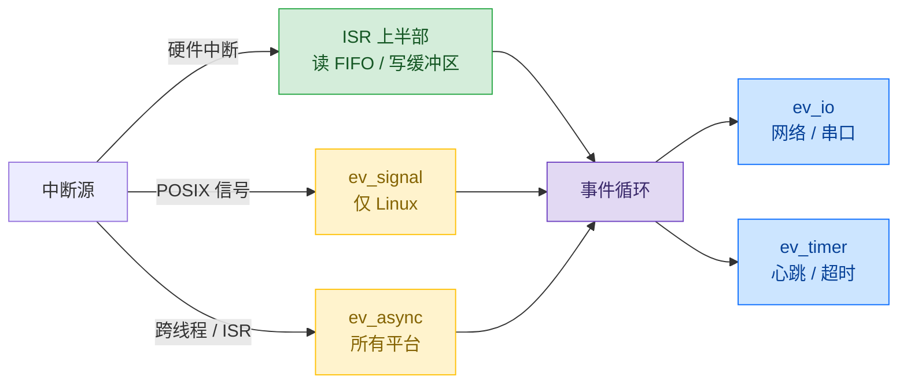
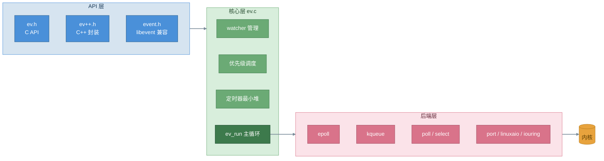
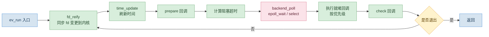
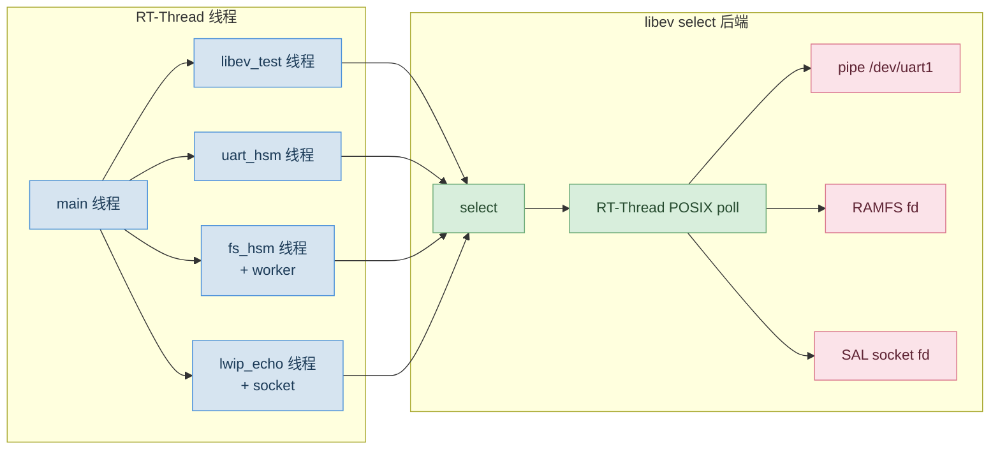
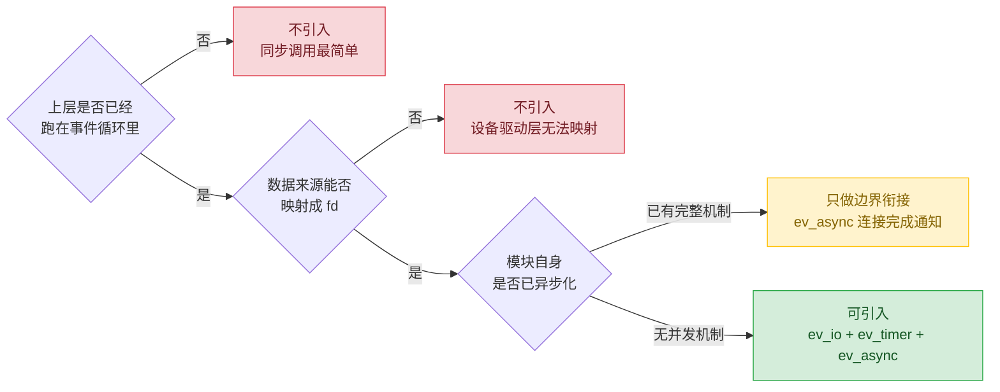

> 结论：libev 是一个单线程的事件循环库（Reactor 模式）。使用时把要等待的事件（文件描述符可读、定时器到期、跨线程通知）注册进去，事件发生后由库调用回调函数处理。在嵌入式系统中，它可以作为一个 RT-Thread 线程运行，STM32F407 上已用 select 后端验证了 ev_io、ev_timer、ev_async 三种用法；它也可以承接中断处理中的耗时部分。是否引入 libev，取决于两点：数据来源能不能映射成文件描述符（fd），以及模块自身是否已经有一套完整的并发处理机制。

本文整理 libev 4.33 的设计文档与 RT-Thread 移植实践，回答三个问题：libev 是什么、内部怎么实现、在嵌入式系统上怎么用、何时不该用。

## 1. 定位：单线程事件循环，不处理硬件中断

### 1.1 libev 是什么

libev 用 C 语言编写，对多种操作系统的 I/O 多路复用机制（select / poll / epoll / kqueue / port 等）提供统一接口。它本身不做业务，只负责一件事：等待用户注册的事件发生，然后调用对应的回调函数。一个循环可以同时等待成百上千个事件，事件之间串行处理，不需要为每件事开一个线程。

最常用的三种事件类型：

| watcher | 等待什么 | 典型场景 |
|---|---|---|
| `ev_io` | 文件描述符可读 / 可写 | 网络消息、串口数据 |
| `ev_timer` | 定时器到期 | 心跳、超时 |
| `ev_async` | 其他线程 / ISR 发来通知 | 跨线程完成通知 |

### 1.2 libev 与中断的关系

libev 不能接管硬件中断：硬件中断由 CPU / 内核 / RTOS 的中断控制器直接跳转到 ISR，有纳秒级的响应要求，而事件循环有调度延迟，不适合在 ISR 上下文运行。

但它可以和中断配合，做法是 Linux 内核常用的「上半部 / 下半部」分工：ISR 里只做必须立刻完成的事（读 FIFO、把字节写入缓冲区），然后通过 `ev_async_send` 通知事件循环；解析、分发、写盘等耗时操作全部在事件循环里做。串口环形缓冲示例演示的正是这个流程：模拟 ISR 只把字节写入环形缓冲并调用 `ev_async_send`，后续处理在事件循环中完成。

与中断相关的三个接口：

1. **硬件中断**：libev 不直接处理，只承接中断之后的耗时操作。
2. **POSIX 信号**：`ev_signal` 可以把信号转成事件循环里的一次回调，避免信号打断带来的竞态；但它只在 Linux 可用，RT-Thread 没有 POSIX 信号，编译时需要关闭（`EV_SIGNAL_ENABLE=0`）。
3. **跨线程 / ISR 通知**：`ev_async_send` 是 libev 唯一可以从其他线程安全调用的接口，相当于从任意线程或 ISR 给事件循环发一个通知，内部用 pipe 实现，所有平台都可用。

## 2. 内部设计：三层结构与主循环

### 2.1 三层架构与单编译单元

libev 自顶向下分三层：API 层、事件循环核心层、后端抽象层。

一个重要的实现选择是**单编译单元**：ev.c 在编译期用 `#include` 把各个后端的 .c 文件内联进来，全部编译进同一个翻译单元。好处是编译器能看到全部代码，便于内联优化，只是没法单独编译某个后端。编译期根据 `HAVE_SYS_EPOLL_H`、`HAVE_KQUEUE` 等宏决定启用哪些后端，运行期可以用 `ev_supported_backends()` 和 `ev_recommended_backends()` 查询。

### 2.2 核心数据结构

四组结构支撑整个循环：

| 结构 | 作用 | 关键字段 |
|---|---|---|
| `ev_watcher` 公共头 | 所有 watcher 类型前面字段一致，可安全互相转换 | `active` / `pending` / `priority` / `data` / `cb` |
| `ANFD` 数组 | 按 fd 下标直接索引，避免哈希查找 | `head` 链表、`events` 关注位、`emask` 内核已注册位 |
| `pendings` 队列 | 按优先级存放待执行的事件 | 回调时从高优先级到低优先级取出 |
| `ANHE` 最小堆 | 定时器按到期时间排序 | `at` 到期时间、`w` 指向定时器 watcher |

同一个 fd 上注册多个 watcher 时，通过 `ANFD.head` 链表串联；epoll 模式下比对 `emask` 与 `events` 的差异，决定是否需要调用 `epoll_ctl` 修改注册。

### 2.3 ev_run 主循环

三个实现要点：

1. **两种时钟**：内部同时维护单调时钟 `mn_now` 和实时时钟 `ev_rt_now`。`ev_timer` 基于单调时钟，不受系统改时间影响；`ev_periodic` 基于实时时钟，行为类似 crontab，会跟随时间调整。
2. **优先级调度**：每个 watcher 的 `priority` 范围 [-2, +2]，数值越大越先执行。
3. **超时计算**：阻塞等待的超时取定时器堆顶的时间，避免无谓的唤醒。

### 2.4 关键不变量

阅读源码和写测试时可以依据四条不变量：

1. `w->active == 1` 当且仅当 watcher 已挂入循环（链表、堆或队列之一）。
2. `w->pending > 0` 表示 watcher 已在待执行队列中，此期间不会重复入队。
3. `anfds[fd].emask` 与内核注册状态一致（每次 fd_reify 执行后成立）。
4. 定时器堆满足最小堆性质，堆顶是全局最近的到期时间。

## 3. RT-Thread 移植：select 后端，每线程一个 loop

libev 4.33 已移植到 RT-Thread 5.2.2，在 Renode 全系统仿真中验证通过，后端只启用 select（`EV_USE_SELECT=1`）。`ev_io`、`ev_timer`、`ev_async` 三种用法均跑通，与 Linux 的 epoll 后端在事件语义上等价。

`ev_run` 是阻塞循环，在 RT-Thread 抢占式内核中必须以独立线程承载，与其他线程并存。

两个要点：

1. 每个线程必须用 `ev_loop_new` 创建独立的 loop。`ev_default_loop` 是全局单例，多个线程共享会触发「ev_loop recursion during release detected」断言。
2. select 后端最终落到 RT-Thread 的 POSIX poll，把 pipe、RAMFS fd、SAL socket fd 统一成同一套 fd 语义，这是移植能跑通的关键。

## 4. 适用性判断：三个问题决定该不该用

对已经有「中断 + 线程 + IPC」机制的嵌入式模块，引入 libev 在多数情况下得不偿失，本质是在现有并发模型上再叠一层。每个模块只需回答三个问题：

1. **数据来源能不能映射成 fd？** libev 的 `ev_io` 只认有「可读 / 可写」状态的 POSIX 文件描述符。
2. **模块是否已经有完整的并发 / 同步机制？** 如果已经有「线程 + 锁 + 事件」，再引入就是重复。
3. **引入是替换还是叠加？** 替换有价值，叠加是负担。

### 4.1 数据来源决定适配成本

| 类别 | 形态 | 能否被 `ev_io` 驱动 |
|---|---|---|
| A 类 | POSIX fd（socket、pipe、DFS 下的 /dev/xxx） | 直接可用 |
| B 类 | RT-Thread 设备 `rt_device_t` + 中断回调 | 需要 DFS fd 桥接，成本高 |
| C 类 | 直接操作外设寄存器做同步握手（如 SPI slave 的 CS 中断 + master 轮询） | 没有可读 / 可写状态，无法映射 |

凡是数据来源是「设备 + 中断」、拿不到 fd 的模块，引入 libev 都要先承担桥接的移植和验证成本。

### 4.2 引入的代价与决策流程

如果在边界处强行引入 `ev_async` + worker 线程，代价包括：额外的线程栈和控制块、`ev_async` 本身（一个 watcher + 一个 pipe）、两套同步机制、数据在调用线程和 worker 之间拷贝或加锁、以及「提交 → 调度 → 执行 → 通知 → 回调」带来的延迟。

什么时候值得：上层本来就跑在事件循环里，且需要非阻塞地触发耗时操作，这时加 `ev_async` 是顺理成章的。什么时候不值得：上层是同步调用，或者目标操作已经自带 worker 线程，再叠一层只是为异步而异步。

## 5. 结论与建议

1. **不为了引入而引入**。模块已经完整时，libev 不进入模块内部，只在「上层已经是事件驱动」的边界用 `ev_async` 连接完成通知。
2. **动手前先判断数据来源**。先问「有没有 fd」，设备 + 中断驱动的模块（尤其涉及外设寄存器的）直接排除。
3. **host 仿真是 libev 最合适的场景**。用 pipe 或文件提供数据、在没有硬件环境时跑解析逻辑，争议最少；RT-Thread 移植则用 select 后端 + 每个线程一个 loop，功能按 `EV_*_ENABLE` 裁剪。

> 一句话：libev 把「等待事件发生」和「事件发生后做什么」分开，用一个单线程循环串行处理；它承接的是中断之后的耗时操作。是否引入不取决于 libev 本身，而取决于数据来源的形态和模块现有的并发机制是否给它留了位置。
