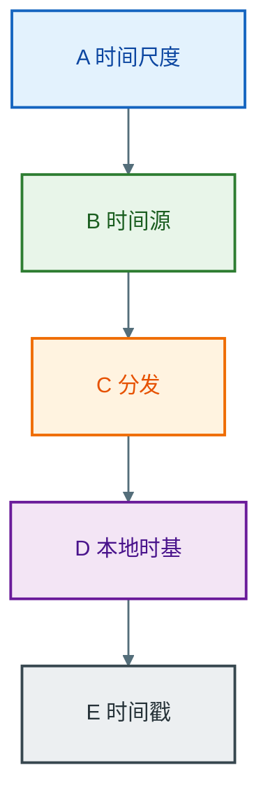
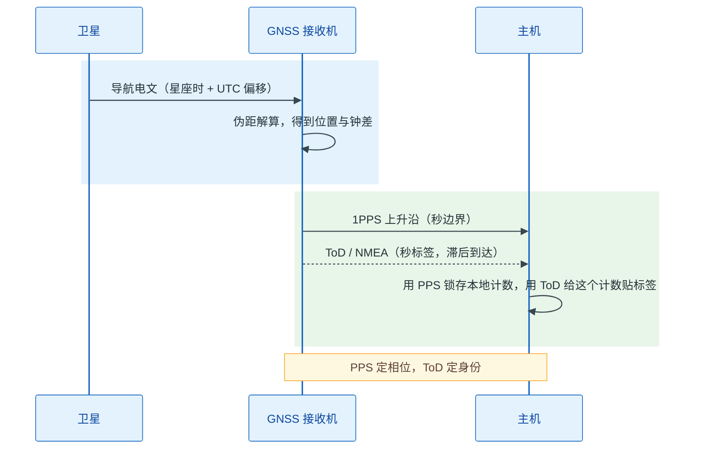
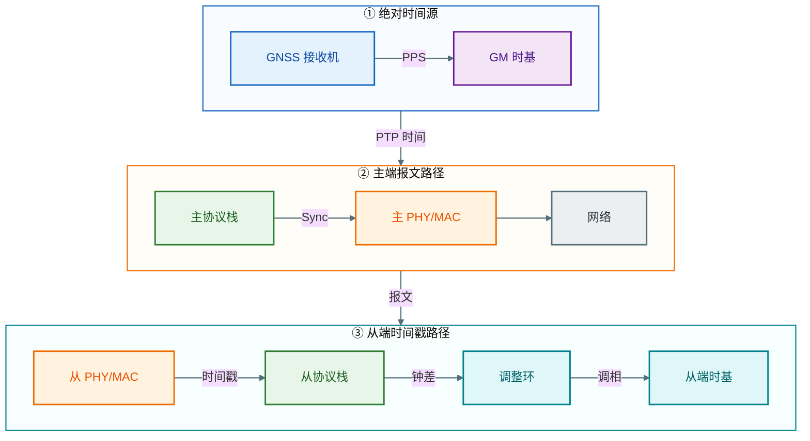
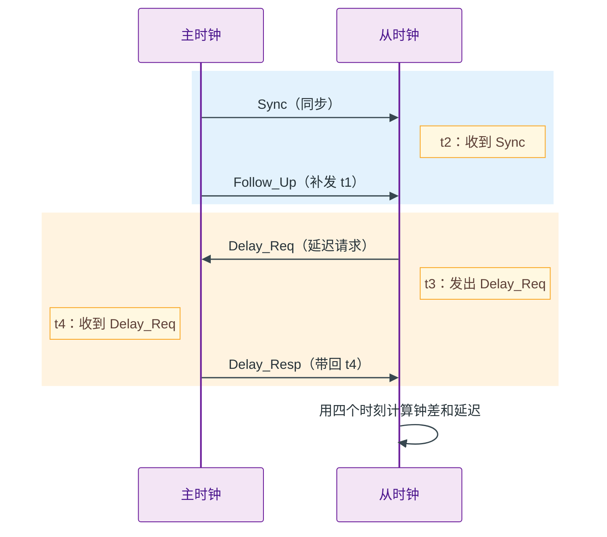
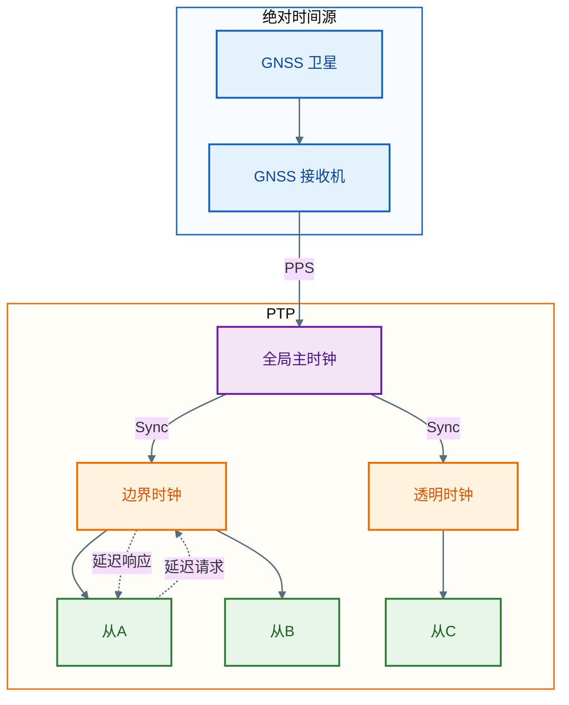

# GNSS 与 PTP 时间同步原理：嵌入式软件工程师视角

> **概述：** 对嵌入式软件工程师来说，GNSS 与 PTP 不是两种可以互相替代的对时技术。GNSS 把本地时间锚定到 UTC/TAI，PTP 把这个时间在局域网内测量、分发并保持。本文从原理层解释三件事：GNSS 如何从卫星钟得到绝对时间，PTP 如何用 4 个时间戳测量主从偏差，以及两者组合后误差和失效从哪里来。文章回答：什么时候 PTP 锁定不等于绝对时间可信，37 秒偏差属于哪一层，精度瓶颈在时间源、链路还是本地时基。

## 1. 时间同步的基本模型

时间同步有三个层面，工程上常混在一起说。

嵌入式软件工程师要定三件事：时间戳在哪个硬件点锁存，系统时基由哪个时钟维护，失效时用什么字段判断时间还能不能用。GNSS 与 PTP 的差别，最后都反映到这三个选择上。

频率同步让两个时钟的秒长一致；相位同步让两个时钟的秒边沿对齐；绝对时间同步还要求这个秒边沿对应 UTC 或 TAI 的某一秒。频率同步是后两者的基础：频率不一致，相位会持续漂移；相位对齐了但频率不准，过一段时间又会偏。绝对时间则多了一层“时间尺度”问题，数值相同不代表含义相同。

描述误差时用三个量：offset 是某一时刻的相位差，skew 是频率差，drift 是频率差随时间的变化。描述控制动作时用 step 和 slew：step 是直接把时钟拨到目标值，slew 是缓慢调整频率让时钟追上。描述运行模式时用 holdover，表示失去参考后靠本地振荡器维持。它们不在同一分类维度上，不能并列成“三种同步方式”。

时间尺度是绝对时间同步的前提。UTC 是民用时间，包含闰秒；TAI 是连续原子时，不含闰秒；GNSS 星座通常使用自己的连续时间尺度，再广播与 UTC 的偏移。截至 2026 年，主要关系如下。

| 时间尺度 | 是否含闰秒（截至 2026 年） | 与 UTC 的关系 | 说明 |
|---|---|---|---|
| UTC | 是 | 0 | 民用时间基准，历史上通过闰秒与地球自转对齐 |
| TAI | 否 | TAI − UTC = 37 s | 连续原子时，PTP timescale 的基准 |
| GPS 时 | 否 | GPS − UTC = 18 s | GPS − TAI = −19 s，固定不变 |
| Galileo GST | 否 | 名义上与 GPS 对齐 | 与 GPS 的偏差在纳秒到几十纳秒量级 |
| 北斗 BDT | 否 | BDT − UTC = 4 s | BDT = GPS − 14 s |
| GLONASS 时 | 是 | UTC(SU) + 3 h | 随 UTC 闰秒调整，与其他星座不同 |

2026 年 10 月 15 日，第 28 届国际计量大会通过决议，自 2027 年 5 月 20 日起实施连续 UTC：不再插入闰秒，`|UT1 − UTC|` 的最大允许值放宽到 3600 秒。此后 TAI − UTC 保持 37 秒，GPS − UTC 保持 18 秒，直到未来重新定义。本文讨论闰秒，必须带这个日期，不能继续写“闰秒会每隔几年插入一次”。

从时间源到业务时间戳，可以抽象成五层。



在这五层中，GNSS 解决 B 层的“绝对时间从哪里来”，PTP 解决 C 层的“如何在局域网内测量并复制”，D 层和 E 层决定“复制过来的时间如何变成业务事件的时间标签”。E 层还可以再分三种语义：事件时间，是事件真正发生的时刻；到达时间，是报文或数据到达主机的时刻；可用时间，是这个时间戳在多长窗口内仍然可信。PTP 同步的是本地时基，不自动保证业务时间戳取的是事件时间。很多现场问题不是协议没工作，而是把不同层混为一谈。

PTP 时钟也有时间尺度属性。`ptpTimescale=true` 表示 PTP timescale，即从 PTP epoch（1970-01-01 TAI）起、用 TAI 秒计量的连续时间；`ptpTimescale=false` 表示 ARB，任意时间尺度。UTC 不是 `ptpTimescale` 的一个直接取值，而是通过 `currentUtcOffset`（TAI − UTC）换算出来的，PTP timescale 下 `UTC = PTP time − currentUtcOffset`。工程上常把 ARB 约定为 UTC，但这是约定，不是标准保证。除此之外，`currentUtcOffsetValid` 表示偏移是否有效，`timeTraceable` 和 `frequencyTraceable` 表示时间与频率是否可溯源到主参考。判断“这个 PTP 时间是不是 UTC”，不能只看 `ptpTimescale`，要把这几个字段一起看。

## 2. GNSS 授时原理

GNSS 卫星携带原子钟，持续广播导航电文。电文里有卫星的轨道参数、钟差参数、时间信息和星座时与 UTC 的偏移。接收机同时接收多颗卫星的信号，测量信号从卫星到接收机的传播时间，再用传播时间乘光速得到伪距。

伪距可以写成：

`ρ = c(t_rx − t_tx) = ||r_sat − r_rx|| + c(δt_r − δt_s) + I + T + ε`

其中 `r_sat` 是卫星位置，`r_rx` 是接收机位置，`δt_r` 是接收机钟差，`δt_s` 是卫星钟差，`I` 和 `T` 是电离层与对流层延迟，`ε` 是多径和噪声。接收机要同时解出三维位置和接收机钟差，四个未知量至少需要四颗卫星。授时型接收机通常把位置固定为已知值，或者先做 survey-in，再进入 timing mode，用更少的卫星维持时间解。

这里有一个常见误解：GNSS 卫星并不直接广播 UTC。卫星广播的是星座时，接收机根据导航电文里的 UTC 参数和闰秒信息换算成 UTC。GPS、北斗、Galileo、GLONASS 的时间尺度各不相同，多星座接收机必须分别处理。把“GNSS 时间”直接当成 UTC，会把 18 秒、4 秒、3 小时和 37 秒混在一起。

接收机对外通常输出两类时间信息：1PPS 和 ToD。1PPS 是每秒一次的硬件脉冲，有效边沿标记秒边界；ToD（Time of Day）是“这是哪一秒”的时刻标签，通常由 NMEA 语句或二进制协议给出。两者的时序关系如下。



正确的用法是“PPS 定相位，ToD 定身份”：PPS 给出秒边沿，ToD 说明它对应 UTC 的哪一秒。主机在 PPS 有效边沿锁存本地计数器，随后到达的 ToD 只是给这个计数贴标签。不能拿 ToD 的到达时刻去设置系统时钟，因为串口传输、驱动调度和解析都会引入延迟；1PPS 到 NMEA 起始位的延迟，就是 PPS 边沿到 NMEA 语句第一个字符开始发送的时间差，可到几百毫秒，抖动可到十毫秒级。这样的时间只能粗对齐，不能作为纳秒源。

MCU/SoC 上，PPS 通常接定时器捕获引脚，ToD 走 UART。软件读捕获寄存器，不要在中断里读系统 tick；中断延迟和串口解析不应进入秒边界测量。

1PPS 的精度也不是无条件的。开阔天空、多星座、良好天线、已知位置、电缆延迟已补偿时，常见模块的 1PPS 可以做到几十纳秒量级；授时型接收机可以更好。天线遮挡、多径、干扰、单星座、未校准的电缆延迟都会让精度退化。电缆延迟大约按 5 ns/m 计算，30 米电缆就是 150 ns，已经超过很多“纳秒级”预算。接收机内部的钟差解算、RAIM 完好性监测和天线相位中心偏差也都要计入。

GNSS 失锁后，接收机进入 holdover，靠本地振荡器维持时间。漂移量可以用一阶模型估算：

`Δt = (Δf / f) × t`

1 ppm 的频率误差对应 1 微秒每秒，10 ppb 对应 1 微秒每 100 秒，1 ppb 对应 1 微秒每 1000 秒。实际还会叠加温度、老化和校准误差。holdover 不是“继续精确授时”，而是“在预算内维持一段时间”。这段时间有多长，取决于振荡器等级和允许的绝对误差。

## 3. PTP 测量原理

PTP 要回答两个问题：我这台设备的钟比主时钟快多少，报文在路上走了多久。做法是主从双方各记两个时刻，凑成四个时间戳。

主时钟先发 Sync（同步）报文，从时钟记下收到它的时刻；从时钟再发 Delay_Req（延迟请求），主时钟记下收到它的时刻，并回一个 Delay_Resp（延迟响应）。把主时钟想成发令员，从时钟想成运动员：t1 是发令枪响，t2 是运动员听到枪声，t3 是运动员回喊，t4 是发令员听到回喊。t1、t4 在主时钟侧记录，t2、t3 在从时钟侧记录。

PTP 报文分两类：需要精确时间戳的事件报文（event message），和只负责带信息的通用报文（general message）。前者只有四种，后者带时间戳、选主和管理信息。

| 类别 | 报文 | 是否需要精确时间戳 | 作用 |
|---|---|---|---|
| 事件报文（event） | Sync、Delay_Req、Pdelay_Req、Pdelay_Resp | 是 | 参与链路延迟和相位测量 |
| 通用报文（general） | Follow_Up、Delay_Resp、Pdelay_Resp_Follow_Up、Announce、Signaling、Management | 否 | 携带时间戳、选主信息或管理信息 |

### 报文在哪里打时间戳

PHY 和 MAC 不是 PTP 的时间源，只决定报文在哪个位置打时间戳。PHY 时间戳靠近线缆，抖动最小，但需要驱动配置和收发延迟校准；MAC 时间戳在网卡侧，工程上更常见；软件时间戳在协议栈或应用层读取系统时间，抖动最大。协议可能显示锁定，但软件时间戳算出的钟差会把协议栈和调度延迟一起算进去。

GNSS 与 PHY 要分开看。GNSS 的 1PPS 是秒边沿，ToD 是秒标签，通常接主时钟的 PPS 输入或驯服环，不直接同步 PHY 时钟。PPS 只提供相位参考，频率仍靠本地振荡器和驯服环。PHY 的硬件时间戳负责报文收发时刻：一个解决“时间从哪来”，一个解决“报文什么时候到”。



两步模式下，Sync 先走，主时钟事后用 Follow_Up 把精确发送时刻 t1 补回来；一步模式则在报文发出时直接把 t1 写进 Sync。一步和两步不是谁更准，而是时间戳写入方式不同。Follow_Up 是“补一张写明发车时间的便签”，不是第二个同步报文。

标准 4 时间戳的时序如下。



四个时刻分列主从两侧；时间戳点不同，含义不同。先确认参考面，再比较钟差。

先算出去程和回程各自扣掉中转补时后的时间差：

```text
去程 = t2 - t1 - 去程补时
回程 = t4 - t3 - 回程补时

钟差 = (去程 - 回程) / 2
单程延迟 = (去程 + 回程) / 2
```

去程等于“单程延迟 + 钟差”，回程等于“单程延迟 - 钟差”，所以相减得到钟差，相加得到延迟。

两种补时来自报文里的 correctionField，可以理解为“补时栏”。交换机转发报文时，把在本设备里排队、转发花掉的时间写进去；没有它，这些停留时间会被误认为链路延迟。它是 64 位有符号定点数，单位是 2^-16 ns，工程上按纳秒理解即可。点对点透明时钟还会把相邻链路的延迟一起补上。

上面的算法假设去程和回程一样快。如果去程比回程多 1 微秒，算出来的钟差就会固定偏 500 纳秒；多测几次也消不掉，因为它是固定偏差，不是随机抖动。工程上的办法无非是：把打戳点靠近线缆、让透明时钟补停留时间、用边界时钟把长链路分段，或者手动填一个链路不对称补偿值。

算出来的单程延迟是平均值，不是某一条报文的瞬时延迟。队列抖动、突发流量和中断合并会让单次样本偏离，调整环（servo）需要用滤波和多次采样把随机部分压下去。随机抖动可以靠统计降低，固定不对称不能。

E2E（端到端）是从时钟直接量到主时钟的整条路；P2P（逐跳）是每两台相邻设备各量一段，用 Pdelay 系列报文。P2P 要求路径上每台设备都支持，普通交换机通常用 E2E。两者只是测量范围不同。

## 4. PTP 分发原理

PTP 分发要先解决“听谁的”。网络里可能有多台设备都能当时间源，PTP 用 BMCA（最佳主时钟算法）自动选出一个 grandmaster（全局主时钟）。grandmaster 是全网最终的时间源头；master 和 slave 是端口角色，不是设备身份。一个边界时钟的上游端口可以从属，下游端口可以当主。

选主靠 Announce（公告）报文。每台设备周期性地报出自己的优先级、时钟等级、精度、稳定性和唯一 ID。比较时先看人为设定的优先级，再看时钟等级、精度和稳定性，最后用唯一 ID 决胜；同一个 grandmaster 有多条路径时，经过跳数少的优先。不同 profile（协议套餐）的规则略有差异，但核心都是“谁的时钟质量更好、路径更短，就听谁的”。时间来源字段只做说明，不能靠“这台设备接了 GNSS”自动决定谁当选。

Profile 是“协议套餐”，transport 是底层传输方式。IEEE 1588 默认套餐可跑 UDP/IPv4、UDP/IPv6 或二层网络（L2）；gPTP 是 IEEE 802.1AS 套餐，通常用 L2、P2P、两步和 125 ms 的 Sync 周期。别把 gPTP 和 L2 并列成传输方式：gPTP 是套餐，L2 是传输层。

PTP 设备按角色分三类。普通时钟（OC）只有一个 PTP 端口，要么当主，要么当从；边界时钟（BC）有多个端口，上游当从、下游当主，相当于把长链路分成几段；透明时钟（TC）不参与对时，只在转发时把停留时间写进 correctionField，相当于在报文上贴一张“我在这里排了多久”的便签。边界时钟每段都要重新锁一次，会引入自己的噪声；透明时钟不改变时间，但要求路径上每台设备都支持。

PTP 拓扑如下图。



图中的“从A、从B、从C”是从时钟节点。软件上，BC 需要完整协议栈和调整环，TC 只修正 correctionField，两者不是同一种设备。

从时钟收到钟差后，不会直接把表拨过去。它先调频率，让秒长和主时钟一致；再慢慢调相位，让秒边沿对齐。偏差大或刚启动时才直接拨表（step），平时用 slew（慢慢调快或调慢）。锁定后如果主时钟丢了，就进入 holdover（保持模式），靠本地晶振继续走，误差按 ppm 累积。

PTP 显示“锁定”只说明本地时基跟主时钟一致，不代表绝对时间正确。主时钟可能丢了 GNSS，正在 holdover；时间尺度可能不是 UTC；UTC 偏移可能无效；链路可能存在固定不对称；应用可能拿报文到达时间当事件时间。判断要按源、协议、调整环、应用四层看：源是否可溯源，协议是否锁定，调整环是否收敛，应用时间戳是否在事件点采集。上一层不成立，下一层 offset 再小也没意义。

## 5. GNSS 与 PTP 的协同原理

GNSS 与 PTP 是串联关系，不是并列关系。GNSS 把 grandmaster 的时间锚定到 UTC/TAI，PTP 把这个时间复制到局域网内的每个节点。GNSS 失锁后，grandmaster 进入 holdover，PTP 仍然可以维持域内一致，但绝对时间会按本地振荡器的 ppm 漂移。此时“PTP 锁定”和“绝对时间可信”是两个不同的问题。

GM holdover 和 slave holdover 要分开看。GM 失去 GNSS 后仍能用本地振荡器继续发 PTP，域内节点仍然一致，但整个域相对 UTC 在漂移；slave 失去 PTP 后只能靠自己的振荡器保持，漂移速率取决于 slave 的晶振和上次锁定的频率。两者叠加，才是业务时间戳的绝对误差。

描述一条时间链路，建议用三个轴，而不是“绝对/相对”二分。

第一是时间尺度：数值是 UTC、TAI 还是 ARB。第二是溯源：时间是否可追溯到 GNSS、原子钟、上级 PTP 或 NTP，`timeTraceable` 和 `frequencyTraceable` 是否成立。第三是分布：GM 到 slave 的拓扑、经过哪些 BC/TC、使用 E2E 还是 P2P。三个轴都清楚，才能回答“这个时间戳代表什么”。

误差也应按性质分类，而不是只给一个“精度”数字。系统误差包括天线电缆延迟、PHY 收发不对称、时间戳点与参考面的偏差、correctionField 未覆盖的驻留时间或不对称；随机误差包括交换机排队、时间戳抖动、晶振相位噪声；量化误差包括 PPS 边沿分辨率、计数器 tick、correctionField 的 `2^-16 ns` 单位。系统误差不能靠平均消除，随机误差可以靠滤波和统计降低，量化误差要靠更高分辨率的时间戳或计数器。把它们混成一个均方根合成的数字，往往会低估固定偏差。

以激光雷达为例。激光脉冲发射时，信令处理模块记录的是本地计数器，不是 UTC；PTP 把本地时基同步到主时钟，业务层再用“计数器—时间”的映射把发射时刻换算成 UTC。关键原理是：时间戳必须在事件发生的时刻锁存，不能用报文到达时间或事后读取的系统时间代替。这套判断对车载、工业和机器人控制器同样成立。映射实现、PHC 与系统时钟的同步、状态机与排查，属于工程层，见 [PTP 网络模块设计：车载传感器的授时链路](https://deguiliu.github.io/tech-notes/posts/architecture/ptp_network_module_design/)。

结论可以归为四点：

- GNSS 提供绝对时间锚点，PTP 提供局域网内的测量与分发，两者不能互相替代。
- PTP 用 4 个时间戳解 offset 和 delay，correctionField 修正驻留时间，链路不对称是精度下限的主要来源之一。
- PTP 锁定只证明本地时基与主时钟一致；绝对时间是否正确，要看时间尺度、溯源和 UTC 偏移。
- 误差要区分系统偏差、随机抖动和量化误差；holdover 的漂移按 ppm × 时间累积，不能用“能撑多久”一句带过。

工程实现、状态机与排查细节属于工程层，本文只保留原理层，不再展开。

## 相关文章

- [PTP 网络模块设计：车载传感器的授时链路](https://deguiliu.github.io/tech-notes/posts/architecture/ptp_network_module_design/)
- [Linux 编程：嵌入式 ARM 平台 Linux 网络实时性能优化](https://deguiliu.github.io/tech-notes/posts/performance/arm_linux_network_optimization/)

## 附录：参考资料

- [IEEE Std 1588-2019](https://standards.ieee.org/standard/1588-2019.html)，Precision Time Protocol
- [IEEE Std 802.1AS-2020](https://standards.ieee.org/standard/802_1AS-2020.html)，Timing and Synchronization for Time-Sensitive Applications
- [linuxptp 文档](https://linuxptp.nwtime.org/documentation/)，`ptp4l(8)`、`phc2sys(8)` 与默认配置
- [BIPM Resolution 5 (2026)](https://www.bipm.org/en/cgpm-2026/resolution-5)，第 28 届国际计量大会关于连续 UTC 的决议，2026-10-15
- [IERS Data Center](https://datacenter.iers.org/)，闰秒公告与地球自转数据
