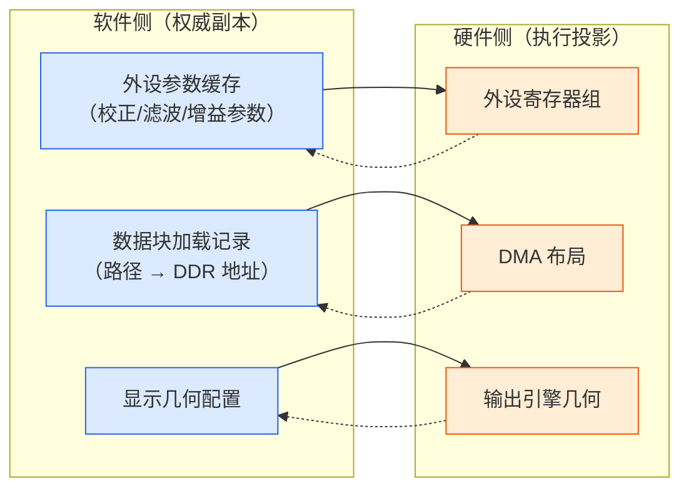
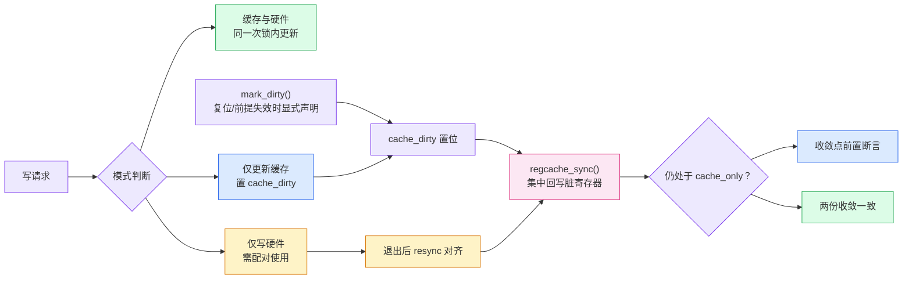
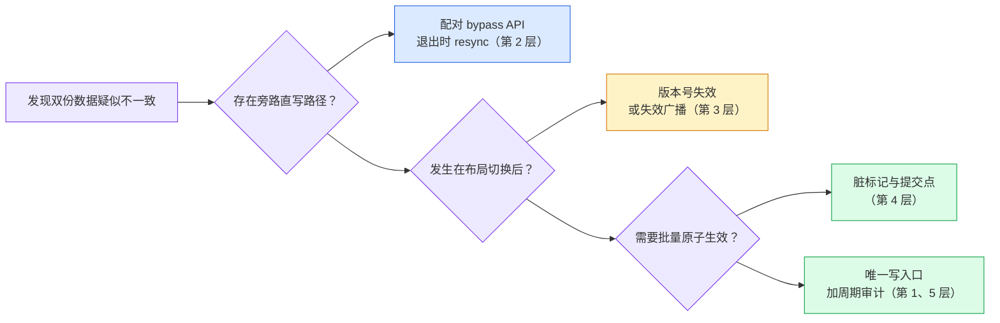

结论先行：软件缓存与硬件状态可以保留两份，但只能有受控的写入口和明确的收敛点。默认写穿、旁路退出后对账、布局变化时使旧记录失效、同步失败时保留脏标记，才能避免旧参数回灌、废弃地址复用和坐标错位。

## 双份状态与延迟故障

嵌入式设备的典型状态存放结构，缓存与硬件各存一份，各有职责：缓存快（读不走总线）、可审计、设备掉电后凭它恢复现场；硬件寄存器是真正驱动行为的执行层。问题不在「存两份」，而在**更新一份时另一份没跟上**。



正常路径（改缓存、下发硬件）通常没人写错。出事的是三类旁路场景：

| 场景 | 谁更新了 | 谁没跟上 | 后果 |
| --- | --- | --- | --- |
| 调试/测试模式直写寄存器 | 硬件（旁路） | 软件缓存 | 退出后全量下发回灌旧值 |
| 布局/模式切换 | 新布局（重算） | 旧地址记录缓存 | 后续访问读到废弃地址 |
| 几何变换（镜像/翻转） | 显示路径 | 业务坐标（检测点） | 检测位置与画面错位 |

### 三类典型故障

以下场景为构造的典型情形，细节做过合并与简化，但每一类都对应实际项目中反复出现的故障模式。

#### 参数回灌：直写寄存器后缓存未同步

某成像设备进入产测模式时，产测程序绕过正常参数接口，直接写图像处理器（ISP）寄存器，修改校正坐标与坏点补偿参数来验证成像效果。测试通过、退出产测模式时，没有人把寄存器当前值抄回软件缓存，两份数据从此分叉。

几天后现场复现：用户切换工作场景，业务层触发**全量参数下发**：软件把缓存里存的（产测之前的）旧值原样重发给 ISP，产测调好的校正参数被静默覆盖，且污染同时下发的其他参数，成像异常但日志无任何报错。

这类故障的排查难点在于**因果在时间上分离**：直写那一刻设备工作完全正常，故障在数天后的某次普通操作中出现，没有人会联想到产测时那次旁路写。

#### 废弃地址：布局重算后旧记录未作废

DMA 布局是「DDR 里哪块区域归谁用」的分配表；系统还有一个「数据块加载记录」缓存：每加载一个数据文件（标定表、查找表等），就记下「文件名 → 已加载 → DDR 地址」，下次要用同一个文件时直接复用旧地址，跳过重复加载。

用户切换预览模式（如双流改单流）后布局重算：某个数据块（如统计分析表）的存放地址从 A 挪到了 B，DDR 里的旧区域分配给了别的模块。但加载记录里「该数据块已加载 @ 地址 A」这条没人清。下次使用该数据块时按文件名查记录、命中、直接使用地址 A，而 A 处的内容已经是其他模块的数据，读到的是废弃数据，出图错乱。


#### 坐标失同步：画面与检测框错位

用户在设置里打开水平镜像。显示路径更新了几何配置，画面实时左右翻转，看起来一切正常。但检测点/线/矩形框的坐标仍是翻转前的原值：画面里目标移到了左侧，检测框还指着右侧的老位置。分析读数对应的是错误的像素区域，结果不再可信：这是用户可见、且直接损害核心功能可信度的错位。

三类坐标全部中招：点坐标（x 未按 width-1-x 变换）、线段（起止点未交换）、矩形（角点未归一化变换）。

#### 共性根因与解法入口

三个场景形态不同，结构相同：**存在 A、B 两份记录同一事实的数据，A 更新后 B 未同步，且故障延迟出现**。它们不是内存错误、不是并发错误，是**双份状态之间缺少同步协议**。

Linux 内核对这个问题给出的答案是 regmap/regcache 子系统：**三个状态标志 + 一个集中收敛点**，把缓存与寄存器的同步做成结构保证。下节直接以它的机制为骨架展开解决方案。

```
bool cache_only;    /* Cache writes only; keep accounting while hardware is off. */
bool cache_bypass;  /* Hardware writes only in a controlled bypass mode. */
bool cache_dirty;   /* Cached changes have not reached hardware. */
```

## regmap 风格的同步协议

### 将同步理解为 redo-only 事务

细看这套机制，会发现它本质上是一套**事务（transaction）**：脏标记是未提交事务，sync 是 commit，失败靠重试收敛。与数据库 ACID 逐项对照：

| 事务要素 | 数据库 | 本文档的同步协议 | NAND 块写入 RMW（同类实现） |
| --- | --- | --- | --- |
| 原子（Atomicity） | commit / rollback | 锁内写穿；sync 集中回写 | 设备锁内读整块-改-写回 |
| 隔离 | 锁 / MVCC | 两份更新在同一次锁内 | 设备锁 + 专用回写缓冲 |
| 持久 | WAL / redo log | 脏标记不清，sync 可重试 | 元数据双备份互为恢复源 |
| 一致 | 约束检查 | 收敛后两份相等 | 写后 CRC / 回读校验 |

概念映射：

```
数据库                          同步协议
─────────────────────────────────────────────────
begin / 事务开始        →  进入 cache_only 或 bypass 模式
未提交数据（暂存区）    →  cache_dirty 标记的脏寄存器
commit                 →  regcache_sync() 集中回写
外部把已提交数据改掉    →  设备复位（需要 mark_dirty 声明）
失败重做（redo）        →  sync 失败脏标记保留，下次继续
```

**关键差异：只有 redo，没有 undo。** 数据库事务失败可以 rollback（undo log 记着旧值，撤销本次操作）；同步协议做不到：寄存器写了一半失败，无法「回滚到写之前」，NAND 块擦了就是擦了，物理写操作不可逆。失败后只能**向前补偿**：用冗余副本（另一份缓存、双备份元数据）重做至收敛。这也是嵌入式介质上事务的普遍形态：**redo-only 补偿事务**：接受操作不可逆，靠重试收敛代替回滚撤销。

明白这一层，几个设计选择就顺理成章：sync 的收敛断言（防止在未真正写入状态下「假装 commit」）对应数据库 commit 前的约束检查；审计层对应对账（reconciliation）；而「旁路标志必须配对」对应事务必须显式结束，不允许悬挂事务。

理解了事务这一层，regmap 的具体机制就好读了：写请求统一进入模式判断，三种模式各有明确语义，所有未收敛状态最终汇聚到 `regcache_sync()` 一个收敛点。整套机制如下：



### 写穿：默认路径只留一个写入口

```
int periph_cfg_write(cfg_cache_t *cache, uint32_t reg_id, const uint32_t val)
{
    int ret = periph_hw_write(reg_id, val);      /* Write the hardware first. */
    if (ret == 0) {
        cfg_cache_store(cache, reg_id, val);     /* Update the authoritative copy only after success. */
    }
    return ret;   /* Keep both updates in one function. */
}
```

对应 regmap 的默认写路径：缓存与硬件在**同一次锁内**先后更新。要点：缓存是**权威副本**，寄存器是它的执行投影。「单一事实来源」不是消灭镜像（物理上必然两份），而是**保证镜像只能通过权威同步产生**。代码审查把「绕过 set 接口直接调寄存器写」列为违规，旁路类缺陷从结构上无法发生。

这直接化解案例 2.1 的第一半：正常路径不可能产生不一致。

### `cache_bypass`：受控收编旁路写

产测/调试场景堵不住直写，regmap 的做法不是禁止，而是**合法化为显式模式**：

```
int direct_mode_begin(void);   /* Enable cache_bypass; subsequent writes reach hardware only. */
int direct_mode_end(void);     /* Clear bypass and resynchronize the cache. */
```

旁路必须**配对使用**：进入置标志、退出时把硬件值读回缓存（resync），两个动作封装在同一抽象层级，业务代码不允许直接操作标志位。互斥约束由运行时断言守卫：regmap 在模式设置函数里放了 `WARN_ON(cache_only && cache_bypass)`，模式组合的合法性检查放在运行时第一线，比 code review 更可靠。

这化解案例 2.1 的第二半：必须存在的旁路不再失控，退出即对账。

### `mark_dirty` 与版本号：显式声明前提失效

regmap 的 `regcache_mark_dirty()` 语义（内核文档原话大意）：**设备断电或复位后，寄存器回到默认值；调用此函数声明这个前提失效，下次 sync 会把缓存里所有非默认值重写。不调用它，sync 假设硬件与缓存一致。**

这个判断对地址/布局类缓存同样成立，且有两种等价实现：

```
/* Option 1: explicit invalidation, regmap style. */
void dma_layout_rebuild(dma_layout_t *lay)
{
    dma_layout_compute(lay);
    cache_invalidate_all();        /* Declare that the prior assumption is invalid. */
}

/* Option 2: versioning prevents missed invalidation. */
int block_cache_query(block_cache_t *c, const char *name, cache_ent_t *out)
{
    cache_ent_t *e = block_cache_find(c, name);
    if ((e != NULL) && (e->version != c->layout_version)) {
        block_cache_drop(e);       /* A version mismatch makes the record stale. */
        return -1;                 /* Force the reload path. */
    }
    ...
}
```

显式声明更显式，版本号更防漏（布局变了，任何旧记录**查一次就自动作废**，忘了清也不会命中）。地址类缓存推荐版本号，因为依赖方会持续增加，靠人记得调用不可靠。

这化解案例 2.2：布局重算后旧地址记录必然作废。

### `cache_only` 与脏标记：在提交点收敛

设备不可写（掉电、冻结）期间，写操作只进缓存并置 `cache_dirty`，返回成功；恢复后 `regcache_sync()` 统一回写所有脏寄存器。两个关键细节：

* **sync 是电源管理恢复路径的固定步骤**，不是可选优化；
* **收敛点自带前置断言**：sync 时若仍处于 cache\_only 模式直接 `-EINVAL` 拒绝，防止「在未真正写入的状态下做同步」。

帧级配置天然需要这个语义：参数必须在帧边界原子生效，冻结窗口就是现成的提交点（脏标记在冻结期累积，解冻时一次性收敛两份）。

### 镜像审计：发现未知旁路

```
void cfg_cache_check(const cfg_cache_t *cache)  /* Run periodically in debug builds. */
{
    uint32_t reg_val;
    for (uint32_t id = 0; id < REG_ID_MAX; id++) {
        periph_hw_read(id, &reg_val);
        if (cfg_cache_load(cache, id) != reg_val) {
            log_warn("cache drift: reg %u cache=0x%x hw=0x%x", id, ...);
        }
    }
}
```

只报警不修复，把延迟出现的漂移**提前到当场暴露**，用于发现未知的旁路写。

### 写失败时撤销缓存承诺

regmap 的一个容易被忽略的细节：硬件写失败时，主动把该寄存器从缓存**剔除**（drop），不留「缓存说成功、硬件是旧值」的中间状态。失败路径的一致性是多数自研代码的缺失环节。

## 分层防护与场景选型

上述机制不是六选一，而是分层组合，各自守住一类漏洞：


### 选型对照

| 场景 | 首选层 | 理由 |
| --- | --- | --- |
| 参数/配置（寄存器与缓存） | 1 + 3 | 参数写入频繁、旁路少，收口写入口最划算 |
| 地址/DMA 布局依赖 | 3（版本号版） | 布局变化低频、依赖方持续增加，版本号免维护 |
| 调试/产测直写寄存器 | 2 | 旁路必须存在，受控为配对 API |
| 帧级/批量配置 | 4 | 需要「原子生效」语义，冻结窗口是现成提交点 |
| 多模块依赖同一资源 | 3（广播版） | 失效回调注册表把「谁受影响」集中可见 |

### 失败路径的一致性

三个必须处理的点：

1. **硬件写失败**：缓存不更新（或回滚已更新部分），不留「缓存说成功、硬件是旧值」的中间状态；
2. **resync/sync 中途失败**：脏标记不清，下次还能重试收敛；
3. **旁路写后异常退出**：bypass 状态残留在全局标志里。标志的设置与清除必须配对且放在同一抽象层级，不允许业务代码直接操作标志位。

### 从编译期到评审的强制手段

机制再好，绕过它一行代码就能让它失效。让开发人员真正使用这套机制，靠五层强制手段，按拦截时机排列。其中 ① 和 ③ 展示了 C 语言如何借鉴 C++ 的 `private` 访问控制与 RAII 配对保障：这些手法不依赖语言特性，只依赖代码组织方式，嵌入式 C 项目可直接照抄。

**① static 私有化（编译期，最强）**：头文件不导出裸地址。

等价于 C++ `private` 的访问控制。寄存器基地址与原始读写全部 `static` 私有化，收敛到一个驱动 `.c`；头文件只导出窄接口。其他模块 `#include` 头文件后既看不到 `REG_BASE` 也调不到 `periph_hw_write`（两者均无外部符号），裸写代码**编译不过、链接失败**：

```
/* periph_drv.c: the only file allowed to access registers. */
static volatile uint32_t *REG_BASE = (void *)0x40021000;  /* Raw address stays private. */

static int periph_hw_write(uint32_t reg_id, uint32_t val) /* Raw writes stay private. */
{
    REG_BASE[reg_id] = val;
    return 0;
}
```

```
/* periph_drv.h: exports neither addresses nor raw-write symbols. */
int periph_cfg_write(uint32_t reg_id, uint32_t val);    /* The only cached write entry. */
int direct_mode_run(const reg_op_t ops[], uint32_t n);  /* Controlled bypass. */
```

与 C++ 的唯一差距：`friend` 能精细授权个别类访问 private，C 做不到（全有或全无），驱动场景下无感。

**② 运行时断言（regmap 的选择）**。堵不死就检测。断言放在机制函数**内部**而非依赖调用方自觉：非法状态组合（bypass 期间调 set 接口、非配对者调 end）出现时立刻 abort 并打印调用栈。调试期断言开到最响，量产版降级为错误码返回。

**③ 回调封装（写代码时）**：语法上防漏调。

借鉴 RAII 的本质：**把 begin/end 从业务代码手里拿走**（C 借不了析构函数，但能借这个思路）。框架一体承担进入与退出，错误路径走同一出口，业务「漏掉配对调用」在语法上不可能发生：

```
/* periph_drv.c */
typedef struct {
    uint32_t reg_id;
    uint32_t val;
} reg_op_t;

int direct_mode_run(const reg_op_t ops[], uint32_t n)
{
    int ret = direct_mode_begin();       /* The wrapper guarantees entry. */
    if (ret != 0)
    {
        return ret;
    }

    for (uint32_t i = 0U; i < n; i++)
    {
        ret = periph_hw_write(ops[i].reg_id, ops[i].val);  /* Raw writes remain private. */
        if (ret != 0)
        {
            break;                       /* Route every failure to one exit. */
        }
    }

    (void)direct_mode_end();             /* The wrapper guarantees exit on errors. */
    return ret;
}
```

业务侧用法对比：

```
/* Incorrect: manual pairing can omit end. */
direct_mode_begin();
raw_write(CROSS_X, 120U);       /* Business code must not access raw writes. */
if (err != 0) return;           /* direct_mode_end() is skipped. */

/* Correct: business code describes operations; the wrapper owns pairing. */
reg_op_t ops[] = {
    { CROSS_X, 120U },
    { NAB_TH,  0x3FU },
};
direct_mode_run(ops, 2U);
```

与 RAII 的差距：业务需要在循环中做条件判断/提前终止时，纯数组表达不了逻辑，需升级为函数指针回调（`int (*apply)(void *ctx)`，返回非 0 即中止），复杂度回升：这是本防线成本标「中」的原因。

**④ CI 门禁（提交时）**。把 5.1 节的审查清单脚本化：grep 寄存器地址/裸写符号在非驱动文件出现即拒绝合入。比 code review 可靠在于它是提交门禁，成本仅十几行脚本。

**⑤ 评审规则（评审时，最弱但必须有）**。评审 checklist 固化三条：新增寄存器写必须走 set 接口、新增缓存必须回答三个前提问题、直写需求必须封装成 direct\_mode API。同时给「合法旁路」留正门：性能原因必须裸写的场景，把它做成显式模式而不是逼人偷写，**堵不住的需求要给正门，否则一定有人走窗户**。

| 防线 | 拦截时机 | 成本 | 定位 |
| --- | --- | --- | --- |
| static 私有化 | 编译期 | 低 | 首选，立即做 |
| 运行时断言 | 运行时 | 低 | 随机制一起写 |
| 回调封装 | 写代码时 | 中 | 高风险路径（产测/烧录） |
| CI 门禁 | 提交时 | 低 | 随 CI 落地 |
| 评审规则 | 评审时 | 零 | 常态化兜底 |

排序原则：**能编译期拦住的不留到运行时，能运行时拦住的不留到评审，能评审拦住的不依赖自觉**。

## 审查、排障与参考资料

### 审查清单

三条 grep 就能覆盖大部分风险面：

```
① grep 所有「直写寄存器」的旁路调用点
   → 逐个确认：有配套的缓存回写或配对的 bypass API？

② grep 所有「改布局/改配置」的函数
   → 确认：尾部有缓存失效（版本号递增或失效广播）？

③ grep 所有「读缓存做决策」的路径
   → 确认：命中条件里包含前提校验（版本号/布局指纹）？
```

再加一条纪律：**新增任何「记录状态」的缓存时，同步回答三个问题**：它的前提是什么？前提变化时谁负责作废它？旁路写它对应实体时它怎么跟上？答不上来的缓存就是下一个故障案例。

### 排障决策树



### 结论与适用边界

* 一致性问题的本质不是「存了两份」，而是**两份之间没有同步协议**。消灭第二份不可行（物理必然），消灭第二个**写入口**可行且是根治手段。
* regmap 的解法骨架：**三模式写路径（写穿/cache\_only/cache\_bypass）+ 显式前提声明（mark\_dirty）+ 一个带断言的收敛点（sync）**。五层防护按成本递增，按场景各取所需。
* 三个设计判断值得记住：**旁路宜受控不宜禁止；前提失效必须显式声明；互斥模式用运行时断言守卫**。
* 最容易被忽略的是失败路径：写失败回滚、sync 中途可重试、旁路标志配对清除。一致性的漏洞往往不在主流程，而在错误处理的分支。

### Linux regmap/regcache 参考资料

* 源码（机制实现所在）：
  + [drivers/base/regmap/regcache.c ， regcache\_sync / cache\_only / cache\_bypass / mark\_dirty](https://github.com/torvalds/linux/blob/master/drivers/base/regmap/regcache.c)
  + [drivers/base/regmap/regmap.c ， 写路径三模式与失败回滚](https://github.com/torvalds/linux/blob/master/drivers/base/regmap/regmap.c)
  + [include/linux/regmap.h ， REGCACHE\_\* 类型与 API 声明](https://github.com/torvalds/linux/blob/master/include/linux/regmap.h)
* [Linux Kernel Documentation: Regmap](https://docs.kernel.org/driver-api/regmap.html)
