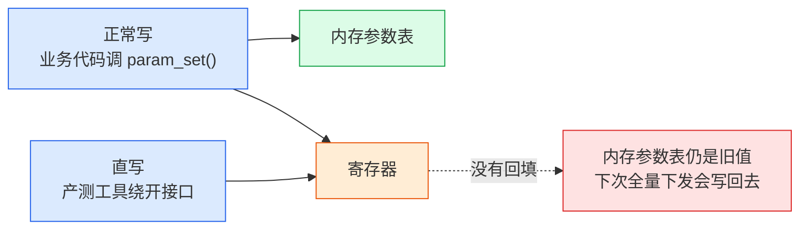
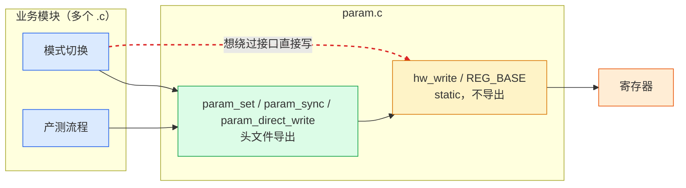
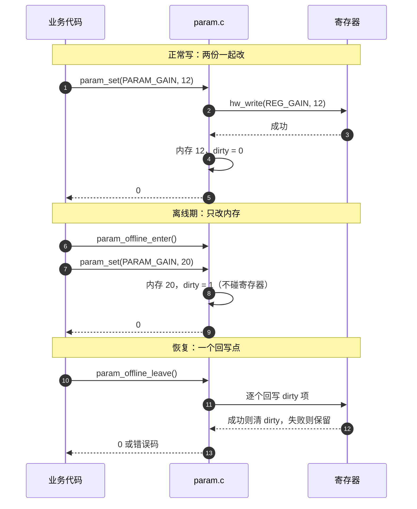
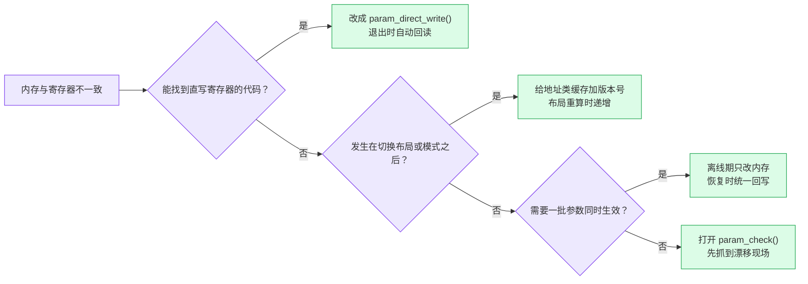

概述：本文讨论的不是 CPU cache line 一致性（MESI、总线侦听那套硬件机制），而是软件保存的一份参数与芯片寄存器里的那份如何保持一致。结论：两份都得留，但不能有第二个写入口。正常写走写穿（write-through，每次写都同时落到内存和寄存器），直写封装成成对接口，布局变化用版本号作废旧记录，设备不可写时只改内存并置脏，恢复后统一回写一次。

## 1. 两份数据，两个写入口

嵌入式设备的参数通常存两处：内存里一份，寄存器里一份。寄存器是芯片上按地址读写的一小块存储，写进去立刻影响硬件行为。内存那份给业务读，可以打日志、可以掉电后从配置文件恢复；寄存器那份真正生效，硬件按它工作。

存两份本身没有问题。寄存器访问要走总线，业务层每次读参数都去读寄存器，延迟和总线占用都不划算。问题出在写：只要存在第二个能改寄存器的入口，两份就可能分叉。

需要先划清边界：这里没有任何自动同步机制。CPU 的多核缓存一致性由硬件维护，改了数据不会出现「核 A 看到新值、核 B 看到旧值」；本文的场景里，两份数据怎么同步完全由软件决定，写错了不会有异常、不会有总线错误，只会在某个后续操作里静默地用错值。

把写路径画出来，分叉点一目了然：



*图 1：两条写路径。正常路径同时改两处；直写路径只改寄存器，内存那份从此是旧值，而且不会再有人发现。*

三个断点，对应三类反复出现的故障：

| 场景 | 谁改了 | 谁没跟上 | 后果 |
| --- | --- | --- | --- |
| 调试 / 产测直写寄存器 | 寄存器 | 内存参数表 | 退出后全量下发，旧值覆盖测试结果 |
| 布局或模式切换 | 新的地址分配 | 旧的地址记录 | 后续按记录取数，读到已被别人占用的区域 |
| 图像镜像 / 翻转 | 显示通路 | 检测框坐标 | 框与画面错位，读数对应错误的像素 |

## 2. 三个具体故障

以下场景为构造的典型情形，细节做过合并，但每一类都对应实际项目中反复出现的故障模式。代码是改造前的写法，函数名沿用项目里的习惯，第 3 节会给出收口后的版本；此时看到 `hw_write`、`g_param` 不必回头找定义。

### 2.1 直写寄存器后没有回填

产测程序绕过参数接口，直接写图像处理器的寄存器和坏点补偿参数，验证完退出。代码大致是这样：

```c
/* 产测工具：自己算好地址，直接写寄存器，内存参数表完全不知道 */
void factory_tune(void)
{
    REG_ISP_CORR_X = 120U;      /* 绕开 param_set() */
    REG_ISP_DPC_TH = 0x3FU;
}

/* 几天后，用户切换场景，业务层触发全量下发 */
void scene_apply(void)
{
    for (uint32_t i = 0U; i < PARAM_ID_MAX; i++) {
        hw_write(g_param[i].reg, g_param[i].value);   /* 写回产测之前的旧值 */
    }
}
```

产测当时设备工作完全正常，故障出现在数天后的另一个操作里。排查时没人会想到那次直写，因为从日志上看，出问题的操作只是「切换场景」。

### 2.2 布局重算后旧记录没作废

DMA 布局是「DDR 里哪块区域归谁用」的分配表。系统另有一张加载记录，每加载一个数据文件（标定表、查找表）就记下「文件名 → DDR 地址」，下次按文件名命中就直接复用：

```c
/* 布局重算：统计分析表的地址从 A 挪到 B，A 分给了别的模块 */
void dma_layout_rebuild(struct layout *l)
{
    layout_compute(l);          /* 新地址写进 l，旧地址 A 已被回收 */
}

/* 加载记录里仍是 A */
uint32_t block_addr(const char *name)
{
    struct block_entry *e = block_cache_find(&g_block_cache, name);

    if (e != NULL) {
        return e->addr;         /* 命中，拿到的地址 A 已经属于别人 */
    }
    return BLOCK_ADDR_NONE;
}
```

读取不报错、不出越界，只是内容错了：A 处现在是另一个模块的数据，画出来的图或算出来的统计值随之出错。

### 2.3 打开镜像后检测框没跟着翻转

用户在设置里打开水平镜像，显示通路更新了几何配置，画面立刻左右翻转。检测框的坐标却仍是翻转前的值：

```c
/* 显示通路的改动 */
void mirror_set(bool on)
{
    g_mirror = on;
}

/* 业务层把检测结果直接交给叠加层 */
struct rect to_screen(const struct rect *r)
{
    return *r;                  /* 没有按镜像做坐标变换 */
}
```

点、线、矩形三类坐标同时失效：点要按 `width - 1 - x` 变换，线段要交换起止点，矩形要按角点归一化后再还原。画面看起来正常，读数却对应错误的像素区域，比直接花屏更难发现。

修正后：

```c
struct rect to_screen(const struct rect *r)
{
    struct rect out = *r;

    if (g_mirror) {
        out.x1 = g_width - 1U - r->x2;
        out.x2 = g_width - 1U - r->x1;
    }
    return out;
}
```

### 2.4 三个故障的共同点

形态不同，结构相同：存在两份记录同一事实的数据，一份改了，另一份没人负责同步，且故障在时间上滞后。它们不是内存越界，不是多线程竞争，所以编译告警、ASan、锁检查都不会报，代码评审也很难看出来。

Linux 内核对同类问题给出了一套完整做法：regmap 的寄存器缓存（regcache）。它把「缓存和寄存器怎么同步」做成驱动框架的结构，而不是每个驱动各自发挥。下一节按它的思路写一个最小实现，代码可以直接照搬到自己的项目里。

## 3. 一个可用的实现

下面这个 `param` 模块把三种写入情形都收在一个文件里：正常写、直写、设备不可写时只记账。业务层只看到几个函数，不接触寄存器地址。

### 3.1 对外只暴露窄接口

```c
/* param.h：头文件里没有寄存器地址，也没有裸写函数 */
#ifndef PARAM_H
#define PARAM_H

#include <stddef.h>
#include <stdint.h>

#define PARAM_ID_MAX 64U

enum param_id {
    PARAM_GAIN = 0,
    PARAM_OFFSET,
    PARAM_NAB_TH,
    PARAM_CROSS_X,
    PARAM_CROSS_Y,
};

struct param_op {
    enum param_id id;
    uint32_t value;
};

int param_set(enum param_id id, uint32_t value);        /* 正常写：两份一起改 */
int param_get(enum param_id id, uint32_t *value);       /* 只读内存，不碰总线 */
int param_offline_enter(void);                          /* 设备不可写：暂停下发 */
int param_offline_leave(void);                          /* 恢复：回写并解冻 */
int param_sync(void);                                   /* 把所有未下发的项写出去 */
int param_direct_write(const struct param_op ops[], size_t count);  /* 直写 */
int param_check(void);                                  /* 调试用：比对两份 */

#endif
```

模块边界也随之确定：只有 `param.c` 能碰到寄存器，其他模块要么走这七个函数，要么链接失败。



*图 2：模块边界。红虚线那条调用在链接阶段就失败，不需要靠评审去发现。*

### 3.2 正常写：先写寄存器，成功了再改内存

写穿的顺序不能反。先改内存再写寄存器，一旦写失败，内存里就是一个从未生效的值。

```c
struct param_entry {
    uint32_t reg;       /* 寄存器偏移 */
    uint32_t value;     /* 内存里保存的值 */
    uint32_t dirty;     /* 尚未写入寄存器 */
    uint32_t valid;     /* 这条记录是否仍然可信 */
};

static volatile uint32_t *const REG_BASE = (void *)0x40021000U;
static struct param_entry g_param[PARAM_ID_MAX];
static uint32_t g_offline;
static uint32_t g_direct;

static int hw_write(uint32_t reg, uint32_t value)
{
    uint32_t rb;

    REG_BASE[reg / 4U] = value;
    rb = REG_BASE[reg / 4U];
    return (rb == value) ? 0 : -1;  /* 回读确认；只读位或写保护会在这里暴露 */
}

static int hw_read(uint32_t reg, uint32_t *value)
{
    *value = REG_BASE[reg / 4U];
    return 0;
}

int param_set(enum param_id id, uint32_t value)
{
    struct param_entry *e = &g_param[id];
    int ret;

    if (g_direct != 0U) {
        return -1;                  /* 直写期间禁止走正常接口 */
    }
    if (g_offline != 0U) {
        e->value = value;
        e->dirty = 1U;              /* 设备不可写，只记账 */
        e->valid = 1U;
        return 0;
    }

    ret = hw_write(e->reg, value);  /* 顺序：先硬件 */
    if (ret != 0) {
        e->valid = 0U;              /* 结果不确定，内存不再声称自己有效 */
        return ret;
    }
    e->value = value;               /* 成功后才更新内存 */
    e->dirty = 0U;
    e->valid = 1U;
    return 0;
}
```

写失败时把 `valid` 清掉，读路径就会退回寄存器取值：

```c
int param_get(enum param_id id, uint32_t *value)
{
    struct param_entry *e = &g_param[id];

    if (e->valid == 0U) {
        if (g_offline != 0U) {
            return -1;                  /* 设备不可读，回读只会拿到无效值 */
        }
        return hw_read(e->reg, value);  /* 内存这条不可信，直接问硬件 */
    }
    *value = e->value;
    return 0;
}
```

这让「内存说成功、寄存器是旧值」的中间状态无法长期存在。实际代码里整个函数要加锁，示例省略。

### 3.3 直写模式：进入和退出绑在同一个函数里

产测、调试场景堵不住直写，正确做法不是禁止，而是把它变成一个显式接口，让进入和退出同生共死。下面的代码假设初始化时已按 `id` 填好每项的寄存器偏移与默认值：

```c
static int direct_enter(void)
{
    if (g_offline != 0U) {
        return -1;                  /* 两种模式互斥，组合非法 */
    }
    g_direct = 1U;
    return 0;
}

static void direct_leave(void)
{
    uint32_t i;

    g_direct = 0U;
    for (i = 0U; i < PARAM_ID_MAX; i++) {
        if (g_param[i].reg != 0U) {
            (void)hw_read(g_param[i].reg, &g_param[i].value);   /* 回读，补上内存 */
            g_param[i].dirty = 0U;
            g_param[i].valid = 1U;
        }
    }
}

int param_direct_write(const struct param_op ops[], size_t count)
{
    size_t i;
    int ret = direct_enter();

    if (ret != 0) {
        return ret;
    }
    for (i = 0U; i < count; i++) {
        ret = hw_write(g_param[ops[i].id].reg, ops[i].value);
        if (ret != 0) {
            break;                  /* 出错也走同一个出口 */
        }
    }
    direct_leave();                 /* 无论成功失败，退出时都回读 */
    return ret;
}
```

业务侧只描述要做什么，配对由模块负责：

```c
/* 错误写法：手工配对，中途 return 就漏掉了退出 */
int cross_calibrate(void)
{
    int ret = direct_begin();

    if (ret != 0) {
        return ret;
    }
    raw_write(PARAM_CROSS_X, 120U);
    if (some_check() != 0) {
        return -1;                  /* 直写标志留在全局里 */
    }
    direct_end();
    return 0;
}
```

```c
/* 正确写法：只描述要写的项，进入与退出由模块负责 */
void cross_calibrate(void)
{
    const struct param_op ops[] = {
        { PARAM_CROSS_X, 120U },
        { PARAM_NAB_TH,  0x3FU },
    };

    (void)param_direct_write(ops, 2U);
}
```

示例在退出时回读了全部带偏移的项。寄存器读取有副作用（例如读清标志）时，应改成只回读本次 `ops` 涉及的项。

模式之间的切换都集中在少数几个函数里，没有别的入口：

```mermaid
stateDiagram-v2
    [*] --> Normal
    state "正常（写穿）" as Normal
    state "直写（旁路）" as Direct
    state "离线（只改内存）" as Offline

    Normal --> Direct: param_direct_write() 进入
    Direct --> Normal: 退出时回读寄存器
    Normal --> Offline: param_offline_enter()
    Offline --> Normal: param_offline_leave() 内部 sync
    Offline --> Offline: param_set() 置脏，不写寄存器
    Direct --> Direct: hw_write() 直达寄存器

    note right of Direct
        进入与退出在同一个函数里完成
        业务代码拿不到标志位
    end note
```



*图 3：三种模式。互斥关系由 `direct_enter()` 的前置检查保证，非法组合在运行的第一行就暴露。*

### 3.4 布局变化：用版本号让旧记录自动作废

参数缓存之外还有一类缓存：它记的不是「值是多少」，而是「数据在哪」。DMA 地址、文件加载位置都属于这一类。它们的失效条件不是值被改，而是布局变了，所以单靠写穿解决不了。

「改完布局记得清缓存」靠人记，依赖方一多就一定漏。版本号把这件事变成读的时候自动检查：

```c
struct block_cache {
    uint32_t layout_version;        /* 当前布局的版本 */
    /* ... */
};

struct block_entry {
    char name[32];
    uint32_t addr;
    uint32_t layout_version;        /* 这条记录产生时的布局版本 */
};

int block_lookup(struct block_cache *c, const char *name, uint32_t *addr)
{
    struct block_entry *e = block_cache_find(c, name);

    if (e == NULL) {
        return -1;
    }
    if (e->layout_version != c->layout_version) {
        block_cache_drop(c, e);     /* 布局变过，这条记录直接作废 */
        return -1;                  /* 走重新加载的路径 */
    }
    *addr = e->addr;
    return 0;
}

void dma_layout_rebuild(struct block_cache *c, struct layout *l)
{
    layout_compute(l);
    c->layout_version++;            /* 所有旧记录从这一刻起查不到 */
}
```

对地址、布局这类低频变化、依赖方又多的数据，版本号比「记得调 invalidate」可靠：漏了也不会有旧值命中。

### 3.5 离线期：只记账，恢复时统一回写

设备掉电、冻结或处于帧间不可写窗口时，写操作只进内存并置脏标记（dirty，表示这条改动还没写进寄存器），直接返回成功；恢复后一次写完：

```c
int param_offline_enter(void)
{
    if (g_direct != 0U) {
        return -1;
    }
    g_offline = 1U;
    return 0;
}

int param_sync(void)
{
    uint32_t i;
    int ret = 0;

    if (g_offline != 0U) {
        return -1;                  /* 还在离线状态，同步没有意义 */
    }
    for (i = 0U; i < PARAM_ID_MAX; i++) {
        if (g_param[i].dirty == 0U) {
            continue;
        }
        if (hw_write(g_param[i].reg, g_param[i].value) != 0) {
            ret = -1;               /* 保留 dirty，下次继续 */
        } else {
            g_param[i].dirty = 0U;
        }
    }
    return ret;
}

int param_offline_leave(void)
{
    g_offline = 0U;
    return param_sync();            /* 解冻即回写，调用方不必记得 sync */
}
```

一次完整的离线过程：



*图 4：离线期的写请求只改内存，恢复时在一个函数里统一回写。失败项保留脏标记，可以重试。*

帧级配置天然需要这个语义：参数必须在帧边界整体生效，帧间不可写的窗口就是现成的回写点。

### 3.6 调试期定期比对

前面的机制防的是已知路径。未知的直写只能靠比对发现：

```c
int param_check(void)
{
    uint32_t i;
    uint32_t hw;

    for (i = 0U; i < PARAM_ID_MAX; i++) {
        if (g_param[i].valid == 0U) {
            continue;
        }
        (void)hw_read(g_param[i].reg, &hw);
        if (hw != g_param[i].value) {
            log_warn("param %u drift: mem=0x%08x hw=0x%08x", i, g_param[i].value, hw);
        }
    }
    return 0;
}
```

只报警、不自动修复。修复要判断哪边是对的，自动改可能把错误放大。把比对放在调试版本的周期任务里，延迟出现的分叉就变成当场告警。

## 4. 失败路径

主流程写对不难，容易漏的是失败分支。三处必须处理：

1. **寄存器写失败**：内存不更新，或把记录标记为不可信（`valid = 0`），不要让内存声称一个没有生效的值；
2. **回写中途失败**：保留 `dirty`，下次 sync 继续写，不要因为一次失败就清掉待办；
3. **直写模式异常退出**：把退出动作放在包装函数里，出错也执行，全局标志不会残留。

回写失败后的重试可以很朴素：

```c
for (uint32_t attempt = 0U; attempt < 3U; attempt++) {
    if (param_sync() == 0) {
        break;                      /* 全部写完才退出 */
    }
    delay_ms(10U);
}
```

这套机制有一个前提：写操作不可回滚。寄存器写了一半失败，没法「撤回到写之前」；只能重做，直到两份对上。所以脏标记必须保留到成功为止，而不是发一次就算完。

## 5. 让机制不被绕过

机制再好，绕过它只需要一行代码。按拦截时机从强到弱排列：

### 5.1 static 私有化（编译期）

寄存器基地址与裸写函数全部 `static`，只留在 `param.c` 里：

```c
/* param.c：唯一允许访问寄存器的文件 */
static volatile uint32_t *const REG_BASE = (void *)0x40021000U;
static int hw_write(uint32_t reg, uint32_t value);
static int hw_read(uint32_t reg, uint32_t *value);
```

头文件不导出这三个符号，其他模块无论是想直接写地址还是调 `hw_write`，都编译不过、链接失败。这相当于 C++ 的 `private`，只是粒度粗一些（全有或全无），驱动场景下够用。

### 5.2 运行时断言

能编译期拦住的用 5.1，拦不住的用断言。断言放在机制函数内部，不依赖调用方自觉：

```c
#define PARAM_ASSERT(cond)                                              \
    do {                                                                \
        if (!(cond)) {                                                  \
            param_panic(__FILE__, __LINE__);                            \
        }                                                               \
    } while (0)

static int direct_enter(void)
{
    PARAM_ASSERT(g_direct == 0U);       /* 重复进入是调用方的错 */
    if (g_offline != 0U) {
        return -1;                      /* 与离线模式互斥 */
    }
    g_direct = 1U;
    return 0;
}
```

调试版本直接停机并打印位置，量产版本降级为返回错误码。

### 5.3 包装函数（写代码时）

3.3 的 `param_direct_write()` 就是这一层：进入、逐项写、退出三步由模块承担，业务代码只提供操作数组。配对动作不在业务手里，漏调就不可能发生。

需要条件判断才能决定写什么时，数组表达不了，改用回调：

```c
typedef int (*param_apply_fn)(void *ctx, uint32_t *reg, uint32_t *value);

int param_direct_apply(param_apply_fn fn, void *ctx);
```

代价是接口变复杂，只在高风险路径（产测、烧录）值得这么做。

### 5.4 CI 门禁（提交时）

把 5.1 的边界检查脚本化，比人工评审可靠：

```bash
# 非 param.c 的文件里出现寄存器基地址或裸写符号，直接拒绝合入
git grep -n -E '0x40021000|REG_BASE\b' -- '*.c' ':!src/param.c' && exit 1
exit 0
```

### 5.5 评审规则（评审时）

评审清单固化三条：新增寄存器写必须走 `param_set()`；新增缓存必须回答「它的前提是什么、前提变了谁作废它、被直写时它怎么跟上」；直写需求必须封装成 `param_direct_write()`。同时给合法直写留一个正门：性能原因必须裸写的场合，把它做成显式模式，不逼人去偷写。

| 手段 | 拦截时机 | 成本 | 定位 |
| --- | --- | --- | --- |
| static 私有化 | 编译期 | 低 | 首选，立即做 |
| 运行时断言 | 运行时 | 低 | 随机制一起写 |
| 包装函数 | 写代码时 | 中 | 高风险路径 |
| CI 门禁 | 提交时 | 低 | 随 CI 落地 |
| 评审规则 | 评审时 | 零 | 常态化兜底 |

## 6. 排障顺序

线上出现「读到的值和预期不符」时，按下面的顺序问，能覆盖绝大多数情况：



*图 5：排障顺序。先找直写，再查失效，最后才怀疑框架本身。*

代码层面三条 grep 能覆盖大部分风险面：

```bash
# 1. 所有直写寄存器的位置，逐个确认有没有回填或配对退出
git grep -n -E 'REG_[A-Z_]+ *=' -- '*.c' ':!src/param.c'

# 2. 所有改布局的函数，确认尾部有版本号递增
git grep -n 'layout_rebuild\|layout_switch'

# 3. 所有读缓存的路径，确认命中条件里带版本号
git grep -n 'cache_find\|cache_lookup'
```

## 7. 与 Linux regmap 的对应

本文的实现借用了 regmap 的骨架，对应关系如下：

| 本文做法 | regmap 对应 | 说明 |
| --- | --- | --- |
| `param_set()` 先写硬件再改内存 | 带缓存的 `regmap_write()` | 缓存保存最近一次写入值 |
| `param_offline_*` | `regcache_cache_only()` | 只改缓存，不访问硬件 |
| `param_direct_write()` | `regcache_cache_bypass()` | 写直达硬件，缓存不动 |
| `param_sync()` | `regcache_sync()` | 把脏项集中写出 |
| `dirty` 标记 | `cache_dirty` | 表示「还没写下去」 |
| 布局版本号 | `regcache_mark_dirty()` | 复位后声明缓存不再可信 |

有一处刻意的差异：regmap 的 bypass 只负责把写直达硬件，缓存保持原样；退出后如果直接 `regcache_sync()`，旧缓存会被写回去，覆盖掉刚才的直写结果，所以调用方通常要丢弃缓存或改走回读。本文的实现把这件事收进 `direct_leave()`，在退出时**回读寄存器**。两种做法都能自洽，关键是退出动作必须有归属，不能留给调用方。

参考资料：

* [drivers/base/regmap/regcache.c：regcache_sync / cache_only / cache_bypass / mark_dirty](https://github.com/torvalds/linux/blob/master/drivers/base/regmap/regcache.c)
* [drivers/base/regmap/regmap.c：写路径与失败处理](https://github.com/torvalds/linux/blob/master/drivers/base/regmap/regmap.c)
* [include/linux/regmap.h：REGCACHE_* 类型与接口声明](https://github.com/torvalds/linux/blob/master/include/linux/regmap.h)
* [Linux Kernel Documentation: Regmap](https://docs.kernel.org/driver-api/regmap.html)

## 8. 结论

* 问题不是「存了两份」，而是**两份之间没有同步规则，且存在第二个写入口**。第二份消不掉，第二个写入口可以消掉。
* 可用的骨架是四条规则加一个回写点：正常写穿、离线只改内存、直写走成对接口、布局变化用版本号作废；所有未下发的改动最终都由 `param_sync()` 写出。
* 三条判断值得记住：直写宜受控不宜禁止；布局变化靠版本号而不是靠人记得清理；互斥状态用断言守。
* 最容易漏的是失败路径。写失败不回填、回写失败保留脏标记、直写退出必须执行，这三处决定了一致性在异常情况下还成不成立。
