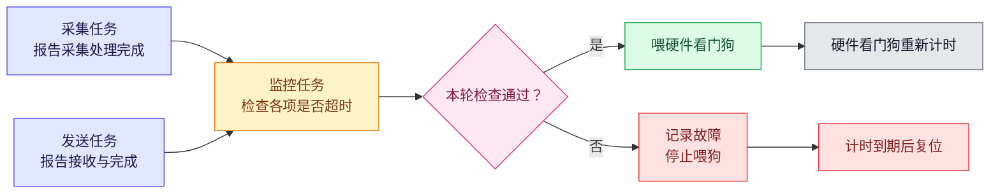
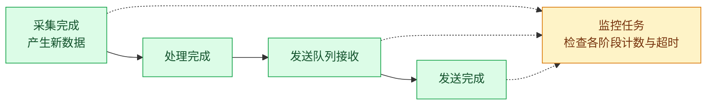

对 MCU 上的关键任务，先规定“什么工作必须在多长时间内完成”，再由监控任务检查完成情况。只有检查通过才喂硬件看门狗；监控任务本身卡住时没有代码继续喂狗，由硬件看门狗超时复位。

以下用一台定时采集数据并发送给主机的设备说明实现方式。文中时间均为设计示例，不是通用推荐值。

## 1. 为什么设备已经卡住，看门狗却没有复位

假设设备有三个任务：

| 任务 | 正常工作 | 可能出现的故障 |
| --- | --- | --- |
| 采集任务 | 每 20 ms 发起一次采集，处理结果 | 等待 DMA 完成通知时永久阻塞 |
| 发送任务 | 从队列取出数据，交给通信外设 | 等不到发送完成，后续数据不断积压 |
| 监控任务 | 每 50 ms 检查关键工作的完成情况 | 被高优先级任务长期抢占，或自身卡住 |

一种常见写法是在空闲任务中喂狗：

```c
void idle_hook(void)
{
    hardware_watchdog_feed();
}
```

这个写法只能说明“空闲任务有机会运行”。假如采集任务永远等在信号量上，它不再占用 CPU，空闲任务仍然运行，看门狗也一直被喂。主机收不到新数据，但设备不会复位。

把喂狗放进定时中断也有类似问题：中断还在触发，不代表任务已经完成工作。

第一步是把喂狗权限收到一处：正常运行阶段只有监控任务在检查通过后调用喂狗接口，其他任务只报告进展。



这也解决了“谁来监控监控任务”的问题：如果监控任务不再运行，就没有代码继续喂狗，硬件计时器最终到期。前提是没有其他路径绕过检查喂狗，而且所选看门狗在相应故障下仍能计时并触发复位。

## 2. 心跳放在哪里，决定了它能证明什么

心跳可以是一个递增计数器，也可以是一次时间戳更新。它本身不含健康含义，只证明程序执行到了上报位置。

例如，在采集循环开头上报：

```c
/* Reports loop entry, not acquisition completion. */
for (;;) {
    report_heartbeat();
    wait_for_dma_done();
    process_sample();
}
```

假如任务随后卡在 `wait_for_dma_done()`，最后一次心跳只代表它进入过循环。只要监控有超时限制，仍能发现它不再上报；但这次心跳不能证明本轮采集成功。

如果监控目标是“持续获得并处理新数据”，上报点应放在对应工作完成之后：

```c
/* Sketch: RTOS and device APIs are omitted. */
for (;;) {
    wait_until_next_period();
    start_acquisition();

    if (wait_for_dma_done(DMA_TIMEOUT_MS)) {
        process_sample();
        report_sample_completed();
    } else {
        report_acquisition_error();
    }
}
```

这里需要区分两件事：

- 等待函数超时，说明任务还能够执行错误处理。
- 采集完成报告，才说明本轮工作确实完成。

如果每次等待都超时，却仍把“循环又跑了一次”当成采集成功，设备可能一直喂狗，却始终没有有效数据。

上报位置决定了监控覆盖的范围：执行到上报点时，只能证明该点之前的工作已经发生。

| 上报位置 | 能证明什么 | 不能证明什么 |
| --- | --- | --- |
| 循环开头 | 任务进入了下一轮 | 本轮工作已经完成 |
| DMA 完成中断 | 外设报告了一次传输完成 | 任务已处理这批数据 |
| 数据处理结束 | 本轮处理已经结束 | 数据一定正确，或已经发到主机 |
| 发送完成回调 | 本次本地发送已完成，具体以驱动定义为准 | 主机应用已收到并处理 |

上报越靠后，覆盖的处理环节越多，但允许时间也要覆盖这些环节。若必须确认主机已经收到数据，就需要协议确认，不能仅依赖本地发送完成。

## 3. 没有数据可发，不等于发送任务卡死

采集任务有固定周期，容易定义“多久没有完成就算异常”。发送任务则不同：它可能长时间没有数据，正常阻塞在空队列上。

如果要求它每 100 ms 上报一次“发送完成”，空闲设备也会被误判为故障。为此把无限等待改成短超时，只能证明任务会定期醒来，不能证明发送功能正常。

更直接的办法是区分两种状态：有待完成工作时检查完成期限，没有工作时允许等待。

对发送链路，可以记录三个信息：

| 信息 | 用途 |
| --- | --- |
| 请求是否已被队列接收 | 明确系统是否已经承担处理责任 |
| 最老未完成请求的接收时间 | 计算它已经等待了多久 |
| 请求的最终结果 | 区分成功、失败和仍未完成 |

例如，规定一个已接收的发送请求必须在 200 ms 内结束：

| 时刻 | 发生的事 | 监控判断 |
| --- | --- | --- |
| 0 ms | 队列为空 | 正常，没有待完成工作 |
| 100 ms | 请求 A 入队成功 | 开始计算 A 的等待时间 |
| 160 ms | A 发送完成 | 正常，耗时 60 ms |
| 180 ms | 请求 B 入队成功 | 开始计算 B 的等待时间 |
| 400 ms | B 仍未结束 | 超时，已等待 220 ms |

这里的期限包含排队和实际发送时间。若只想检查外设发送阶段，还需要单独记录发送开始时间，不能混用两种口径。

也不要只看“最近一次完成时间”。如果较新的请求能够越过旧请求先完成，完成计数一直增加，旧请求仍可能永远挂着；此时应检查最老未完成请求，或逐请求检查期限。

入队失败也必须留下结果。请求没有进入队列，不能算作已经接收；调用方应重试、返回忙或按策略丢弃，并记录失败。否则，请求可能在进入监控范围之前就丢失，监控仍显示正常。

## 4. 从单个任务，检查到整条数据链

即使采集和发送任务都在运行，设备仍可能发不出数据。例如，采集任务正常生成数据，但向发送队列提交时一直失败；发送任务没有收到请求，便一直正常等待。

因此，任务级检查之外，还应在业务要求持续输出时，检查最终输出是否更新：



在这个例子里，可以保留以下几项观测：

- 采集完成计数：判断数据源是否持续产出。
- 入队失败计数：发现数据是否卡在任务交接处。
- 最老发送请求的等待时间：发现队列或外设是否堵塞。
- 发送完成计数：确认数据链末端仍有输出。

这些信息各有用途。只有采集计数停止，优先检查采集端；采集继续而入队失败增加，优先检查队列容量和发送速度；请求已接收却迟迟不结束，优先检查发送路径。

监控规则还要随工作模式变化。设备处于待机状态时，不应要求持续采集；主机主动停止接收时，也不应无条件把“没有发送完成”判为任务卡死。应先规定该模式下设备要继续输出、允许丢弃，还是暂停链路，再检查相应行为。

这并不意味着要监控每个函数。先选关键工作的完成点，只有在需要定位故障时，再增加中间计数。计数只能证明进展，数据内容是否正确仍需要范围检查、校验或业务规则。

## 5. 监控任务怎样决定是否喂狗

把前面的条件汇总起来，监控任务每轮做三件事：读取状态、检查超时、决定是否喂狗。

下面是表达流程的伪代码，不是可直接移植的驱动实现：

```c
/* Sketch: snapshot and time helpers are platform-specific. */
void monitor_cycle(void)
{
    MonitorSnapshot s = read_monitor_snapshot();
    uint32_t now = monotonic_ms();

    bool acquisition_ok = !s.acquisition_required ||
        elapsed_ms(now, s.last_sample_ms) <= SAMPLE_LIMIT_MS;

    bool transmission_ok = !s.has_pending_tx ||
        elapsed_ms(now, s.oldest_tx_accept_ms) <= TX_LIMIT_MS;

    bool output_ok = !s.output_required ||
        elapsed_ms(now, s.last_tx_complete_ms) <= OUTPUT_LIMIT_MS;

    bool healthy = acquisition_ok && transmission_ok && output_ok;

    if (!healthy) {
        latch_monitor_fault(&s, now);
    }

    if (healthy && !monitor_fault_latched()) {
        hardware_watchdog_feed();
    }
}
```

这里采用“严重超时后锁存故障并等待复位”的简单策略。故障锁存后，即使某个迟到的回调更新了时间戳，也不会立刻恢复喂狗。若设备允许先重启外设或重建链路，需要另外规定恢复期限和成功条件，不能无限重试并持续喂狗。

实现时，有几处细节不能省略：

| 细节 | 处理原则 |
| --- | --- |
| 多任务同时读写监控数据 | 用适当的原子操作、短临界区或锁取得一致快照；`volatile` 不能代替同步 |
| 时间计数回绕 | 使用单调计时；无符号差值计算须满足计数位宽、最长间隔和检查频率的约束 |
| 启动时尚无完成记录 | 设置有上限的启动宽限期，并要求首个结果按期出现，不能把零值当成成功 |
| 任务主动停止 | 由工作模式明确取消对应要求，不能让任务自行悄悄退出监控 |
| 故障记录 | 优先保存故障项、时间和进展快照；避免阻塞式日志拖住故障处理 |

硬件看门狗不直接知道哪个任务卡住。它只知道是否按时被喂。把任务状态转换为喂狗决策，是软件监控的责任。

## 6. 超时时间怎样选

超时太短会把正常抖动当成故障，太长则会延迟恢复。应先测量正常运行时的最坏耗时，再结合设备允许的故障持续时间确定阈值。

继续使用前面的例子：

| 项目 | 示例配置 | 配置含义 |
| --- | --- | --- |
| 采集周期 | 20 ms | 正常情况下每 20 ms 产生一次结果 |
| 采集完成超时 | 100 ms | 距离上次处理完成超过 100 ms，判定异常 |
| 发送请求期限 | 200 ms | 已接收请求的排队与发送总时间不得超过 200 ms |
| 连续输出超时 | 300 ms | 要求持续输出时，不能超过 300 ms 没有发送完成 |
| 监控周期 | 50 ms | 每 50 ms 检查一次 |
| 硬件看门狗超时 | 500 ms | 停止喂狗后，计时到期触发复位 |

正常运行时，硬件超时必须覆盖两次喂狗之间的最长间隔，包括监控执行、调度延迟和时钟误差。它不必机械地大于所有业务超时：业务超时决定何时判故障，硬件超时决定多久没有合格检查就复位，两者职责不同。

还要估算从故障发生到复位的总时间。以采集刚完成后立即卡死为例：

1. 等待采集完成记录超过 100 ms。
2. 下一轮监控发现异常；若监控按期运行，额外等待不超过约 50 ms。
3. 从最后一次喂狗起，硬件计时累计至 500 ms 后复位。

用“业务超时 + 一轮监控间隔 + 硬件超时”可得到约 650 ms 的保守估算；这不是精确复位时刻，实际还受最后一次喂狗时间、调度延迟和看门狗时钟误差影响。若设备要求故障后更快停止危险输出，应另行设计停机路径，不能只等待 MCU 复位，也不能假定复位必然让外设和执行器进入安全状态。

如果使用窗口看门狗，还必须满足“不能过早喂狗”的限制，不能简单在每轮检查通过后立即喂狗。是否有独立时钟、调试暂停行为和低功耗下是否继续计时，也要以所选硬件的说明为准。

## 7. 怎样验证没有漏报和误报

正常运行时看到心跳不断增加，还不能说明监控有效。需要主动制造故障，检查它是否按预期报告并停止喂狗。

| 测试 | 预期结果 |
| --- | --- |
| 让采集任务永远等待 DMA 通知 | 采集完成超时；即使空闲任务仍运行，也应停止喂狗 |
| 让发送任务长期等在空队列上 | 无待处理请求且不要求输出时，不应报故障 |
| 接收发送请求，但屏蔽完成通知 | 最老请求超过期限后报故障 |
| 持续制造入队失败 | 记录提交失败；要求持续输出时，末端超时能发现链路停滞 |
| 暂停监控任务 | 没有其他路径继续喂狗，硬件最终复位 |
| 在启动、待机和恢复运行之间切换 | 按各模式的规则检查，不因正常暂停误报 |
| 将计时值推进到回绕附近 | 超时判断仍正确，不突然出现极长宽限期或立即超时 |

测试时至少保留故障原因、最后进展时间和复位原因。否则，设备虽然能够自动重启，却无法说明是哪个环节先出了问题。调试器可能改变看门狗行为，应在脱离调试器的运行条件下复验。

## 参考实现

文中两处做法在开源项目里可以对照阅读：

- [coact](https://github.com/DeguiLiu/coact)：面向 RT-Thread 单核 MCU 的 header-first C++17 事件框架，事件由任务或 ISR 提交、单一线程派发给主动对象；框架层只保留喂狗接口，判定留给板级，与第 5 节的单一入口思路一致。
- [newosp](https://github.com/DeguiLiu/newosp)：面向嵌入式 Linux 的 C++17 header-only 基础库，含心跳骨架 `BeatLoop` 与线程看门狗 `ThreadWatchdog`，可对照第 2 节的上报点选择和第 3 节的进展判据。

## 总结

心跳是某个指定位置被执行过的记录，不构成系统正常的证明。周期任务检查关键工作是否按期完成，事件驱动任务检查已接收的工作是否按期结束，持续输出业务再检查链路末端是否更新。以上结果由唯一的监控入口汇总，合格才喂硬件看门狗：关键任务卡住时不会被无关代码掩盖，监控任务卡住时由硬件兜底。
