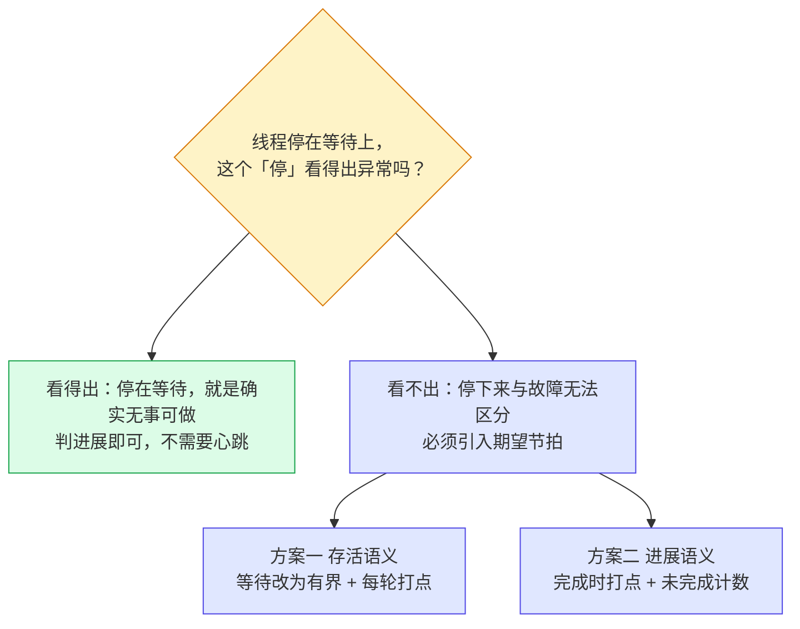
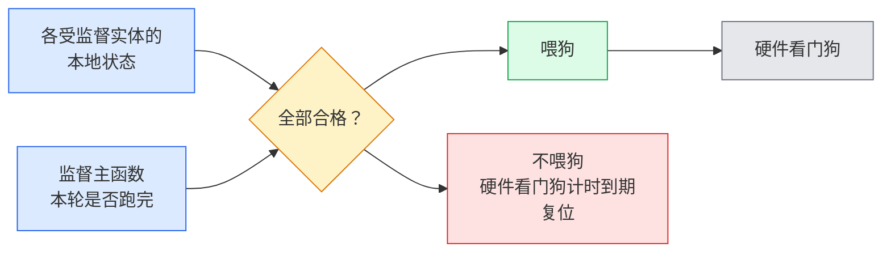
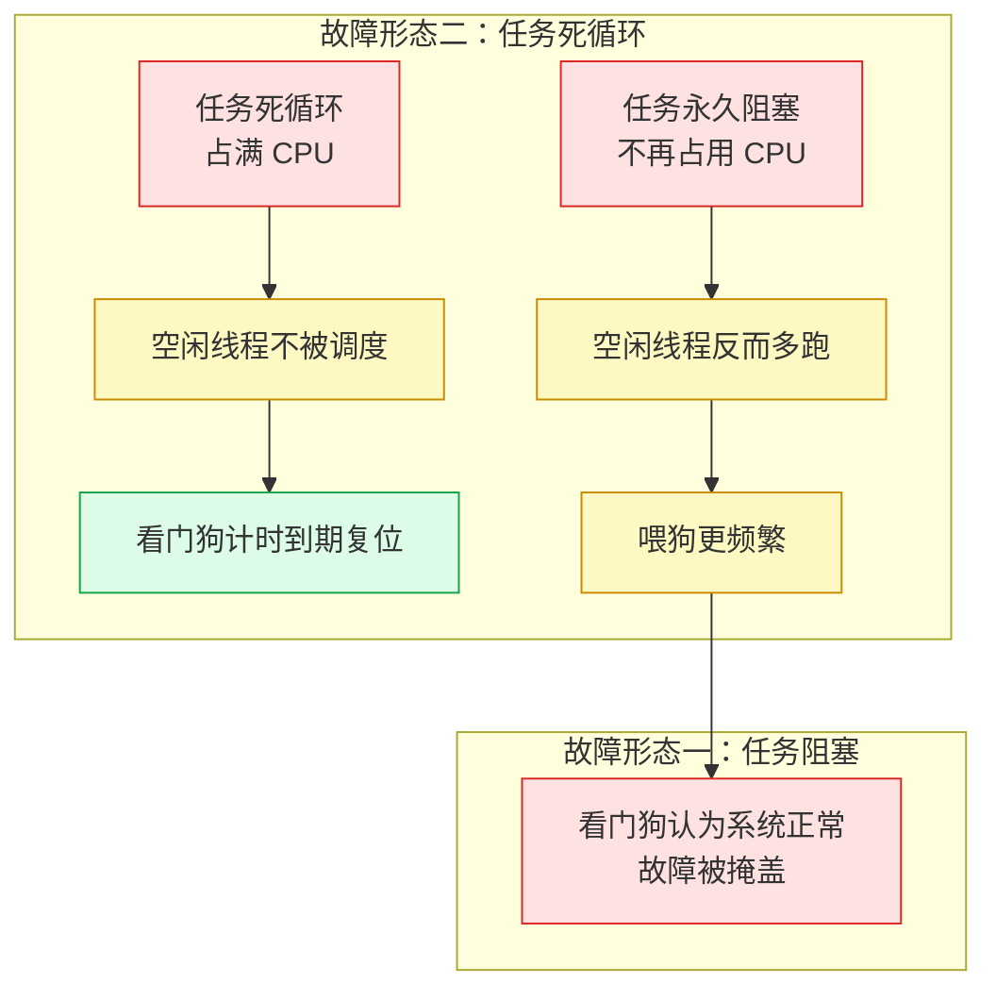
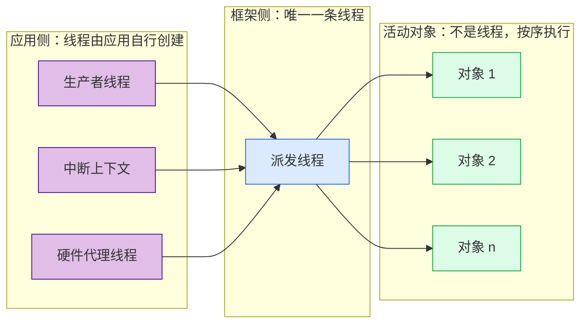

结论先行：关键任务需要监控，但不应给每条线程机械增加心跳。应用层先定义可观测的期望节拍或功能进展，监督逻辑再聚合判定，板级只在全部关键条件满足时喂独立硬件看门狗；把喂狗放进空闲线程会掩盖永久阻塞。

## 从失效形态判断是否需要心跳

工业现场设备，如运动控制器、视觉采集前端、通信网关，大多运行在单核 MCU 或 SoC 上，实时任务与硬件代理线程共存，一般不能以重启作为常规恢复手段。在这类系统中，关键任务停止推进是最难检测的失效：其形态不是崩溃，而是永久阻塞在信号量上，或死循环占满 CPU。表现是静默的：没有异常，没有断言，其他任务照常运行，产出数据逐渐偏离正确值。检测手段按失效形态分层如下：

| 失效形态 | 现象 | 检测所需条件 |
| --- | --- | --- |
| 崩溃 / 断言 | 立即停止 | 错误处理器，不需要心跳 |
| 永久阻塞 | 任务不再推进 | 期望节拍 + 独立观察者 |
| 执行变慢 | 输出延迟增长 | 截止时间预算 |
| 状态迁移错误 | 输出语义错误 | 迁移合法性约束 |

第一类与第四类不需要心跳。真正需要的是第二类，其可判定性取决于一个前提：**该任务的期望节拍是否已知**。“任务是否仍在运行"这一问题，对**周期型**任务可判定，对**事件驱动型**任务不一定可判定，差别在于观察者是否掌握该任务应当何时运行。周期任务的期望节拍来自配置，观察者可以据此判断"本轮未到即异常”；事件驱动任务没有节拍概念，它没有事件就不运行，而"没有事件"与"事件已丢失"在框架内部无法区分。这一前提贯穿全文，也是后文区分监控对象粒度的依据。

## 逻辑、时序与物理活性的三层判定

必要性的分歧来自把三层混为一谈。三层各自回答一个不同的问题，也各自只有一个判定方：

| 层 | 回答的问题 | 判定方 |
| --- | --- | --- |
| 逻辑活性 | 状态迁移是否合法 | 静态状态表（编译期） |
| 时序活性 | 任务是否仍在推进 | 期望节拍 + 独立观察者（应用层） |
| 物理活性 | 线程是否仍被调度 | 独立硬件看门狗（硬件） |

作为参考模型，AUTOSAR WdgM 的监督对象不是 RTOS 线程，而是**受监督实体**（Supervised Entity，通常对应软件组件或进程），实体通过**检查点**（checkpoint）上报进展；其三类监督恰好覆盖前两层：

| 监督类型 | 语义 | 对"期望节拍已知"的依赖 |
| --- | --- | --- |
| Alive Supervision | 一个监督周期内，某检查点被到达的次数落在期望区间的上下界之间 | 需要周期与期望次数 |
| Deadline Supervision | 两个检查点之间经过的时间落在允许窗口内 | 需要起止点定义 |
| Logical Supervision | 检查点出现顺序符合配置的迁移图 | 需要顺序图 |

三个细节决定了它比"一个计数器"多了什么：Alive 是**周期内计数**而非距上次上报的时间，因而同时有下限与上限（上限检测"执行过快、节拍失序"，即窗口看门狗的另一半语义）；**单次失败不构成判决**，需连续失败超过容忍值，用于吸收调度抖动；监督结果是**聚合**而非逐条上报，由全局状态驱动动作。

### 逻辑活性：在状态表中消除非法迁移

[coact](https://github.com/DeguiLiu/coact) 的状态表与转移表是编译期常量，状态机只接受表内定义的迁移：

```
/* hsm.hpp: search up the parent chain; no transition at the root. */
for (;;) {
    const TransitionDef<Context>* tran = find_transition(ctx, evt, state);
    if (tran != nullptr) { execute_transition(...); return true; }
    const int8_t parent = states_[state].parent;
    if (parent < 0) { return false; }        // Ignore undefined transitions.
    state = parent;
}
```

非法迁移不存在，无需在运行时检测顺序偏差。这一层与 AUTOSAR 的 Logical Supervision **目标相同、手段相反**：后者在运行期比对配置的迁移图并上报偏差，前者使非法迁移在编译期即不可表达。代价是未匹配事件被静默丢弃，这是可观测性缺口，不是活性问题。

### 时序活性：期望节拍决定能否判定

核心问题：**等待型线程的"阻塞"是正常状态还是故障状态？** 两种情况必须分开。

**情况一：阻塞可判定。** [coact](https://github.com/DeguiLiu/coact) 的派发线程空闲时无限期等待：

```
/* dispatcher.hpp:164-181 */
/* Idle wait: a true blocking wait; 0 means wait forever. */
pal_.wait_dispatcher(0U);
```

**该分支仅在所有分区均为空、未就绪时才可达**，于是"阻塞"与"队列空"双向等价，“阻塞且存在待处理事件"是不可达状态。它不需要活性监控。可疑的是"存在待处理事件却未推进”，那属于进展判据。

**情况二：阻塞不可判定。** [coact](https://github.com/DeguiLiu/coact) 的硬件代理线程以互斥量加条件变量做单槽交接，槽满即拒：

```
/* WorkerBase::submit returns false when the slot is full. */
if (count < kDepth) { /* Accepted. */ }
else { ++rejected; ok = false; }
```

该线程阻塞时**无法区分"确实无请求"与"请求已被拒绝"**，阻塞不再是可判定的合法状态。两条修法：等待有界化（使"仍被调度"可观测，即存活语义），或判据改为进展（已提交未完成，即进展语义），二者择一。存活语义在 [coact](https://github.com/DeguiLiu/coact) 中的落法是把等待上界从"永远"改为具体值：

```
/* Replace 0U with a bound so idle periods can report liveness. */
pal->cond_wait(cond, mtx, kBeatWaitMs);
```

链路上另一形态，即有界产帧循环，天然可监控：每帧迭代一次，节拍由配置的帧率给出，属于第一节所述的周期型任务。



这一层对应 Deadline Supervision 并部分覆盖 Alive Supervision，差别在期望值的来源：AUTOSAR 来自配置，[coact](https://github.com/DeguiLiu/coact) 的等待型线程没有配置层，期望只能由应用给出，这是心跳最终落在应用层的原因之一。

### 物理活性：最终判据必须独立于软件

软件无法自证线程仍在被调度：置于被监控线程内的检测代码在其停止推进时不执行，置于监督线程内的检测代码在监督线程停止推进时同样不执行。只有硬件看门狗真正独立：独立时钟、独立计数、独立复位路径。

MCU / SoC 上这一层有标准硬件基础：**独立看门狗**（IWDG）由独立时钟源驱动，主时钟失效时仍能计时；**窗口看门狗**（WWDG）同时约束喂狗时间的上下界。功能安全实践对二者的定位是"保证系统不在故障状态下继续运行"，因此喂狗条件必须由监督逻辑的输出决定，不能由任意代码路径决定。

[coact](https://github.com/DeguiLiu/coact) 对这一层的处理是**只暴露接口、不留判定**。PAL 契约中的喂狗入口在三个后端实现完全相同：

```
/* Same shape in pal_rtthread.cpp:413, pal_posix.cpp:186, and pal_windows.cpp:334. */
void RtThread::watchdog_progress(uint32_t /*marker*/) noexcept
{
    /* No-op: watchdog management is handled at the BSP layer. */
}
```

下游入口同样已备：`BreakerBank::broadcast_watchdog()` 将所有 AO 推入 `Safe` 降级态。[coact](https://github.com/DeguiLiu/coact) 因此只提供**信号入口与降级出口**，中间的判定条件留给板级。"何时该喂狗"依赖板级对关键链路的定义，框架层不掌握。

AUTOSAR 在此多走一步：**触发硬件看门狗是有条件的**，监督主函数每轮执行完毕且所有实体状态满足条件时才触发，并引入 `EXPIRED` 状态标记"监督者自身未按时完成一轮"：



`EXPIRED` 是整个设计的支点：它使"监督者自身未按时完成一轮"也成为可检测状态。缺少它，监督逻辑本身失效无人发现，而硬件看门狗仍会被其他路径照常喂狗。

反例是工业 SoC 项目中的常见写法，即 BSP 把喂狗挂在空闲线程钩子上：

```
rt_err_t ret = Svc_Wdt_Init();
if (RT_EOK == ret) {
    rt_thread_idle_sethook(rt_hw_feed_dog);     /* Feed the watchdog from idle. */
}
```

语义完全相反：



任务永久阻塞在信号量上时不占用 CPU，空闲线程反而更活跃、喂狗更频繁。**看门狗判定系统良好，而该任务已经失效**：它检测的是"CPU 是否被独占"，不是"任务是否存活"。喂狗点散落于图形库绘制、日志写入、内存自检等多处则更糟，每一处只证明"某个不相关路径被执行过"，合起来不具备证明力。该项目看门狗寄存器集合亦无最小时间（窗口）寄存器，硬件只支持"喂得不够快则复位"，本节开头所述另半个语义只能由软件补偿。

## 监控功能进展，而不是抽象的线程存活

[coact](https://github.com/DeguiLiu/coact) 是面向单核 MCU 的事件驱动活动对象框架：生产者从任务或 ISR 上下文提交事件，由唯一一条派发线程交付给活动对象（AO），AO 由层次状态机驱动。**框架自身只创建一条线程**，其余线程均为应用侧的生产者与硬件代理。两侧的线程创建点可以直接对照：

```
/* Framework: the only thread creation site is Runtime::start(). */
detail::pal_start_dispatcher(pal, entry, ctx);   /* Calls pal.start_dispatcher(...). */

/* Application: producers and workers create their own threads. */
g_pal->thread_create(thread_, &IrscWorker::tramp, this);
```



按线程监控在这里只有两个候选对象：派发线程（一条，且是单点）与应用的 AO（它不是线程）。AUTOSAR 的实践早已给出方向：监控受监督实体（软件组件 / 进程）而非 RTOS 线程。线程是调度单位，不是功能单位：一个功能单元可能横跨多个线程，一个线程也可能承载多个功能单元。按线程监控报出的是"某个调度实体状态异常"，而需要知道的是"某个功能已不工作"。[coact](https://github.com/DeguiLiu/coact) 在这一点上有天然优势：**其监控单位本就不是线程**：所有 AO 运行在同一条派发线程上、按序执行、状态只在该线程内变更，按 AO 监控即可获得功能语义。

但按 AO 监控随即遇到第二个障碍：**AO 在语义上不存在"存活"这一状态**。它是事件驱动的，没有事件即不运行；一个安静等待的 AO 与一个已失效的 AO，在框架内部**无法区分**：框架不掌握"该 AO 应每 33 毫秒运行一次"这条信息（第一节的前提）。这一点在 [coact](https://github.com/DeguiLiu/coact) 的计数器布局上直接可见：心跳只有全局一个计数器，而 per-AO 计数器里没有心跳字段。

```
/* monitor.hpp: global heartbeat counter. */
void heartbeat() noexcept;        /* Updates GlobalCounters::watchdog_heartbeats. */

/* monitor.hpp: per-AO counters have no heartbeat field. */
struct AoCounters {
    std::atomic<uint64_t> direct_duration_ns{0};
    std::atomic<uint32_t> direct_timeouts{0};
    std::atomic<uint32_t> rtc_timeouts{0};
    std::atomic<uint16_t> pending{0};
    /* No last_beat or alive_count field. */
};
```

WdgM 的活性监控之所以在 AUTOSAR 中成立，是因为软件组件的期望节拍是配置数据。[coact](https://github.com/DeguiLiu/coact) 没有这一层配置；若强行引入，即需在核心增加一套 per-AO 期望周期注册表，与"只实现最小 AO/HSM"的设计目标直接冲突。因此对 AO 而言正确的机制不是"AO 存活"，而是\*\*“链路进展”\*\*：在一处集中观察关键事件链的推进，而不是为每个对象配置心跳：前者观察功能是否在工作，后者观察调度实体是否在运行，只有前者是本架构能给出的信息。

## 用循环骨架固定心跳上报点

框架层的边界划定之后，需要的那部分落在应用层。**维持责任落在调用方**。编译期 AOP 的解法是将上报收进循环骨架，使其成为唯一执行路径：

```
template <typename Pred, typename Body>
void BeatLoop(Beat* b, Pred&& pred, Body&& body) noexcept
{
    while (pred()) {
        if (nullptr != b) { b->Hit(); }        /* Advice fixed at the top of each iteration. */
        if constexpr (std::is_same_v<decltype(body()), bool>) {
            if (!body()) { break; }            /* A bool body may stop the loop. */
        } else {
            body();
        }
    }
}
```

连接点是"谓词成立之后、循环体之前"这一唯一位置，具有三个性质：**先于阻塞点**（单次阻塞最多延迟一轮，而非压制整段）、**每轮必经**（`while` 语义保证）、**首轮即上报**（进入循环后首先执行上报）。

参考实现与对照：

* **coact**（本文对象）， [github.com/DeguiLiu/coact](https://github.com/DeguiLiu/coact)
* **newosp** ， [github.com/DeguiLiu/newosp](https://github.com/DeguiLiu/newosp)；心跳骨架的 `BeatLoop` 与 `ThreadWatchdog` 出自此项目
* **QP/C++**（同类框架对照）， [github.com/QuantumLeaps/qpcpp](https://github.com/QuantumLeaps/qpcpp)
