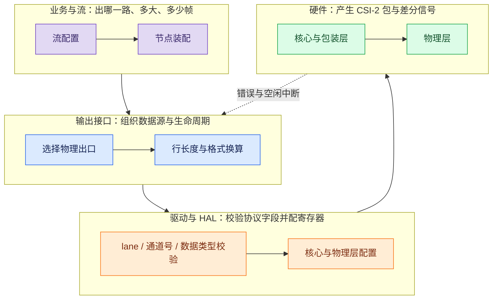
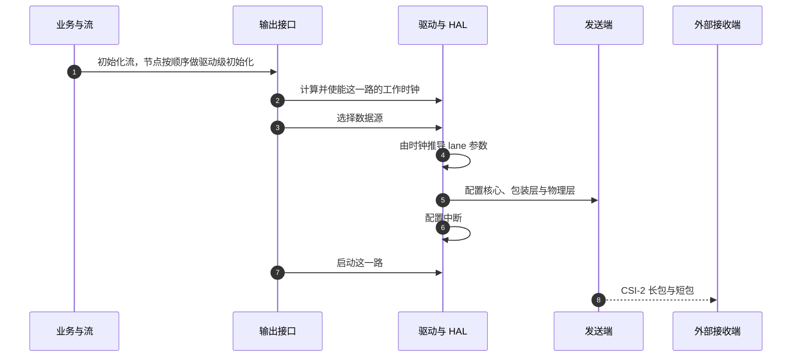
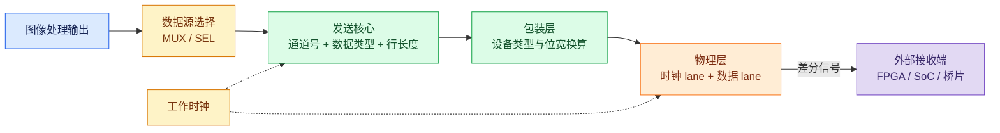

图像芯片通过 MIPI CSI-2 把画面送到外部接收端时，“收不到图”的常见原因不是数据没产生，而是配置项和接收端没有对齐。这种问题有一个共同特征：出错的那一项往往不在业务配置里，而在协议层字段里。逐个字段核对比换工具更有效。

这篇接着上一张总图讲其中一个出口。总图见 [图像 SoC 的视频流架构](/tech-notes/posts/architecture/video_stream_pipeline_architecture/)，它决定同一张画面如何组装成一路流；这里要解决的是这一路流怎么变成物理链路上的 CSI-2 包。

## 1. 四层各管什么

### 背景：CSI-2 是什么，和并行接口差在哪

CSI-2 是摄像头与主控之间的串行接口标准，物理层用差分信号（D-PHY），一条链路由一对时钟 lane 和若干对数据 lane 组成。它把一帧画面切成两类包：只带同步信息的短包，和携带像素净荷的长包。

包里有三个字段决定接收端怎么还原画面：

- **虚拟通道**：同一条物理链路上区分多路流的编号。
- **数据类型**：声明这一路送的是什么像素格式。
- **行长度**：一行净荷的字节数，接收端按它分配行缓冲。

和并行接口（DVP 那类）相比，这里没有独立的行同步、场同步信号线：一帧从哪开始、一行到哪结束，都由包头和净荷长度表达。这是串行接口省引脚换来的代价，也是它的排错方式和并行接口完全不同的原因。

另外，主机侧（例如 Windows）通常不直接收 CSI-2，中间要经过桥片把它转成主机认识的接口。所以“接收端”可能是 FPGA、另一颗 SoC，也可能是桥片。

| 层 | 负责 | 不负责 |
|---|---|---|
| 业务与流 | 出哪一路、多大尺寸、多少帧率、分配哪些节点 | 不直接写寄存器 |
| 输出接口 | 组织数据源与消费者，管理接口生命周期，按格式与输出宽度算出行长度 | 不等同于协议层通道 |
| 驱动与 HAL | 校验 lane、虚拟通道、数据类型与帧尺寸，把行长度透传给硬件，配置核心与物理层 | 不解释上位机语义 |
| 硬件 | 产生 CSI-2 包与差分信号，上报中断 | 不提供主机的设备协议 |

按这张表，协议字段对不上要往驱动和硬件层看，尺寸和资源冲突要往业务层看。把“接收端没出图”直接当成驱动问题，往往会跳过错配的那一个字段。

与其他并行输出接口对照也有用：并行接口用行场同步信号划分一帧，没有通道号这类字段，所以它的排错清单里没有这一项；相关机制见已发的 [DVP 图像输出通路](/tech-notes/posts/architecture/dvp_image_output_principle/)。

## 2. 初始化顺序：先算时钟，再配链路

接口启动的顺序是固定的：先按业务需求算出这一路需要的时钟并使能它，再选择数据源，然后用时钟推导 lane 参数，配置核心、包装层与物理层，最后使能中断并启动这一路。业务侧之后启动流时只需要使能图像处理部分，接口本身已经就绪。

这里的取舍在于时钟与 lane 的先后。也可以先按固定 lane 数配置、再调时钟，但每次改几何都要算两遍：lane 数与数据率决定时钟下限，时钟又反过来限制 lane 数能支持的最大速率。先算时钟再配 lane，把“能不能跑”和“跑多快”压成一步判断；限制是时钟必须在链路配置之前就位，启动阶段出不了图。

从数据源到接收端的物理拓扑如下。通道号、数据类型和行长度是发送核心里的字段，设备类型与位宽换算发生在包装层，两层可能不一致：

## 3. 四项必须与接收端对齐的配置

**虚拟通道** 是同一条物理链路上区分多路流的手段。常见做法是让通道号跟着软件流的索引走，每路一个号。它不是软件里的流名称，也不是业务里的通道编号，而是包头里的一个字段；接收端按它分流，对不上就会把两路搞混或者全部丢弃。如果可用通道数不够用，有两条路可走：几路流复用一个通道号、按另一套数据类型组织，或者换一个物理出口；走哪条取决于接收端能不能按数据类型把复用的流重新分开。

**数据类型** 声明这一路送的是什么像素格式。当前已经实现的一组映射：

| 数据语义 | 数据类型取值 |
|---|---:|
| YUV420 8 bit | 0x1A |
| YUV422 8 bit | 0x1E |
| RGB888 / YUV444 | 0x24 |
| Y8 | 0x2A |
| Y16 | 0x2E |

数据类型之外还有一层设备类型字段，用来描述包装层的替换方式，两者可能不同，例如线路上声明为高精度灰度，包装层却按 8 bit 组织。接收端要按最终的线上配置核对这两项，只看业务侧的输出格式不够。通道号与数据类型这两个字段的通用含义，已发的 [UVC 与 CSI-2 图像输出通路](/tech-notes/posts/architecture/uvc_vs_csi2_output_paths/) 已经讲过，这里只补平台侧的取值差异。

**行长度** 是 CSI-2 一行长包里净荷的字节数，由格式和输出宽度算出来，打包格式（如 Y16）可以直接按“一行像素数 × 每像素字节数”算；具体口径取决于这条链路最终的线格式，接收端应以此字段为准独立核对。它是接收端分配行缓冲的依据，少算一个字节就会从这一行开始整帧错位。以 1920×1080 的 Y16 为例，一行是 3840 字节，一帧净荷约 4.15 MB（按 1 MB = 10⁶ 字节），接收端必须按这个数准备缓冲。

**Lane 与时钟** 要同时核对五项：lane 数量与物理连接、数据率与时序范围、时钟是连续还是非连续、lane 的顺序与极性，以及上面那几项协议字段。这五项里任何一项不匹配，现象都可能是“完全没有图像”而不是“图像花屏”，而现象本身分不清是字段错配还是硬件故障，只能按项核对。

## 4. 单路独占与多路共享是两层概念

输出接口层和协议层各自有一套说法，容易混在一起：

| 概念 | 所在层 | 含义 |
|---|---|---|
| 单消费者 | 输出接口 | 一个消费者独占一个物理出口 |
| 组合 | 输出接口 | 多个消费者按时隙共享一个物理出口 |

协议层另有三种通道模式：每路流一个通道号、只用一路通道发单幅图、以及把两路拼进同一个通道发送。它们的命名与取值已在前文链接的那篇里列出，这里不重复。

“组合”不等于把多个对象动态合成一个，也不等于单通道模式。它们分属两层，可以各自独立选择：物理出口是共享的，协议层仍可以每路一个通道号；反过来也一样。两层混着谈，配置就会对不上。

## 5. 收不到图时的排查顺序

按这个顺序走，每一步都能缩小范围：

1. 先确认流已经初始化并启动，输出接口指向了正确的物理出口。
2. 再确认数据源关系、尺寸、帧率和输出格式前后一致。
3. 然后逐项核对 lane 数量、时钟模式、虚拟通道、数据类型与行长度是否与接收端一致。
4. 最后同时看两边的统计：发送端的错误与空闲中断、接收端的包计数。只看一边，等于只验证了一半。

如果接收端是主机上的通用接口而不是裸 CSI-2 接收器，还要单独确认桥接设备的枚举、描述符与格式转换，不能拿发送端的现象当结论。

这条通路讲完，另一个出口的做法完全不同：它不做协议封包，而是把数据直接写进 USB 端点。下一篇讲 [UVC 视频的硬件直写通路](/tech-notes/posts/performance/uvc_hardware_direct_write_path/)。
