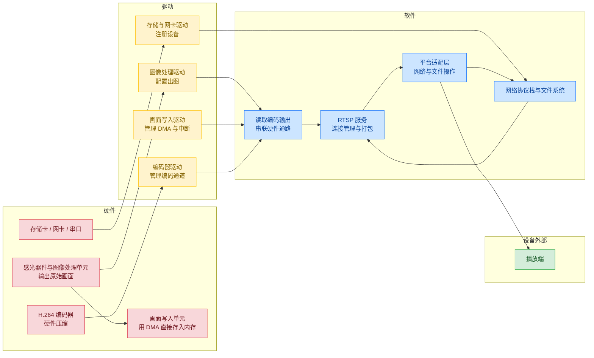
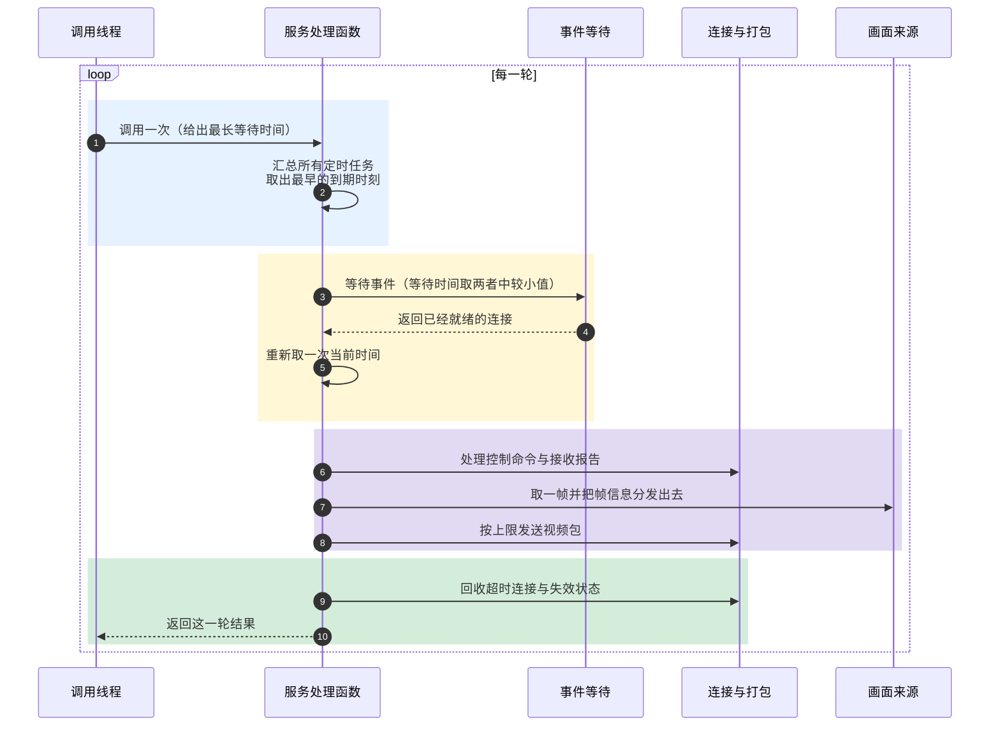
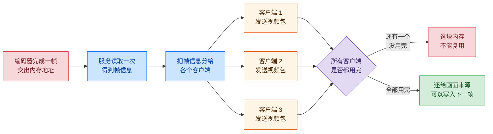
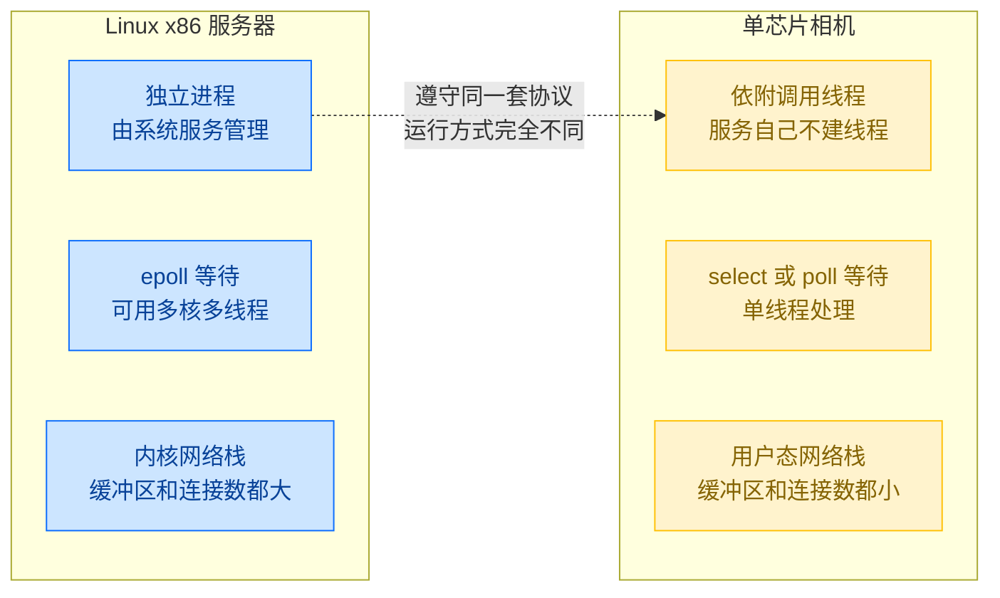

> 结论先行：相机上的 RTSP（实时流传输协议）服务是接在画面输出通路末端的一个协议处理模块，由应用线程反复调用，自己不创建线程。它的结构取决于三件事：一帧画面从编码器交到网络发送时归谁管、所有定时任务共用的到期时刻怎么算、一条连接同时传控制命令和视频时按什么顺序发。这三件事划定了设备能承受的连接数，以及一次处理能做多少工作。
>
> 服务器上有进程隔离、内核网络栈和大容量内存，相机上这些都没有。所以哪些做法能直接照搬，哪些必须自己写，要看运行环境。

本文分析一台运行 RTOS 的单芯片相机如何对外提供 H.264 视频流。设备通过以太网或 WiFi 连接，播放端使用 VLC 一类软件。文中的做法不绑定某一种 RTOS，涉及具体内核时给出文件名和行号，便于核对。

## 1. 服务的定位与设计限制

### 1.1 设备形态

这类设备的共同点是：一颗芯片同时负责图像采集、视频编码和网络发送，没有独立的第二颗处理器，运行的是实时操作系统而不是 Linux，可用内存按百 KB 计算。

结构上有两个改不了的选择，两者互相影响。

第一，**服务自己不创建线程**。它对外只提供一个函数，调用一次就处理一次，处理完立即返回。服务何时运行、运行在哪个线程、分配多少栈空间，全部由调用方决定。

第二，**画面数据不做二次拷贝**。编码器完成后交出来的是内存地址，不是数据本身。服务按 RTP（视频传输协议）的规则把这批数据切成包直接发出。省掉了整帧搬运，代价是这块内存什么时候可以复用，要由服务自己算清楚。


*图 1：三个互相影响的取舍。执行方式决定资源上限，资源上限又决定数据怎么传递。*

### 1.2 本文的组织方式

第 2 章说明画面通路上的三层分工，第 3 章说明一次调用要完成哪些工作，第 4 章专门比较相机方案与运行在 Linux x86 服务器上的 RTSP 服务有什么不同，第 5 章给出设计判断与容易踩的坑。

## 2. 硬件、驱动、软件三层分工

### 2.1 从图像到网口的通路

一帧画面从感光器件到网口，要经过三层模块。图中的 DMA（直接内存访问）指硬件不经过处理器、直接把数据写进内存的方式。



*图 2：四层通路。硬件负责出图和压缩，驱动负责配置硬件与响应中断，软件负责协议与打包。*

### 2.2 三层各自做什么

| 类别 | 包含哪些 | 负责什么 | 不负责什么 |
|---|---|---|---|
| 硬件 | 感光器件与图像处理单元、画面写入单元、H.264 编码器、存储卡、网卡、串口 | 出图、搬运数据、硬件压缩、物理收发 | 不认识网络协议，不知道有几个客户端 |
| 驱动 | 图像处理驱动、画面写入驱动、编码器驱动、存储驱动、网卡驱动 | 写寄存器、处理中断、把设备注册给系统 | 不解析协议，不做业务判断 |
| 软件 | 读取编码输出、RTSP 服务、平台适配层、网络协议栈、文件系统 | 解析协议、管理连接、打包发送、读文件 | 不直接读写寄存器 |

下面两条规则划定了三者的边界。

**软件不直接读写寄存器。** 上层只调用驱动注册好的设备接口。换一颗芯片时，需要改动的部分集中在驱动里。

**画面数据只传地址，不传副本。** 编码完成后，软件拿到的是一组信息：缓冲区地址、数据长度、时间戳、是否关键帧。这样做对这类设备很关键，因为一帧 1080p 的原始画面超过 3 MB，逐帧复制会同时占用处理器时间和内存带宽。代价是缓冲区什么时候能复用必须由软件自己判断。

### 2.3 平台适配层与画面缓冲区的归属

软件内部还有一条分界：协议逻辑与操作系统接口分开。网络收发、文件操作、取时钟、休眠这些和系统相关的调用，全部集中放在一个适配层里；协议部分只调用适配层提供的函数。

这条分界有个直接好处：同一份协议代码可以在开发电脑上编译调试，再拿到设备上运行，差别只在适配层的条件编译分支。对于嵌入式项目，能在电脑上先验证协议逻辑，比在设备上用串口打印调试快得多。

多客户端时会遇到内存归谁管的问题。处理方式在第 3.5 节展开，这里先记住一条：同一块内存被多个客户端引用时，要等全部用完才能写入下一帧。

读取画面输出的回调函数还有一个容易被忽略的特点。它表面上是普通的函数调用，内部却可能等待编码器出数据，或者去申请互斥锁。**回调函数本身就可能让线程停下来等**，所以要给所有外部回调约定一个耗时上限。

## 3. 一轮处理怎么完成

### 3.1 由外部线程反复调用

服务对外只有一个函数，调用一次就做完一轮工作：算出这次该等多久、等待事件、处理已经就绪的事件、执行已经到时间的任务，然后返回。调用方传进来的参数是这一次最多能等多久，不是固定的执行周期。

这样设计的好处是：服务不假设自己被调用的快慢，而是把时间点记在绝对时刻上。调用方来得早一点或晚一点，只影响被唤醒的时刻，不影响任务本身安排在什么时间执行。



*图 3：一次调用的先后顺序。四段顺序固定，其中分发帧信息必须排在发送视频包之前。*

### 3.2 统一的到期时刻

等待时间算得准不准，决定了整个服务的准时程度。如果只看视频发送时间，其他定时任务就只能靠每轮顺手检查一次，实际执行时刻会随调用快慢而漂移。

| 定时任务 | 到期时刻怎么算 |
|---|---|
| 发送视频包 | 上一次发送时刻加上帧间隔 |
| 发送接收报告 | 上一次发送报告的时刻加上固定间隔 |
| 连接超时 | 最后一次收到数据的时刻加上超时上限 |
| 请求没收完就断开 | 收到不完整命令的时刻加上超时上限 |
| 文件播完后的收尾 | 读到文件末尾的时刻加上收尾时间 |
| 画面暂时没有时重试 | 取帧失败的时刻加上一小段延时 |
| 一帧分多个包没发完 | 下一个时间点，或者连接可以写入时 |

等待时间取调用方给的上限和最早的到期时刻中较小的那个。这样既尊重调用方的时间预算，也保证任何任务都不会因为调用得快慢而被推迟。

### 3.3 两处容易写错的地方

**比较时间必须用无符号数的差值。** 毫秒计数是 32 位无符号数，累计到最大值后会回到零。直接比较大小，在回绕的那一瞬间会得出错误答案：

```c
static bool TimeReached(uint32_t now, uint32_t due)
{
    return ((int32_t)(now - due) >= 0);
}
```

两个无符号数相减，再当成有符号数判断是否大于等于零，只要两次比较相隔不超过 2 的 31 次方毫秒，就不会判断错误。各内核判断 tick 是否到期用的也是这个办法。这也说明：在需要处理回绕的代码里，要么统一记录绝对时刻，要么统一记录剩余时间，不要混着用。

**周期任务要以上次计划时刻为基准。** 如果每次都用当前时刻加上间隔重新安排，误差会一次次累积，运行久了任务的实际执行时刻会持续偏移。正确做法是以上次计划时刻为基准往前推；如果已经错过好几个周期，这一轮只执行一次，然后把计划时刻直接推到未来的最近一个周期，既避免偏移，也避免集中补做。

还有一点要注意：判断到期的动作要放在等待之后。如果先判断、再去等待，那么被等待唤醒的任务要等到下一轮才被执行，这一次唤醒就浪费了。正确顺序是先等到事件返回，重新取一次当前时间，再判断哪些任务到期。

### 3.4 会让时间安排失准的操作

时间安排能做到多准，取决于一次调用里有多少地方会让线程停下来等。

| 让线程停下的原因 | 具体表现 | 造成什么结果 |
|---|---|---|
| 网络连接默认是阻塞的 | 对方接收窗口满了，发送就卡住 | 线程被卡在这里，控制命令无法及时响应 |
| 发不出去就延时重试 | 发送失败后先睡一小会儿再试 | 一次调用要花多久无法预估 |
| 不等直接反复查询 | 发送受上限打断后立刻再查一次 | 处理器空转，影响其他任务 |
| 回调内部等待 | 取画面时等待编码器或互斥锁 | 问题藏在看起来普通的函数调用里 |
| 读文件 | 从存储卡读取样片 | 存储慢的时候会挡住控制命令的处理 |

### 3.5 多客户端共用同一帧

给多个客户端分发画面有两种做法：各自去取，或者只取一次再分给大家。相机这类设备普遍选后者，因为编码器和读取通道通常是独占的，多个客户端同时去读会互相干扰，重复复制像素也浪费内存带宽。

这样做的代价是内存归谁管这件事变复杂了。同一块内存被多个客户端引用，只要有一方提前让它复用，其他客户端就会读到已经被改写的内容。由此得出两条规则：

- **分发和发送的先后不能交换**：必须先把帧信息分给所有客户端，再开始发送，不能拆成两个互不相关的定时任务；
- **所有客户端都用完才能复用**：最后用完的那个客户端发送完成后，这块内存才能还给画面来源；如果要把帧数据留到下一轮再用，就需要记录引用次数或者复制一份。

把一帧的完整过程画出来，两条规则的来源就清楚了。



*图 4：一帧从产生到复用的过程。只要还有一个客户端没发完，这块内存就不能被下一帧覆盖。*

### 3.6 一条连接同时传控制命令和视频

RTSP 有一种传输方式，把视频包直接封装在控制连接里，格式由 RFC 2326 规定：

```text
+--------+---------+--------+-------------+
| 0x24 $ | channel | length | 视频或报告包 |
+--------+---------+--------+-------------+
   1 字节   1 字节   2 字节     长度不固定
```

这改变了发送部分的设计。控制命令的回复、视频包、接收报告三种数据共用同一条数据流，每次写入都必须完整。如果让每个视频轨道各自排队、各自写，数据流里就会出现交叉，接收端无法再把包分开。

正确做法是**每条连接只保留一份发送顺序**：所有要发的内容都排在这一个队列里，队列记录当前发到哪、总共多长、已经发出多少。FFmpeg 的 RTSP 输出就是这样，先把包写到临时缓冲，再统一加上帧头一次写出；开源项目 oximedia-net 则让控制回复和视频写入共用同一把锁，避免封装帧在报文中间被切开。

### 3.7 数据发不完怎么办

把连接设为非阻塞之后，发不进去时函数会立刻返回，不让线程干等。这样做的价值在于把等待变成一件可以接着做的事：这次发出去一部分，就记住已经发了多少，下次从断点接着发。

```c
typedef struct {
    const uint8_t *data;    /* 要发送的数据在哪里 */
    uint32_t       len;     /* 一共多长 */
    uint32_t       offset;  /* 已经发出去多少字节 */
    bool           active;  /* 是否还有数据没发完 */
} PendingTx;
```

发送函数的返回值要分开处理：实际发出字节数小于请求长度，说明只发出去一部分；返回零，说明对方已经关闭；返回负数，才需要看错误码判断是暂时发不进去，还是连接真的出问题了。

由此还引出一条内存规则：**要发送的数据必须活得比函数调用更久**。控制命令的回复不能使用函数内部的临时数组，因为函数一返回这块内存就失效了，而没发完的数据可能要到下一次调用才继续处理。

TCP 连接还有一条和 UDP 不一样的性质：不能靠丢掉一个包让上层重传，丢掉任何一个字节都会让对方的解析出错。开源项目 rtp2httpd 遇到客户端处理不过来时，采用的办法是暂停读取上游数据：积压到设定的高比例就停止读取，让 TCP 自己的接收窗口去压制发送方；回落到低比例再恢复。这种办法不破坏数据流的完整性。

### 3.8 内存很小时怎么用缓冲区

嵌入式 RTSP 实现几乎都用静态缓冲区。开源的 MCU 版实现 Micro-RTSP 用一个固定大小的缓冲区组装数据包，再把同一份数据发给所有客户端。这能成立有两个前提：只有一个线程在发送，且所有客户端看到的内容一样。一旦改成多线程发送，或者不同客户端画面不同，就必须让每个连接各持一份。

## 4. 与 Linux x86 服务器上的 RTSP 服务的区别

同样对外提供 RTSP，放在 x86 服务器上运行和放在相机芯片里运行，差别并不只在性能高低。下面六个方面，每一项都对应一个具体的设计选择。



*图 5：左侧是服务器上的运行方式，右侧是相机里的运行方式。协议相同，运行条件差别很大。*

| 对比项 | Linux x86 服务器 | 单芯片相机 |
|---|---|---|
| 运行形态 | 独立进程，由系统服务管理器启动和重启 | 依附调用方线程，随应用一起运行 |
| 等待机制 | epoll，内核直接给出就绪的连接 | select 或 poll，逐个检查 |
| 并发方式 | 多线程、多核并行 | 单线程顺序处理 |
| 内存管理 | 虚拟内存按需分配，容量按 GB 计 | 内存平坦，容量按百 KB 计，多数编译期确定 |
| 网络栈 | 操作系统内核自带，参数可调 | 用户态协议栈，缓冲区很小 |
| 时间精度 | 纳秒级单调时钟 | 依赖系统节拍，通常毫秒级 |
| 画面来源 | 另一个进程提供，需跨进程传递 | 同一地址空间，直接拿地址 |
| 故障影响 | 只影响本进程，可重启 | 可能影响整机 |
| 诊断手段 | 调试器、性能分析、系统调用跟踪、崩溃转储 | 主要靠串口日志 |

### 4.1 运行方式与隔离

服务器上的 RTSP 服务是一个独立进程，由系统服务管理器启动，可以单独重启、单独升级、单独限制资源。它崩溃时只影响自己，操作系统负责回收资源，其他服务不受牵连。

相机上的服务没有这层隔离。它和图像采集、编码、显示等模块运行在同一颗芯片、同一块内存上。一个越界写、一次空指针访问，都可能让整机复位。也正因为没有进程边界，画面数据才能以地址的形式直接交给发送模块，省掉一次跨进程拷贝。想要隔离就得多一次拷贝，想省掉拷贝就得放弃隔离，两者只能选一个。

### 4.2 事件等待与并发

服务器的等待机制建立在 epoll 上。内核维护一份就绪列表，调用一次就能拿到所有就绪的连接，开销与就绪数量相关，连接数可以从几十扩到几万；并发上可以用多线程加多核，把不同连接分散到不同核心。

相机的等待机制建立在 select 或 poll 上，每轮都要把所有关注的连接检查一遍，开销与连接总数成正比，上限通常是十几到几十，并发上是单线程顺序处理。

这个差别决定了设计重点不同：服务器可以把复杂度放在如何调度大量连接上，相机必须把复杂度放在如何保证一轮处理的时间可预估上。

### 4.3 内存与数据传递

服务器的进程有独立的虚拟地址空间，内存按需分配，页表把虚拟地址映射到物理地址，越界访问会被处理器拦下。缓冲区可以按需扩大，一次发送几十 KB 也很平常。操作系统内核还提供了一些避免拷贝的手段，可以让数据不经过用户态中转。

相机的地址空间是平坦的，多数运行环境下没有地址映射保护，越界访问不会立刻被拦下。内存通常在编译期就分配好，缓冲区大小固定。连接数、每次发送的包数、每轮的帧数都要有明确上限。

数据传递方式也由此不同。服务器上画面来自另一个进程，无论走管道还是网络，都要经过内核缓冲，至少一次拷贝；想避免拷贝就要用共享内存，但随之要处理同步。相机上所有模块在同一地址空间，画面数据可以直接以地址形式传递，只有一块内存被多方同时引用，因此需要约定好在什么时候可以复用。

### 4.4 时间精度

服务器可以取到纳秒级的单调时间，这个时间不会因为系统对时被调整，位数也足够宽，正常使用不会回绕。定时任务可以做到亚毫秒级精度。

相机的时间来自系统节拍，通常是 1 毫秒或 10 毫秒一次，误差下限就是这个节拍。计时一般是 32 位毫秒计数，大约 49.7 天回绕一次，所以比较时间要用差值而不是直接比大小（见第 3.3 节）。相机上只能保证"不早于"某个时刻，实际执行会晚一个节拍以内。

### 4.5 故障影响与诊断手段

服务器上服务出问题时可以单独重启这个进程，运行期间还能用调试器附加、查看性能数据、分析崩溃转储，日志写到本地磁盘随时回看。

相机上一个错误可能让整机复位，复位原因要靠寄存器或日志确认，诊断主要依靠串口输出。因此相机上的代码更强调提前避免出错：所有输入做边界检查，所有资源在编译期分配好。

### 4.6 协议范围与选择依据

服务器上有成熟的现成组件可用，通常直接支持音频、多路视频、组播和认证。相机的协议部分是按需实现的一个子集，只覆盖播放所需的命令和编码格式。选择哪一种取决于设备形态。

- 设备有独立主控、运行通用操作系统、画面处理能力有富余：用服务器方案，可以少写代码，并且随时能扩展协议范围。
- 芯片同时负责采集、编码和网络，内存按百 KB 计算：用相机方案，能让资源占用可预估，并且省掉跨进程的数据拷贝。

两种做法的共同前提是一样的：都要求所有定时任务统一到同一个到期时刻，都要求发送进度能够接着算，都要求缓冲区在所有使用者用完之后才复用。区别只在于这些要求分别由操作系统保证，还是由应用代码自己保证。

## 5. 设计判断与常见误区

### 5.1 三件事

**执行**：服务自己不持有线程，靠调用方反复调用。所有定时任务要统一到同一个到期时刻，不能依赖调用方调用得快慢。

**数据**：画面只传地址，并被多个客户端共用。分发和发送的先后、内存什么时候能复用、发送进度记在哪里，都要写清楚。控制命令和视频共用一条数据流时，只能有一份发送顺序。

**出错处理**：把连接设为不等待之后，发送失败不再是死等，而是一件可以接着做的事。前提是发送进度能接着算、缓冲区的存活时间比函数调用长、提前醒来之后会重新算剩余时间。

### 5.2 六个常见误区

| 误区 | 会出现什么问题 | 正确做法 |
|---|---|---|
| 用软件定时器执行协议逻辑 | 定时器回调在另一个线程或任务里运行，等于多出一个执行位置 | 定时器只发信号，协议逻辑留在服务线程 |
| 在中断里调用网络收发接口 | 会破坏协议栈内部状态，问题往往过一段时间才出现 | 中断只记录事件，处理交给服务线程 |
| 只等网络连接 | 画面来源、编码器这些事件无法参与等待，只能反复查询 | 让等待覆盖这些事件，或加一个可等待的通道 |
| 每轮重新申请等待用的数组 | 循环每秒运行三十次以上，小块内存反复申请释放 | 改成静态数组，每轮只重置状态 |
| 认为等待返回就代表条件满足 | 可能被中断、其他线程或信号提前打断 | 写成循环：先检查条件，再算剩余时间 |
| 忘记等待集合容量的来源 | 容量由协议栈允许的并发连接数决定 | 改连接数时同步检查等待集合大小 |

### 5.3 参考资料

| 主题 | 来源 |
|---|---|
| 把视频包封装在控制连接里的格式 | RFC 2326 第 10.12 节 |
| 封装后统一发送的实现 | FFmpeg `libavformat/rtspenc.c` |
| 客户端处理不过来时暂停读取上游 | rtp2httpd 项目 PR #465 |
| 内存受限设备上的 RTSP 实现 | Micro-RTSP 项目 |
| 用管道配合等待接口的网络编程结构 | RT-Thread 官方应用笔记 AN0019 |
| 等待集合容量与连接数的关系 | lwIP `src/include/lwip/sockets.h` 的 `FD_SETSIZE` 定义 |
