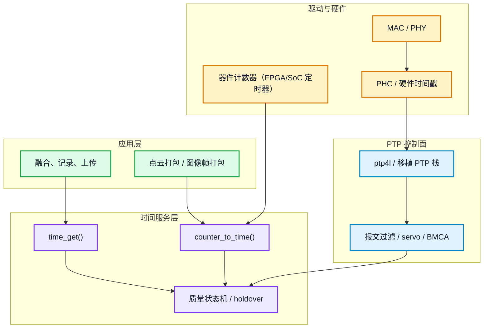
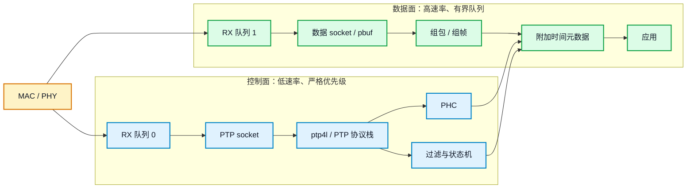
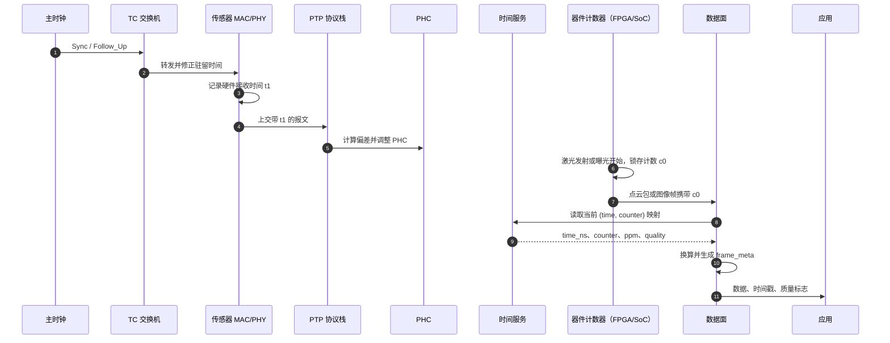
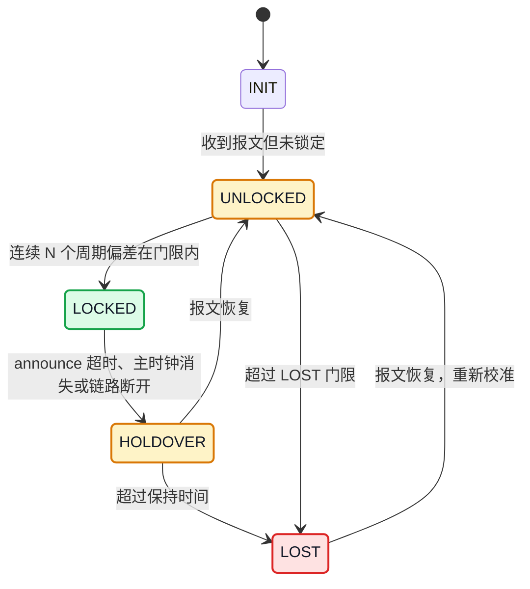
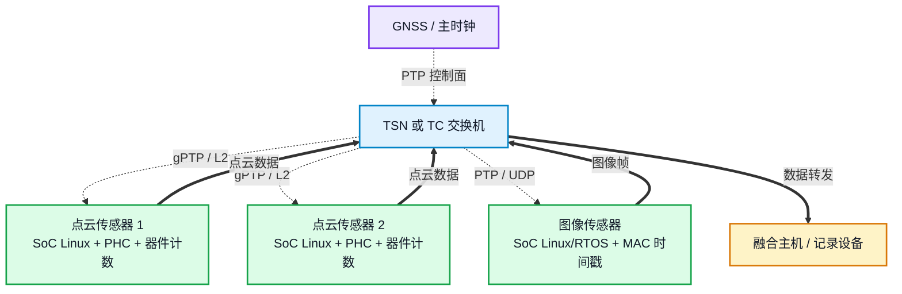

# PTP 网络模块设计：车载传感器的授时链路

> **概述：** PTP 网络模块的目标不是把 `ptp4l` 跑起来，而是让每一帧点云或图像都带一个可解释、可验证的时间戳：它来自哪个时钟，经过哪条链路，失锁时是否仍然可信。本文给出一套面向车载传感器的模块划分、接口、报文过滤、状态机与验证方法。

网络收包的通用优化，包括批量收包、队列、内存池、CPU 绑定和零拷贝，已经在 [Linux 编程：嵌入式 ARM 平台 Linux 网络实时性能优化](https://deguiliu.github.io/tech-notes/posts/performance/arm_linux_network_optimization/) 中讨论。本文只讨论 PTP 相关的设计：时间戳从哪里来，怎样和传感器数据绑定，异常时怎样降级。

先说明范围。本文以 Linux 为主，最后给出 lwIP 和 RTOS 的差异。示例假设 SoC 的 MAC 或 PHY 支持硬件时间戳，并且有一颗可被 PTP 调整的硬件时钟（PHC）。如果硬件不具备这些能力，设计目标要降级，不能靠软件补偿声称达到微秒级。

几个词先统一：

| 术语 | 含义 |
| --- | --- |
| PTP | 精确时间协议，IEEE 1588，用来让网络中的设备保持同一时间 |
| gPTP | IEEE 802.1AS，车载以太网和 TSN 常用的 PTP profile |
| 主时钟 / 从时钟 | 提供基准时间的设备 / 跟随主时钟的设备 |
| PHC | 网卡或 SoC 内的硬件时钟，PTP 直接调整它 |
| 硬件时间戳 | MAC 或 PHY 在报文收发时刻记录的时间，简称 HWTS |
| TC | 透明时钟，交换机记录报文在本节点的驻留时间并转发 |
| BMCA | 最佳主时钟算法，用来选举主时钟 |
| servo | 伺服算法，根据偏差调整本地时钟的频率和相位 |
| holdover | 失锁保持，主时钟消失后靠本地晶振继续维持时间 |
| PPS | 秒脉冲，每秒输出一个边沿，常用于测量和校准 |
| TAI / UTC | 国际原子时 / 协调世界时，TAI 比 UTC 快 37 秒（截至 2026 年） |

PTP 的闭环可以压成三步：主时钟周期发送 Sync，从时钟记录到达时间；两步模式再由 Follow_Up 把发送时间告诉从时钟。链路延迟用 Delay_Req/Delay_Resp（E2E，端到端）或 Pdelay_Req/Pdelay_Resp（P2P，邻居到邻居）测量。伺服算法根据偏差调整本地时钟。gPTP 使用 P2P，普通 PTP 常用 E2E；后文出现 pdelay 时，指的就是 P2P 的邻居延时测量。

## 1. 场景与指标：车载传感器要的不是同一种时间

本章先把两类典型车载传感器分开，一类是高包速率的点云传感器，另一类是整帧输出的图像传感器。两者的数据形态、时间戳含义和失效后果不同，如果都用“传感器数据”概括，后面的设计很容易选错参数。

### 1.1 数据形态不同

| 类型 | 数据形态 | 包速率 | 时间戳粒度 | 主要问题 |
| --- | --- | --- | --- | --- |
| 点云传感器（如激光雷达） | 点云数据报，单包常接近 MTU | 高，可能短时突发 | 点、包或帧 | 多机点云拼接、包序、丢包 |
| 图像传感器（如红外模组） | 整帧图像拆成多个包，单帧几十 KB 到数百 KB | 中等，随帧率变化 | 帧，通常对应曝光开始或结束 | 帧重组、曝光时刻、丢包后整帧有效性 |

红外模组经网络输出时，常见形态是一整帧拆成很多包，而不是持续不断的小包。它关心的是帧边界和曝光时刻，不是每个包的时间戳。点云传感器相反，单包接近 MTU，包速率高，时间戳要落到点云的行、列或包。把两者混为一谈，会导致缓冲区大小、队列深度和过滤规则都不合适。控制命令只影响队列优先级，不参与本文的时间戳设计。

### 1.2 三个时间不能混

一条传感器数据从产生到应用，至少经过三个时间点：

1. **事件时间**：激光脉冲发射、红外探测器曝光开始或结束的时刻。
2. **到达时间**：报文到达 MAC 或 PHY 的时刻，硬件时间戳记录的是这个时间。
3. **可用时间**：应用读到数据、完成组帧的时刻。

PTP 只负责让网络中的时钟对齐，不会把事件时间变出来。点云传感器的点时间戳必须来自传感器内部的计时单元在发射时刻锁存的计数，这个计时单元可能是 FPGA、SoC 定时器或专用计数器，不能假定一定是 FPGA；图像传感器的帧时间戳必须来自曝光同步信号或传感器帧同步信号。用报文到达时间代替事件时间，误差会包含传感器事件到 MAC/PHY 的链路延迟和网络排队；如果时间戳是软件打的，还会叠加中断延迟和线程调度。这个误差可能远大于传感器周期。

### 1.3 精度目标决定成本

| 目标精度 | 典型手段 | 适用场景 | 代价 |
| --- | --- | --- | --- |
| 10 ms 级 | NTP 或应用层对时 | 日志、低速状态上报 | 低 |
| 100 μs 至 1 ms 级 | PTP + 软件时间戳 | 低频传感器、事件回溯 | 中；轻载直连可到十几至几十 μs，但不保证 |
| 100 μs 级 | PTP + MAC 硬件时间戳 | 多传感器融合、工业控制 | 需要网卡和驱动支持 |
| 1 至 10 μs 级 | 硬件时间戳 + 良好 PHY + 受控队列 | 车载传感器、车载以太网 | TC/L2 只是传输条件，不能单独保证精度 |
| 1 μs 以下 | PHY 时间戳 + TC + 校准 | 高精度测量、同步采样 | 成本和调试难度都高 |

精度目标要先写进需求，再选协议和硬件。1 ms 和 1 μs 的差别，主要不在 `ptp4l` 配置，而在时间戳打在哪一层、PTP 报文会不会被数据流挤掉、交换机是否支持 TC，以及 CPU 是否给 PTP 留出了稳定时间片。高包速率车载传感器现场常见的目标是 1 至 100 μs，具体落在哪一端，取决于时间戳路径、交换机、PHY 和负载。不要用一个实验环境的平均值代替验收指标。

## 2. 需求拆解：设计前要回答五个问题

上一章把数据形态和精度目标分开了。下一步把这些目标变成可设计、可验证的需求。下面五个问题没有答案时，不要急着选型。

| 问题 | 设计输出 | 常见错误 |
| --- | --- | --- |
| 时间基准是什么 | UTC 还是 TAI，闰秒怎样处理，谁负责换算 | 主从 `ptpTimescale` 或 `currentUtcOffset` 不一致，出现 37 秒偏差 |
| 时间戳打在哪 | PHY、MAC、器件计数器还是应用层 | 用 `clock_gettime` 记录的时间当传感器事件时间 |
| 数据契约是什么 | 每点、每包还是每帧带时间戳，是否带质量字段 | 时间戳和帧边界不同步，丢包后仍然打戳 |
| 失效时怎么办 | holdover、LOST、step 限制、数据标记 | 主时钟恢复时时间跳变，点云时间戳倒退 |
| 现场怎样观测 | 状态、计数器、日志、告警接口 | 现场只能看到“同步”或“不同步”，无法定位 |

把这五个问题写成一张需求表，后面每个模块都要能追溯到其中一项。比如“时间戳打在哪”决定了驱动要不要开硬件时间戳，“失效时怎么办”决定了时间服务层要不要保存映射的 epoch。

## 3. 参考架构：控制面与数据面分开

需求明确后，才能决定模块怎么分层。PTP 网络模块可以分成四层：硬件、驱动、协议、时间服务。数据面和管理面作为跨层模块，分别负责业务数据和状态观测。分层是为了让每层只承担一种责任，出问题时能定位到具体一层。

### 3.1 分层结构



*图 1：PTP 网络模块的分层与主要数据流。数据面和管理面是跨层模块，图中只画时间主路径。*

每一层的职责可以这样划分：

| 模块 | 职责 | 不应该做什么 |
| --- | --- | --- |
| `ptp_net` | 收发包、使能硬件时间戳、读取收发时间 | 不直接修改系统时钟 |
| `ptp_filter` | 检查 domain、源身份、序列号，识别 TC | 不做 servo 计算 |
| `ptp_servo` | 计算偏差、调整 PHC 或系统时间 | 不碰数据缓冲区和业务队列 |
| `ptp_time` | 维护时间映射、换算、质量状态 | 不拥有点云或图像缓冲区 |
| `ptp_data` | 组包、组帧、附加时间元数据 | 不解析 PTP 报文 |
| `ptp_status` | 计数器、日志、告警、看门狗 | 不在热路径做阻塞操作 |

### 3.2 控制面与数据面分开

PTP 报文每秒只有几十到几百个，数据面每秒可能有几万到几十万个包。两者共享同一个 MAC，但不能共享同一个无界队列。PTP 报文排在大帧或突发数据后面，硬件时间戳仍然正确，但 PTP 协议栈处理会被推迟，伺服更新变慢，状态开始抖动。



*图 2：控制面与数据面共享 MAC。以具备多 RX 队列的 MAC 为例；单队列时只能共享 NAPI，并靠处理预算和入口过滤降低干扰。*

控制面需要稳定的时间戳路径和较低的排队延迟，不需要跟着数据面放大 `SO_RCVBUF`。数据面需要大缓冲和有界队列，但不能把 PTP 报文一起塞进去。

Linux 上，只有网卡有多个 RX 队列，并且驱动或交换机支持按 EtherType、UDP 端口或 VLAN PCP 分类时，才谈得上把 PTP 放进独立队列。发送方向可以用 `SO_PRIORITY` 或 VLAN PCP；接收方向的 `SO_PRIORITY` 不起作用。单队列 MAC 上，PTP 和数据共享同一个 NAPI 实例，只能靠限制 `netdev_budget` 和单次处理时间、在驱动入口过滤 PTP、给 PTP 线程留出时间片来降低干扰，不能假设一定能物理隔离。lwIP 没有多队列和 `SO_PRIORITY`，更要在驱动入口做过滤和优先级区分。

### 3.3 CPU 与队列的分配

同一路传感器数据的收包、组包和发送固定在一个 CPU 核。多核用于不同数据流、不同网卡队列，或者控制、日志、看门狗等不同职责。这条规则在 PTP 场景下同样成立：同一路点云的收包和组包跨核，会带来缓存失效、队列竞争和包序抖动，时间戳再准也没有意义。

PTP 是控制流，可以放在控制核。只有一个核时，给 PTP 线程更高优先级，同时给数据面设处理预算，避免一次突发把 PTP 线程饿死。优先级只在单核竞争或软件时间戳场景下明显；已经使用硬件时间戳时，它通常不是精度瓶颈。一套高包速率传感器平台出现过这样的问题：数据面读取粒度从 128 KB 改成 64 KB，但 DMA buffer 仍是 128 KB，每次读只拿一半，剩余数据触发下一次读取和重试，CPU 被拖在数据面，`ptp4l` 报文处理被挤占，同步状态在锁定和未锁定之间来回跳。把 buffer 对齐后恢复。这不是 PTP 协议的问题，是数据面把控制面的时间片吃掉了。

### 3.4 对上接口

时间服务层对上提供两组接口：取当前时间，以及把器件计数换算成带质量的帧元数据。接口要明确返回值的含义，避免上层把“最后一次同步成功的时间”当成“当前时间”。

```c
typedef enum {
    TIME_OK = 0,        /* 已锁定，时间戳可用于融合 */
    TIME_DEGRADED = 1,  /* 失锁但仍在保持，误差在扩大 */
    TIME_INVALID = 2    /* 超过保持时间，不能当时间基准使用 */
} time_quality_t;

typedef enum {
    TIMESCALE_UTC = 0,
    TIMESCALE_TAI = 1
} timescale_t;

typedef struct {
    uint64_t time_ns;        /* 按 timescale 解释的纳秒时间 */
    uint64_t mono_ns;        /* 单调时钟，用于超时和差分 */
    uint32_t uncertainty_ns; /* 估计不确定度，不是硬保证 */
    uint32_t epoch;          /* 映射代次，step 后递增 */
    time_quality_t quality;
    timescale_t timescale;
} time_sample_t;

typedef struct {
    uint64_t device_counter; /* 事件时刻的器件计数 */
    uint64_t time_ns;        /* 换算后的时间，含义看 timescale */
    uint64_t mono_ns;        /* 采集时刻的单调时间，用于排序 */
    uint32_t uncertainty_ns;
    uint32_t epoch;
    time_quality_t quality;
    timescale_t timescale;
} frame_meta_t;

int time_get(time_sample_t *out);
int time_counter_to_meta(uint64_t counter, uint32_t epoch, frame_meta_t *out);
```

上层拿到 `frame_meta_t` 后，即使时间质量是 `TIME_DEGRADED`，也可以选择继续记录，只是把该帧标记为低置信度。质量字段必须随数据一起走，不能只放在日志里。融合算法需要知道哪一帧的时间可信，而不是事后猜。`mono_ns` 用于超时和排序，不参与时间基准映射；`epoch` 用于识别 step，`time_map.seq` 用于防读撕裂，两者不能混用。`time_counter_to_meta` 在传入的 `epoch` 与当前映射不一致时应返回错误，不能悄悄用新映射换算旧帧。

Linux 上，`ptp4l` 调整 PHC，`phc2sys` 把 PHC 同步到 `CLOCK_REALTIME`。数据打戳优先读 PHC；日志和 `date` 读系统时间。两条时间线不要混用，系统时间还可能被 NTP 或管理员再次调整。

## 4. 实现：从收包到打戳

架构定下来后，下面看每个模块的具体实现。顺序按数据流走：先选传输方式和 socket，再开硬件时间戳，然后建立器件计数到时间基准的映射，最后处理过滤、状态机和数据面。

### 4.1 传输方式与 socket

PTP 的传输方式决定了报文走哪条路径，也决定了 socket 类型和现场排障方式。

| 方式 | 报文路径 | 目标地址 | 适用场景 | 主要限制 |
| --- | --- | --- | --- | --- |
| gPTP | 二层多播 | `01:80:C2:00:00:0E` | 车载以太网、TSN、有 TC 交换机 | 多从时钟或需要驻留时间补偿时，交换机要支持 802.1AS 的每端口 pdelay 和 correctionField |
| PTP L2 | 二层多播 | `01:1B:19:00:00:00` | 工业控制、想绕开 IP 过滤 | 不能跨路由器 |
| UDPv4 多播 | UDP 319/320 | 组播地址 | 普通 PTP 网络 | 组播可能被交换机或防火墙过滤 |
| UDPv4 单播 | UDP 319/320 | 主时钟或从时钟单播地址 | 跨网段、客户要求单播 | 需要维护单播表，`ptp4l` 版本要支持 |

选择顺序可以按下面的规则：

1. 有 TSN 或车载以太网主干，交换机支持 TC，优先 gPTP。
2. 只能二层通信，或者 IP 层被防火墙过滤，用 PTP L2。
3. 需要跨网段，或者客户明确要求单播，用 UDP 单播。
4. 普通工业网络，没有特殊限制，用 UDP 多播。

gPTP 从时钟的典型配置如下。`neighborPropDelayThresh` 的单位是纳秒，写成 800 会被当成 800 ns，链路被误判为不可达。

```ini
[global]
gmCapable               0
priority1               254
priority2               254
domainNumber            0
logSyncInterval         -3
syncReceiptTimeout      3
neighborPropDelayThresh 800000
transportSpecific       0x1
ptp_dst_mac             01:80:C2:00:00:0E
network_transport       L2
delay_mechanism         P2P
time_stamping           hardware
clock_servo             linreg
clientOnly              1
inhibit_announce        1

[eth0]
# 端口级参数放在这里；接口名也可以由启动命令 -i eth0 指定
```

启动命令：

```bash
ptp4l -f gptp.cfg -i eth0 -m
```

`clientOnly` 是当前版本的名字，旧版本用 `slaveOnly 1`，两者不要同时设置。`gmCapable 0` 表示这个节点不参与当主时钟；如果设备确实要具备主时钟能力，再改成 1 并重新评估 BMCA。`neighborPropDelayThresh 800000` 是 800 μs，默认值偏宽松；线缆和 PHY 延迟远小于这个值时，应按实测分布收紧，避免接受远端串扰。

Linux 上二层报文用 `AF_PACKET` 收发，通常由 `ptp4l` 处理；三层报文用 UDP socket。二层 socket 要挂 BPF 只接收 `0x88F7`，否则 PTP socket 会收到全部数据帧；有 VLAN 标签时，先跳过 802.1Q 头再判断 EtherType。嵌入式平台的 fd 数量通常不大，单路或少量固定 socket 用阻塞 `recvmmsg` 就够；需要同时等多个 fd 时用 `poll`；fd 少且编号受控时可以用 `select`。`epoll` 不是嵌入式主路径，lwIP 通常也没有 `epoll`。

lwIP 的差异更大一些：

| 平台 | 定时器 | 收包方式 | 硬件时间戳 |
| --- | --- | --- | --- |
| Linux | hrtimer、`timerfd` | socket、`recvmmsg`、`poll`/`select` | PHC + `SO_TIMESTAMPING`；`phc2sys` 同步系统时间 |
| lwIP | `sys_timeout`、`sys_check_timeouts` | netconn 或 raw API，pbuf 链 | MAC/PHY 的时间戳单元，驱动从寄存器或 DMA 描述符读取 |
| 裸机 | 硬件定时器 | 中断 + DMA 环 | MAC/PHY 的时间戳单元；PPS 只用于校准，不提供逐包时间戳 |

lwIP 没有 `epoll`。`NO_SYS=0` 时，`sys_check_timeouts` 通常由 `tcpip_thread` 调用，raw API 的回调也在该线程；`NO_SYS=1` 时由主循环调用。只有 socket API 才有 `lwip_select`/`lwip_poll`，raw API 没有 fd 事件循环。lwIP 本身不是 PTP 协议栈，PTP 的报文解析、BMCA、servo 和过滤要移植 ptpd/linuxptp 的对应部分，或者自己实现。回调和定时器处理都必须短，不能阻塞。`libev` 提供事件循环和软件定时器，但不提供硬件时间戳，软件定时器的精度不能当成 PTP 精度。

如果目标是 RT-Thread/lwIP，本文只覆盖时间戳、队列和状态机的设计原则；PTP 协议栈、BMCA、servo 和 MAC 时间戳驱动的移植要单独做。移植前先确认 MAC 是否有 PTP 时间戳寄存器和 PPS 输出，否则精度目标要降级。

### 4.2 硬件时间戳

先确认网卡和驱动支持哪些时间戳：

```bash
ethtool -T eth0
```

输出里应能看到 `hardware-transmit`、`hardware-receive` 和 `hardware-raw-clock`。只有 `software-transmit` 或 `software-receive` 时，精度通常在 100 μs 至 1 ms，轻载直连可能到几十 μs，但不能保证微秒级。

应用通过 `SO_TIMESTAMPING` 请求时间戳。驱动还要通过 `SIOCSHWTSTAMP` 配置哪些报文需要打时间戳，过滤规则没有覆盖 PTP 报文时，硬件时间戳字段仍然是 0。下面的标志表示接收和发送都使用硬件时间戳，发送方向只回传时间戳，不把原报文放回错误队列：

```c
int flags = SOF_TIMESTAMPING_RX_HARDWARE |
            SOF_TIMESTAMPING_TX_HARDWARE |
            SOF_TIMESTAMPING_RAW_HARDWARE |
            SOF_TIMESTAMPING_OPT_TSONLY |
            SOF_TIMESTAMPING_OPT_ID;

if (setsockopt(fd, SOL_SOCKET, SO_TIMESTAMPING, &flags, sizeof(flags)) < 0) {
    /* 记录能力不足，降级而不是静默继续 */
}
```

`SIOCSHWTSTAMP` 的 `hwtstamp_config.rx_filter` 要按 PTP 报文类型设置，并检查调用返回的实际值。驱动或硬件不支持目标过滤值时，可能退化成更宽或更窄的过滤，结果是所有包都打时间戳，或者 PTP 包没有时间戳。P2P 要覆盖 Pdelay_Req 和 Pdelay_Resp，不能只配对 Sync。上线前用“有时间戳的包数/预期 PTP 包数”做一次计数核对。

收包时从控制消息里取硬件时间戳。`SO_TIMESTAMPING` 返回三个 `timespec`：软件时间戳、旧接口时间戳、硬件原始时间戳。第三个才是 PHC 的时间。

```c
static int read_hw_timestamp(struct msghdr *msg, struct timespec *out)
{
    struct cmsghdr *cmsg;

    for (cmsg = CMSG_FIRSTHDR(msg); cmsg != NULL; cmsg = CMSG_NXTHDR(msg, cmsg)) {
        if (cmsg->cmsg_level != SOL_SOCKET ||
            cmsg->cmsg_type != SO_TIMESTAMPING) {
            continue;
        }

        struct timespec *ts = (struct timespec *)CMSG_DATA(cmsg);
        if (ts[2].tv_sec == 0 && ts[2].tv_nsec == 0) {
            return -1; /* 没有硬件时间戳 */
        }

        *out = ts[2];
        return 0;
    }

    return -1;
}
```

发送方向的时间戳从 socket 错误队列读取，调用 `recvmsg(fd, ..., MSG_ERRQUEUE)`，在 `SCM_TIMESTAMPING` 控制消息里取 `timespec[2]`。报文 ID 在 `sock_extended_err.ee_data` 中，要和发送时记录的 ID 配对。不能假设“收到的下一个时间戳就是刚才那包的”，多队列网卡上完成顺序和发送顺序可能不同。one-step 模式下 Sync 的发送时间写在报文里，不从错误队列回传，代码要按 one-step/two-step 分开处理。

硬件时间戳只解决 PTP 报文的收发时刻。传感器数据的时间戳还要经过下一节的映射。

### 4.3 器件计数到时间基准的映射

PTP 让 PHC 和主时钟对齐，但点云传感器的时间来自器件计数器，图像传感器的时间来自曝光同步信号。两者需要一个映射：用 PPS、传感器触发沿或帧同步信号锁存一个器件计数，同时读取 PHC；没有硬件锁存时，前后各读一次计数并取中点，把两次读取的偏斜计入不确定度。得到一对 `(time_ns, counter)` 后，才能把任意计数换算成时间。

控制面和数据面的时间关系可以用下面的时序表示。上半部分是 PTP 如何把 PHC 拉齐，下半部分是传感器事件如何借用这条时间基准。



*图 3：PTP 对时链路与传感器数据打戳路径。PHC 只负责时间基准，器件计数到时间的映射由时间服务维护。*

```c
struct time_map {
    uint64_t time_ns;   /* 建立映射时的时间 */
    uint64_t counter;   /* 同一时刻的器件计数 */
    uint64_t valid_ns;  /* 映射有效期 */
    uint32_t counter_hz; /* 器件计数器频率，例如 125000000，必须非零 */
    uint32_t seq;       /* 序列号，防止读到半更新数据 */
    int32_t  ppm;       /* 计数器相对时间基准的频率误差，正表示偏快 */
    timescale_t timescale;
};
```

换算时不能只做减法。器件晶振和 UTC 的频率不完全相同，温度变化还会带来漂移。下面的实现用 ppm 做一阶修正，实际项目要根据晶振特性和温度曲线决定是否需要更复杂的模型。

```c
uint64_t counter_to_time(uint64_t counter, const struct time_map *map)
{
    int64_t delta_ticks = (int64_t)(counter - map->counter);
    int64_t delta_ns = (delta_ticks / map->counter_hz) * 1000000000LL
                     + ((delta_ticks % map->counter_hz) * 1000000000LL) / map->counter_hz;
    int64_t corr = delta_ns - (delta_ns * (int64_t)map->ppm) / 1000000;
    return map->time_ns + (uint64_t)corr;
}
```

映射要周期刷新。刷新时不要直接改正在使用的结构，用双缓冲或序列号切换。写者按“`seq++`（奇数）、更新字段、`seq++`（偶数）”的顺序写，读者读完再检查 `seq` 是否一致；ARM 弱内存序下要配 acquire/release 屏障。调用 `counter_to_time` 前还要检查 `now - map.time_ns < map.valid_ns`，过期映射不能继续当有效时间使用。`valid_ns` 用 64 位，避免 32 位在几秒后就溢出。

映射失效时，数据仍然可以输出，但时间质量要降级，时间戳可以退化为单调计数。不能让上层把失效的时间基准当成有效时间。

转换放在哪一端要在接口里定死。推荐传感器只传计数，主机用最新映射换算；如果传感器端已经换算，帧头必须带 `epoch`、质量和 `timescale`，主机不能再套一次映射。两种方式不能混用，否则同一帧会被换算两次。

对点云传感器，点云包通常不需要每个点都带完整时间，带宽不够。可以在帧头放 `(counter_start, time_start, ppm, quality)`，每个点只带相对 `counter_start` 的增量。对图像传感器，帧头放曝光开始和结束的计数及对应时间基准，帧内不重复。时间元数据属于帧或包，不属于 payload，不能塞进图像数据中间。

### 4.4 报文过滤与主时钟候选

PTP 协议假设网络里的报文值得信任，现场网络不是。从时钟通过 announce 报文里的 `clockClass`、`priority1`、`priority2` 比较主时钟候选，选出主时钟；白名单是现场兜底，不替代 BMCA。过滤要放在状态机之前，避免异常报文把伺服打进故障状态。一个不支持 gPTP 的交换机会把某个从时钟的 `pdelay_resp` 透传给其他从时钟，其他从时钟看到源身份不匹配，报 `rogue peer delay response`，随后进入 FAULTY，按 `clock_fault_timeout` 静默（源材料为 16 秒，具体值随版本和配置）。这类问题在普通交换机加多从时钟的现场很常见。

过滤至少要做下面几件事：

1. 只接受配置的 domain。domain 不匹配的报文直接丢弃。
2. `announce` 和 `sync` 按当前主时钟或候选主时钟集合过滤。BMCA 还没选出主时钟时，不能把候选 `announce` 全丢掉；学习模式要有超时和人工锁定，不能“第一条 announce 即信任”。
3. `pdelay_resp` 来自邻居或 TC 端口，不能按主时钟 clockid 过滤。它必须与本地发出的 `pdelay_req` 按 `(requestingPortIdentity, sequenceId)` 配对，只有 sequenceId 相同不够。
4. 观察 `pdelay_resp` 的源身份。如果源身份等于主时钟，说明路径上没有改写源身份的 TC；如果不等于，可能是 TC 交换机，也可能是串扰。要结合 `requestingPortIdentity`、sequenceId 和拓扑判断，不能一律丢弃。
5. 对 announce 和 sync 做最小间隔检查，防止泛洪。PTP 报文速率很低，突然出现的高速率报文通常不正常。
6. 每条丢弃规则都要有计数器，现场能看出丢在哪一步。

```c
enum filter_result ptp_filter(const struct ptp_msg *msg, struct ptp_ctx *ctx)
{
    if (msg->domain != ctx->domain) {
        return DROP_DOMAIN;
    }

    if (msg->type == ANNOUNCE || msg->type == SYNC) {
        if (!gm_candidate(ctx, msg)) {
            return DROP_SOURCE;
        }
        if (!rate_ok(ctx, msg)) {
            return DROP_RATE;
        }
    } else if (msg->type == PDELAY_RESP) {
        if (!pdelay_match(ctx, msg)) { /* requestingPortIdentity + sequenceId */
            return DROP_SEQ;
        }
    }

    return PASS;
}
```

过滤规则要可配置、可观测。写死在代码里，客户换主时钟就要重新烧录；没有计数器，现场只能看到“不同步”，不知道是报文没到、domain 错了，还是被过滤了。

### 4.5 状态机与降级

状态机回答两个问题：当前时间能不能用；不能用时数据怎么办。只看 `ptp4l` 是否在运行不够，进程在运行不代表已经锁定，锁定也不代表偏差没有变大。



*图 4：时间质量状态机。链路断开先进入 HOLDOVER，超过保持时间才进入 LOST。*

几个参数要写清楚：

- **锁定门限**：连续多少个周期偏差小于多少纳秒，才进入 `LOCKED`。不能用一个样本判断。
- **解锁门限**：连续多少个周期超过多少纳秒，才退出 `LOCKED`。解锁门限要大于锁定门限，形成迟滞，避免在边界来回跳。
- **保持时间**：主时钟消失后，本地时钟还能维持多久。保持期间时间质量是 `TIME_DEGRADED`，不确定度随时间增长。
- **LOST 门限**：超过保持时间仍没有有效报文，进入 `LOST`，数据时间戳标记为 `TIME_INVALID`。

如果系统需要兼容某项目 PCS 的 7/8/14 私有状态码，可以这样映射。它们不是 IEEE 1588 的标准 portState：标准里 7 是 PASSIVE，8 是 UNCALIBRATED，9 是 SLAVE，14 不是 portState。

| 语义 | PCS 私有码 | 数据标记 | 含义 |
| --- | --- | --- | --- |
| LOCKED | 7 | `TIME_OK` | 已锁定，时间戳可用于融合 |
| UNLOCKED | 8 | `TIME_DEGRADED` | 还能收到报文，但未锁定 |
| LOST | 14 | `TIME_INVALID` | 超过阈值没有有效报文 |

不要把 8 当成 14 报警，也不要把 14 当成 7 使用。8 表示还能收到报文但没锁定，14 表示已经超时，数据时间戳不可信。`HOLDOVER` 没有对应的私有码时，要单独定义并上报，不能复用 7。PTP 和 gPTP 的失联语义也不同：PTP 主时钟关闭后可能先走 8，gPTP 可能直接超时到 14，告警映射要按协议区分。

主时钟恢复时，如果偏差超过 `step_threshold`，`ptp4l` 可能直接 step 它控制的 PHC；只有 `-S` 软件时间戳模式才直接 step 系统时钟。系统时间通常由 `phc2sys` 从 PHC 同步。step 会让时间跳变，正在使用的映射和帧时间戳可能倒退。设计上要在 step 前后冻结映射，递增 `epoch`，数据面看到 `epoch` 变化就重新取映射，不能跨 step 做差值。检测 step 不能只靠“时间不对”这种事后判断，可以比较 UTC 与单调时钟的差值跳变、读取 `ptp4l` 的 hook 或日志，或者用 `phc_ctl` 监测；没有检测机制，`epoch` 不会自动递增。

### 4.6 数据面：零拷贝与有界队列

PTP 报文很小，复制一次的开销可以忽略；数据面很大，每秒复制量可能是几 MB 到几百 MB。两者要用不同的策略。

数据面在 Linux 上通常走 socket 加环形缓冲，在 lwIP 上走 pbuf 链。pbuf 可以串成链；只有应用能消费 scatter-gather、且 pbuf 池按帧大小配置时，组帧才能只移动描述符。lwIP 默认的 `PBUF_POOL_SIZE` 往往远小于一帧需要的 pbuf 数，300 KB 的帧按 1460 B 分片大约要 211 个 pbuf，池不够时仍会复制或丢包。按每路流的帧长、帧率和最大排队时间计算池大小，或者用 `PBUF_REF` 和自定义池；ARM 非一致性 DMA 还要做 cache 维护。时间元数据放在描述符或帧头，不放进 payload。队列必须有界，满了按策略丢弃：点云可以丢最旧的包并标记该帧不完整，图像可以丢整帧，不能无限堆积到内存耗尽。

零拷贝的边界在 [C++ 零堆零拷贝：事件只构造一次，全程只传指针](https://deguiliu.github.io/tech-notes/posts/performance/zero_heap_zero_copy_event_passing/) 中讨论过：零拷贝的前提是地址稳定、生命周期明确、所有权清晰。PTP 模块只消费时间，不拥有数据缓冲区；数据面只附带时间元数据，不把 PTP 状态机嵌进组帧逻辑。

## 5. 两类车载传感器的落地差异

同一套架构，落到不同车载传感器时，参数和侧重点不同。下面以点云传感器和图像传感器两类典型形态为例，避免把一种场景的经验直接套到另一种。

### 5.1 点云传感器

以激光雷达这类高包速率点云传感器为例，网络模块通常面对高速数据报。设计重点如下：

- **时间戳位置**：传感器内部的计时单元在发射时刻锁存计数，点云包携带计数器增量，帧头携带映射对和质量字段。这个计时单元可能是 FPGA、SoC 定时器或专用计数器。
- **传输方式**：有 TC 交换机时用 gPTP 加 P2P；IP 层被过滤或需要极致精度时用 PTP L2。某套嵌入式平台的记录是：XQ500 硬时钟主时钟、Lidar 侧为软时钟、L2 直连，平均偏差约 1.5 μs；两端软时钟直连，轻载记录约 13 μs。原始材料没有把“软时钟”和“软件时间戳”完全分开，这两个数字只用于量级对比，不能直接写成产品规格。
- **过滤**：多台点云传感器接普通交换机时，重点防 `rogue peer delay response`。识别 TC 或按 sequenceId 配对，可以避免十几秒静默。
- **CPU**：每路点云的收包、组包、发送固定在同一个核；PTP 放控制核，或者在同一核上给 PTP 更高优先级并限制数据面单次处理时间。
- **失效处理**：`LOST` 时点云仍然可以记录，但每帧标记为时间不可信。融合端可以选择降权，而不是直接丢弃整段数据。

### 5.2 图像传感器

以红外模组这类整帧输出传感器为例，经网络输出时常见形态是整帧图像拆成多个包。设计重点不同：

- **时间戳位置**：帧头记录曝光开始或结束的计数器及对应时间基准（UTC 或 TAI，随配置）。帧内不重复时间戳，避免带宽浪费。
- **传输方式**：UDP 单播或多播通常就够，不一定需要 gPTP 和 TC 交换机。如果客户网络过滤组播，改单播；如果 IP 层完全不可用，再考虑 L2。
- **精度目标**：多传感器融合常见要求是 100 μs 到 1 ms。比绝对精度更重要的是曝光时刻的稳定性和帧与帧之间的一致性。PTP 误差 1 ms 可能可以接受，曝光抖动 10 ms 不行。
- **缓冲**：一帧可能几十 KB 到数百 KB，至少准备双缓冲。帧不完整时整帧丢弃并标记，不能把半个帧打上时间戳交给应用。
- **CPU 与 socket**：单路或少量固定 socket 用阻塞 `recvmmsg`；需要等多个 fd 时用 `poll`；fd 少且编号受控可以用 `select`。不需要为了“高并发”引入 `epoll`，嵌入式现场通常没有那么多连接。
- **失效处理**：`HOLDOVER` 期间帧仍然输出，但质量降级；`LOST` 后帧时间戳标记无效，应用可以选择用本地单调时钟维持短时记录。

### 5.3 典型拓扑

下面的拓扑把控制面和数据面分开画。虚线是 PTP 控制面，实线是传感器数据面。主时钟可以来自 GNSS，也可以是带高稳晶振的授时设备；融合主机是数据消费者，不一定是 PTP 主时钟。



*图 5：车载传感器的典型部署拓扑。虚线是 PTP 控制面，实线是数据面。*

如果现场没有 TC 交换机，点云传感器可以退回普通 PTP 或 L2，但这是更换 delay mechanism 和 BMCA 语义，不是只换传输方式；多从时钟场景要重点测试 pdelay 串扰。图像传感器在 100 μs 至 1 ms 的目标下通常不需要 TC，是否敏感取决于 delay mechanism 和交换机队列，需要实测。

### 5.4 参数对照

| 项目 | 点云传感器（如激光雷达） | 图像传感器（如红外模组） |
| --- | --- | --- |
| 数据形态 | 点云数据报，接近 MTU | 整帧图像拆包，单帧几十 KB 到数百 KB |
| 包速率 | 高，可能突发 | 中等，随帧率变化 |
| 时间戳 | 点、包、帧头计数 | 帧头曝光时刻 |
| 传输方式 | gPTP、PTP L2 | UDP 单播或多播，必要时 L2 |
| 交换机 | 建议 TC | 普通交换机可满足 |
| 精度目标 | 1 至 100 μs | 100 μs 至 1 ms |
| 缓冲策略 | 有界包队列，丢包标记 | 双缓冲帧，整帧丢弃 |
| 失效处理 | 点云标记低置信度 | 帧标记无效或延迟输出 |

## 6. 验证与边界

设计完成后，需要证明它在目标板、目标网络和目标负载下可用。PTP 的验证不能只看 `pmc` 的一个 offset 数字，也不能只在实验室直连环境跑一遍。

### 6.1 验证清单

| 阶段 | 方法 | 通过标准 |
| --- | --- | --- |
| 硬件能力 | `ethtool -T eth0` | 有硬件收发时间戳和 PHC |
| PTP 链路 | `pmc -u -b 0 'GET TIME_STATUS_NP'` | 状态稳定，offset 的 p99 和最大值在预算内 |
| 报文 | L2：`tcpdump -i eth0 -nn ether proto 0x88f7`；UDP：`tcpdump -i eth0 -nn udp port 319 or udp port 320` | P2P 看 Pdelay_Req/Pdelay_Resp，E2E 看 Delay_Req/Delay_Resp；two-step 另有 Follow_Up，one-step 没有 |
| 时钟 | 先用 `ethtool -T eth0` 查 PHC 索引，再执行 `phc_ctl /dev/ptpX get`；同时看 `date` | PHC 与系统时间的关系符合配置 |
| 端到端 | 外部时间源或回环测量 | 数据时间戳误差在预算内 |
| 故障 | 拔网线、停主时钟、重启交换机 | 状态转换和恢复时间符合预期 |
| 负载 | 数据面满速，CPU 打到 95%；记录 `sched_rt_runtime_us` | PTP 不被 RT throttling 饿死，状态不跳变 |
| 长稳 | 24 小时、72 小时，条件允许再加温度循环 | socket 接收队列无异常增长（TCP IPC 场景重点看 Recv-Q）、无 fd 泄漏、无持续漂移 |

抓包时要注意，PTP over L2 的 EtherType 是 `0x88F7`；PTP over UDP 的端口是 319 和 320。两者抓法不同，不能只抓 UDP。gPTP 默认使用 P2P，没有 `Delay_Req`；如果配置是 E2E，才检查 `Delay_Req/Delay_Resp`。

### 6.2 指标要看分布

只看平均值会掩盖问题。一个平均 1 μs、偶尔跳到 5 ms 的链路，比平均 5 μs、最大 20 μs 的链路更危险。至少记录下面几项：

- offset 的 p50、p99 和最大值；
- 失锁次数和每次持续时间；
- 主时钟消失后的 holdover 漂移，单位 ppm；
- 恢复锁定所需时间；
- 端到端数据时间戳误差；
- PTP 报文丢弃计数和原因；
- 数据帧中 `TIME_OK`、`TIME_DEGRADED`、`TIME_INVALID` 的比例。

### 6.3 边界与常见误区

- **PTP 不修复采样抖动**：它只让时钟对齐。曝光抖动、激光触发抖动、器件计数器噪声要单独处理。
- **软件时间戳不能保证微秒级**：轻载直连可能到几十 μs，但负载、调度和驱动都会把它拉回 100 μs 至 1 ms，不要在规格书里承诺微秒级。
- **多从时钟的 gPTP 需要支持 802.1AS 的交换机**：普通交换机透传 pdelay 报文，多从时钟场景会出现串扰和静默。要么换支持每端口 pdelay 和 correctionField 的交换机，要么改回普通 PTP/E2E；单从直连是另一回事，要单独测。
- **L2 不能跨路由器**：需要跨网段时用 UDP 单播。
- **单设备不一定需要 PTP**：没有多传感器对齐需求时，单调时钟加本地记录就够了，引入 PTP 只会增加故障点。
- **PTP 不等于功能安全或车规认证**：它只是时间同步机制。功能安全、网络安全的认证要求要单独评估。
- **`clockdiff`、`pmc` 和点云时间戳不是同一种时间**：`clockdiff` 看系统时间，`pmc` 看补偿后的偏差，点云时间戳看应用层映射。只对一个，可能漏掉 TAI/UTC 的 37 秒偏差。
- **PTP 报文也会被攻击**：伪造 announce 可以把从时钟引到错误的主时钟。至少要做源过滤、domain 检查和速率限制；安全要求高的链路再考虑 MACsec 或 802.1X。

### 6.4 上线前检查表

1. `ethtool -T` 确认硬件时间戳能力，能力不足时在规格和日志里明确降级。
2. 具备多个 RX 队列时，把 PTP 分到独立队列；只有单队列时，限制 NAPI 预算和数据面单次处理时间，并接受 servo 更新会有抖动。`SO_PRIORITY` 只作用于发送，不能解决接收队列问题。
3. 同一路传感器数据的收包、组包、发送固定在一个核；PTP 线程有稳定时间片。
4. 过滤规则覆盖 domain、源身份、sequenceId 和速率，且每条规则有计数器。
5. 状态机有锁定门限、解锁门限、保持时间和 LOST 门限，参数可配置。
6. 时间映射有序列号、有效期和 epoch，step 后能安全切换。
7. 数据帧携带质量、不确定度和 epoch，应用能据此决定是否使用。
8. 主时钟消失、网线拔插、交换机重启、CPU 满载都做过故障注入。
9. 72 小时长稳通过；socket 接收队列、fd、内存和 offset 分布都有记录，TCP IPC 场景重点看 Recv-Q。
10. 配置、日志、抓包和恢复步骤形成文档，现场人员能按步骤排查。

## 附录：术语与参考

### 术语补充

- **one-step / two-step**：PTP 的两种时间戳模式。one-step 在报文中直接写入发送时间，two-step 先发 Sync，再用 Follow_Up 携带发送时间。
- **E2E / P2P**：端到端延时测量 / 邻居到邻居延时测量。gPTP 常用 P2P，普通 PTP 常用 E2E。
- **clockClass、priority1、priority2**：BMCA 选举主时钟时使用的属性。
- **`step_threshold`**：偏差超过该值时直接跳变时钟，否则用 slew 缓慢调整；单位是秒。
- **`tx_timestamp_timeout`**：等待发送时间戳的超时时间，单位毫秒；设置过小会导致发送时间戳丢失。
- **`SO_TIMESTAMPING`**：Linux socket 选项，用于请求软件或硬件收发时间戳。
- **`SIOCSHWTSTAMP`**：网卡 ioctl，用于配置哪些报文需要硬件时间戳。
- **pbuf**：lwIP 的报文缓冲区描述符，可以串成链；配合 `PBUF_REF`/`PBUF_ROM` 可以减少 payload 复制，组帧头部仍可能复制。
- **skb**：Linux 内核的 socket buffer，驱动和协议栈之间传递报文的结构。
- **`MSG_ERRQUEUE`**：Linux 读取发送时间戳和错误信息的 socket 标志，TX 硬件时间戳从这里返回。
- **`SCM_TIMESTAMPING`**：`SO_TIMESTAMPING` 在控制消息中的类型名，携带三个 `timespec`。
- **`hwtstamp_config`**：`SIOCSHWTSTAMP` 使用的配置结构，包含 TX 模式和 RX 过滤模式。
- **`phc2sys`**：linuxptp 的辅助程序，把 PHC 时间同步到 `CLOCK_REALTIME`。

### 参考资料

如果只读一份公开资料，建议从 [linuxptp 文档](https://linuxptp.nwtime.org/documentation/) 开始：`ptp4l`、`phc2sys`、`pmc` 的配置、状态查询和工具说明都在这里。

- [Linux kernel: Timestamping](https://docs.kernel.org/networking/timestamping.html)
- [Linux kernel: PTP hardware clock infrastructure](https://docs.kernel.org/driver-api/ptp.html)
- [linuxptp 项目文档](https://linuxptp.nwtime.org/)
- [lwIP 项目主页](https://savannah.nongnu.org/projects/lwip/)
- [IEEE 1588-2019 标准概述](https://standards.ieee.org/ieee/1588/6825/)
- [IEEE 802.1AS-2020 标准概述](https://standards.ieee.org/ieee/802.1AS/7109/)

### 相关文章

- [Linux 编程：嵌入式 ARM 平台 Linux 网络实时性能优化](https://deguiliu.github.io/tech-notes/posts/performance/arm_linux_network_optimization/)
- [C++ 零堆零拷贝：事件只构造一次，全程只传指针](https://deguiliu.github.io/tech-notes/posts/performance/zero_heap_zero_copy_event_passing/)
