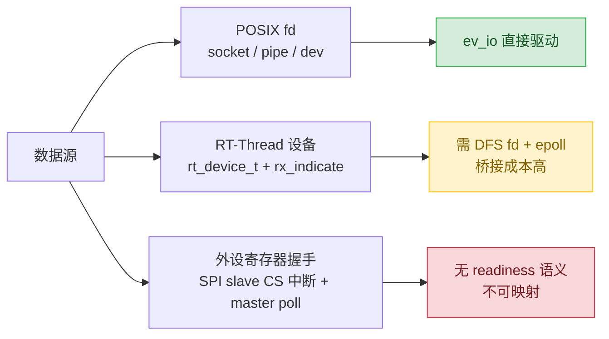
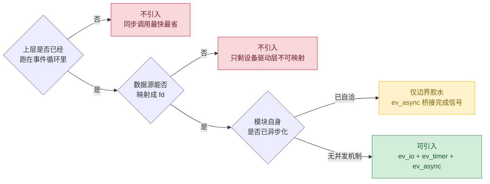

> 结论先行：对一套已经基于「中断 + 线程 + IPC」自洽的嵌入式模块群，引入 Reactor 事件循环（libev）在大多数模块上是净成本，本质是「第二套并发模型叠第一套」。是否值得，取决于两个先决条件：数据源能否映射成 fd、模块是否已有完整的并发机制。

## 1. 问题与评估框架

### 1.1 背景

某嵌入式 SoC（RT-Thread 内核）上已有若干模块：运行时通信中间件、数据持久化管理、批量烧录子系统、厂商命令解析服务（UART/SPI/CCI 多通道）。与此同时，团队在 host 侧用 libev 4.33 验证了一套事件驱动示例（ev_io / ev_timer / ev_async / 层级状态机）。

要回答的问题是：要不要把 libev 引入这些模块。

### 1.2 评估框架

每个模块只需问三个问题，答案基本就定了：

1. **数据源能不能映射成 fd？** libev 的 `ev_io` 只认有 readiness 语义的 POSIX fd。
2. **模块是否已有完整的并发/同步机制？** 若已有「线程 + 锁 + 事件」，再引入就是叠加。
3. **引入是替代还是叠加？** 替代有价值，叠加是冗余。

## 2. 数据源形态决定适配边界

`ev_io` 的底层是 epoll/select，它等待的是「这个 fd 有数据可读/可写」。因此数据源的形态直接决定了适配成本。按形态分三类：

| 类别 | 形态 | 能否被 `ev_io` 驱动 |
|---|---|---|
| A 类 | POSIX fd（socket、pipe、DFS 下的 `/dev/xxx`） | 直接可用 |
| B 类 | RT-Thread 设备 `rt_device_t` + 中断 `rx_indicate` | 需 DFS fd + epoll 桥接，成本高 |
| C 类 | 直接操作外设寄存器的同步握手（SPI slave 的 CS 中断 + master poll） | 无 readiness 语义，不可映射 |

这一问就淘汰掉一半场景：凡是数据源是「设备 + 中断」而非 fd 的模块，引入 libev 都先背上「DFS fd + epoll 桥接」的移植与验证成本。

## 3. 逐模块评估结论

评估遵循同一套逻辑，结论按适配难度从「互补」到「不可」排序。

| 模块 | 数据源形态 | 已有并发机制 | 结论 |
|---|---|---|---|
| 运行时通信中间件 | 无 fd，纯 IPC | signal S/R + service C/S | 互补，不可替代 |
| 非易失存储（NAND/NOR） | MTD 设备，poll 恒 ready | worker 线程 + 有界缓存 | 只做异步调度层 |
| 数据持久化管理 | 文件/存储语义 | HSM + 锁层级 + worker/reader + Condition/Event | 只适合边界适配 |
| 批量烧录子系统 | 文件语义 | 已异步化最彻底 | 最不需要 |
| 厂商命令解析服务 | 设备 + 中断 + 寄存器 | rx_indicate + 事件线程 + 状态机 | 最不适合 |

### 3.1 通信中间件：互补，不可替代

通信中间件的职责是模块间通信（信号发布订阅、服务调用），基于内核 mutex/mq/sem/thread 实现。它不是事件循环，与 libev 处在不同层次：前者解决「模块间怎么传数据」，后者解决「单个上下文里怎么调度 I/O」。两者互补，不存在替代关系。

### 3.2 非易失存储：只做异步调度层

NAND/NOR 的 MTD 设备在 poll 下恒返回 ready，`ev_io` 直接监视 flash fd 没有意义。libev 在这里的正确姿势不是监视存储 fd，而是作为异步调度层：把慢速擦写放到 worker 线程，用 `ev_async` 把完成信号送回事件循环。即「异步调度」而非「事件驱动 I/O」。

### 3.3 数据持久化：边界适配有冗余

该模块内部已有完整并发机制：层级状态机、多级锁、worker/reader 线程、条件变量与事件。libev 若进入内部就是第二套并发模型。唯一合理的位置是**边界**：当上层应用本来就跑在事件循环里、需要在循环中触发持久化的慢操作时，用 `ev_async` 桥接完成通知。这是「胶水」，不是「重写」。

### 3.4 批量烧录：最不需要

批量烧录是持久化模块里异步化最彻底的部分，自带 worker 线程、reader 线程、有界缓存和完成通知。再在外面包一层 `ev_async` 就是「线程套线程」的纯冗余。它需要的不是「用 libev 重写」，而是「把完成信号桥接进上层的循环」，前提是上层有循环可桥接。

### 3.5 厂商命令解析：最不适合

这是设备驱动层：数据源是 `rt_device_t` + 中断回调，SPI slave 路径更是直接读写外设 FIFO 寄存器、靠 CS 中断和 master poll 做同步握手。这类数据源没有「fd 可读」的 readiness 语义，`ev_io` 无从下手。现有形态（中断唤醒 → 事件线程 → 状态机解析 → IPC 分发）已经自洽，引入 libev 是净成本。唯一正相关的结论是：它的 UART 解析逻辑可以在 host 上用 libev + 状态机做纯软件测试桩。

## 4. 冗余开销从哪来

假设硬要在边界引入 `ev_async` + worker 做异步适配，账单如下：

| 开销 | 具体成本 |
|---|---|
| 额外线程 | worker 线程栈 + 线程控制块（嵌入式 SRAM 稀缺时是真实压力） |
| `ev_async` 本体 | 一个 watcher + 底层 pipe（依赖内核 POSIX pipe 支持） |
| 双层同步 | 模块内部一套锁/事件，适配层再一套 |
| 数据传递 | 请求/响应在调用线程与 worker 之间拷贝或加锁 |
| 延迟 | 同步「调用即返回」变为「提交 → 调度 → 执行 → 通知 → 回调」 |

**何时不冗余**：上层应用本来就在事件循环里（有持续 I/O、定时、心跳），且需要非阻塞触发慢操作时，`ev_async` + worker 是顺水推舟。

**何时纯冗余**：上层是同步调用模型，或目标操作本身已自带 worker 线程，再叠一层就是为异步而异步。

## 5. 决策与建议

把「该不该引入」收敛成一条决策链：

三点落地建议：

1. **不要为了引入而引入**。模块已自洽时，libev 不进入模块内部，只在「上层已经是事件驱动」的边界做 `ev_async` 桥接。
2. **数据源先验判断**。动手前先问「有没有 fd」，设备 + 中断驱动的模块（尤其涉及外设寄存器的）直接排除。
3. **host 仿真才是 libev 的甜点**。用 pipe 或文件喂数据、在无硬件环境跑解析逻辑，是 libev 最合适、也最没争议的落点。

> 一句话：Reactor 事件循环和「设备驱动 / 线程 + IPC」是不同层次的东西，前者在后者之上。引入与否不取决于 libev 好不好，而取决于目标模块的数据源形态与已有并发机制是否留出了它的位置。
