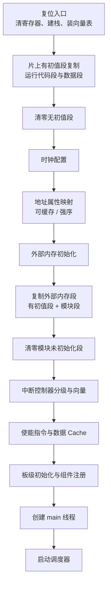

启动链路里最容易犯的错误，是把“汇编搬段”“初始化外部内存”“启动调度器”当成一件事。它们其实是四段，每段都有自己的前置条件，顺序换一下就会失败，而且失败现象都长得很像：没有任何输出。

前面三篇讲的是画面怎么流出芯片；这一批往下走一层，讲它流出之前依赖的东西。这一篇讲启动顺序，下一篇讲这些地址是怎么定下来的。

## 1. 启动分成四段

| 段 | 做什么 | 前置条件 |
|---|---|---|
| 复位入口 | 建立最小可运行的 C 环境 | 只有片上内存可用 |
| 片上初始化 | 时钟、地址属性、Cache、外设基础 | 入口已建立，栈可用 |
| 外部内存 | 初始化 DDR 或片内高速 RAM，再复制对应段 | 时钟与地址属性已配好 |
| 内核启动 | 板级初始化、组件注册、调度器启动 | 所有代码与数据都在可访问的内存里 |

分段的意义在于定位：如果连串口都没有输出，问题在第一段或第二段；如果串口有输出但某个组件没起来，问题在第四段的注册顺序；如果系统能起但画面没有，启动链路大概率已经跑完了，该去查采集和输出。

## 2. 复位入口：先造出能跑 C 的环境

复位后的第一件事是把处理器状态清成已知值：31 个通用寄存器逐个清零，原因是复位前它们的内容不确定，而后面所有代码都默认这是从头开始；接着建立全局指针，把异常入口设成默认处理入口，装上向量表，并把栈顶指向中断栈。这一步做完，才有资格执行第一条 C 代码。

复位后能访问的只有片上内存，所以第一批要处理的段都落在片上：需要运行的代码段、有初值的数据段、以及运行时必须为零的段。前两类要从镜像里复制到运行地址，后一类直接清零。它们的共同点是“目的地址必须在复位后立刻可写”，因此这一步一定发生在外部内存初始化之前。

这里的顺序不能反过来。把需要访问外部内存的段放在这一步复制，就是往一块还没初始化的空间里写数据；而把它放到后面又会漏掉片上段。两者都做、且按正确顺序做，才是完整的搬运流程。

## 3. 片上初始化：时钟、地址属性与中断

第二段是一串有严格顺序的初始化：先让调试通路可用，再打开扩展指令、精确故障定位、非对齐访问和浮点状态；接着配置系统时钟；然后配置地址属性映射，也就是告诉核哪些区间是可缓存的、哪些必须强序访问；再初始化外部内存；之后配置中断控制器的分级、清掉挂起状态、建立向量；最后才使能指令与数据 Cache，并开启机器模式软件中断。

这个顺序里有两处不能交换。时钟必须早于任何依赖时序的外设；地址属性必须早于 Cache 使能，否则 Cache 会按默认属性去缓存本不该缓存的区间，之后即使改了属性，已经进 Cache 的内容也不会自动作废。

## 4. 外部内存与内核启动

外部内存那一段的执行顺序是固定的：先初始化外部内存本身，等它返回之后，再复制放在外部内存里的代码段和数据段，然后是各模块自己的内存段，最后清零各模块中不需要初值的段。把这段顺序写反（先搬数据再初始化内存）是容易写错的一处结论。

外部内存初始化完成后，启动进入内核阶段：板级初始化建立串口、控制台、系统节拍与堆，随后依次初始化定时器与调度器、创建主线程、创建定时器线程与空闲线程，最后启动调度器。这一段真正需要记住的是两条：**主线程在调度器启动之前只是就绪状态，一行都不执行**；**板级自动初始化和后面组件注册的自动初始化不在同一时刻**，前者在板级初始化里，后者要等主线程跑起来之后。

## 5. 启动失败时的判断顺序

按这个顺序查，能把问题范围一步步缩小：

1. 先记录本次实际使用的构建参数（核编号、变体、外部内存类型），再谈任何地址。
2. 从本次产物的符号表确认入口、各段符号与地址，不用旧产物对照。
3. 如果异常发生在片上初始化之前，优先查栈、向量表、片上段和时钟。
4. 如果异常发生在外部内存段复制时，查外部内存初始化的返回值与地址属性。
5. 如果主线程没有运行，先区分是调度器没启动、主线程没就绪，还是某个注册函数阻塞了。
6. 如果系统起来了但没有画面，启动链路大概率已经完成，转去查采集、处理和输出。

前两个坑也有人踩过：把只读存储里的引导行为、镜像头解析和 `Reset_Handler` 当成同一层软件看；以及把构建配置里存在的条件分支当成对应链接脚本一定存在。第一种会让排查方向整体跑偏，第二种会在换变体时直接构建失败。

关于组件注册的等级与顺序，已发的 [嵌入式 SD 卡上电加载](/tech-notes/posts/architecture/embedded_sd_boot_load_flow/) 里有完整的等级表和两条容易弄反的顺序判据，这里不再重复；与 [MCU 二级 Bootloader 设计](/tech-notes/posts/architecture/mcu_secondary_bootloader/) 讲的 OTA 与安全启动也不是一回事，本文只讲应用核从复位到调度器这一段。

这些段到底被放在哪些内存区间、为什么换一个构建参数地址就全变了，是下一篇的主题：[图像 SoC 的内存分区与缓冲布局](/tech-notes/posts/architecture/soc_memory_partition_and_buffer_layout/)。
