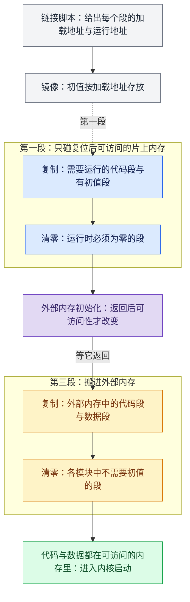
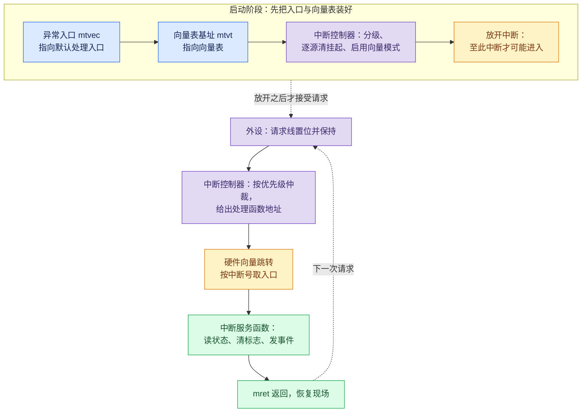
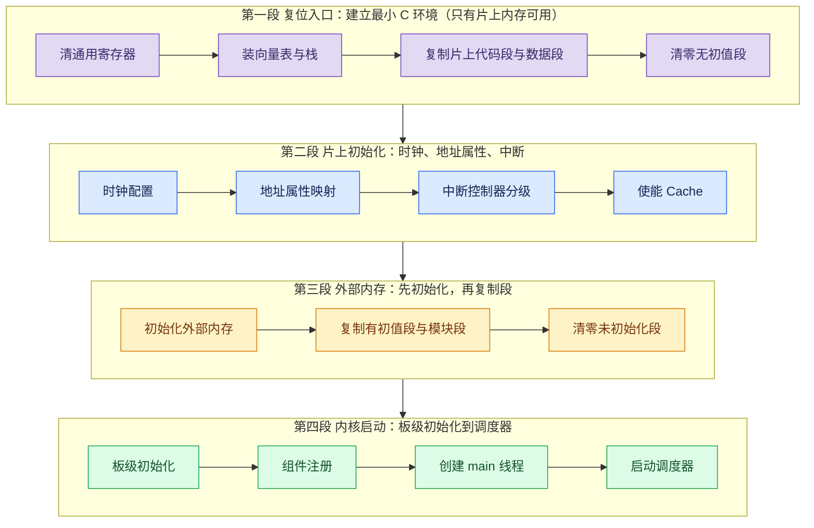
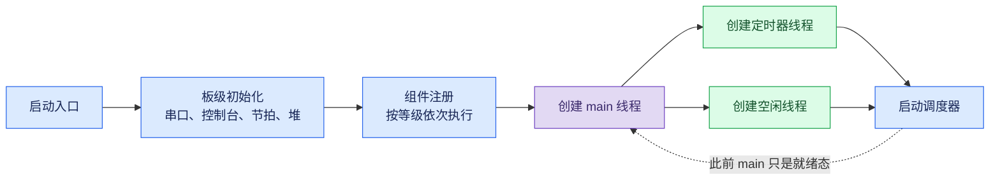
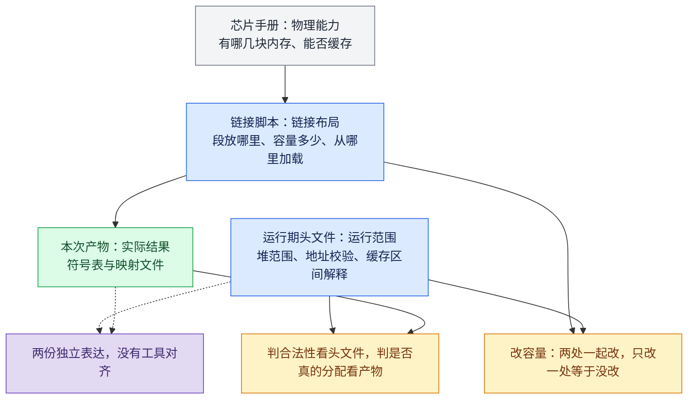
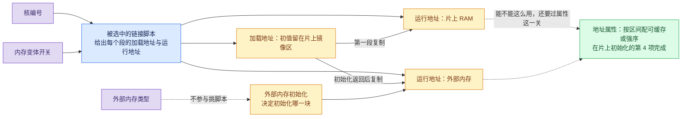

启动链路里最容易犯的错误，是把“汇编搬段”“初始化外部内存”“启动调度器”当成一件事。它们其实是四段，每段都有自己的前置条件，顺序换一下就会失败，而且失败现象都长得很像：没有任何输出。

这一系列先讲画面怎么流出芯片，再往下走一层，讲它流出之前依赖的东西：启动的顺序，以及这些段和它们的地址是怎么定下来的。

## 1. 启动分成四段

### 背景：RISC-V 的启动入口与内存两种角色

RISC-V 和 ARM Cortex-M 在启动约定上有个明显差别：基础指令集里没有固定的复位入口，也没有固定放在某个地址的中断向量表。复位后从哪里取第一条指令、栈指针设成多少，都由芯片厂商在链接脚本和启动代码里约定。这颗芯片把这件事交给一个启动符号（`Reset_Handler`）去做，它是上电后第一段有实际意义的代码。

启动代码要解决四件事：把 C 语言运行需要的最小环境建起来（栈、全局指针）、把有初值的段从镜像搬到运行地址、把无初值的段清零、把异常与中断入口装好。搬段要用到链接脚本里的两个地址概念：

- **加载地址**：初值在镜像里存放的位置。
- **运行地址**：程序运行时真正访问的位置。

两者可以不同，这正是“搬段”存在的原因。

内存也分两种角色：复位之后立刻能用的只有片上内存；外部内存（DDR 或片内高速 RAM）必须先初始化，之后才能访问。**段复制的顺序由这个可访问性决定，与代码里写的先后无关。**

中断方面，RISC-V 的机器模式用 `mtvec` 指向异常入口；带中断控制器的实现（如 CLIC）另有一个向量表基址 `mtvt`，中断按向量号查表跳转。

| 段 | 做什么 | 前置条件 |
|---|---|---|
| 复位入口 | 建立最小可运行的 C 环境 | 只有片上内存可用 |
| 片上初始化 | 时钟、地址属性、Cache、外设基础 | 入口已建立，栈可用 |
| 外部内存 | 初始化 DDR 或片内高速 RAM，再复制对应段 | 时钟与地址属性已配好 |
| 内核启动 | 板级初始化、组件注册、调度器启动 | 所有代码与数据都在可访问的内存里 |

分段的意义在于定位：如果连串口都没有输出，问题在第一段或第二段；如果串口有输出但某个组件没起来，问题在第四段的注册顺序；如果系统能起但画面没有，启动链路大概率已经跑完了，该去查采集和输出。

## 2. 复位入口：先造出能跑 C 的环境

复位后的第一段代码，目标不是把系统初始化好，而是让 C 代码具备可以开始运行的最小条件。它按固定顺序做四件事：

1. **把处理器状态清成已知值**：31 个通用寄存器逐个清零。复位前它们的内容不确定，而后面所有代码都默认“从头开始”，清零就是让这个前提成立。
2. **建立 C 运行的最小环境**：设置全局指针，供 gp 相对寻址使用；并把栈顶指向中断栈，此时还没有线程，唯一可用的栈就是这一块。
3. **装上异常与中断入口**：把异常入口（`mtvec`）指向默认处理入口，向量表基址（`mtvt`）指向向量表。
4. **搬入片上段并清零无初值段**：复位后可访问的只有片上内存，所以第一批要处理的段都落在片上：需要运行的代码段与有初值的数据段从镜像复制到运行地址，运行时必须为零的段直接清零。

这里有两处容易忽略。一是第 2 步建立的是**中断栈，不是函数调用栈**：此后的代码可以调用函数，但可用深度受这一块栈的大小限制，深调用与大局部变量在启动早期就会踩栈，这也是早期阶段不放开中断的原因之一。二是搬运必须两头都做：把需要访问外部内存的段放在这一步复制，就是往一块还没初始化的空间里写数据；漏掉片上段，第一条用到这些数据的指令就会取到错值。

段的搬运由加载地址与运行地址两条地址驱动，顺序只受一件事约束：目的地此刻能不能访问。

## 3. 片上初始化：时钟、地址属性与中断

第二段是一串顺序不能换的初始化。每一项都在为后面某项创造前提，提前做或跳过，都会以别处的失败形式暴露出来：

| 顺序 | 初始化项 | 前置条件 | 提前或跳过的后果 |
|---:|---|---|---|
| 1 | 调试通路 | 入口已建立 | 挂不上调试器，后面只能靠猜 |
| 2 | 核的可选能力：扩展指令、精确故障定位、非对齐访问、浮点状态 | 入口已建立 | 用到这些能力的代码触发非法指令 |
| 3 | 系统时钟 | 前项已完成 | 依赖时序的外设都跑在错误频率上 |
| 4 | 地址属性映射：哪些区间可缓存、哪些必须强序访问 | 时钟已就位 | 可缓存与强序区间判错，CPU 与 DMA 看到的数据不一致 |
| 5 | 外部内存初始化 | 时钟与地址属性已配好 | 外部内存不可访问，第三段的段复制全部失败 |
| 6 | 中断控制器：分级、清挂起、建立向量 | 前项已完成 | 中断收不到，或全部落到默认处理入口 |
| 7 | 使能指令与数据 Cache | 地址属性已生效 | Cache 按默认属性缓存了本不该缓存的区间 |
| 8 | 机器模式软件中断 | 前项已完成 | 核间通知与软中断调度不可用 |

这个顺序里有两处不能交换。时钟必须早于任何依赖时序的外设；地址属性必须早于 Cache 使能，否则 Cache 会按默认属性去缓存本不该缓存的区间，而且改过属性也不会让已经进 Cache 的内容自动作废：属性必须在使能之前配好，没有事后补救的机会。地址属性与一致性之间的取舍，见已发的 [嵌入式软硬件缓存一致性](/tech-notes/posts/architecture/hardware_software_cache_coherence/)。

表里还有一处容易看错：**初始化外部内存是第二段执行流里的一步（第 5 项），把段复制进外部内存才属于第三段**。两者之间隔着一次可访问性的变化，外部内存初始化返回之后，第三段的搬运才成立，这是第三段必须等它返回的原因。

### 中断入口的建立与放开

中断可用不是一次配置的结果，而要按顺序建立入口、清干净挂起状态，最后才放开。启动早期保持关中断，是为了不在栈与向量表还没就绪时被中断打断：第一段建好的只有那一块中断栈，见上一节末。

链路本身是固定的：外设请求线置位，中断控制器仲裁后提供处理函数地址，硬件向量跳转进入服务函数，服务函数只做读状态、清标志、发事件三件事，其余工作留给线程。这条路径的完整版本（含 CLIC 向量模式与中断、线程的职责边界）见已发的 [嵌入式 SD 卡上电加载](/tech-notes/posts/architecture/embedded_sd_boot_load_flow/)，这里不重复。

## 4. 外部内存与内核启动

外部内存那一段的执行顺序是固定的：先初始化外部内存本身，等它返回之后，再复制放在外部内存里的代码段和数据段，然后是各模块自己的内存段，最后清零各模块中不需要初值的段。把这段顺序写反（先搬数据再初始化内存）是容易写错的一处结论。

外部内存初始化完成后，启动进入内核阶段：板级初始化建立串口、控制台、系统节拍与堆，随后依次初始化定时器与调度器、创建主线程、创建定时器线程与空闲线程，最后启动调度器。这一段有两条需要记住：**主线程在调度器启动之前只是就绪状态，一行都不执行**；**板级自动初始化和后面组件注册的自动初始化不在同一时刻**，板级自动初始化发生在板级初始化里，组件注册要等主线程跑起来之后。

这里的顺序同样是依赖关系，不是习惯：板级初始化必须最先，因为组件注册、线程创建与后续的调试输出都要用到串口、控制台、节拍和堆，这几样都在这一步建立；调度器初始化必须在创建线程之前，否则新建的线程没有可用的调度基础设施；三个线程都建好之后，调度器才有可切换的对象，所以启动调度器是最后一步。创建与启动是两个动作：创建只把线程放进就绪队列，启动才把它交给调度器，主线程“建好了却一行都没跑”正是这两个动作被分开的结果。

上面两条结论指向同一套等级机制：自动初始化按等级从低到高执行，板级初始化内部跑的是最低的两级（板级与内核前置对象），主线程运行之后才轮到组件、环境与应用这三级。**两个区间之间隔着调度器启动**，所以在早的那一级里创建线程或申请堆内存都不成立，那时调度器与内存堆还没就绪。完整的等级表与两条容易弄反的顺序判据，见已发的 [嵌入式 SD 卡上电加载](/tech-notes/posts/architecture/embedded_sd_boot_load_flow/)。

内核对象之间的创建与依赖关系：

## 5. 段落在哪里、地址是谁定的

段复制的顺序定了，还剩一个问题：这些段和它们的地址是谁定的，为什么换一个构建参数，地址就全变了。

同一块内存，往往同时有四份说法。四份都对，只是回答的问题不同：

| 说法 | 回答的问题 | 依据 |
|---|---|---|
| 物理能力 | 芯片上有哪几块内存、能不能缓存 | 芯片手册 |
| 链接布局 | 段允许放在哪里、容量多少、从哪里加载 | 当前生效的链接脚本 |
| 运行范围 | 堆的范围、地址合法性校验、缓存区间怎么解释 | 运行期头文件 |
| 本次产物 | 每个段和对象实际落在哪里、多大 | 符号表与映射文件 |

分开看才有用：改容量要同时动链接脚本和运行期头文件，只改一处等于没改；判断一个地址合不合法要用运行期头文件，判断它是否真的被分配要用本次产物。这两组问题混着问，就会得出错误结论。而且链接脚本与运行期头文件是两份互相独立的表达，中间没有工具做一致性检查，写岔了不会有任何提示。

### 构建参数先定，地址才有答案

任何讲地址的结论都要先声明构建参数，否则结论不成立：

- 核编号与内存变体开关决定最终挑中哪一份链接脚本。
- 外部内存类型不参与挑脚本，它决定启动时初始化哪一块内存、以及镜像参数怎么给。

同一条启动路径在不同变体下并不等价，这也是下一节里“先记录构建参数，再谈任何地址”这条动作的由来。

### 加载地址与运行地址：两条推论

链接脚本给每个段两个地址：加载地址是初值在镜像里的位置，运行地址是代码执行、数据被访问的位置。两者可以不同，典型写法是段运行在外部内存、初值却留在片上镜像区（`> EXT AT > ROM`）。启动代码负责把初值从镜像区复制到运行区，这也是“复制必须发生在外部内存初始化之后”的另一半原因。没有初值的段根本不进镜像，启动时直接在运行地址上清零：不占镜像空间，但占内存空间，核算容量时不能漏。

由此得到两条实用推论。一是某段数据在启动后表现异常，先分清它是“从镜像复制来的”还是“启动时清零的”：复制来的出错查复制范围与顺序，清零来的出错查清零范围，两类问题的排查方向完全不同。二是判断某块缓冲安不安全，要先知道它落在哪个区间，而区间边界来自实际配置入参，源码注释里的区间说明常常早已过时；属性配错或漏配的现象通常不是崩溃，而是偶发读到旧数据（CPU 改了内存、DMA 仍读到旧值），这种问题不会稳定复现，容易被误判成硬件故障。

## 6. 启动失败时的判断顺序

判断有一个前提：**越早的段越沉默**。输出通道本身依赖时钟与引脚配置，这两项到第二段才建立，所以第一段与第二段早期失败的现象就是“没有任何输出”。沉默是定位信息：它把范围限定在输出能力建立之前。

先把现象归到阶段：

| 现象 | 最可能停在哪个阶段 | 先查什么 |
|---|---|---|
| 换了构建参数后行为变化，或按旧产物判断地址 | 启动之前：链接与镜像 | 本次构建参数、实际生效的链接脚本 |
| 完全没有输出，一行日志都没有 | 第一段或第二段早期 | 栈、向量表、片上段是否搬对；时钟是否起振 |
| 有早期输出，进入外部内存相关处理后卡死或复位 | 第三段 | 外部内存初始化的返回值与地址属性 |
| 系统能起，某个组件不工作 | 第四段 | 注册函数的等级与依赖顺序 |
| 主线程没有运行 | 第四段末 | 调度器是否已启动、主线程是否就绪、注册函数是否阻塞 |
| 系统正常但没有画面 | 启动链路之外 | 转去查采集、处理与输出 |

再按两个固定动作确认前提：

1. 先记录本次实际使用的构建参数（核编号、变体、外部内存类型），再谈任何地址。
2. 从本次产物的符号表确认入口、各段符号与地址，不用旧产物对照。

前两个坑也有人踩过：把只读存储里的引导行为、镜像头解析和 `Reset_Handler` 当成同一层软件看；以及把构建配置里存在的条件分支当成对应链接脚本一定存在。第一种会让排查方向整体跑偏，第二种会在换变体时直接构建失败。

比事后排查更省事的做法，是给每一段留一个可观测点：一段结束时打一行日志、翻转一个 GPIO，或写下一个自检结果，把“沉默”变成“停在哪一段”。第一段与第二段早期还没有输出能力，只能用调试器或调试通路提供的信号补上。

与 [MCU 二级 Bootloader 设计](/tech-notes/posts/architecture/mcu_secondary_bootloader/) 讲的 OTA 与安全启动不是一回事，本文只讲应用核从复位到调度器这一段；多核 SMP 下调度器初始化与核间启动是另一类问题，见 [双核 ARM SoC 上跑 RT-Thread SMP](/tech-notes/posts/architecture/dual_core_arm_rtthread_smp/)。
