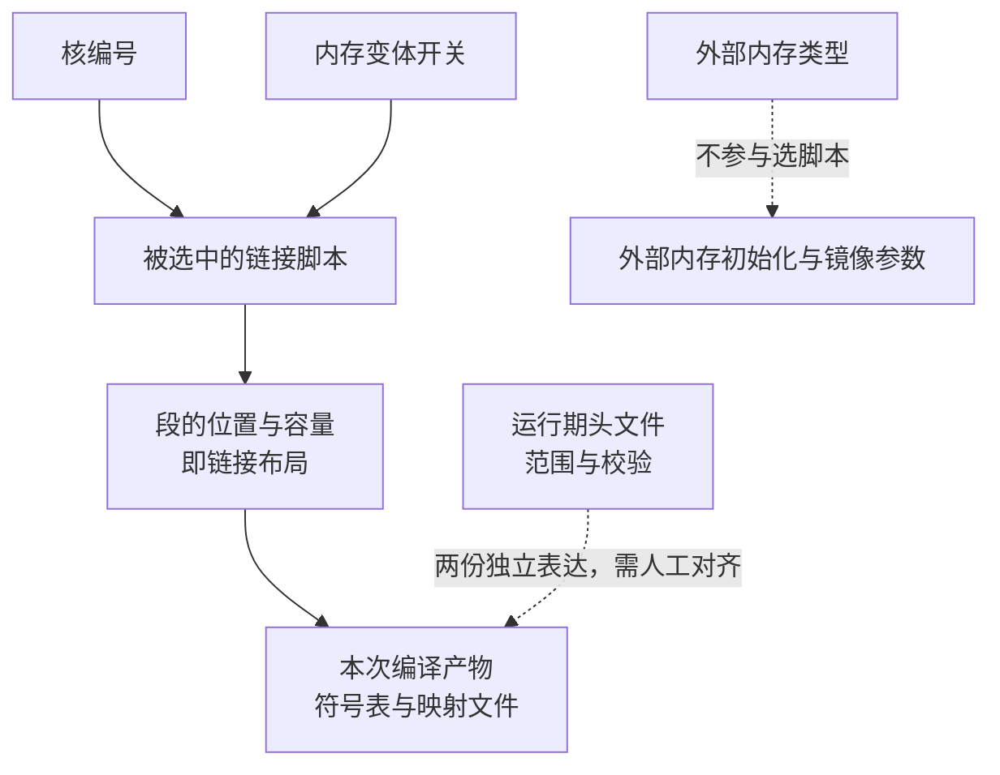

在这类 SoC 上，问“这块内存的地址是多少”通常得不到唯一答案。同一段容量可能同时有四份说法：芯片手册里的物理能力、链接脚本里的布局、运行期头文件里的范围、最终产物里的实际布局。四份都对，只是回答的问题不同：前两份说“这个数是多少”，后两份说“能不能这么用”。把两种问题混在一起，就会得出错误结论。

上一篇 [RISC-V 应用核的启动链路](/tech-notes/posts/architecture/riscv_firmware_boot_chain/) 讲到“先初始化外部内存，再复制对应段”。这一篇接着回答：那些段和那些图像缓冲的地址，究竟是谁定的，为什么换一个构建参数地址就全变了。

## 1. 先把五类语义分开

| 语义 | 回答的问题 | 依据 |
|---|---|---|
| 物理能力 | 芯片上有哪几块内存、能否缓存 | 芯片手册 |
| 链接布局 | 段允许放在哪里、容量多少、从哪里加载 | 当前链接脚本 |
| 运行范围 | 堆的范围、地址合法性校验、缓存区间如何解释 | 运行期头文件 |
| 最终结果 | 每个段和对象实际落在哪里、多大 | 本次编译的符号表与映射文件 |
| DMA 使用 | 哪个模块读写哪些缓冲、谁负责一致性 | 业务配置、驱动与硬件寄存器 |

分开看的用处有三个：改容量要同时动链接脚本和运行期头文件，只改一处等于没改；判断某地址是否合法要用运行期头文件，判断它是否真的被分配要用最终产物；某块缓冲给谁用由第五类决定，但安不安全还要过第二、三类的地址范围与属性这两道关。

同一段容量在两处写法不一致时，不会有任何工具报警：它们分处两份独立表达，只靠人工对齐，实际出现过十几 KB 量级的偏差。

构建参数会改变第一类和第三类。核编号与内存变体开关决定最终挑中哪一份链接脚本；外部内存类型不参与选脚本，它决定启动时初始化哪块内存、以及镜像参数怎么给。因此任何一篇讲地址的材料，都得先声明参数，再谈结论；同一条启动路径在不同变体下并不等价。



## 2. LMA 与 VMA：初值在镜像里，运行在目的区

链接脚本里，每个段有两个地址。加载地址（LMA）是初值存放在镜像中的位置，运行地址（VMA）是代码真正执行、数据真正被访问的位置。两者可以不同，典型写法是让段运行在外部内存、初值却留在片上镜像区：

```ld
.ext_data :
{
    _ext_data_start = .;
    *(.ext_data*)
    _ext_data_end = .;
} > EXT AT > ROM
```

这行的读法是：运行地址落在外部内存区（`EXT`），加载地址落在片上镜像区（`ROM`）。启动代码负责把内容从后者复制到前者，这也是为什么“复制”必须发生在外部内存初始化之后。没有初值的段（`.bss` 和各类未初始化段）不进镜像，启动时直接在运行地址上清零：它们不占镜像空间，但占内存空间，核算容量时不能漏。

一个实用推论是：如果一段数据在系统启动后表现异常，先分清它属于“从镜像复制来的”还是“启动时清零的”。复制来的数据出错要查复制范围与顺序，清零来的数据出错要查清零范围，两类问题的排查方向完全不同。

## 3. 三类分配器不能混着算

内存被三种用途分走，它们的归属和生命周期都不一样：

| 分配方式 | 归属 | 特点 |
|---|---|---|
| 片上静态段 | 链接脚本 | 启动期搬入或清零，运行期不增删 |
| 模块专用段 | 链接脚本，按模块划分 | 容量隔离、启动行为确定，代价是必须预留足够空间 |
| 通用堆 | 运行期初始化 | 适合大小运行期才定的对象，不适合长期占用的大块 |

图像缓冲的来源就更多一层：它可能放在为图像规划好的固定区域里，也可能是堆上一次对齐分配的结果，还可能由业务方从外部传进来，甚至来自调试命令临时保留的地址。这四种来源对应四种生命周期，所以“缓冲区地址”本身不能说明它安全不安全。

最常见的错误是把模块静态池、通用堆和图像 DMA 区当成同一个分配器：三者各自溢出互不影响，但如果核算时把它们加在一起，就会得出“内存不够”或“内存很富余”的错误判断。

## 4. Cache 与强序属性：决定谁能看见谁

地址属性在系统初始化的早期按区间配好，通常分成两类：允许缓存的区间用于 CPU 频繁访问的数据，强序或不可缓存的区间用于外设、共享内存和需要立刻被外部看见的访问。它们是按地址范围配置的，不是按对象配置的。

两个后果需要记住。第一，属性边界来自实际配置入参，源码注释里的区间说明可能早已过时，判断当前边界要看配置函数接收到的参数，而不是注释。第二，属性配错或漏配时，现象往往不是崩溃，而是偶发读到旧数据：CPU 改了内存，DMA 读到的仍是旧值；DMA 写了新帧，CPU 读到的还是上一帧。这种问题不会稳定复现，也因此经常被误判为硬件问题。

## 5. 一块缓冲要同时满足的条件

把图像缓冲交给 DMA 使用前，这些条件要逐项确认，缺任何一项都可能变成偶发故障：

1. 地址范围是否落在当前构建允许的区域内。
2. 起始地址与长度是否满足硬件的对齐要求。
3. CPU 与 DMA 各自的读写方向是什么。
4. 该区域是否可缓存。
5. CPU 写、DMA 读之前是否做了写回。
6. DMA 写、CPU 读之前是否做了失效。
7. 多缓冲切换时，硬件是否仍可能引用即将被覆盖或释放的那一块。

这七项分属三类：前两项是布局，中间两项是属性，后三项是时序。只有前两项能在构建阶段发现，剩下五项必须在板上验证。

改变内存布局或缓冲尺寸时，验证也要按顺序走，否则很容易改对了地址却漏了属性：

1. 明确本次构建参数与目标内存类型。
2. 确认唯一生效的链接脚本，只改它。
3. 同步核对运行期头文件的范围与地址属性配置。
4. 构建并保存本次产物，后续所有容量结论都以此为准。
5. 检查区域溢出、段地址与加载地址、堆栈与模块段。
6. 检查固定地址的调试缓冲是否与新布局重叠。
7. 在板上验证写回与失效、DMA 数据完整性和第一帧。

如果这套内容主要关心“哪块数据放哪个内存更好”，那么已发的 [Cortex-M 内存寻路](/tech-notes/posts/architecture/cortex_m_memory_topology_sram_ccm/) 讲的是这个问题；本文关心的是另一头：地址从哪来、为什么随参数变、以及一块缓冲要过哪些关卡。Linux 侧用物理地址映射做零拷贝的那条路，见 [DMA 物理内存映射与 FPGA 环形缓冲](/tech-notes/posts/architecture/dma_devmem_and_fpga_ringbuffer/)。

再往下就是本篇提到的那些缓冲本身：为什么需要两段缓冲、三帧怎么算、运行期改配置时它们怎么保持一致，是接下来三篇的主题。
