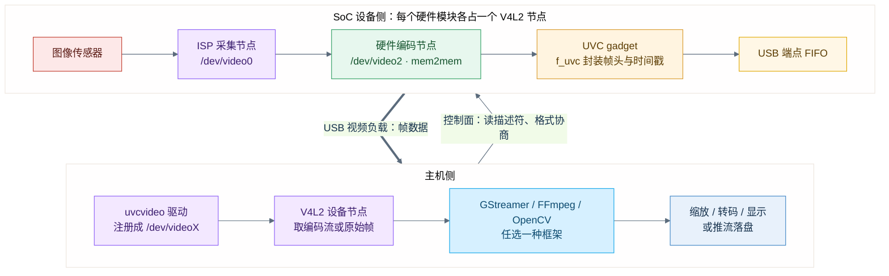
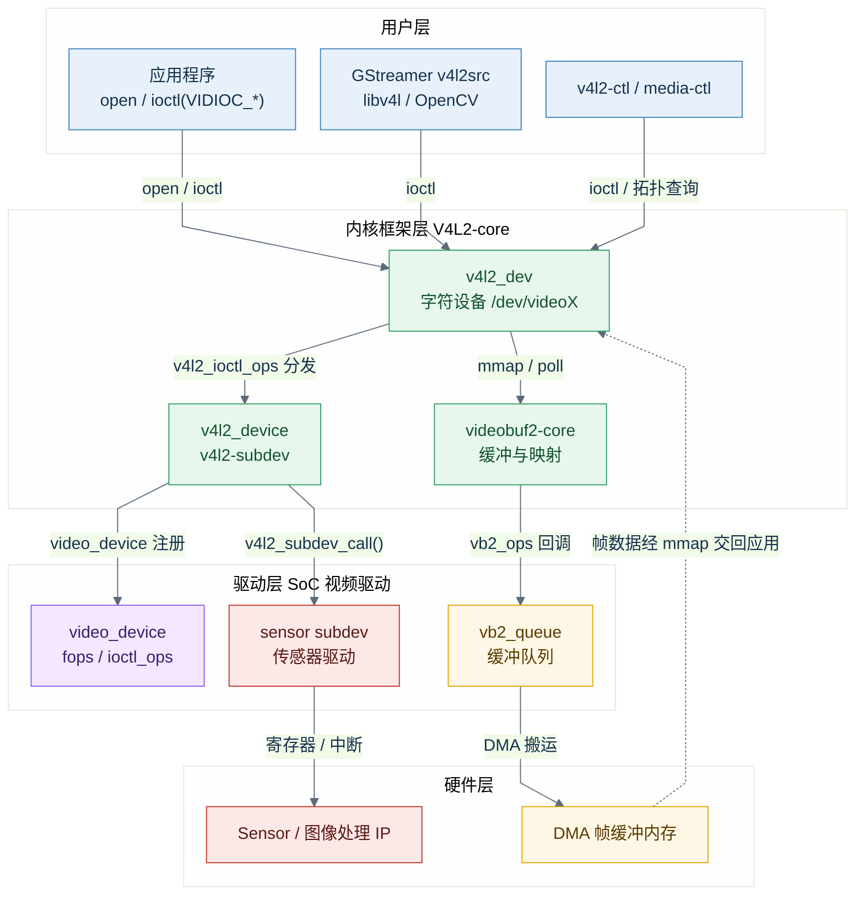
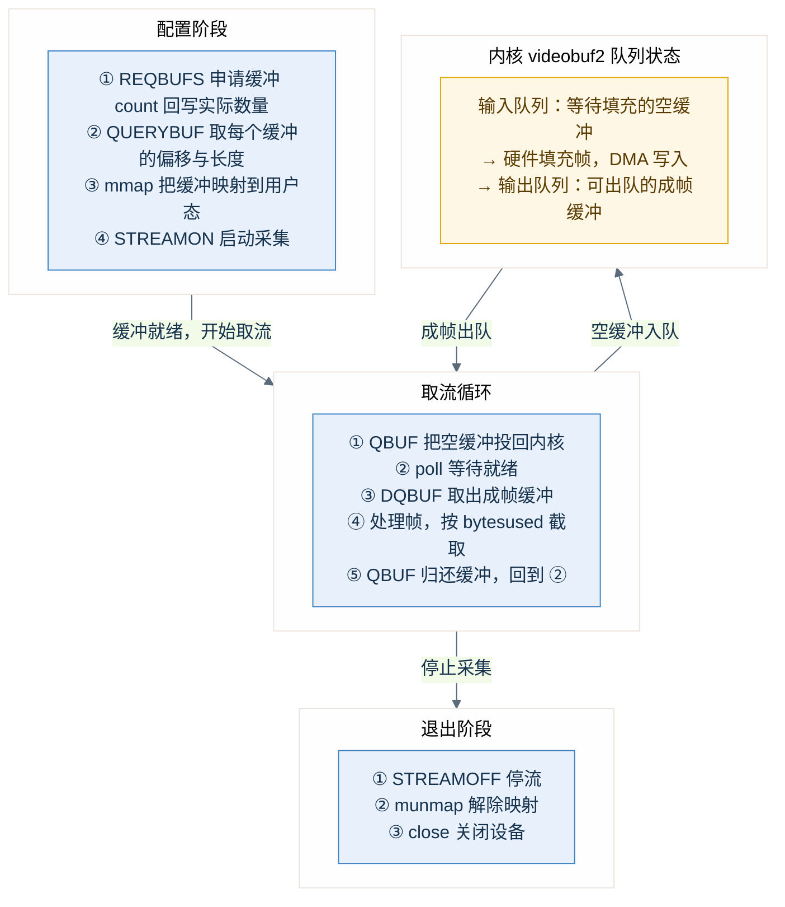
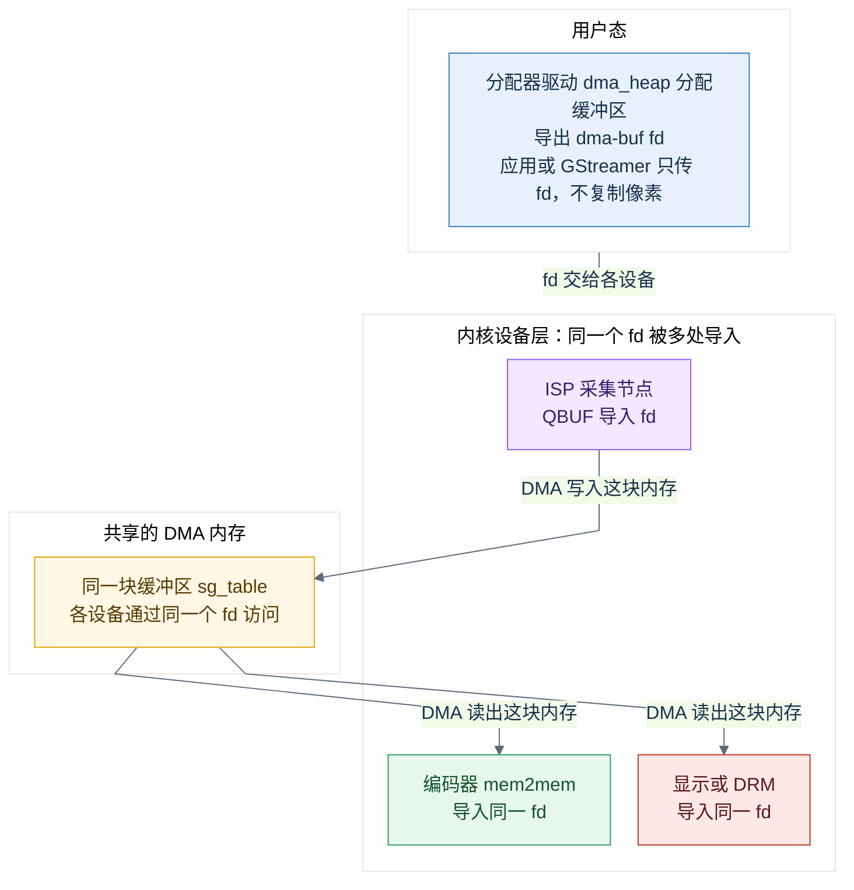
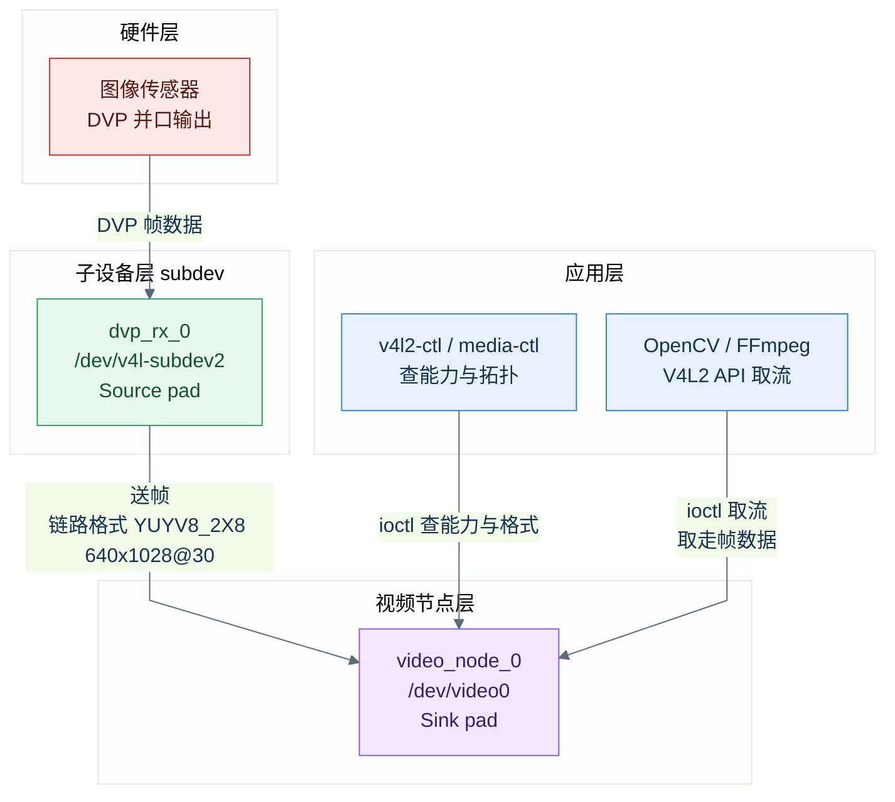
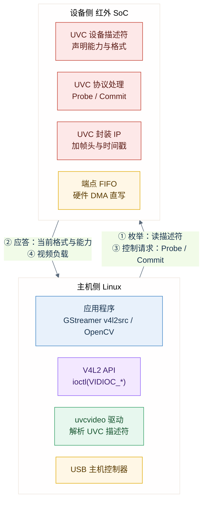
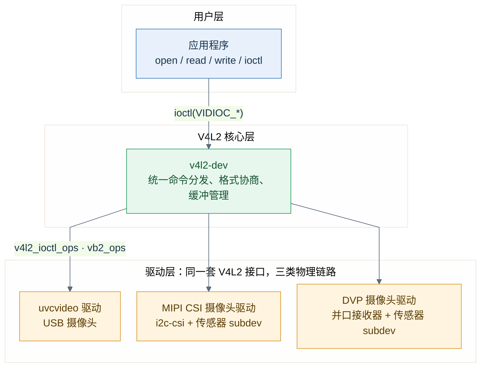
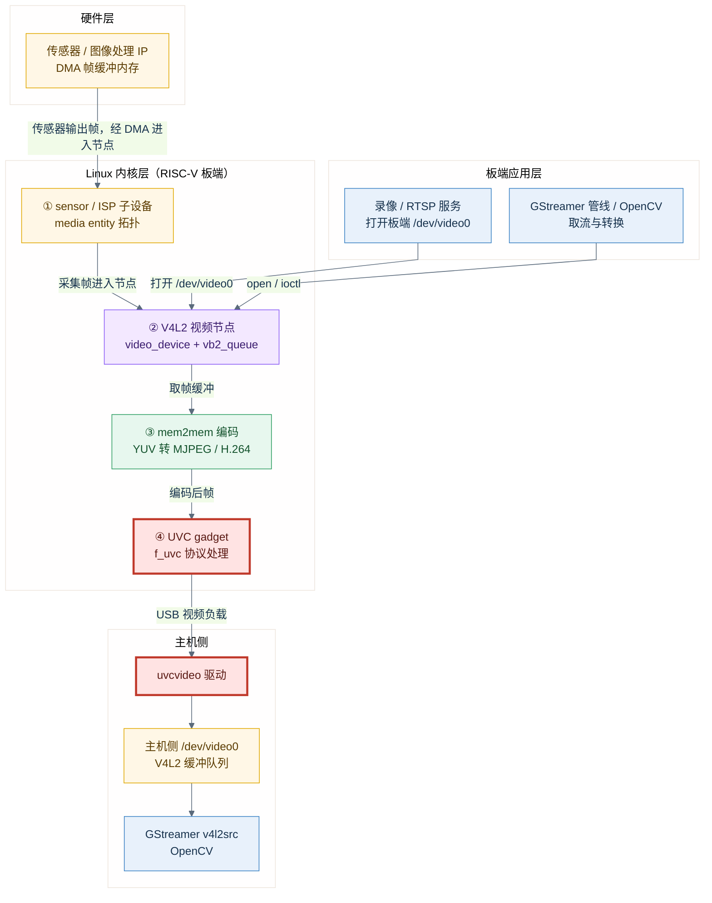
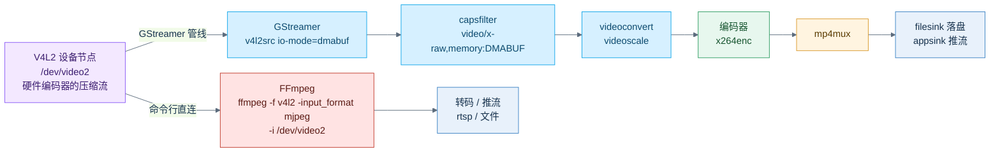

概述：

1. V4L2 是 Linux 主机侧的视频设备框架。在 SoC 上用 Linux V4L2 取流，本质是四件事：找到设备节点、拿到缓冲、把缓冲交给别的设备、整条链路不拷贝
2. 设备节点。图像处理、编码器、解码器各占一个 `/dev/videoX`，选哪个决定拿到原始帧还是压缩流。能力看 `VIDIOC_QUERYCAP`，格式用 `VIDIOC_S_FMT` 协商后回读。
3. 缓冲队列。帧在 videobuf2 的 `vb2_queue` 里循环。逐帧看四个字段：`bytesused` 定帧长，`sequence` 判丢帧，`timestamp` 做同步，`flags` 标错帧。队列深度决定可容忍时延，等于深度乘帧间隔，超窗就丢帧。
4. DMA-buf。跨设备流转靠 fd 共享一块内存：`VIDIOC_EXPBUF` 导出，`REQBUFS` 传 `V4L2_MEMORY_DMABUF` 后在 `QBUF` 带 fd 导入。代价是分配器与 fence 同步。
5. 零拷贝管线。有了 dma-buf，采集、编码、显示共用一块内存。GStreamer 用 `v4l2src io-mode=dmabuf` 串起，FFmpeg 同一套接口。跨 USB 归 UVC：设备侧 `f_uvc` 封装帧头，主机侧 `uvcvideo` 还原成普通 V4L2 设备
6. SoC 也可以是 USB 摄像头：设备侧用 UVC gadget，主机侧由 `uvcvideo` 驱动接管，主机与设备两端都落在 V4L2 生态里。

## 1. V4L2 是什么，以及怎么找到该用的设备节点

### 1.1 V4L2 是什么

V4L2 规定了应用与视频设备之间的接口，设备由内核驱动实现。官方对编程步骤的概括是六步（[common.html](https://www.kernel.org/doc/html/latest/userspace-api/media/v4l/common.html) 原文）：

> Programming a V4L2 device consists of these steps: Opening the device / Changing device properties, selecting a video and audio input, video standard, picture brightness a. o. / Negotiating a data format / Negotiating an input/output method / The actual input/output loop / Closing the device.

对第一次接触的人，可以先只记住三步：打开设备，协商格式，循环取帧。

SoC 上的视频通路通常由多颗硬件模块串成：图像传感器 → 图像处理（ISP）→ 编码器 → 解码器 → 显示。每一级在 Linux 里都是一个 V4L2 设备节点，所以一块板子上会出现一串 `/dev/video0`、`/dev/video1`、`/dev/video2`。

于是「用哪个节点」成了应用要做的第一个选择：取原始帧走 ISP 输出节点，拿到的是未压缩的 YUV，格式与尺寸由驱动定死；取压缩流走硬件编码节点，拿到的是 H.264 或 MJPEG，带宽小一个量级，代价是多一次硬件编码与相应延迟。

节点也不是越多越好。每个节点自带缓冲队列与格式协商，选错节点的表现往往不是报错，而是拿到不想要的格式（该 NV12 的成了 YUYV、帧率被驱动改写）。所以排查时先看 `media-ctl -p` 打印的拓扑，再看 `v4l2-ctl --list-formats-ext` 列出的能力，然后才决定往哪个节点上写。下面先把全景摆出来，再逐层拆。

### 1.2 全景: 一条视频从传感器到画面

先把整条链路摆出来，后面各节都只是在这张图上展开细节。图中左半边在一块 SoC 上，右半边在主机上，中间是 USB。



这条链路上有三个接口层，各管一段：SoC 内部用 V4L2 视频节点取帧，跨 USB 用 UVC 封装帧头与时间戳，主机侧再由 `uvcvideo` 驱动把设备还原成一个普通的 V4L2 设备，交给 GStreamer 之类的框架使用。

中间那两条连线是 USB 上的两个方向：上面是帧数据，从设备流向主机；下面是控制面，描述符与格式协商这类请求从主机流向设备。

### 1.3 分层模型

一条带是一层，带内的方框是该层的组成部分，带与带之间的箭头是调用方向与交互内容。



三个要点：

- `/dev/videoX` 是字符设备，内核用 `v4l2_file_operations` 接管 `open`、`read`、`mmap`、`poll`，`unlocked_ioctl` 转到 V4L2 的命令分发。
- `video_device` 绑定自己的 `v4l2_ioctl_ops`，`VIDIOC_*` 最终落到驱动实现的函数指针上。驱动要访问具体芯片时，经 `v4l2_subdev_ops` 和 `v4l2_subdev_call()` 调 subdev。
- 帧缓冲不在 `video_device` 里，而是挂在 `video_device->queue` 指向的 `vb2_queue` 上，由 videobuf2 负责分配、排队与映射。

### 1.4 设备节点与能力位

主次设备号的约定见采集接口章节（[dev-capture.html](https://www.kernel.org/doc/html/latest/userspace-api/media/v4l/dev-capture.html) 原文）：

> Conventionally V4L2 video capture devices are accessed through character device special files named `/dev/video` and `/dev/video0` to `/dev/video63` with major number 81 and minor numbers 0 to 63. `/dev/video` is typically a symbolic link to the preferred video device.

主设备号 81 归 V4L2 字符设备族，从设备号 0 到 63 区分族内不同设备实例。

节点本身不是「设备」，而是应用进入内核的入口。驱动注册 `video_device` 之后，内核把对应的字符设备登记到设备模型，由 devtmpfs 与 udev 在文件系统里生成 `/dev/videoX`；应用 `open()` 它得到一个文件描述符，之后所有 `ioctl` 都作用在这个描述符上，内核据此找回 `video_device` 与它的缓冲队列。

这样设计的目的只有一个：让同一套接口覆盖所有视频来源。USB 摄像头、MIPI CSI 传感器、DVP 并口摄像头、采集卡在应用看来都是 `/dev/videoX`，差别被压在各自的驱动里。节点还顺带提供了权限控制与热插拔生命周期，设备拔出时 udev 把节点删掉。

**两台机器上的 `/dev/videoX` 不是一对。** V4L2 是每个 Linux 内核各自实现的一套接口，不是跨机协议。SoC 侧的节点供 SoC 上的进程使用（板端录像、RTSP 服务，或作为 UVC gadget 的取帧来源）；主机侧的节点是 `uvcvideo` 为那台远程设备登记的本地句柄。两边跑的是同一套 `VIDIOC_*`，中间相连的却是 UVC over USB，不是 V4L2。两边的节点编号也没有对应关系：主机上的 `/dev/video0` 未必就是 SoC 上的 `/dev/video0`。

能力位由 `VIDIOC_QUERYCAP` 返回，放在 `struct v4l2_capability` 的 `capabilities` 字段：

| 能力位 | 含义 | 用途 |
|---|---|---|
| `V4L2_CAP_VIDEO_CAPTURE` | 支持采集接口 | 能否当采集设备使用 |
| `V4L2_CAP_VIDEO_CAPTURE_MPLANE` | 支持多平面采集 | 选单平面还是多平面 API |
| `V4L2_CAP_STREAMING` | 支持流式 I/O | `mmap` / `userptr` / `dmabuf` 的前提 |
| `V4L2_CAP_READWRITE` | 支持 `read()` / `write()` | 简单抓单帧 |
| `V4L2_CAP_DEVICE_CAPS` | 能力需再查 `device_caps` | 多接口设备按流类型二次过滤 |

### 1.5 格式协商: S_FMT 的官方语义

格式协商最容易写错。官方对 `VIDIOC_S_FMT` 的定义（[vidioc-g-fmt.html](https://www.kernel.org/doc/html/latest/userspace-api/media/v4l/vidioc-g-fmt.html) 原文）说明驱动会检查并调整参数，并把当前生效的参数回填给应用：

> When the application calls the `VIDIOC_S_FMT` ioctl with a pointer to a struct `v4l2_format` structure the driver checks and adjusts the parameters against hardware abilities. ... Finally the `VIDIOC_S_FMT` ioctl returns the current format parameters as `VIDIOC_G_FMT` does.

由此得到两条规则：`S_FMT` 之后必须回读结构体，请求值只是意向；I/O 进行中或资源不可用时 `S_FMT` 返回 `EBUSY`。`TRY_FMT` 与 `S_FMT` 语义相同，但不改变驱动状态，也不返回 `EBUSY`，适合先探测再提交。

### 1.6 官方文档地图

规范按章拆分渲染，遇到问题直接定位到章，比在总目录里翻快。

| 要解决的问题 | 官方章节 | 链接 |
|---|---|---|
| 编程步骤总纲 | Common API Elements | [common.html](https://www.kernel.org/doc/html/latest/userspace-api/media/v4l/common.html) |
| 有哪些 I/O 方法 | Input/Output | [io.html](https://www.kernel.org/doc/html/latest/userspace-api/media/v4l/io.html) |
| 设备接口分类 | Interfaces | [devices.html](https://www.kernel.org/doc/html/latest/userspace-api/media/v4l/devices.html) |
| 采集接口与 `/dev/video*` 约定 | Video Capture Interface | [dev-capture.html](https://www.kernel.org/doc/html/latest/userspace-api/media/v4l/dev-capture.html) |
| 内存映射流式 I/O | Streaming I/O (Memory Mapping) | [mmap.html](https://www.kernel.org/doc/html/latest/userspace-api/media/v4l/mmap.html) |
| 导入 DMA-buf | Streaming I/O (DMA buffer importing) | [dmabuf.html](https://www.kernel.org/doc/html/latest/userspace-api/media/v4l/dmabuf.html) |
| 导出 DMA-buf | `VIDIOC_EXPBUF` | [vidioc-expbuf.html](https://www.kernel.org/doc/html/latest/userspace-api/media/v4l/vidioc-expbuf.html) |
| 缓冲结构与标志位 | Buffers | [buffer.html](https://www.kernel.org/doc/html/latest/userspace-api/media/v4l/buffer.html) |
| 格式协商语义 | `VIDIOC_G_FMT` / `S_FMT` / `TRY_FMT` | [vidioc-g-fmt.html](https://www.kernel.org/doc/html/latest/userspace-api/media/v4l/vidioc-g-fmt.html) |
| 每个 ioctl 的完整语义 | Function Reference | [user-func.html](https://www.kernel.org/doc/html/latest/userspace-api/media/v4l/user-func.html) |
| videobuf2 内核 API | Media subsystem kernel internal API | [v4l2-videobuf2.html](https://www.kernel.org/doc/html/latest/driver-api/media/v4l2-videobuf2.html) |
| dma-buf 子系统 | Buffer Sharing and Synchronization | [dma-buf.html](https://www.kernel.org/doc/html/latest/driver-api/dma-buf.html) |
| 子设备模型 | V4L2 sub-device API | [v4l2-subdev.html](https://www.kernel.org/doc/html/latest/driver-api/media/v4l2-subdev.html) |
| 内存到内存编解码 | Video Memory-To-Memory Interface | [dev-mem2mem.html](https://www.kernel.org/doc/html/latest/userspace-api/media/v4l/dev-mem2mem.html) |
| 媒体控制器拓扑 | Media Controller | [media-controller.html](https://www.kernel.org/doc/html/latest/userspace-api/media/mediactl/media-controller.html) |
| UVC 设备类规范 | USB-IF Video Class 1.5 | [USB_Video_Class_1_5.zip](https://www.usb.org/sites/default/files/USB_Video_Class_1_5.zip) |

驱动作者视角的总体介绍在 [v4l2-intro.html](https://www.kernel.org/doc/html/latest/driver-api/media/v4l2-intro.html)，它解释了 V4L2 设备为何普遍由多颗 IC 组成、为什么会暴露多个 `/dev` 节点。

### 1.7 先纠正几个常见说法

这些说法在入门资料里很常见，但与官方文档对不上。

| 常见说法 | 实际情况 | 依据 |
|---|---|---|
| `width` / `height` 必须是 16 的倍数 | 官方 `struct v4l2_pix_format` 未规定倍数约束，倍数限制若有，来自具体驱动 | [videodev2.h](https://github.com/torvalds/linux/blob/master/include/uapi/linux/videodev2.h) |
| `REQBUFS` 的 `memory` 只有 MMAP 与 USERPTR | `enum v4l2_memory` 还有 `V4L2_MEMORY_OVERLAY` 与 `V4L2_MEMORY_DMABUF` | 同上 |
| UVC 是 V4L2 框架的一部分 | UVC 是设备类规范，UVC 设备经 `uvcvideo` 暴露为 V4L2 设备 | [UVC 1.5](https://www.usb.org/sites/default/files/USB_Video_Class_1_5.zip)、内核 [uvcvideo](https://github.com/torvalds/linux/tree/master/drivers/media/usb/uvcvideo) |
| `video_device` 定义于 `v4l2_dev.h` | 该头文件已不存在，现为 `v4l2-device.h` 与 `v4l2-subdev.h` | 内核 `include/media/` |
| 用 `select()` 阻塞等待采集完成 | 官方函数参考以 `poll()` 描述等待语义，`select()` 另有章节且要求驱动配合 | [user-func.html](https://www.kernel.org/doc/html/latest/userspace-api/media/v4l/user-func.html) |
| 零拷贝等于整条链路没有拷贝 | 零拷贝的边界只到某一段；主机内核与用户态仍可能存在驱动缓冲与应用队列 | [dma-buf.html](https://www.kernel.org/doc/html/latest/driver-api/dma-buf.html) |

## 2. 缓冲队列: 取流方式、帧生命周期与逐帧字段

### 2.1 取流有哪几种方式

官方对 I/O 方法的划分（[io.html](https://www.kernel.org/doc/html/latest/userspace-api/media/v4l/io.html)）有四种。`read()` / `write()` 是打开设备后自动选中的默认方式，其余三种都要用 `VIDIOC_REQBUFS` 协商：

| 方式 | 怎么用 | 拿到什么 | 代价 | GStreamer `io-mode` |
|---|---|---|---|---|
| `read()` / `write()` | 直接读写设备文件 | 只有像素数据 | 少两步映射，但拿不到帧计数与时间戳 | `rw` |
| `mmap` 流式 | `REQBUFS` 申请缓冲，`mmap` 映射 | 像素加 `bytesused`、`sequence`、`timestamp` | 缓冲由驱动分配，只有本设备能用 | `mmap` |
| 用户指针流式 | `REQBUFS` 传入 `V4L2_MEMORY_USERPTR`，`QBUF` 时给地址 | 同上 | 内存由应用分配，驱动直接写用户的内存 | `userptr` |
| `DMABUF` 流式 | `REQBUFS` 传入 `V4L2_MEMORY_DMABUF`，`QBUF` 时带上 fd | 同上 | 需要分配器驱动与同步机制，驱动支持度不一 | `dmabuf` / `dmabuf-import` |

`v4l2src` 还有 `auto` 一档，由 GStreamer 自行选择，默认值就是它。

`read()` 的取舍在官方文档里说得很直白（[rw.html](https://www.kernel.org/doc/html/latest/userspace-api/media/v4l/rw.html) 原文）：

> It is considered inferior though because no meta-information like frame counters or timestamps are passed. This information is necessary to recognize frame dropping and to synchronize with other data streams.

要判断丢帧、要做多路流同步，只能走流式 I/O。

### 2.2 videobuf2 与帧生命周期



`poll()` 的等待语义见官方函数参考（[func-poll.html](https://www.kernel.org/doc/html/latest/userspace-api/media/v4l/func-poll.html)）。调试时常用到两点：未调用 `VIDIOC_STREAMON`，或已 `STREAMON` 但还没 `QBUF`，`poll()` 都返回成功并置 `POLLERR`。

`VIDIOC_REQBUFS` 会回写实际分配数量（[vidioc-reqbufs.html](https://www.kernel.org/doc/html/latest/userspace-api/media/v4l/vidioc-reqbufs.html) 原文）：

> When the ioctl is called with a pointer to this structure the driver will attempt to allocate the requested number of buffers and it stores the actual number allocated in the `count` field. It can be smaller than the number requested, even zero, when the driver runs out of free memory.

申请 4 个不等于拿到 4 个。另有两条：申请数为 0 表示释放全部缓冲，并隐含一次 `STREAMOFF`；若仍有缓冲处于映射或 DMABUF 导出状态，再次 `REQBUFS` 返回 `EBUSY`，除非驱动声明 `V4L2_BUF_CAP_SUPPORTS_ORPHANED_BUFS`。

关闭设备前先 `VIDIOC_STREAMOFF` 再 `munmap`，缓冲仍处于映射状态时 `REQBUFS` 与释放都可能返回 `EBUSY`。

### 2.3 逐帧要看的四个字段

`VIDIOC_DQBUF` 取回的 `struct v4l2_buffer` 有四个字段值得逐帧关注（[buffer.html](https://www.kernel.org/doc/html/latest/userspace-api/media/v4l/buffer.html)）：

| 字段 | 含义 | 使用要点 |
|---|---|---|
| `bytesused` | 本帧有效数据长度 | 末帧可能小于 `length`，按它截取 |
| `sequence` | 驱动计的帧序号 | 官方明确是帧计数而非场计数，序号跳变即丢帧 |
| `timestamp` | 采集时刻 | 驱动决定打点位置与时钟源，用于多路流同步 |
| `flags` | 缓冲标志 | 常用 `V4L2_BUF_FLAG_TIMESTAMP_*`、`V4L2_BUF_FLAG_ERROR`，取用后按需清标志再 `QBUF` |

一帧有多长不由应用决定。`bytesused` 是设备交出来的这一帧的实际长度，是设备侧成帧逻辑的结果。应用能协商格式与帧率，不能决定一帧在哪里被切开。这条在对接 USB 摄像头时最容易踩：设备提前收尾时，主机侧看到的是一帧被截断，而不是一次 ioctl 失败。

**丢帧怎么判断。** 缓冲深度决定可容忍的处理时延窗：

```
可容忍的最大处理时延 = 缓冲深度 × 帧间隔
```

30fps、缓冲深度 4 时，处理只要在 132ms 内回来一次就不丢帧；某一次处理超过这个窗，队列就满了，下一帧无处可放。所以要盯的是峰值时延，不是平均速度，也不是先加线程。排查时先用 `sequence` 核对驱动交出了多少帧：帧数对得上而画面异常，问题在格式或色彩；帧数对不上，才是队列或上游的问题。

## 3. DMA-buf: 一块内存，多个设备

DMA-buf 是内核里共享缓冲区的通用机制。官方定义（[dma-buf.html](https://www.kernel.org/doc/html/latest/driver-api/dma-buf.html) 原文）：

> The dma-buf subsystem provides the framework for sharing buffers for hardware (DMA) access across multiple device drivers and subsystems, and for synchronizing asynchronous hardware access.

它有三个原语：`dma-buf` 是一段可被 DMA 访问的内存，以文件描述符的形式暴露给用户态；`dma-fence` 用来通知异步硬件操作已完成；`dma-resv` 管理挂在同一个 dma-buf 上的 fence 集合。

落到 V4L2 上，DMABUF 有导入和导出两个方向。

**导出**：把 V4L2 自己的缓冲导出成 dma-buf fd，交给别的设备用。`VIDIOC_EXPBUF` 是 `mmap` I/O 的扩展，只对 `V4L2_MEMORY_MMAP` 缓冲可用（[vidioc-expbuf.html](https://www.kernel.org/doc/html/latest/userspace-api/media/v4l/vidioc-expbuf.html) 原文）：

> After calling `VIDIOC_EXPBUF` the `fd` field will be set by a driver. This is a DMABUF file descriptor. The application may pass it to other DMABUF-aware devices.

**导入**：把外部分配的 dma-buf fd 交给 V4L2 设备。官方对导入角色的描述（[dmabuf.html](https://www.kernel.org/doc/html/latest/userspace-api/media/v4l/dmabuf.html) 原文）：

> The DMABUF framework provides a generic method for sharing buffers between multiple devices. Device drivers that support DMABUF can export a DMA buffer to userspace as a file descriptor (known as the exporter role), import a DMA buffer from userspace using a file descriptor previously exported for a different or the same device (known as the importer role), or both.

> Buffers (planes) are allocated by a driver on behalf of an application. Next, these buffers are exported to the application as file descriptors using an API which is specific for an allocator driver. Only such file descriptor are exchanged.

导入方式是把 `REQBUFS` 的 `memory` 设成 `V4L2_MEMORY_DMABUF`，然后在每次 `QBUF` 时带上 fd。单平面与多平面的写法见官方示例：

```c
int buffer_queue(int v4lfd, int index, int dmafd)
{
	struct v4l2_buffer buf;

	memset(&buf, 0, sizeof buf);
	buf.type = V4L2_BUF_TYPE_VIDEO_CAPTURE;
	buf.memory = V4L2_MEMORY_DMABUF;
	buf.index = index;
	buf.m.fd = dmafd;

	if (ioctl(v4lfd, VIDIOC_QBUF, &buf) == -1) {
		perror("VIDIOC_QBUF");
		return -1;
	}

	return 0;
}
```

多平面时每个 plane 可以带各自的 fd，官方示例用 `buf.m.planes[i].m.fd`。

一条典型的 SoC 内部通路长这样：ISP 把帧写进一块共享缓冲区，编码器与显示各自导入同一个 fd，读的是同一块内存，中间没有 CPU 参与搬运。在 GStreamer 一侧，这就是 `v4l2src io-mode=dmabuf` 与 `dmabuf-import` 的用法。



用 DMA-buf 要付出的代价：

- 需要一个分配器。缓冲不是 V4L2 自己分配的，而是由 `dma_heap` 之类的分配器驱动分配，再导出 fd。
- 需要同步。多个设备异步访问同一块内存时，完成顺序要靠 `dma-fence` 表达。
- 需要驱动支持。`REQBUFS` 用 `V4L2_MEMORY_DMABUF` 返回 `EINVAL`，就说明这个设备不支持导入。
- 多平面设备每个 plane 都要单独的 fd，配置与同步都更复杂。

## 4. 零拷贝管线: 拓扑、UVC 与用户态编排

### 4.1 subdev 是什么

官方对子设备的定位（[dev-subdev.html](https://www.kernel.org/doc/html/latest/userspace-api/media/v4l/dev-subdev.html) 原文）：

> The drivers usually reflect the hardware model in software, and model the different hardware components as software blocks called sub-devices.
>
> Sub-device character device nodes, conventionally named `/dev/v4l-subdev*`, use major number 81.

subdev 通常是内核内部对象。实现了 media device API 的驱动，subdev 自动继承 media entity，应用因此能用 entity、pad、link 枚举硬件拓扑。驱动也可以把 subdev 暴露成字符节点，让应用直接 `ioctl(VIDIOC_SUBDEV_*)` 查控制量、订阅事件、按 pad 协商格式、检查内部路由。

### 4.2 一条真实拓扑

下面是 `media-ctl -p /dev/media0` 的分层拓扑。`dvp_rx_0` 是 DVP 接收端，做的是 subdev；`video_node_0` 是视频节点，落在 `/dev/video0`。



### 4.3 media-ctl 输出怎么读

| 字段 | 含义 |
|---|---|
| `entity N` | 实体编号与名称 |
| `type / subtype` | `Node`（视频节点）或 `V4L2 subdev`（子设备） |
| `device node name` | 实体对应的设备节点，如 `/dev/video0`、`/dev/v4l-subdev2` |
| `pad0: Sink/Source` | 端口方向，Sink 收数据，Source 发数据 |
| `-> "entity":pad [ENABLED]` | 已建立并使能的链路，箭头指向就是数据流向 |
| `[fmt:.../WxH@fps/1]` | 链路上协商出的格式、分辨率与帧率 |

拓扑模型见官方 [media-controller.html](https://www.kernel.org/doc/html/latest/userspace-api/media/mediactl/media-controller.html)。

### 4.4 调试三件套

```bash
# 抓一帧，指定格式与分辨率
v4l2-ctl -d /dev/video0 --set-fmt-video=width=320,height=240,pixelformat=UYVY \
  --stream-mmap=3 --stream-skip=3 --stream-to=./cif.out --stream-count=1 --stream-poll

# 看设备支持的格式
v4l2-ctl --device=/dev/video5 --list-formats-ext

# 看拓扑与当前链路格式
media-ctl -p /dev/media0
```

`--list-formats-ext` 的真实输出节选：

```text
ioctl: VIDIOC_ENUM_FMT
    Type: Video Capture Multiplanar
        [0]: 'NV16' (Y/CbCr 4:2:2)
            Size: Stepwise 64x64 - 1920x1797 with step 8/8
        [1]: 'NV61' (Y/CrCb 4:2:2)
            Size: Stepwise 64x64 - 1920x1797 with step 8/8
        [2]: 'NV12' (Y/CbCr 4:2:0)
```

`Type` 指出单平面还是多平面，`[N]` 是格式索引，`Size` 的 `Stepwise 64x64 - 1920x1797 with step 8/8` 表示分辨率在 64×64 到 1920×1797 之间按 8 递增。

常见报错：

| 现象 | 常见原因 |
|---|---|
| `VIDIOC_DQBUF: Resource temporarily unavailable` | 缓冲未归还、队列耗尽，或等待超时口径不当 |
| `VIDIOC_S_FMT: Device or resource busy` | I/O 进行中，先 `STREAMOFF` 再改格式 |
| `VIDIOC_REQBUFS: Device or resource busy` | 仍有缓冲处于映射或 DMABUF 导出状态 |
| `REQBUFS` 后 `count` 小于请求值 | 驱动内存不足，实际分配数被回写 |
| `REQBUFS` 用 `V4L2_MEMORY_DMABUF` 返回 `EINVAL` | 该设备不支持导入 DMA-buf |
| `mmap` 失败 | 长度或偏移被改动；多平面 API 下每个 plane 单独映射 |

### 4.5 跨 USB: SoC 作为 USB 摄像头

UVC 是 USB 设备类规范，规定摄像头怎样用描述符自述能力、怎样协商格式与帧率、视频负载如何分帧与加时间戳；V4L2 是主机内核框架，规定应用如何通过 `/dev/videoX` 和 ioctl 使用视频设备。两者通过内核 `uvcvideo` 驱动衔接。



#### 4.5.1 UVC 规范讲了什么

规范原文见 [USB Video Class 1.5](https://www.usb.org/sites/default/files/USB_Video_Class_1_5.zip)（USB-IF 发布）。与取流直接相关的有五件事：

1. **接口划分**：VideoControl 接口管理设备能力与状态，VideoStreaming 接口负责数据，两者通常由接口关联描述符绑定成一个视频功能。
2. **能力自述**：格式描述符列出支持的负载格式（未压缩 YUV、MJPEG、H.264 等），帧描述符给出每个格式下的分辨率与帧率范围。
3. **运行时协商**：Probe 问设备支持什么，Commit 锁定最终参数并让设备开始出流。
4. **数据面格式**：每帧负载带帧头，含起始标记、时间戳（PTS 与 SCR）与帧尾 EOF 标记。
5. **传输方式**：等时端点保带宽保时延，批量端点按总线调度发送，时延不保证。

#### 4.5.2 主机侧 uvcvideo 驱动做了什么

- 枚举阶段读设备描述符，把 UVC 的格式与帧描述符翻译成 V4L2 的能力与格式枚举。
- 注册 `video_device`，缓冲交给 videobuf2 管理；内核随后在**主机**上生成 `/dev/videoX`，这就是 PC 侧应用能打开 UVC 摄像头的原因。
- Probe 与 Commit 落到 `VIDIOC_G_FMT` 和 `VIDIOC_S_FMT`。
- 支持把端点缓冲导出成 DMA-buf fd（`VIDIOC_EXPBUF`），供零拷贝管线使用。

源码：[drivers/media/usb/uvcvideo](https://github.com/torvalds/linux/tree/master/drivers/media/usb/uvcvideo)。

#### 4.5.3 V4L2 统一了哪些物理链路

UVC 只是 V4L2 支持的一类设备。同一个 `/dev/videoX` 接口，背后可以是 USB 摄像头、MIPI CSI 传感器、DVP 并口摄像头，也可以是 HDMI 采集卡。应用层看到的是同一套 ioctl 与同一套缓冲模型。


三种链路的差别全部收敛在驱动层：UVC 走 USB 协议栈，MIPI CSI 与 DVP 走 SoC 内部的视频接收器，应用侧感知不到。这也是 V4L2 存在的意义，用一套接口盖住所有视频来源。

#### 4.5.4 UVC 与 V4L2 的概念对照

| UVC | V4L2 | 说明 |
|---|---|---|
| VideoStreaming 接口 | 视频节点 `/dev/videoX` | 一个流接口通常对应一个视频节点 |
| 格式描述符与帧描述符 | `VIDIOC_ENUM_FMT`、`VIDIOC_ENUM_FRAMESIZES` | 同样都是先枚举能力再选参数 |
| `VS_PROBE_CONTROL` | `VIDIOC_G_FMT`、`VIDIOC_TRY_FMT` | 问能力与范围，不改变驱动状态 |
| `VS_COMMIT_CONTROL` | `VIDIOC_S_FMT` | 锁定参数并启动，返回值同样要回读 |
| 负载头 PTS / SCR / EOF | `v4l2_buffer` 的 `timestamp`、`bytesused` | 时间戳与帧边界都来自设备侧 |
| 等时或批量端点 | `vb2_queue` 与 DMA-buf | 端点缓冲在 V4L2 里是队列里的一个缓冲 |

#### 4.5.5 边界与常见坑

- **UVC 只覆盖 USB 视频**。MIPI CSI、DVP、HDMI 各有自己的驱动，V4L2 是它们统一的接口。
- **UVC 跨平台免驱，V4L2 是 Linux 专有**。同一台设备在 Windows 上走 `usbvideo.sys`，在 Linux 上走 `uvcvideo`，应用侧的接口却一样。
- **描述符与实际负载不一致会花屏**。设备若用 YUY2 描述符却装 Y16 或 NV12 的负载，主机侧会按描述符解释每一帧，结果是颜色错乱或行错位。
- **带宽是硬约束**。等时端点可用带宽等于每帧字节数乘帧率，超出预约就丢帧；批量端点不预约带宽，但突发时延不受控。
- **能力以描述符为准**。描述符声明的分辨率或帧率若大于设备实际能力，主机侧表现为拿到截断的帧，而不是一次明确的 ioctl 失败。

### 4.6 一块板子上的完整通路

把前面几件事放到一块 RISC-V SoC 上：设备侧跑 Linux 之后，视频通路会变成什么样。

一块 SoC 跑起 Linux 之后，设备侧会自己长出一套 V4L2 栈：板端应用、内核里的采集与编码、USB gadget、硬件，外加主机侧通过 `uvcvideo` 接管的一端。



设备侧要做的事，按内核提供的现成机制拆开看：

- 传感器用 i2c subdev 表达，图像处理链用 media entity、pad、link 描述拓扑，`media-ctl -p` 可直接打印。
- 视频节点用 `video_device` 注册，缓冲交给 `vb2_queue`，内存用 DMA API 分配。
- 需要跨设备共享帧时改用 DMA-buf：ISP、编码器、显示各自导入同一个 fd，帧在设备之间不再经过 CPU。
- 出口用 USB gadget 的 UVC 功能（`f_uvc.c`），主机侧免驱枚举。
- 需要压缩时走 V4L2 内存到内存接口，官方章节在 [dev-mem2mem.html](https://www.kernel.org/doc/html/latest/userspace-api/media/v4l/dev-mem2mem.html)。

这样做的收益与代价：

- 主机侧不需要专用上位机。PC 上用 `v4l2-ctl` 或 OpenCV 就能采，设备侧格式转换交给内核的 mem2mem 编码器。
- 时间戳统一。vb2 的 `timestamp` 有明确的时钟源与打点位置定义，多路流与外部授时对齐有共同基准。
- 零拷贝可以贯穿设备。采集、编码、显示之间改用 DMA-buf 传同一块内存，CPU 不参与搬运。
- 代价在实时性与内存一致性。RISC-V 平台上的 DMA 一致性、cache 属性、缓冲深度与帧间隔给出的时延窗，都要在通用内核调度下重新核对。

### 4.7 用户态编排: GStreamer 与 FFmpeg

**为什么值得单独讲 GStreamer。** 1.1 节的场景假设是 SoC 上有硬件图像处理与硬件编解码，这些模块各占一个 V4L2 节点，于是同一台机器上会同时出现原始帧节点、编码流节点、解码输出节点。真正麻烦的不是「怎么打开节点」，而是：选哪个节点、拿到的是原始帧还是压缩流、帧要不要在用户态再转一次格式、能不能整条链路都不拷贝。这几件事在 GStreamer 里是一个管线的事：`v4l2src` 负责取流，`videoconvert`、`videoscale` 负责格式与尺寸，编码器与封装器负责输出，`io-mode` 负责选内存路径。换成自己写 ioctl，这些都得自己拼。

**三种常见姿势。**

| 姿势 | 典型代表 | 特点 |
|---|---|---|
| 直接调 ioctl | 自写采集程序 | 最贴近硬件，元信息最全，代码量最大 |
| 兼容封装 | libv4l | 提供 V4L1 兼容与格式转换，官方文档见 [libv4l.html](https://www.kernel.org/doc/html/latest/userspace-api/media/v4l/libv4l.html) |
| 媒体框架 | GStreamer、FFmpeg、OpenCV | 管线化、跨平台，抽象掉了大部分 ioctl 细节 |

**GStreamer 与 V4L2 的接口点。** GStreamer 通过 `video4linux2` 插件访问 V4L2 设备，官方元素有三个：[v4l2src](https://gstreamer.freedesktop.org/documentation/video4linux2/v4l2src.html) 采集、[v4l2sink](https://gstreamer.freedesktop.org/documentation/video4linux2/v4l2sink.html) 输出、[v4l2radio](https://gstreamer.freedesktop.org/documentation/video4linux2/v4l2radio.html) 收音机调谐。

`v4l2src` 的 `io-mode` 属性直接对应 V4L2 的几种 I/O 方法，对照关系见 2.1 节。换成 FFmpeg 也是同一套接口，只是走命令行：



命令行形式：

```bash
gst-launch-1.0 v4l2src device=/dev/video2 io-mode=dmabuf ! \
  video/x-raw,format=NV12,width=1920,height=1080,framerate=30/1 ! \
  videoconvert ! autovideosink

ffmpeg -f v4l2 -input_format mjpeg -i /dev/video2 -c copy rtsp://... 
```

`io-mode=dmabuf` 时，帧从驱动出来就一直在 DMA 内存里，管道里后续的缩放、转换、编码可以直接接着用同一块内存。

## 5. 参考资料与边界

### 5.1 参考资料

- V4L2 API 规范总目录：[userspace-api/media/v4l](https://www.kernel.org/doc/html/latest/userspace-api/media/v4l/v4l2.html)
- Common API Elements：[common.html](https://www.kernel.org/doc/html/latest/userspace-api/media/v4l/common.html)
- Input/Output 方法：[io.html](https://www.kernel.org/doc/html/latest/userspace-api/media/v4l/io.html)
- 视频采集接口：[dev-capture.html](https://www.kernel.org/doc/html/latest/userspace-api/media/v4l/dev-capture.html)
- 缓冲与元信息：[buffer.html](https://www.kernel.org/doc/html/latest/userspace-api/media/v4l/buffer.html)
- 内存映射流式 I/O：[mmap.html](https://www.kernel.org/doc/html/latest/userspace-api/media/v4l/mmap.html)
- DMA-buf 导入与导出：[dmabuf.html](https://www.kernel.org/doc/html/latest/userspace-api/media/v4l/dmabuf.html)、[vidioc-expbuf.html](https://www.kernel.org/doc/html/latest/userspace-api/media/v4l/vidioc-expbuf.html)
- dma-buf 子系统：[dma-buf.html](https://www.kernel.org/doc/html/latest/driver-api/dma-buf.html)
- 子设备接口：[dev-subdev.html](https://www.kernel.org/doc/html/latest/userspace-api/media/v4l/dev-subdev.html)
- videobuf2 内核 API：[v4l2-videobuf2.html](https://www.kernel.org/doc/html/latest/driver-api/media/v4l2-videobuf2.html)
- 媒体控制器模型：[media-controller.html](https://www.kernel.org/doc/html/latest/userspace-api/media/mediactl/media-controller.html)
- 内存到内存接口：[dev-mem2mem.html](https://www.kernel.org/doc/html/latest/userspace-api/media/v4l/dev-mem2mem.html)
- UVC 设备类规范 1.5：[USB_Video_Class_1_5.zip](https://www.usb.org/sites/default/files/USB_Video_Class_1_5.zip)
- UVC gadget 源码：[drivers/usb/gadget/function/f_uvc.c](https://github.com/torvalds/linux/tree/master/drivers/usb/gadget/function/f_uvc.c)

### 5.2 本文边界

- 本文只写模型与用法，字段级语义以官方章节为准。
- 4.6 节的板级形态是把前面几节拼起来的推演，还没有在目标板上验证。
- 文中 `v4l2-ctl` 与 `media-ctl` 的输出是特定平台的实例，保留它们作为格式示例。