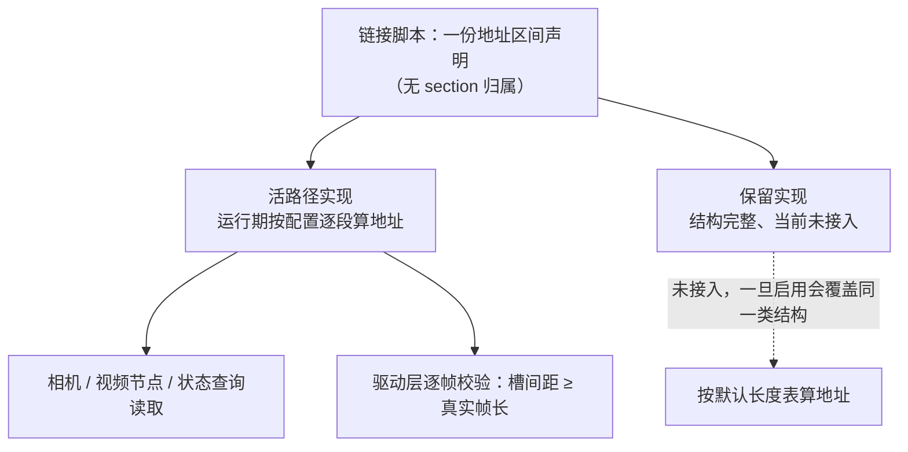

一块给 DMA 用的三帧缓冲，涉及三个不同的问题：地址是谁算的、算完之后谁检查、以及检查失败之后谁能收场。这三个问题在多数系统里都没有明确归属，于是缓冲区成了“人人可用、无人负责”的地方。

上一篇讲了这两段缓冲为什么要分开、尺寸怎么算，见 [两级三帧缓冲: 一级按输入算尺寸、二级按输出算](/tech-notes/posts/architecture/two_level_dma_triple_buffer/)；这一篇接着问一个更容易被忽略的问题：这些地址算出来之后，靠什么保证它不出错。

## 1. 风险清单

按严重程度排，这类系统的风险集中在四处：

**一是保留但未接入的实现看起来可用。** 有些系统里同一份地址描述有两份实现：一份在活路径上，另一份接口完整、注释正常，但不在当前构建里。后者的危险不在于它现在会出错，而在于它看起来随时可用。按现有代码，把它接回来会先因为缺少配套定义在编译期失败；即便补齐，它也缺模式判断与独立游标，算出的布局会出现地址重叠。征兆是：打开开关后先在编译期报“缺少配套定义”，而不是运行期出错。

**二是校验只覆盖末端，且越界不回滚。** 布局阶段比较的是整条链的终点与预留区域的末尾，中间某个区域超界并不会在这一步被发现；越界本身只产生一条错误日志，已经写进结构体的地址不会回滚。单帧是否真的越界，由驱动层的逐帧校验独立把关。征兆是：布局表里的地址已经被写坏，硬件侧却没人报错。

**三是容量约束在编译期和链接期都不存在。** 预留区域只有一份书面声明，没有任何代码段落在里面，链接器认为它的占用是零，也就不会报重叠或溢出。两处独立硬编码的容量常量之间，没有编译期断言去保证一致。征兆是：只改一处常量，构建照常通过，问题留到板上才出现。

**四是地址重算与读取方之间没有并发保护。** 布局重算会逐个字段改写上百个地址，而读取方可能同时在用。当两者之间没有互斥、没有版本号、也没有内存屏障时，读到的可能是新旧混合的地址组合。这一条目前没有对应的故障记录，属于潜在风险；它的前提是“重配期间相关流已停止”，而这个前提并没有断言来保证。在没有故障记录之前，这一条只能算待验证的推断。要补的机制是版本号或脏标记，见已发的 [嵌入式软硬件缓存一致性](/tech-notes/posts/architecture/hardware_software_cache_coherence/) 里“版本号与脏标记”那一节。

外部协议直接下发的宽高如果缺少上界校验，会进入长度计算的乘法。无符号乘法回绕是定义行为，不会报错，得到的是一个很小的长度；它反而让布局末尾检查更难触发。实际后果通常止于“配置被驱动拒绝”，但错误语义落在底层错误码上，看不到“尺寸不合法”这样的提示。

## 2. 同一份描述，两处实现

三帧缓冲的描述结构本身很简单：一个单帧长度，加上三个起始地址。它没有归属信息、没有引用计数、没有状态位。正因为结构里没有主人，才出现了两处实现：

| 维度 | 活路径上的实现 | 未被接入的实现 |
|---|---|---|
| 地址推进 | 有独立游标，按上一段末尾对齐推进 | 直接“上一段地址加长度”，无游标 |
| 模式判断 | 有：不分配时地址置 0、游标不推进 | 无 |
| 单帧长度来源 | 按实际配置计算 | 用一套默认长度表 |
| 读取方 | 相机自身、视频节点、状态查询 | 若干个未编译进当前构建的服务 |

两处实现的差异不在细节，而在“是否知道当前这一路到底出不出图”。所以判断任何一处实现的可信度，先看它有没有模式判断，再看它有没有独立的地址游标。

## 3. 谁预留、谁定量、谁保证

把三个角色分开看，责任缺失就很清楚：

| 角色 | 实际承担者 | 可靠性 |
|---|---|---|
| 预留 | 链接脚本的一份区间声明 | 只是书面声明：无 section 归属，链接期不产生任何诊断 |
| 定量 | 两处硬编码的容量常量 + 两层运行期长度公式 | 常量之间无一致性约束，只能靠人工对齐 |
| 保证 | 四层检查中的最后一层 | 只有驱动层的逐帧校验是有效防线 |

四层检查是：编译期断言、链接期诊断、布局计算后的末端比较、驱动配置时的逐帧校验——编译期、链接期、初始化期、运行期，这也是通用做法里常见的分层验证划分。只被声明、不被任何段落占用的区间，链接期不会产生任何诊断；布局层只保末端且不回滚；真正每帧都生效的是驱动层：它用硬件真实的帧尺寸算出这一帧要占多大，再检查相邻槽位的间距是否够放。

这里有两条推论。第一，硬件尺寸校验通过，不等于软件算的长度正确，两者是独立的口径；第二，槽位间距校验只覆盖前两个槽，最后一个槽与前一槽的间距两级都没有检查，而单帧写模式下这个问题会被跳过。

## 4. 三帧环上的共享与竞争

一个三帧环保住的只是“写侧不覆盖读侧正在读的那一帧”，它并不天然支持任意多个使用者：

| 使用者 | 访问方式 | 与三帧环的关系 |
|---|---|---|
| 前端 DMA | 硬件三帧循环写 | 写侧，冲突时跳过当前帧 |
| 处理流水线 | 硬件读端口，固定读上一帧 | 读侧，从结构上不读正在写的槽 |
| 输出接口 | 经第二级三帧环取数 | 独立一环，不共享第一级 |
| 帧平均类算法 | 临时把写模式改成固定写第 1 帧 | 会改变整环的写行为，需显式恢复 |

写侧“冲突跳过”和读侧“固定读上一帧”是配套的：只做其中一侧，都会在某一瞬间读到正在被覆盖的槽。第三行的帧平均（把若干帧逐像素取平均以降低噪声）是这里最需要小心的使用方式：它把三帧环临时改成单槽使用，实现上靠保存、切换、恢复三步，而这几步之间没有任何锁保护；如果另一个线程同时改写模式，恢复值会互相覆盖。排查提示：出现间歇性破图、且时间点跟帧平均功能相关时，先看这条路径。要修的话，加锁或者给写模式加版本号都属于通用做法，这里不展开。

还有两处容易忽略的访问方式：调试功能直接由 CPU 覆盖三帧缓冲，写前必须先做缓存写回，否则硬件看到的是旧内容；另一种“软件读取”通道当前编译关闭，关闭时它的 FIFO 扩展槽长度恒为 0，不会参与排布。

判断共享是否安全，看的是三件事：谁是写侧、谁是读侧、有没有第三方在中间修改写侧的行为。前两件通常写在设计里，第三件往往只存在于代码里。

## 5. 把不一致收敛掉

上面这些风险有一个共同来源：同一个物理量在不同层各有一套口径。收敛的办法是把口径固定到一处，再让所有使用方都从这里取值。具体落点有四个：

1. 容量总量只写一处，另一处改成引用；做不到就用构建期断言把两个常量绑在一起，让不一致在编译时暴露。
2. 长度计算只保留一条路径，删除或明确标注另一条；被标注为保留的实现要么接回构建，要么连同开关一起移除。
3. 校验位置前移。把宽高、格式、模式的合法性检查放在参数入口，错误语义就是“参数不合法”，不至于让驱动抛一个底层错误码。
4. 与并发有关的做法（给地址描述加版本号，或在重算与读取之间加同步点）属于通用结论，已发的 [嵌入式软硬件缓存一致性](/tech-notes/posts/architecture/hardware_software_cache_coherence/) 已经讲透，这里不重复。

改完之后怎么确认：让生产侧跑满、不节流，连续取上千帧，并给每一帧带上一个自增的世代号——位置要选生产和消费双方都会读到的字段，不能放在会被裁剪或压缩的区域里。取帧方校验同一帧里读到的世代号是否一致：不一致说明仍存在半新半旧的窗口，但要留个心眼，其它故障（传输错误、缓存没写回）也会造成同样的现象，可以用读写序号之差进一步区分。这个测试值得长期留在代码里，一次重构就可能把竞态悄悄放回来；生产构建用编译开关关掉即可。

判断标准很简单：**把“谁负责”写进代码，而不是写在注释里。** 一份区间声明加两处硬编码常量，不是一个能自动兜住错误的设计；能兜住错误的位置只有两个：参数入口和驱动校验。

本文只讲三帧缓冲这一类共享缓冲上的具体形态。

下一篇接着讲运行期改这些配置时要保证什么：[运行期重配输出链路: 哪些状态要一起改、失败了怎么退](/tech-notes/posts/practice/display_pipeline_atomic_reconfigure/)。
