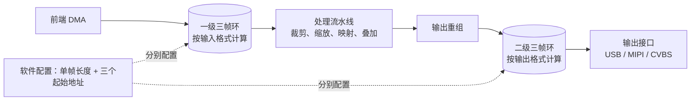

一条图像通路上常常有两段三帧缓冲：前端 DMA 把数据搬进一级，处理后由输出侧 DMA 搬进二级，接口再从二级取数。两级的描述结构一模一样，但单帧长度算法、尺寸来源和对齐要求都不同。把它们当成同一块缓冲去算容量，是这类设计里最容易出错的地方。

地址是谁定的、为什么换构建参数就变，见 [图像 SoC 的内存分区与缓冲布局](/tech-notes/posts/architecture/soc_memory_partition_and_buffer_layout/)；这一篇回答的是另一组问题：这些缓冲为什么要分两段、每段多大、尺寸怎么算。

## 1. 为什么必须分成两级

把两段合并成一段不可行，原因有四条：

1. 生产者和消费者不是同一对。前端只负责把数据搬进内存，处理流水线是另一方，两者的速率不一定同步。
2. 数据格式不同。一级按传感器位深存放（典型是每像素 2 字节），二级按最终的输出格式存放，每像素可能是 3、2 或 1.5 字节。
3. 尺寸来源不同。一级跟着传感器侧的输入尺寸走，二级跟着业务指定的输出尺寸走，两者可以不相等。
4. 帧节拍可以不同。中间有放大或缩放处理时，输出侧的节拍与输入侧不一致。

三帧环本身解决的是“生产者和消费者速率不齐”：写侧按自己的节拍轮转三个槽位，读侧固定读正在写的上一帧，两者就不必互相等。两级各自有一个这样的环，各自独立轮转，三帧环的入门形态见已发的 [嵌入式双路 USB 视频输出](/tech-notes/posts/architecture/embedded_usb_dual_video_output/)。

这套做法在通用资料里的名字是三缓冲（triple buffering）。它与双缓冲的差别可以压成一句话：双缓冲要求消费者一直跟得上，三帧环默认消费者偶尔会迟到，用多出来的一个槽位吸收这段时间抖动；换来的是内存多占一份、数据最多滞后两帧——这是“写一帧换槽、读侧取最近完整帧”这类协议的性质，索引方式不同，滞后量也不同。槽位数在本平台由硬件状态位宽直接限制；从通用角度看，再加缓冲也只增加延迟和内存，换不到额外收益。



## 2. 两段缓冲的分工对照

| 维度 | 一级 | 二级 |
|---|---|---|
| 谁在写 | 前端 DMA | 输出重组硬件 |
| 谁在读 | 处理流水线（读上一帧） | 输出接口 |
| 单帧长度口径 | 输入位深，每像素 2 字节 | 输出格式，每像素 3 / 2 / 1.5 字节 |
| 尺寸来源 | 传感器侧的输入尺寸 | 业务指定的输出尺寸 |
| 中间环节 | — | 裁剪、缩放、映射、叠加、格式重组 |
| 关闭时的行为 | 地址置 0，游标不推进 | 地址置 0，游标不推进 |

最后一行要留意：两级都支持“这一路不分配缓冲”的状态，此时地址全部为 0，并且排布游标不再前进。**游标停住的含义是这一段不占空间，后面的区域从同一个起点继续排**，所以判断某个缓冲到底有没有分配，不能只看它的长度，还要看这一路是否处于关闭状态。

## 3. 两段缓冲怎么排下去

几十个区域不是各自挑地址，而是按一条单向链排下来：起点固定，之后每一段都取“上一段末尾对齐后”的地址，再往下推。对齐要求按硬件逐段不同，图像类缓冲一般要求首地址 16 字节、帧内 32 字节对齐，需要被独立加载的区域要求 512 字节对齐，其余小块系数区 4 字节即可。这些粒度来自总线和缓存的约束，不是随手取的整数：16 与 32 字节对应一次总线传输覆盖的最小与常用粒度，512 字节对应独立加载按页对齐；缓存行本身按平台而定（常见 32 或 64 字节），不要把它和这里的对齐档混为一谈。对齐还有性能含义：起始地址跨了缓存行或突发边界时，总线会把一次传输拆成多次，带宽跟着下降。按段依次推进地址的这套做法，在通用内存布局里叫顺序分配（bump allocator）。

链上有两个推进指针（下文称游标）。一个服务于三帧区段，按帧内对齐推进；另一个记录“最后一段的末尾与长度”，供链尾整体对齐使用。两者分开是因为关心的对齐不同：前者只管帧内三个地址互不重叠，后者决定整块区域的终点。

## 4. 分区的尺寸是静态的

给图像缓冲预留的整块区域、以及堆所占的区域，都是链接脚本里的字面常量，运行期不会伸缩。由此有两条推论：图像侧预留用不完，堆也不会因此变大；图像侧真的需要更多，堆也不会让出来，只能改常量重新编译。

还要区分“上限”和“实际占用”：预留区域是上限，真实用量是排布链的终点到预留区域末尾之间的距离。做容量评估时要看这个差值，而不是看预留总量。

这里有一处明确的取舍：堆的大小可以按“物理内存总量减去各预留段”算出来，也可以写成固定常量。减法式写法的前提是所有分区尺寸在同一处对齐，而实际构建里分区尺寸既可能是链接脚本里的字面量，也可能是运行期头文件里的宏，两份独立表达一旦对不上，出错的偏偏是堆——堆溢出比“预留偏小”更难定位。固定常量的代价也很直接：改总量要同时改两处，并且没有人替你检查它们是否一致。

## 5. 尺寸是怎么算出来的

一级和二级的长度公式不同，下面两个例子分别用了传感器侧和业务指定的几何：

```
一级（传感器侧 1280×720，16 位输入）
  每像素 2 字节：1280 × 720 × 2 = 1 843 200 B ≈ 1.84 MB
  三帧占用 = 3 × 单帧 + 两次对齐填充

二级（业务指定 960×540，输出 YUV420，带 2 行信息行）
  Y 平面：960 × (540 - 2) × 1 = 516 480 B
  色度：960 × (540 - 2) × 0.5 = 258 240 B
  信息行：960 × 2 × 2 = 3840 B
  合计 ≈ 778 560 B ≈ 0.78 MB
```

两个公式的输入不同：一级用输入尺寸乘输入位深，二级用输出尺寸乘输出格式的每像素字节数，再单独加信息行。所以**“三帧缓冲总共多大”必须分两级回答**，只报一个数字肯定是错的：拿一级的长度去估二级，在二级按 1.5 字节每像素时会高估三成左右。真的算到不够用时，先动业务侧能动的三项——降输出几何、减信息行、改位深——最后才动构建常量。分区总量不会因为堆有空闲而变大，这一点 [图像 SoC 的内存分区与缓冲布局](/tech-notes/posts/architecture/soc_memory_partition_and_buffer_layout/) 已经讲过。

尺寸里还有一段容易漏的部分：中间处理带放大时，输出侧的节拍会随倍率变化；至于哪些缓冲的长度会跟着变，要按每一级的长度来源逐项核对，不能只看分辨率。

最后一个边界情形值得记住：**当某一路的单帧长度算成 0 时，它的三个地址会落到同一处。** 判据别只看长度（长度本身就是算出来的），看两个独立信号更可靠：三个地址是否完全相同、排布指针是否停在原地不动。两者同时出现时，三帧保护实际已经失效——写侧刚写进去的那一帧，读侧可能正在读。它属于下一个话题：谁负责保证这些缓冲不重叠、以及在什么条件下会漏掉检查，见 [三帧缓冲地址的三层责任: 声明区间、计算长度、逐帧校验](/tech-notes/posts/architecture/triple_frame_buffer_consistency_risk/)。
