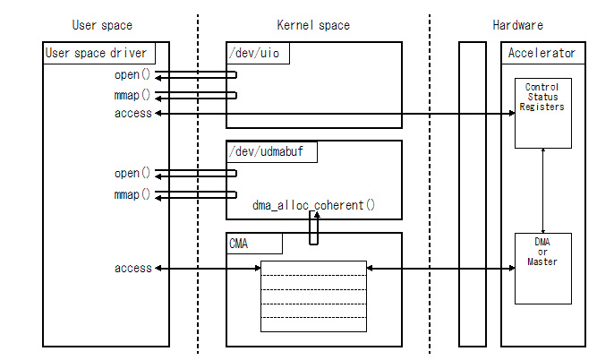
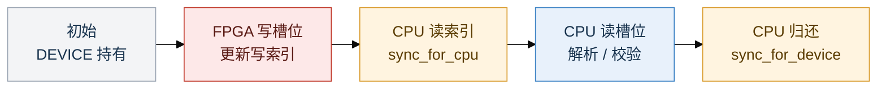

前一篇文章《从 /dev/mem 到 DMA-BUF》讨论了迁移的必要性。本文只回答三个问题：udmabuf 是什么，怎么用，收益和代价是什么。

结论先行：

1. udmabuf（驱动名 u-dma-buf）把连续 DMA 缓冲的分配、用户态 mmap、物理地址查询和 cache 同步收进一个树外内核模块，适合 FPGA 固定物理地址、无 IOMMU、用户态零拷贝采集。
2. 收益是地址可控、零拷贝、生命周期由内核管理、同步接口统一；代价是树外维护、cache 与槽位所有权自理、容量固定、IOMMU 和权限边界要自己确认。
3. 它不负责控制面，也不是完整的 DMA-BUF 框架；需要时可以把子区间导出成 PRIME dma-buf。

## 1. udmabuf 是什么

仓库名是 `udmabuf`，模块名和源码文件名是 `u-dma-buf`。改名是为了避免与 Linux 5.x 主线新增的 `drivers/dma-buf/udmabuf.c` 重名。两者都叫 udmabuf，但解决的问题不同：

| 维度 | ikwzm/udmabuf（u-dma-buf） | 主线 udmabuf |
| --- | --- | --- |
| 内存来源 | `dma_alloc_coherent()`，CMA 或 reserved-memory | memfd 背后的 shmem 页 |
| 物理连续 | 无 IOMMU 时连续 | 不保证 |
| 用户接口 | `/dev/udmabuf0` + `mmap()` / `read()` / `write()` | `/dev/udmabuf` + `UDMABUF_CREATE` |
| 典型用途 | FPGA/UIO 数据面、用户态 DMA 缓冲 | 虚拟机、图形栈共享 memfd |
| 是否在主线 | 否，树外驱动 | 是 |
| 许可证 | BSD-2-Clause | GPL-2.0 |

项目始于 2015 年，当前 master 的驱动版本是 5.9.0。搜资料时先看模块名：`u-dma-buf.ko` 是本文对象，`udmabuf.ko` 可能指主线驱动。



*图 1　u-dma-buf 官方架构图（图源：[ikwzm/udmabuf README](https://github.com/ikwzm/udmabuf/blob/master/Readme.md)，BSD-2-Clause）*

图中左侧用户态驱动通过 `/dev/uio` 访问控制状态寄存器，通过 `/dev/udmabuf` 映射数据缓冲；右侧 FPGA 加速器经 DMA 引擎读写 DDR；中间缓冲由 `dma_alloc_coherent()` 从 CMA 分配。控制面和数据面是两条独立通路。

它向用户态暴露三个入口：

| 入口 | 用途 |
| --- | --- |
| `/dev/<device-name>` | `mmap()` 直接读写，或 `read()` / `write()` |
| `/sys/class/u-dma-buf/<device-name>/` | 查询 `phys_addr`、`size`、`dma_coherent`，配置 `sync_*` |
| 设备文件 ioctl | 同步、查询信息、导出 PRIME dma-buf |

两种使用模式：

| 模式 | 用户态拿到什么 | 适用 |
| --- | --- | --- |
| 字符设备模式 | `/dev/udmabuf0` + `mmap()` | CPU 直接读写，FPGA/UIO 数据面 |
| DMA-BUF 导出模式 | `U_DMA_BUF_IOCTL_EXPORT` 返回的 fd | 交给 V4L2/DRM/GPU 等 importer |

需要说清层次：DMA-BUF 是共享框架，u-dma-buf 是缓冲分配器。前者管 fd 传递和 importer/exporter，后者管一块内存怎么分配、映射、同步。两者可以组合，但不是替代关系。

## 2. 配置、分配与 mmap：源码与用法

以下源码以当前 master（v5.9.0）的 `u-dma-buf.c` 为准。

### 2.1 对象模型：sys_dev 与 dma_dev

源码里每个设备是一个 `struct udmabuf_object`。删掉调试和条件编译字段后，关键成员是：

```c
struct udmabuf_object {
    struct device* sys_dev;      /* char device and sysfs */
    struct device* dma_dev;      /* device used for DMA mapping */
    struct cdev    cdev;
    struct mutex   sem;
    size_t         size;
    size_t         alloc_size;
    void*          virt_addr;
    dma_addr_t     phys_addr;
    int            sync_mode;
    u64            sync_offset;
    size_t         sync_size;
    int            sync_direction;
    bool           sync_owner;
    /* ... */
};
```

`sys_dev` 是字符设备和 sysfs 的宿主；`dma_dev` 是 `dma_alloc_coherent()`、`dma_sync_single_*()`、`dma_mmap_coherent()` 使用的设备。没有绑定父设备时两者相同；通过 `udmabufN_bind` 或 `bind` 绑定到 PCI 等父设备时，`dma_dev` 指向父设备，DMA mask、IOMMU 和 cache 属性都跟着父设备走。`phys_addr` 在不同平台上语义不同，根源就在这里。

生命周期没有单独的 kref，而是复用 `struct device` 的引用计数。`udmabuf_object_get()` 在 `status_lock` 下检查 `UDMABUF_OBJECT_ALIVE`，然后 `get_device()`。`open()` 取对象引用，`release()` 归还；`mmap()` 通过 VMA 持有 `vm_file`，所以 fd 关闭后只要映射还在，`release()` 不会发生；`EXPORT` 显式调用 `udmabuf_object_get()`，dma-buf `release()` 时归还。引用归零后 `udmabuf_object_release()` 才 `dma_free_coherent()`、释放 reserved-memory、`ida_simple_remove()`、`kfree()`。

`udmabuf_object_destroy()` 先把状态置为 `UDMABUF_OBJECT_DEAD`，再 `cdev_device_del()`，最后 `put_device()`。所以卸载驱动后，只要还有 open fd、映射或导出的 dma-buf，buffer 不会立即释放。这是生命周期收益，也是排查“rmmod 后内存没回来”时要看的点。

### 2.2 分配路径：reserved-memory 到 dma_alloc_coherent

设备树匹配表只有一项：

```c
static struct of_device_id udmabuf_of_match[] = {
    { .compatible = "ikwzm,u-dma-buf", },
    { }
};
```

`udmabuf_platform_device_probe()` 的顺序值得注意：

1. 读取必填 `size`，0 或超过 `SIZE_MAX` 直接失败；
2. 读取 `minor-number`、`device-name`，创建 `udmabuf_object`；
3. 读取 `dma-mask`，在 `of_dma_configure()` 之前设置；
4. `of_reserved_mem_device_init(dev)` 关联 `memory-region`；
5. `of_dma_configure()` 建立 DMA ops；
6. 读取 `sync-mode`、`sync-offset`、`sync-size`、`sync-direction`、`quirk-mmap-*`；
7. `udmabuf_object_setup()` 真正分配。

`udmabuf0=...` 不是 probe 参数，而是在 `u_dma_buf_init()` 里由 `udmabuf_static_device_create_all()` 为每个非零参数创建 platform device；`udmabuf0_bind` 通过 `bus_find_device_by_name()` 找父设备，再走 `udmabuf_child_device_create()`。模块参数和 DT 最终汇到同一个 probe/对象创建路径。

分配代码很短：

```c
this->alloc_size = ((this->size + (PAGE_SIZE - 1)) >> PAGE_SHIFT) << PAGE_SHIFT;
this->virt_addr = dma_alloc_coherent(this->dma_dev, this->alloc_size,
                                     &this->phys_addr, GFP_KERNEL);
```

三个直接后果：

- `size` 按页向上取整，`alloc_size` 可能大于用户请求的 `size`；
- `phys_addr` 是 `dma_alloc_coherent()` 返回的 DMA 地址，不是“保证的物理地址”；
- 没有 `memory-region` 时走内核 CMA/DMA coherent 池，空间不足会在 probe 阶段失败。

`of_reserved_mem_device_init()` 只负责把 reserved-memory 绑到设备上，真正取内存仍是 `dma_alloc_coherent()`。所以“设备树写了 reserved-memory 就一定能拿到那块地址”这个假设要验证：读 `phys_addr`，和 FPGA 基址比对。`udmabuf_object_setup()` 最后用 `cdev_device_add()` 注册字符设备，成功后才把状态置为 `ALIVE`。

### 2.3 IOMMU 与 IOVA：地址转换不在 udmabuf 里

IOMMU 是介于设备和内存之间的硬件地址转换与权限控制器，可以理解为“面向设备的 MMU”。设备发出的通常不是 CPU 物理地址，而是 IOVA（I/O Virtual Address）。IOMMU 把 IOVA 映射到真实物理地址，并设置读、写、不可访问权限。

它的作用包括：

- 让设备看到连续的 IOVA，即使背后物理页是分散的；
- 隔离设备，阻止设备越界访问不属于自己的内存；
- 支持 DMA 缓冲区共享和动态映射；
- 支持设备直通/虚拟化，让虚拟机中的设备访问宿主机内存更安全；
- 配合 DMA-BUF，让多个设备对同一缓冲区建立各自的 IOVA 映射。

举例：CPU 分配了一块 DMA-BUF，物理地址是 `0x80000000`；开启 IOMMU 后，某个设备看到的地址可能是 `0x10000000`。设备向 `0x10000000` 发起 DMA，IOMMU 将其转换为 `0x80000000`。同一块 DMA-BUF 的 fd 交给另一个设备时，另一个设备会拿到自己的 IOVA 映射。

没有 IOMMU 时，设备直接使用总线/DMA 地址，通常要求连续，并受 DMA mask 限制。是否启用 IOMMU，以及 domain 是 identity、blocked 还是 unmanaged，由内核配置和平台决定。

udmabuf 不自己维护页表，也不自己做 IOVA 分配；它把设备交给内核 DMA/IOMMU 子系统：

- `udmabuf_object_create()` 选择 `dma_dev`（父设备或自身），并设置 `dma_mask` / `coherent_dma_mask`；
- 设备树模式下调用 `of_reserved_mem_device_init()` 和 `of_dma_configure()`，由内核建立 DMA ops、IOMMU domain 等；
- `dma_alloc_coherent()` 返回 `virt_addr`（CPU 侧）和 `phys_addr`（`dma_addr_t`，设备侧 DMA 地址）；开启 IOMMU 时，`phys_addr` 可能已经是 IOVA，而不是传统物理地址；
- `mmap()` 先尝试 quirk-mmap，否则调用 `dma_mmap_coherent()`；
- 导出 DMA-BUF 后，`dma_get_sgtable()` 构造 sg_table，`dma_map_sgtable()` 让每个导入设备在自己的 IOMMU/domain 中建立映射；解除时 `dma_unmap_sgtable()`；
- cache 同步仍走 `dma_sync_single_for_cpu/device()`、`begin_cpu_access/end_cpu_access` 或对应 ioctl。

地址链可以概括为：

```text
CPU 虚拟地址
  -> dma_alloc_coherent() 分配的托管内存
  -> dma_addr_t（IOMMU 环境下可以是 IOVA）
  -> DMA-BUF
  -> dma_map_sgtable()
  -> 每个导入设备各自的 IOMMU 映射
```

所以 `phys_addr` 这个 sysfs 名字容易误导：它是 DMA API 返回的设备侧地址。无 IOMMU 时通常等于物理地址；有 IOMMU 时可能是 IOVA。把 `phys_addr` 写给 FPGA 前，必须确认 FPGA 使用的是物理地址还是 IOVA，以及它是否在同一个 IOMMU domain 里。

`dma_coherent` sysfs 反映的是 `dma_dev` 的一致性属性；`dma-mask` 限制设备可寻址位宽。相关入口见 [u-dma-buf.c 的设备配置与 probe 逻辑](https://github.com/ikwzm/udmabuf/blob/0c45271c2331a002baedb9253dcfda9155802dad/u-dma-buf.c#L3543-L3606)。

### 2.4 mmap 路径：dma_mmap_coherent 与 quirk-mmap

`mmap()` 入口很短：

```c
static int udmabuf_device_file_mmap(struct file *file, struct vm_area_struct *vma)
{
    struct udmabuf_object *this = file->private_data;
    bool force_sync = ((file->f_flags & O_SYNC) != 0);

    return udmabuf_object_mmap(this, vma, force_sync);
}
```

`O_SYNC` 不是 `open()` 时改属性，而是在 `mmap()` 时作为 `force_sync` 传下去。`udmabuf_object_mmap()` 先校验 `vma->vm_pgoff` 和 `vma_pages()`；只有 `force_sync` 为真或 `sync_mode` 带 `SYNC_ALWAYS` 时，才按 `sync_mode & 0x03` 修改 `vma->vm_page_prot`；然后设置 `VM_IO | VM_PFNMAP | VM_DONTEXPAND | VM_DONTDUMP`。

真正映射有两条路：

1. `quirk_mmap_enable()` 为真：设置自定义 `vm_ops`，缺页时 `_udmabuf_mmap_vma_fault()` 用 `phys_addr + pgoff` 算 PFN，`vmf_insert_pfn()` 插入；`quirk-mmap-page` 模式改用 `vmf_insert_page()`，并把 VMA 改成 `VM_MIXEDMAP`，让 `O_DIRECT` 的 `get_user_pages()` 能工作。
2. 否则调用 `dma_mmap_coherent()`，由 DMA API 决定映射属性。

`quirk_mmap_enable()` 的策略是：`quirk-mmap-off` 禁用，`quirk-mmap-on` 强制启用，`quirk-mmap-auto` 返回 `!IS_DMA_COHERENT(dma_dev)`；默认在 ARM/ARM64 是 always-on，在其他架构是 auto。

这解释了为什么“不开 O_SYNC 也能 cacheable”在不同平台表现不同：quirk-mmap 走的是 `vmf_insert_pfn()` 的自定义路径，不是标准 `dma_mmap_coherent()`。收益是 CPU 读快；代价是它不是主线标准路径，`get_user_pages()`、`O_DIRECT`、cache alias 等边界要自己验证。

### 2.5 落地：设备树、加载与 mmap

固定物理地址场景用 reserved-memory 预留一段 DDR，再通过 `memory-region` 关联给 u-dma-buf：

```dts
/ {
    reserved-memory {
        #address-cells = <2>;
        #size-cells = <2>;
        ranges;

        fpga_capture: capture@3c000000 {
            compatible = "shared-dma-pool";
            reusable;
            reg = <0x0 0x3c000000 0x0 0x04000000>;
        };
    };

    udmabuf@0 {
        compatible = "ikwzm,u-dma-buf";
        device-name = "udmabuf0";
        size = <0x04000000>;
        memory-region = <&fpga_capture>;
    };
};
```

这个例子预留 64 MiB：物理基址 `0x3c000000`，长度 `0x04000000`。`size` 要和预留区匹配；超过 4 GiB 时用两个 32 位 cell 表示，例如 `size = <0x01 0x00000000>`。

常用属性：

| 属性 | 作用 | 注意 |
| --- | --- | --- |
| `compatible` | 匹配驱动 | 新驱动用 `ikwzm,u-dma-buf`；旧模块才是 `ikwzm,udmabuf-0.10.a` |
| `size` | 缓冲字节数 | 必填，按页向上取整 |
| `memory-region` | 关联 reserved-memory | 不写时从内核 CMA 池分配 |
| `device-name` / `minor-number` | 设备名和次设备号 | 设备名决定 `/dev/<name>` 和 sysfs 路径 |
| `dma-coherent` | 声明硬件保证一致性 | FPGA 走 ACP 等一致性端口时才加 |
| `sync-mode` / `sync-always` | 打开时的 cache 行为 | DT 取 0-3；`sync-always` 让行为不受 `O_SYNC` 影响 |

调试阶段可以先用模块参数：

```console
make ARCH=arm64 KERNEL_SRC=/path/to/linux-6.6 all
sudo insmod u-dma-buf.ko udmabuf0=0x04000000
ls -l /dev/udmabuf*
dmesg | tail
```

模块名是 `u-dma-buf.ko`。`udmabuf.ko` 是旧版或主线同名驱动，不要混用。

`CONFIG_U_DMA_BUF_STATIC_DEVICE` 控制静态设备数，范围 0-8，默认 8；`minor-number` 范围 0-255。v4.0 起还可以用 [u-dma-buf-mgr](https://github.com/ikwzm/u-dma-buf-mgr) 动态创建和删除设备。README 列出的支持范围覆盖 Linux 3.6 到 6.18 的多个版本。

启动后先做地址对账：

```console
cat /sys/class/u-dma-buf/udmabuf0/phys_addr
cat /sys/class/u-dma-buf/udmabuf0/size
cat /sys/class/u-dma-buf/udmabuf0/dma_coherent
```

`phys_addr` 是 `dma_alloc_coherent()` 返回的 DMA 地址。没有 IOMMU 时它就是物理地址；启用 IOMMU 时它是 IOVA，不能直接当物理地址写给 FPGA。`phys_addr` 必须和 FPGA 逻辑里的基址一致；不一致就不要继续。若 FPGA 有基址寄存器，把读到的 DMA 地址写进去，这时也可以考虑 dma-heap。

原型阶段可以只靠 CMA 加 `insmod`，但每次启动的 `phys_addr` 可能变化；量产要么用 reserved-memory 固定基址，要么由启动脚本或驱动把读到的地址写进 FPGA 基址寄存器。

最小用户态打开与映射：

```c
#include <fcntl.h>
#include <stdint.h>
#include <stdio.h>
#include <stdlib.h>
#include <sys/ioctl.h>
#include <sys/mman.h>
#include <unistd.h>
#include "u-dma-buf-ioctl.h"

static int open_udmabuf(const char *path, size_t size, void **base)
{
    int fd = open(path, O_RDWR);   /* keep CPU cache enabled: do not add O_SYNC */
    if (fd < 0)
        return -1;
    *base = mmap(NULL, size, PROT_READ | PROT_WRITE, MAP_SHARED, fd, 0);
    if (*base == MAP_FAILED) {
        close(fd);
        return -1;
    }
    return fd;
}

static uint64_t read_phys_addr(const char *name)
{
    char path[128];
    char buf[32] = {0};
    int fd;

    snprintf(path, sizeof(path), "/sys/class/u-dma-buf/%s/phys_addr", name);
    fd = open(path, O_RDONLY);
    if (fd < 0)
        return 0;
    read(fd, buf, sizeof(buf) - 1);
    close(fd);
    return strtoull(buf, NULL, 0);
}
```

`read()`/`write()` 也能用，但它们会走 `copy_to_user()`/`copy_from_user()`。采集热路径应使用 `mmap()`，否则并没有真正避免内核拷贝。

非 root 访问通过 udev 组权限控制，不要在生产环境用全局可写：

```rules
SUBSYSTEM=="u-dma-buf", GROUP="fpga", MODE="0660"
```

### 2.6 最小流程与常见误区

把上面的步骤压缩成最小流程：

1. 编译并加载 `u-dma-buf.ko`，确认 `/dev/udmabuf0`。
2. 读 `phys_addr` / `size`，与 FPGA 逻辑基址比对；有基址寄存器就写入。
3. `open()` + `mmap()`，热路径不要用 `read()` / `write()`。
4. CPU 写后 `sync_for_device`，读前 `sync_for_cpu`；不要在 DMA 缓冲上只用 `msync()`。
5. `munmap()` / `close()`；有导出 dma-buf 时，fd 关闭前对象不会释放。

常见误区：

- `insmod udmabuf.ko` 是旧版/主线模块名；本仓库是 `u-dma-buf.ko`。
- `msync(MS_SYNC)` 只同步页缓存，不做 DMA cache maintenance；它不能替代 `dma_sync_single_for_device()`。
- `min-size` 不是 u-dma-buf 的设备树属性；容量用 `size`。
- `no-map` 会改变内核映射语义，`quirk-mmap` 的 `pfn_valid()` / `vmf_insert_pfn()` 路径不一定可用；先用官方示例的 `shared-dma-pool` + `reusable` 验证。
- `reserved-memory` 的 `reg` 不能和内核其他保留区重叠；改完先看 `/proc/iomem` 或启动日志。
- `dma_buf_fd()`、`dma_buf_attachment`、`dma_buf_map_attachment()` 都是内核 API；用户态 fd 来自 `U_DMA_BUF_IOCTL_EXPORT`。

## 3. 同步、ioctl 与采集环：源码与用法

### 3.1 同步核心：sync_arguments 与 sync_owner

所有同步最终汇到 `udmabuf_sync_arguments()`。它先尝试从 64 位 `command` 里解码参数；解不出来就用对象当前的 `sync_offset` / `sync_size` / `sync_direction`：

```c
if (!udmabuf_sync_command_get_arguments(command, &sync_offset, &sync_size, &sync_direction)) {
    sync_offset    = this->sync_offset;
    sync_size      = this->sync_size;
    sync_direction = this->sync_direction;
}
if (!udmabuf_range_valid(this, sync_offset, sync_size))
    return -EINVAL;
switch (sync_direction) {
    case 1: *direction = DMA_TO_DEVICE; break;
    case 2: *direction = DMA_FROM_DEVICE; break;
    default: *direction = DMA_BIDIRECTIONAL; break;
}
*phys_addr = this->phys_addr + sync_offset;
*size      = sync_size;
```

`udmabuf_sync_for_cpu()` / `udmabuf_sync_for_device()` 只做三件事：解析 address/size/direction，调用 `dma_sync_single_for_cpu()` / `dma_sync_single_for_device()`，清命令并更新 `sync_owner`（CPU=0，device=1）。

`sync_owner` 只是状态展示，不是互斥锁。普通路径用 `sem` 保护参数更新，`SYNC_FAST` 连 `sem` 都跳过。两个线程同时同步同一段内存，驱动不会替你串行化；槽位所有权仍是应用协议。

`read()` / `write()` 的实现也值得注意：只有 `O_SYNC` 或 `SYNC_ALWAYS` 时才在 `copy_to_user()` 前后调用 `dma_sync_single_*`；不开 `O_SYNC` 时，它只做拷贝，不保证 cache 一致。`read()` / `write()` 不是自动安全的兜底。

### 3.2 ioctl：普通路径与 SYNC_FAST

`U_DMA_BUF_IOCTL_SET_SYNC` 的普通路径在 `udmabuf_device_file_ioctl()` 里：`copy_from_user()` 取参数，锁 `sem`，更新 `sync_offset` / `sync_size` / `sync_direction`，设置 `sync_for_cpu` / `sync_for_device`，调用核心同步函数，最后解锁。

`SYNC_FAST` 是另一条分支：

```c
if (GET_U_DMA_BUF_IOCTL_FLAGS_SYNC_FAST(&sync_args) != 0) {
    sync_offset = sync_args.offset;
    sync_size   = (size_t)sync_args.size;
    if (!udmabuf_range_valid(this, sync_offset, sync_size))
        return -EINVAL;
    phys_addr = this->phys_addr + sync_offset;
    /* 0: BIDIRECTIONAL, 1: TO_DEVICE, 2: FROM_DEVICE */
    switch (sync_command) {
        case U_DMA_BUF_IOCTL_FLAGS_SYNC_CMD_FOR_CPU:
            dma_sync_single_for_cpu(this->dma_dev, phys_addr, sync_size, direction);
            break;
        case U_DMA_BUF_IOCTL_FLAGS_SYNC_CMD_FOR_DEVICE:
            dma_sync_single_for_device(this->dma_dev, phys_addr, sync_size, direction);
            break;
    }
}
```

它跳过 `sem`、跳过参数更新、跳过 `sync_owner`，只做 DMA API 调用。收益是少一次锁和状态更新，适合每帧/每槽位同步；代价是调用方必须保证同一 buffer 上没有并发同步。`SYNC_FAST` 需要 IOCTL version >= 3，当前 v5.9.0 是 5。

`GET_DRV_INFO` 返回的 flags 里有 `IOCTL_VERSION`、`USE_QUIRK_MMAP`、`STATIC_DEVICE_NUM` 等能力位，适合启动时做 feature probe，而不是硬编码版本号。

### 3.3 导出：从子区间到 PRIME dma-buf

`U_DMA_BUF_IOCTL_EXPORT` 先校验 `offset`、`size` 页对齐，`offset + size` 不越界，`fd_flags` 只允许 `O_CLOEXEC | O_SYNC | O_ACCMODE`。然后 `udmabuf_export_create_entry()` 复制一份 `object_data`，把 `phys_addr` / `virt_addr` 按 offset 平移，设置 `sync_offset = 0`、`sync_size = size`，再调用：

```c
DEFINE_DMA_BUF_EXPORT_INFO(export_info);
export_info.ops      = &udmabuf_export_ops;
export_info.size     = size;
export_info.priv     = entry;
export_info.flags    = export_fd_flags;
export_info.exp_name = entry->name;
entry->dma_buf = dma_buf_export(&export_info);
```

随后 `get_unused_fd_flags()` 预留 fd，`fd_install()` 安装 `dma_buf->file`，ioctl 把 `exp.fd` 和 `exp.addr` 返回用户态。

`udmabuf_export_ops` 里：

- `map_dma_buf()` 用 `dma_get_sgtable()` + `dma_map_sgtable()`；
- `unmap_dma_buf()` 反向 unmap 并释放 sg_table；
- `mmap()` 复用 `udmabuf_object_mmap()`；
- `begin_cpu_access()` / `end_cpu_access()` 对整段导出范围调用 `dma_sync_single_for_cpu/device()`；
- `release()` 从 export list 删除并 `udmabuf_object_put()`。

导出的 fd 可以交给 V4L2/DRM/GPU，但它不是“第二个 udmabuf 设备”：它是同一块内存的一个 dma-buf 视图，同步走 DMA-BUF 的 `begin/end_cpu_access`。用户态只拿 `exp.fd` 并传给 importer；`dma_buf_attachment` / `dma_buf_map_attachment()` 是内核 importer 的接口，`dma_buf_fd()` 也是内核 API。u-dma-buf 不会创建 `/dev/dma_heap/xxx`，dma-heap 是另一套分配器。该功能受 `CONFIG_U_DMA_BUF_EXPORT` 控制，README 标注为开发中。

### 3.4 落地：cache 策略与采集环

`sync_mode` 决定 `open()` 带 `O_SYNC` 时如何映射：

源码里 `udmabuf_object_create()` 把 `sync_mode` 初始化为 `SYNC_MODE_NONCACHED`（1），所以不配 `sync-mode` 时，带 `O_SYNC` 打开就是 non-cached 映射。`sync-size` 未配置时在 probe 里默认成整个 buffer，`sync_offset` 默认 0，`sync_direction` 默认 0。

| sync_mode | `O_SYNC` 时 | 不带 `O_SYNC` 时 | 典型用途 |
| --- | --- | --- | --- |
| 0 | cache 保持开启 | cache 保持开启 | 硬件一致或手动同步 |
| 1 | non-cached | cache 开启 | 简单但 CPU 读慢 |
| 2 | write-combine | cache 开启 | CPU 大量写 |
| 3 | DMA coherent 映射 | cache 开启 | 平台支持时 |
| 4-7 | 分别是 0-3 的 always 版本 | 同左 | 不受 `O_SYNC` 影响 |

DT 的 `sync-mode` 取 0-3，`sync-always` 等价于把 always 位置一；sysfs 和 ioctl 直接支持 0-7。

固定槽位布局下，最常用的是按槽位同步。ioctl 路径比 sysfs 干净：

```c
static int sync_slot(int fd, uint64_t offset, size_t size, int for_cpu)
{
    u_dma_buf_ioctl_sync_args args = {
        .offset = offset,
        .size   = size,
    };

    SET_U_DMA_BUF_IOCTL_FLAGS_SYNC_DIR(&args, 2);   /* DMA_FROM_DEVICE */
    SET_U_DMA_BUF_IOCTL_FLAGS_SYNC_FAST(&args, 1);
    SET_U_DMA_BUF_IOCTL_FLAGS_SYNC_CMD(&args,
        for_cpu ? U_DMA_BUF_IOCTL_FLAGS_SYNC_CMD_FOR_CPU
                : U_DMA_BUF_IOCTL_FLAGS_SYNC_CMD_FOR_DEVICE);
    return ioctl(fd, U_DMA_BUF_IOCTL_SET_SYNC, &args);
}
```

`sync_slot()` 里方向固定为 2（FPGA 写、CPU 读）。如果方向反过来（CPU 写、FPGA 读），把 `SYNC_DIR` 改成 1（`DMA_TO_DEVICE`）。

这段代码用 `SYNC_FAST` 按槽位同步；并发约束见 3.2。普通路径用 `U_DMA_BUF_IOCTL_SET_SYNC_FOR_CPU`/`SET_SYNC_FOR_DEVICE`，或者写 sysfs：

```console
echo 0x00000000 > /sys/class/u-dma-buf/udmabuf0/sync_offset
echo 1048576    > /sys/class/u-dma-buf/udmabuf0/sync_size
echo 2          > /sys/class/u-dma-buf/udmabuf0/sync_direction
echo 1          > /sys/class/u-dma-buf/udmabuf0/sync_for_cpu
```

`sync_direction` 要设对：FPGA 只写用 2（DMA_FROM_DEVICE），FPGA 只读用 1（DMA_TO_DEVICE），双向用 0。方向设错时，驱动可能不做你期望的 cache 操作。`sync_owner` 可以读回当前所有权：1 表示设备持有，0 表示 CPU 持有。

采集环的典型结构是“一块缓冲切成多个槽位，FPGA 按写索引循环写，CPU 按读索引消费”：



几条硬规则：

1. 槽长按 cache line 向上取整，槽数取 2 的幂，索引用掩码回绕。
2. 索引优先放 FPGA 寄存器，由 UIO 或专用驱动访问；索引若放 DDR，单独占一条 cache line，并纳入同步范围。
3. FPGA 侧保证数据写完成后再更新写索引。CPU 内存屏障约束不了 FPGA，只能约束 CPU。
4. CPU 读完索引后加屏障，再 `sync_for_cpu`，再读槽位；顺序反了会读到旧数据。
5. 单消费者。多线程消费要么加锁，要么每个线程独立队列。
6. 用 seq 或 CRC 检测覆盖。FPGA 不会等 CPU，队列满时要么丢帧，要么覆盖。

消费循环示意：

```c
uint32_t rd = 0;

for (;;) {
    uint32_t wr = mmio_read32(wr_index);
    while (rd != wr) {
        struct slot *s = &slots[rd & (SLOT_COUNT - 1)];
        uint64_t off = (uint8_t *)s - (uint8_t *)base;

        sync_slot(fd, off, SLOT_STRIDE, 1);
        if (s->seq == rd)
            consume(s);
        else
            drop_one();
        rd++;
    }
}
```

`mmio_read32()` 里要包含一次读屏障，避免编译器或 CPU 把索引读和数据读重排。纯读采集只需要 `sync_for_cpu`；`sync_for_device` 只在 CPU 写过这块数据、FPGA 还要读时才需要。

需要把缓冲交给 V4L2、DRM 或 GPU 时，用 `U_DMA_BUF_IOCTL_EXPORT` 导出页对齐的子区间：

```c
#include <linux/dma-buf.h>

u_dma_buf_ioctl_export_args exp = {
    .offset = slot_offset,
    .size   = slot_size,
};
struct dma_buf_sync sync = {
    .flags = DMA_BUF_SYNC_START | DMA_BUF_SYNC_RW,
};

SET_U_DMA_BUF_IOCTL_FLAGS_EXPORT_FD_FLAGS(&exp, O_CLOEXEC | O_RDWR);
if (ioctl(fd, U_DMA_BUF_IOCTL_EXPORT, &exp) == 0) {
    void *p = mmap(NULL, slot_size, PROT_READ | PROT_WRITE,
                   MAP_SHARED, exp.fd, 0);
    ioctl(exp.fd, DMA_BUF_IOCTL_SYNC, &sync);
    /* access p */
    sync.flags = DMA_BUF_SYNC_END | DMA_BUF_SYNC_RW;
    ioctl(exp.fd, DMA_BUF_IOCTL_SYNC, &sync);
}
```

`offset` 和 `size` 必须页对齐。README 把这个 ioctl 标注为开发中，先在目标内核上验证，再放进量产链路。

## 4. 收益：为什么用它

| 收益 | 具体表现 |
| --- | --- |
| 固定地址可控 | reserved-memory 固定基址，`phys_addr` 可读，适合没有基址寄存器的 FPGA |
| 零拷贝 | 用户态 `mmap()` 直接访问内核分配的 DMA 缓冲，不经过 `copy_to_user()` |
| 生命周期清晰 | buffer 由内核引用计数管理，设备节点权限限定到具体缓冲 |
| 同步接口统一 | `sync_for_cpu` / `sync_for_device` 和 `DMA_BUF_IOCTL_SYNC` 走内核 DMA API，不用手写平台刷 cache 代码 |
| 可共享 | `U_DMA_BUF_IOCTL_EXPORT` 可把子区间导出成 PRIME dma-buf，交给 V4L2/DRM/GPU |
| 内核内复用 | 可选 `CONFIG_U_DMA_BUF_IN_KERNEL_FUNCTIONS` 导出 `u_dma_buf_device_search/create/remove/getmap/sync` |
| 集成成本低 | 一个 `.c` 文件，能和 UIO 组成“控制面 + 数据面”，许可证是 BSD-2-Clause |

这些收益都围绕一个前提：FPGA 需要一个固定或可写的 DMA 地址，且 CPU 需要直接访问这块内存。如果 FPGA 有基址寄存器，或者平台有 IOMMU，dma-heap 或自研 dma-buf exporter 可能更标准。

## 5. 代价：需要自己承担什么

| 代价 | 具体表现 | 应对 |
| --- | --- | --- |
| 树外维护 | 不在主线，没有稳定 ABI；设备树属性随版本变化 | pin 驱动版本，升级内核后重跑回环测试 |
| cache 与所有权自理 | 手动同步要管 `sync_direction`、cache line 对齐和槽位所有权 | 槽位按 cache line 对齐，单消费者，seq/CRC 检测覆盖 |
| 容量固定 | buffer 大小在启动时确定，不能按需增长 | 预留足够 CMA/reserved-memory；多路用多个实例 |
| IOMMU 地址语义 | `phys_addr` 可能是 IOVA，不一定是物理地址（见 2.3） | 确认 FPGA 看到的是物理地址还是 IOVA；必要时用 identity mapping |
| 不负责控制面 | 寄存器、中断、索引仍要 UIO 或专用驱动 | 控制面与数据面分开实现 |
| quirk-mmap / O_SYNC 限制 | `quirk-mmap` 非标准，可能影响 `get_user_pages()`/`O_DIRECT`；ARM64 上非对齐 `memset()` 可能出错 | 优先硬件一致或手动同步；必要时用 `sync_mode=2/3` |
| 权限与隔离 | 设备节点是全局的，不是按进程分配 | 用 udev 组权限，不要 0666；多进程场景重新评估 |
| EXPORT 仍是开发中 | 导出 PRIME dma-buf 的功能尚未稳定 | 先在目标内核验证，再进量产 |
| 关闭 cache 的读代价 | README 的 10 MiB 样例中，cacheable 约 4.34 s，non-cached 约 22.83 s，write-combine 约 16.56 s | 能硬件一致就不要关 cache；必须关时先测 CPU 访问模式 |

什么时候不该用：

- FPGA 有基址寄存器，或平台有 IOMMU，dma-heap 更标准；
- 需要主线 ABI、动态分配、多进程共享，选 dma-heap 或自研 dma-buf exporter；
- 需要严格的安全隔离或按进程分配，u-dma-buf 的设备节点模型不够；
- 需要完整的采集框架（寄存器、中断、帧协议），它只提供缓冲。

## 6. 结论与落地清单

适合：FPGA 固定物理地址、无 IOMMU、用户态直接采集、希望避免 `/dev/mem` 的场景。不适合：动态分配、主线 ABI、IOMMU 隔离、多进程动态共享的场景。

落地前检查：

1. 无 IOMMU 时，`phys_addr` 等于 FPGA 基址；有 IOMMU 时，确认 IOVA 与 FPGA 看到的地址一致。
2. `size` 覆盖所有槽位，槽长和槽偏移按 cache line 对齐。
3. `dma_coherent` 与 FPGA 端口一致；为 0 时，手动同步路径经过验证。
4. 用已知图案做读写回环，分别测试 cache 开启和关闭，确认没有旧数据。
5. FPGA 保证“数据写完再更新索引”；CPU 在读索引和数据之间加屏障。
6. 单消费者；用 seq/CRC 检测覆盖，明确队列满时的丢帧策略。
7. 热路径使用 `mmap()` + ioctl 同步，不用 `read()`/`write()`，不在热路径做多余 `memcpy`。
8. pin 驱动版本，记录 `driver_version` 和 `ioctl_version`，升级内核后重新跑回环测试。

一句话：u-dma-buf 是固定地址 FPGA 采集链路的缓冲底座；收益来自“地址、映射、同步”收进内核，代价是树外维护和 cache/所有权自理。

### 参考资料

- [ikwzm/udmabuf](https://github.com/ikwzm/udmabuf)
- [u-dma-buf Readme](https://github.com/ikwzm/udmabuf/blob/master/Readme.md)
- [u-dma-buf-mgr](https://github.com/ikwzm/u-dma-buf-mgr)
- [u-dma-buf-kmod-dpkg](https://github.com/ikwzm/u-dma-buf-kmod-dpkg)
- [DMA-BUF 驱动侧文档](https://www.kernel.org/doc/html/latest/driver-api/dma-buf.html)
- [dma-buf.h](https://github.com/torvalds/linux/blob/master/include/uapi/linux/dma-buf.h)
- [主线 udmabuf 源码](https://github.com/torvalds/linux/blob/master/drivers/dma-buf/udmabuf.c)
