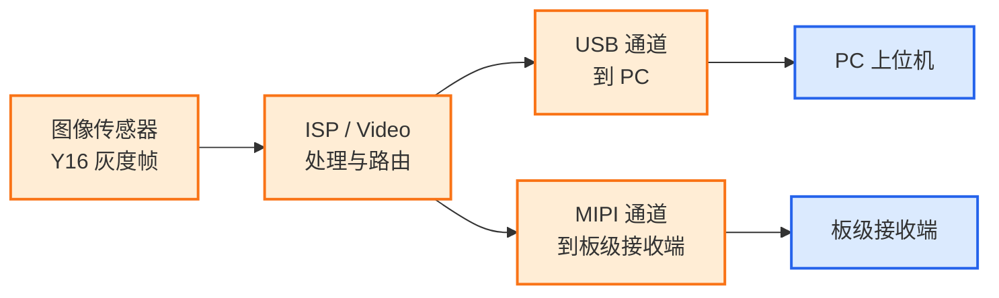
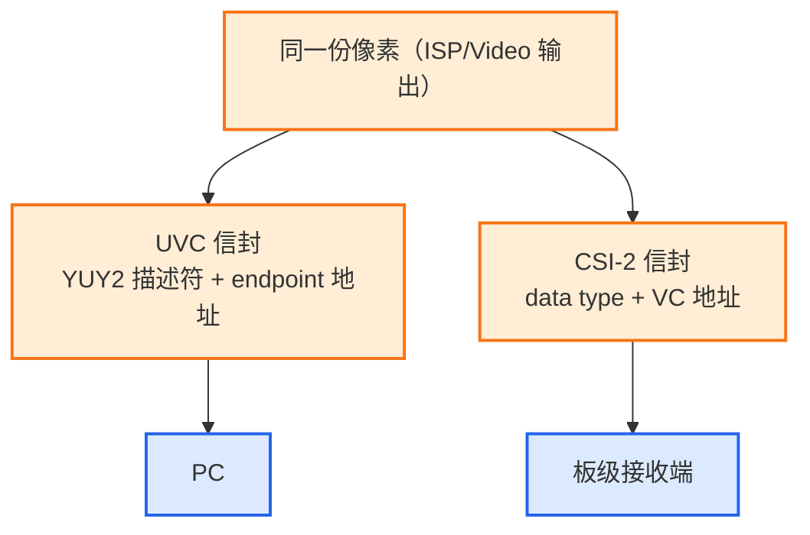

概述：UVC 与 CSI-2 可以承载同一份 ISP 输出像素，但不是可互换的接口。UVC 用描述符和 endpoint 把视频交给 PC，CSI-2 用 data type 和 VC 把视频交给板级接收端；目的地不同，决定了封装、物理层和带宽取舍。

## 同源像素为何分成两条输出通路

传感器输出 Y16 灰度帧，进入 ISP/Video 处理与路由后，数据有了两个去向。这不是两条互相竞争的路径，而是**同一份数据的两种交付形态**：



**一句话定调**：USB 是"送到电脑上去"，MIPI 是"送到板上下一颗芯片去"。去向不同，决定了后面所有设计取舍都不同。

| 维度 | USB 通道 | MIPI 通道 |
| --- | --- | --- |
| 目的地 | PC 上位机 | 板级接收端（SoC/FPGA/桥片） |
| 距离尺度 | 设备到主机（米级） | 板内（厘米级） |
| 为什么要存在 | 通用、免驱、即插即用 | 高速、低开销、板内高带宽 |

## UVC 通路：面向主机的协议封装

### 链路与节点


USB 这条路的枢纽是**桥接芯片**：它把传感器的 DVP/CSI 采样进来，按 UVC 协议打上帧头、Payload 头、CRC，再经端点发出。对 PC 而言，它只是一个"UVC 摄像头"。

### 用 endpoint 标识视频流

USB 通道用 **endpoint（端点）** 区分流。例如主图走 `0x81`、第二路流走 `0x82`。端点号在描述符里写死，不存在"运行时按虚拟通道映射"这回事。

### 描述符格式与真实像素语义

UVC 设备通过 VS 的格式描述符声明格式。而本文要指出的关键在于：**描述符声明的格式，与 payload 真实像素语义可以分离**。

桥接固件把 **Y16 / NV12 实际数据** 通过 **YUY2 描述符** 发出。上位机按真实语义解包，而非按 YUY2 色彩空间解释：描述符说的是 YUY2，body 里装的是 Y16/NV12。于是 SDK 配置里两个字段并存：

```
[camera.properties]
format = "YUY2"        # Format exposed through UVC descriptors.
image_format = "NV12"  # Actual pixel semantics used for decoding.
```

`format` 面向驱动层枚举，`image_format` 面向像素层解码。两者分离，是"描述符层面"与"像素层面"的刻意解耦。

## CSI-2 通路：面向板级接收端的成帧

### 链路与节点


MIPI 这条路没有"桥接芯片"这个角色：因为它是**芯片内部直通**，出芯片就是 D-PHY 电气信号，直接进板级接收端。

### 用 VC 标识视频流

MIPI 不用 endpoint，而是靠 **虚拟通道 VC** 在同一条物理链路上区分多路流。常见 VC 模式（`mipi_vc_mode`）：

| VC 模式 | 语义 | data type |
| --- | --- | --- |
| NORMAL | VC 号 = stream 索引（`virtualCh = stream_idx`） | 随 out\_fmt |
| SINGLE\_VC\_PIC | 单 VC 单图，NV12 伪装 YUV422 | 固定 YUV422\_8bit |
| SINGLE\_VC\_DUAL | 单 VC 双图，两流上下拼接同一 VC | 固定 YUV422\_8bit |

### 用 data type 声明格式

MIPI 的"格式"不是 4CC，而是 **CSI-2 data type**，由输出像素格式决定：

```
YUV422 → YUV422_8bit
RGB888 / YUV444 → RGB888_YUV444
Y16 → Y16
Y14 / Y10 / Y8 → 各自对应
```

data type 与 word count 共同告诉接收端"这一包是什么、多长"。接收端须独立核对 word count。

### D-PHY 物理层约束

Clock Lane + 1~4 条 Data Lane，单 lane Gbps 级。lane 数量与时钟模式（continuous / non-continuous）必须与接收端匹配，否则无帧、错行、丢同步。

## 封装差异、带宽与选型边界

把两条路放到一起，落点是这五处差异：

| 维度 | USB / UVC | MIPI / CSI-2 |
| --- | --- | --- |
| **数据怎么送** | 桥接芯片采样 → 打 UVC 头 → endpoint | ISP 直通 → Stream SEL → CSI TX → D-PHY |
| **怎么标识流** | endpoint（0x81/0x82） | **VC 虚拟通道** |
| **怎么声明格式** | UVC 描述符（可能"伪装"） | **data type**（随 out\_fmt） |
| **送到哪** | PC（免驱 UVC 堆） | 板级接收端 |
| **物理介质** | USB 差分线（bulk ±半双工） | D-PHY 的 clock + data lane |

而**唯一同源的**，是它们背靠同一份 ISP/Video 输出的像素数据：只是被分装成了两种截然不同的"信封"与"地址"。



### USB 2.0 的带宽硬约束

两条路里，MIPI 的 Gbps 级 lane 带宽在板内几乎不构成瓶颈；真正要算账的是 **USB 2.0**：

| 分辨率 | 帧率 | 格式 | 带宽 | USB 2.0 可用？ |
| --- | --- | --- | --- | --- |
| 640×480 | 30 fps | Y16 | 17.6 MB/s | 可用 |
| 1920×1440 | 30 fps | Y16 | 158 MB/s | 不可 |
| 1920×1440 | 5 fps | Y16 | ~26 MB/s | 可用（降帧率） |

USB 2.0 理论 480 Mbps，bulk 半双工 + 协议开销后有效约 **40 MB/s**。高分辨率满帧率需要 USB 3.0（SuperSpeed），或降帧率。

这也是为什么"去 PC"的路要选 USB 而非 MIPI：USB 有带宽可调、有免驱生态；MIPI 的高带宽只在板内才划算。

### 选型结论

1. **同源分叉**：一份像素，ISP 后分 USB 与 MIPI 两路。
2. **USB 路**：桥接芯片 → UVC 信封 → endpoint 地址 → 送 PC，靠描述符（可伪装）声明格式。
3. **MIPI 路**：ISP 直通 → CSI-2 信封 → VC 地址 → 送板级接收端，靠 data type 声明格式。
4. **本质差异**：endpoint vs VC、UVC 描述符 vs data type、PC vs 板级。
5. **约束**：USB 2.0 约 40 MB/s，高分辨率满帧率需 USB 3.0。
