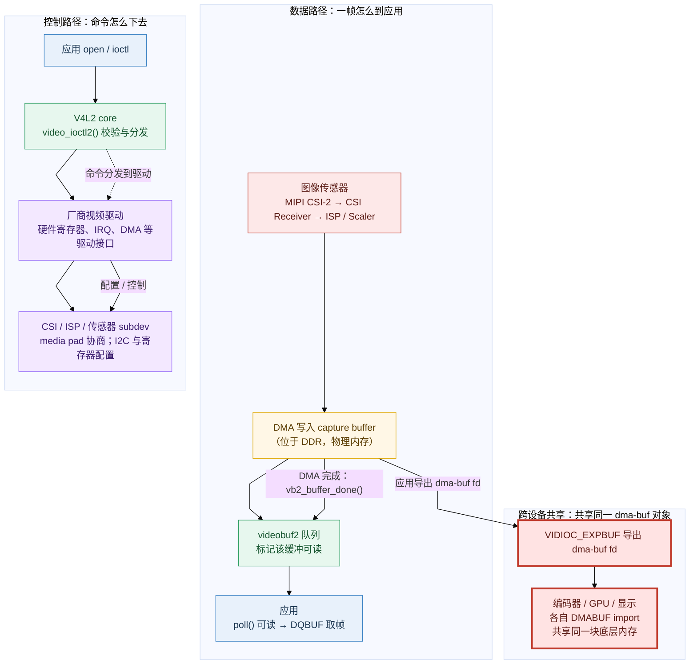
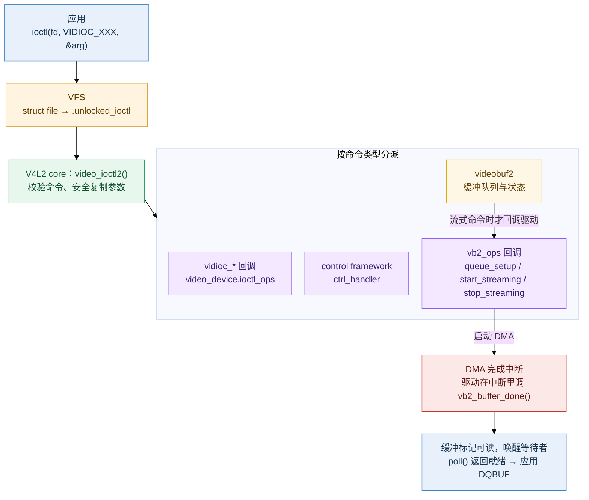
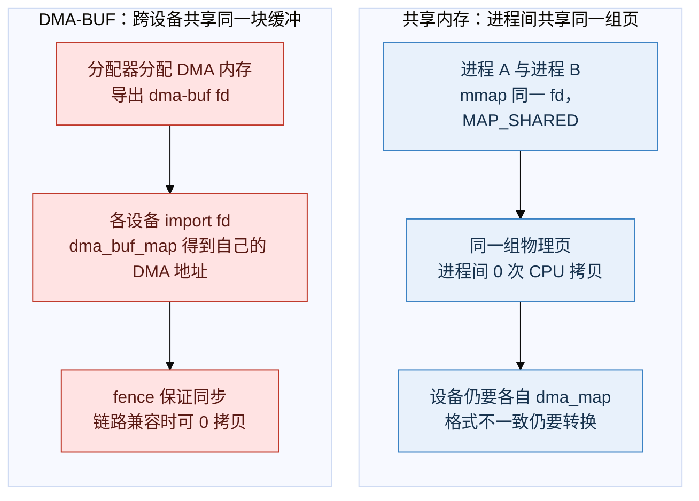

概述：V4L2 的应用侧接口容易上手，难点在它背后那套内核机制。这篇面向写驱动的读者，从一次 ioctl 往下追四件事：命令怎么被校验与分发，缓冲怎么在应用、驱动和 DMA 之间流转，一帧如何从传感器走到应用，以及帧要跨设备共享时该用共享内存还是 DMA-BUF。应用与框架侧的视角见另一篇 [《SoC 视频取流四件事》](/posts/architecture/soc_video_pipeline_v4l2_dma_buf/)，那篇讲设备节点、`io-mode`、DMA-BUF 的使用与 GStreamer、UVC 的分工，这篇讲内核侧怎么实现。

## 1. 整体架构与数据链路

### 1.1 谁负责什么

内核里和视频相关的部分可以分成四层，各管一段：

- **Media Controller（媒体控制器）** 是内核里的拓扑框架，用 entity、pad、link 描述硬件怎么连。传感器、CSI 接收器、ISP 在框架里各是一个 entity，之间的连接是一条 link。挂在上面的驱动对象叫 subdev，驱动之间用 `v4l2_subdev_ops` 互相调用，例如 `v4l2_subdev_call()` 让 ISP 去问传感器要分辨率。官方模型见 [media-controller.html](https://www.kernel.org/doc/html/latest/userspace-api/media/mediactl/media-controller.html) 与 [v4l2-subdev.html](https://www.kernel.org/doc/html/latest/driver-api/media/v4l2-subdev.html)。
- **V4L2 core** 是用户态接口与命令分发。驱动注册一个 `video_device`，内核据此生成 `/dev/videoX`，应用的 ioctl 由 core 校验参数后分发下去。官方总纲见 [common.html](https://www.kernel.org/doc/html/latest/userspace-api/media/v4l/common.html)。
- **videobuf2** 负责缓冲队列与缓冲状态：分配、入队、出队、映射、计时。内核 API 见 [v4l2-videobuf2.html](https://www.kernel.org/doc/html/latest/driver-api/media/v4l2-videobuf2.html)。
- **厂商驱动** 承担与硬件相关的全部动作：写寄存器、配中断、用 DMA API 起搬运。

### 1.2 一帧数据怎么走

图里有两条路径。数据路径是帧的流向：传感器出图，经 MIPI CSI-2 送到 CSI Receiver，再进 ISP 与 Scaler 处理，最后由 DMA 引擎写进 capture buffer，这块 buffer 就是 videobuf2 管理的内存，位于 DDR。控制路径是命令的流向：应用的 `open` 与 `ioctl` 进 V4L2 core，core 分发到厂商驱动，驱动再经 subdev 配置链路上的各个硬件。

一帧落地时，驱动在 DMA 完成中断里调用 `vb2_buffer_done()`，videobuf2 把该缓冲标记为可读并唤醒在 `poll` 上等待的进程，应用随后用 `VIDIOC_DQBUF` 取走。

### 1.3 帧要跨设备时

采集到的帧常常还要交给别的设备：硬件编码器压成 MJPEG 或 H.264，显示或 GPU 消费，UVC gadget 往 USB 上送。这时帧不能靠 CPU 复制，而要共享同一块内存，办法就是 DMA-BUF：buffer 导出成 fd，各设备 import 同一块底层内存。官方语义见 [dmabuf.html](https://www.kernel.org/doc/html/latest/userspace-api/media/v4l/dmabuf.html) 与 [dma-buf.html](https://www.kernel.org/doc/html/latest/driver-api/dma-buf.html)。

## 2. ioctl 的内核响应机制

### 2.1 调用链

一次 ioctl 的完整路径：应用的 `ioctl(fd, VIDIOC_XXX, &arg)` 进入 VFS，VFS 通过 `struct file` 找到 `file->private_data` 里的 `video_device`，调用它的 `.unlocked_ioctl`，通常是 `video_ioctl2()`。core 在这里做两件事：按命令号校验参数是否合法，以及把用户指针安全地复制进内核结构体。

校验通过后按命令类型分派到三个方向：属于设备能力的命令落到 `video_device.ioctl_ops` 里的 `vidioc_*` 回调；属于相机控制项的命令落到 control framework 的 `ctrl_handler`；属于缓冲的命令落到 videobuf2，由它维护队列状态，并在流式命令上回调驱动的 `vb2_ops`。

### 2.2 缓冲类命令与 vb2 回调

videobuf2 只有在流式命令上才回调驱动。`VIDIOC_STREAMON` 时它调用 `vb2_ops->start_streaming`，驱动在这里把每个 buffer 的地址写给 DMA 引擎、开中断、启动硬件；`VIDIOC_STREAMOFF` 时调用 `vb2_ops->stop_streaming`，驱动停 DMA、断中断。另有 `queue_setup` 回调用于按流类型设置队列参数。

驱动一侧的完成通知方向相反：硬件中断里驱动主动调 `vb2_buffer_done()`，videobuf2 更新缓冲状态并唤醒等待者。每个 ioctl 的完整语义见官方 [user-func.html](https://www.kernel.org/doc/html/latest/userspace-api/media/v4l/user-func.html)。

### 2.3 常用 ioctl 分类

| 类别 | 常用命令 | 作用 |
|---|---|---|
| 能力与枚举 | `VIDIOC_QUERYCAP`、`VIDIOC_ENUM_FMT`、`VIDIOC_ENUM_FRAMESIZES`、`VIDIOC_ENUM_FRAMEINTERVALS` | 查设备能做什么、支持哪些格式与分辨率 |
| 格式与区域 | `VIDIOC_G_FMT`、`VIDIOC_TRY_FMT`、`VIDIOC_S_FMT`、`VIDIOC_G_SELECTION`、`VIDIOC_S_SELECTION` | 协商图像格式、裁剪窗口与缩放区域 |
| 缓冲与启停 | `VIDIOC_REQBUFS`、`VIDIOC_QUERYBUF`、`VIDIOC_QBUF`、`VIDIOC_DQBUF`、`VIDIOC_STREAMON`、`VIDIOC_STREAMOFF`、`VIDIOC_EXPBUF` | 申请缓冲、排队出队、启停流、导出 DMA-BUF |
| 相机控制 | `VIDIOC_QUERYCTRL`、`VIDIOC_G_CTRL`、`VIDIOC_S_CTRL`、`VIDIOC_G_EXT_CTRLS`、`VIDIOC_S_EXT_CTRLS` | 曝光、增益、白平衡、对焦等 |
| 事件与路由 | `VIDIOC_DQEVENT`、`VIDIOC_SUBSCRIBE_EVENT`、`VIDIOC_G_INPUT`、`VIDIOC_S_INPUT`、`VIDIOC_SUBDEV_G_ROUTING`、`VIDIOC_SUBDEV_S_ROUTING` | 订阅事件、切换输入源、配置 subdev 内部路由 |

`S_FMT` 的语义值得单独记：驱动会检查并调整参数，返回的是当前生效的值，所以设置完必须回读。`TRY_FMT` 语义相同但不改变驱动状态，适合先探测再提交。详见 [vidioc-g-fmt.html](https://www.kernel.org/doc/html/latest/userspace-api/media/v4l/vidioc-g-fmt.html)。

## 3. 缓冲流转与多路摄像头的瓶颈

### 3.1 buffer 的循环与所有权

缓冲的所有权在两个状态之间切换：`QBUF` 之后归驱动所有，应用不能改；`DQBUF` 之后归应用所有，应用在这一步读 `bytesused` 确认这一帧有多长、看 `sequence` 判断有没有丢帧、按 `timestamp` 做多路流同步、查 `flags` 有没有错误标志，处理完必须尽快 `QBUF` 归还，否则队列耗尽，流就停了。字段语义见 [buffer.html](https://www.kernel.org/doc/html/latest/userspace-api/media/v4l/buffer.html)。

### 3.2 四种内存方式

| 方式 | 谁分配 | 能否跨设备 | 代价与适用 |
|---|---|---|---|
| `read()` / `write()` | 驱动 | 不能 | 最简单；官方说明驱动既可能用 CPU 拷贝，也可能直接 DMA 到用户内存，所以效率不一定低，**真正的劣势是不带帧计数与时间戳等元信息** |
| `mmap` | 驱动 | 不能 | 最常用；应用 `QUERYBUF` 取偏移后 `mmap` 映射，直接读写 |
| `userptr` | 应用 | 不能 | 内存由应用分配，驱动固定并映射给设备 |
| `dmabuf` | 分配器驱动 | 能 | 外部提供 fd，驱动导入供设备 DMA，适合跨模块共享 |

四种方式的官方定义见 [io.html](https://www.kernel.org/doc/html/latest/userspace-api/media/v4l/io.html)。`dmabuf` 还要驱动声明 `V4L2_BUF_CAP_SUPPORTS_DMABUF`，`REQBUFS` 传 `V4L2_MEMORY_DMABUF` 返回 `EINVAL` 就说明这个设备不支持导入。

### 3.3 mmap 流式采集的标准步骤

1. `VIDIOC_QUERYCAP` 确认设备支持采集与流式，再 `VIDIOC_S_FMT` 协商格式并回读确认。
2. `VIDIOC_REQBUFS` 申请缓冲，逐个 `VIDIOC_QUERYBUF` 取偏移与长度，`mmap` 映射到用户态。
3. 把所有缓冲 `VIDIOC_QBUF` 投给驱动，再 `VIDIOC_STREAMON` 启动采集。
4. `poll()` 等待可读，`VIDIOC_DQBUF` 取帧处理，处理完及时 `VIDIOC_QBUF` 归还。
5. 收尾 `VIDIOC_STREAMOFF`、`munmap`、`close`。

### 3.4 多路摄像头的瓶颈排查

顺序错了会浪费很多时间，建议按下面三步走：

1. **先判断帧有没有到**。看 `sequence` 是否跳变：连续说明帧都到了，问题在处理或格式；跳变说明帧没接住，再往下查。丢帧和花屏是两回事，不要混着查。
2. **再算带宽**。每路 `分辨率 × 帧率 × 每像素字节数`，多路相加；然后对照 CSI 链路、ISP 像素率、DDR 带宽、USB 或网口的预算。
3. **最后查硬件限制与实测**。CSI 接收器路数、ISP 吞吐、编解码算力、散热降频都要看；用压测复现，观察丢帧、延迟与温度。

## 4. 共享内存与 DMA-BUF 的差别

### 4.1 解决的是不同问题

两者常被混为一谈，其实解决的问题不同。

**共享内存**解决进程之间的数据共享。进程 A 与进程 B 映射同一组物理页，数据只写一次，两边都能看到。这是 POSIX 层面的机制，它不负责设备 DMA 映射，也不负责硬件同步。

**DMA-BUF** 解决跨驱动、跨硬件设备的共享。内存由分配器驱动分配并导出成 fd，各设备 import 这个 fd，用 `dma_buf_map()` 映射出各自的 DMA 地址，用 fence 表达完成顺序。内核侧的机制见 [dma-buf.html](https://www.kernel.org/doc/html/latest/driver-api/dma-buf.html)。

一句话：**共享内存是「跨进程」，DMA-BUF 是「跨设备」**。V4L2 侧的导入导出见 [dmabuf.html](https://www.kernel.org/doc/html/latest/userspace-api/media/v4l/dmabuf.html) 与 [vidioc-expbuf.html](https://www.kernel.org/doc/html/latest/userspace-api/media/v4l/vidioc-expbuf.html)。

### 4.2 拷贝次数与对齐

- **拷贝次数**：同一个缓冲被多处共享时，通常是 0 次 CPU 拷贝。但这是有条件的：像素格式、stride、plane 布局或设备的 DMA 能力不一致时，仍然要重新分配并转换，产生一次或多次拷贝。共享内存同样如此，只是它的转换发生在用户态。
- **对齐要求**：要同时满足页对齐、DMA 地址与长度对齐、图像格式的 stride 与 plane size 对齐，以及硬件的 burst 对齐。实际开发优先用 DMA API 或子系统提供的分配接口，不要自己算偏移。

### 4.3 怎么选

| 需求 | 选择 |
|---|---|
| 多个进程读同一份视频帧 | 共享内存，或让各进程各自 `open` 同一个节点各取一份 |
| 帧要交给另一个设备处理 | DMA-BUF |
| 设备之间链路兼容、格式一致 | DMA-BUF，零拷贝 |
| 格式不一致，或要跨设备重排 | DMA-BUF 加一次转换，转换放在硬件里最省 |
| 只是简单抓几帧 | `read()` 足够 |

另外，`V4L2_EXPBUF` 只能把 **mmap 缓冲**导出成 DMA-BUF fd，不能把已经是 DMA-BUF 的缓冲再导回 mmap；反过来，DMA-BUF 缓冲也能直接用 `mmap` 映射给应用看，只是那样就退化成普通内存访问了。

## 5. 与另一篇的分工

| 主题 | 这篇（内核机制） | [《SoC 视频取流四件事》](/posts/architecture/soc_video_pipeline_v4l2_dma_buf/)（应用与框架） |
|---|---|---|
| 视角 | 驱动与内核 | 应用与管线 |
| 关键对象 | `video_device`、`vb2_queue`、`vb2_ops`、subdev | `/dev/videoX`、`io-mode`、GStreamer 元素 |
| 典型问题 | 命令怎么分发、缓冲怎么流转、共享怎么对齐 | 选哪个节点、怎么零拷贝、UVC 怎么协商 |
