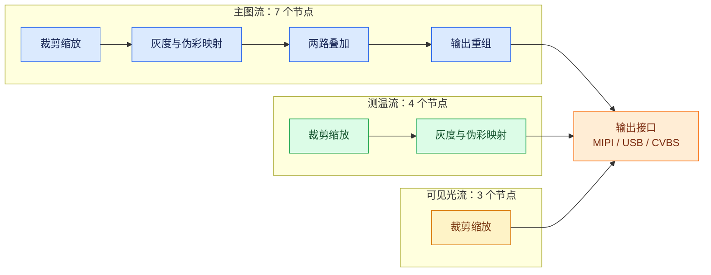
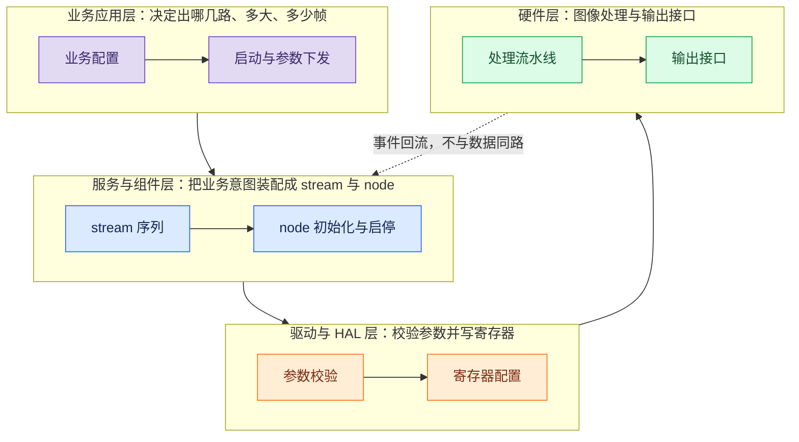

在这类图像 SoC 上，一路视频流不是预先写死的流水线，而是按一份节点序列配置装配出来的通道。装配决定这一路能做什么：几个节点、什么顺序、每个节点占多少静态资源，在流启动之前就定了，运行期不再增删。

理解这套结构，关键是分清三条链路。命令流决定“怎么处理和送到哪里”，数据流是硬件按节点顺序搬运图像，事件流只报告硬件发生了什么，等待方自己决定什么时候去看。三者混在一起看，就会出现“参数明明配置成功，画面却还是旧的”这种误判。

本文讲的是总图；这张图上有三个出口，后面的文章展开其中的 MIPI 与 USB 两条，第三条不在本系列范围。

## 1. 四层分工，以及为什么节点序列是配置生成的

整条链路分四层：业务应用决定出哪几路、什么尺寸、什么帧率；服务与组件层把业务意图翻译成 stream 与 node 的装配；驱动与 HAL 校验参数并写硬件；最下面才是图像处理与输出接口的寄存器。寄存器只由驱动和 HAL 写，业务侧只给业务参数，中间两层负责把参数翻译成硬件配置并做校验。

一个明确的取舍是：节点序列在编译期由配置生成只读表，运行期不动态建链。要加一个处理节点，得改配置重新编译；换来的是两件事：内存占用在启动前就能算清，每个节点的初始化顺序可预测。对一个 DDR 里同时跑着图像缓冲和业务堆的 SoC 来说，可预测比灵活更重要。

同一份配置里，数量与顺序是两个字段：数量决定每类节点静态实例有几个，顺序决定创建、配置、初始化和回滚的次序。两者对不上属于配置错误，构建阶段就该暴露出来。

## 2. 一路 stream 装了什么

当前平台上并存的几路流，节点数量差别很大：

| 流 | 节点数 | 包含的处理 | 典型用途 |
|---|---:|---|---|
| 主图流 | 7 | 两级裁剪缩放、灰度与伪彩映射、两路叠加、输出重组、输出接口 | 观察图、伪彩、叠加后输出 |
| 测温流 | 4 | 两级裁剪缩放、灰度与伪彩映射、输出接口 | 测温面阵与映射 |
| 可见光流 | 3 | 两级裁剪缩放、输出接口 | 可见光或内部视频转接，多路各占一套资源 |

三路流的节点拓扑如下：每一路内部按顺序串行，最后汇到同一个输出接口；主图流节点最多，可见光流最短。

节点多的那一路，能做的事多，代价是链路更长、单帧延迟更大。节点少的两路，能力被刻意收窄：测温流没有叠加和输出重组节点，可见光流的当前序列里也没有格式转换节点。这些能力本来就是按需装配的：不需要的不装配，也就不占资源。

画中画容易被画成与主图流平级的独立通道，实际它是主图流的内部支路：没有独立节点序列，也不占独立资源。把它画错，后面的资源核算会跟着错。

## 3. 命令、数据、事件：三条链路各管一段

命令流从业务下发一路走到寄存器：业务发起流的初始化，组件层按顺序调用各节点的初始化，驱动把参数写进硬件，输出接口节点最后才启动接口本身。运行期改参数也走同一条路。**参数修改成功只代表硬件接受了配置，不代表下一帧已经采用它。** 这种形态没有通用的“已生效”信号，只能依赖停稳与帧边界时序：改完参数之后，要自己按帧边界确认新的几何、位宽和时钟是不是都换过来了。

数据流是硬件自己的事：像素在片内由各处理模块按装配顺序处理，中间通过 DMA 在内存与处理模块之间往返。这一路上 CPU 不参与像素搬运，只在配置阶段出现。具体经过几次搬运取决于这路流装了哪些节点，装配时就能看出来。

事件流则是通知机制。中断服务程序只做两件事：清掉硬件标志、把状态映射成一个事件位。往上是事件对象保存状态，具体谁在等、等哪个事件、超时怎么办，由使用方决定。把事件当成“数据已经可用”的凭证是常见的误用：事件只说明硬件状态变了，不说明下游已经准备好接收。

## 4. 启停顺序与回滚

初始化分两步。第一步是流级初始化：分配并绑定配置、按顺序初始化各节点。第二步是驱动级初始化：流初始化完成后，各节点再去配置属于自己的硬件，最后启动输出接口。启动是另一次调用，把状态从就绪推进到运行。

停止按相反方向走：先让输出接口停下来，再停处理节点，最后释放流。任何一步失败都要按已经走到的位置回退，不能从头再来。这里的顺序不是形式：如果先停处理节点再停输出接口，输出接口在窗口期内仍会按旧配置取数，读到的是正在被拆掉的那一帧。

## 5. 适用范围与边界

| 项 | 当前边界 |
|---|---|
| 节点增减 | 需要改配置并重新编译，运行期不支持动态增删 |
| 画中画 | 是主图流的内部支路，不占独立 stream 资源 |
| 测温流 | 无叠加与输出重组节点，不适合需要叠字或重组的场景 |
| 可见光流 | 当前序列只有裁剪缩放与输出接口，未装配格式转换节点 |
| 参数生效 | 配置成功不等于下一帧生效，需要时按帧边界确认 |
| 多路并存 | 各路独立启停；若多路消费者共用同一个物理出口（组合），共享的分辨率、帧率等参数必须一致 |

后面两篇的分工是这样：主图流最终要交给一个物理接口，而接口自身的配置有一套独立的核对项。下一篇从 [MIPI CSI-2 发送端配置](/tech-notes/posts/architecture/mipi_csi_tx_output_path/) 说起，再下一篇讲 [UVC 的硬件直写通路](/tech-notes/posts/performance/uvc_hardware_direct_write_path/)。
