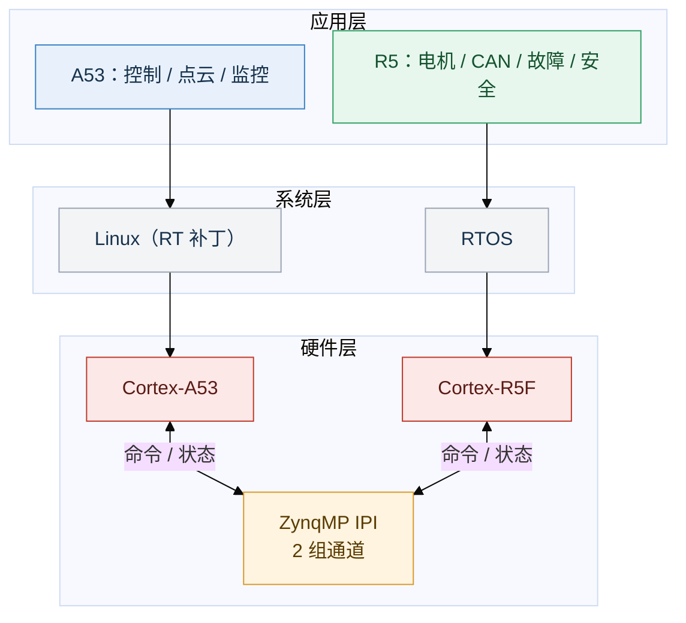
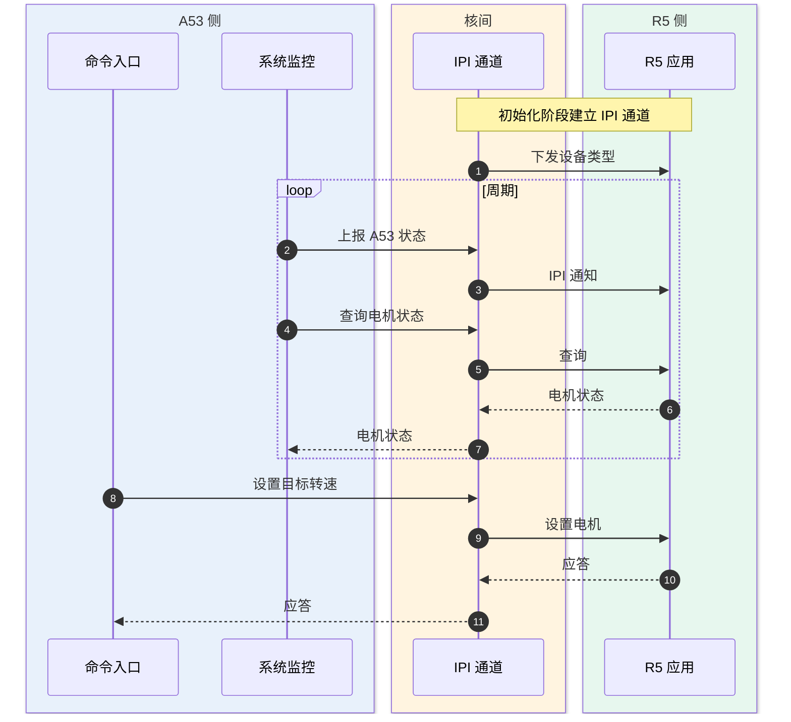
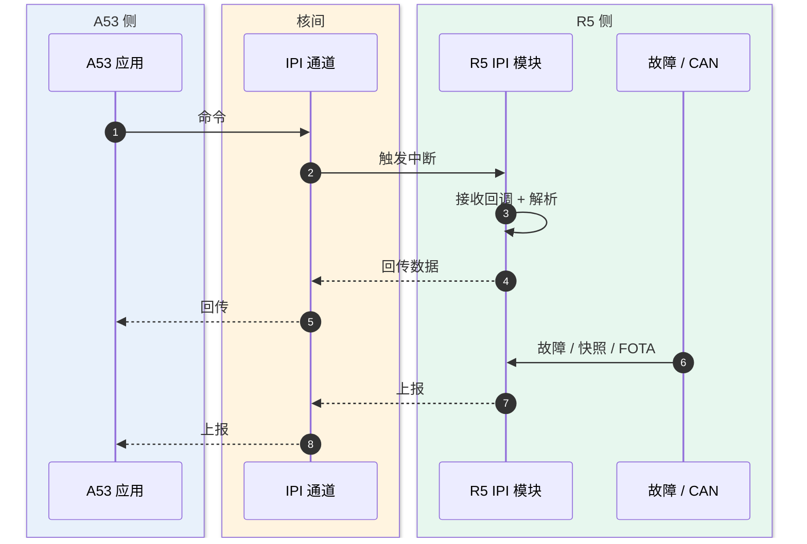
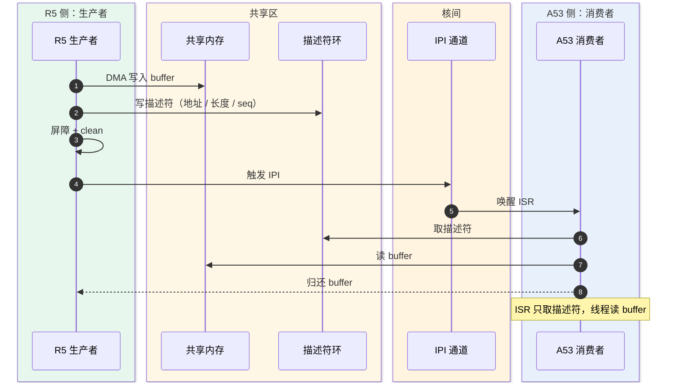

概述：本文讨论 A53 与 R5 之间通过 ZynqMP IPI 完成的核间交互。它不是对称的点对点通道，而是两条方向相反的通信链：A53 主动下发命令、查询状态，R5 主动上报故障与运行状态。消息按大小分流：命令和状态走 IPI 消息寄存器，大块数据走共享内存，描述符只传地址、长度和序号。文中的 master/slave 只描述 IPI 通道方向，原因见第 2 节。

## 1. 系统位置与职责

| 侧 | 硬件 | 操作系统 | 主要职责 |
|---|---|---|---|
| A53 | Cortex-A53 ×2 | Linux（RT 补丁） | 数据处理、网络服务、点云生成、人机接口 |
| R5-0 | Cortex-R5F | RTOS | 电机控制、CAN 通信、故障检测、功能安全 |
| 核间 | ZynqMP IPI，11 个通道 | — | 命令、查询、状态与故障通知 |

图 1 先给分层：应用层、系统层、硬件层；IPI 在硬件层连接两侧的核。


图 1　A53/R5 的分层与依赖。应用层经各自操作系统落到硬件，IPI 在硬件层连接两侧的核。

这里的“小消息”指跨核接口上的命令与状态，不是电机控制环内部的数据。电机控制环在 R5 本地以 1 ms 周期运行，电流采样、位置、PWM 不出 R5；跨核只传目标转速、使能、模式和故障。若要把原始电流或编码器波形送到 A53，1 kHz × 16 B 就是 16 KB/s，10 kHz 就是 160 KB/s；这类数据应走共享内存，不要逐次占用 IPI 消息寄存器。

## 2. 通道与主从模型

ZynqMP 的 IPI 单元提供 11 个通道，每个通道带一组 32 位消息寄存器。该方案使用其中 6 个，按方向成组分配：

IPI 通道是单向的：master 侧在发送函数里先写消息寄存器，再写该通道的触发寄存器；ZynqMP IPI 硬件随后向目标核的 GIC 拉中断，slave 侧收到的是中断，不是函数调用。一个通道只有一个发起方向，所以双向通信要两组通道；A53 master→R5 slave 负责下行，R5 master→A53 slave 负责上行。master/slave 是硬件通道的角色，不是软件层的上下级。如果只有一侧主动发起，一组通道就够；这套方案两边都会主动发起，所以两组都需要。A53 侧通常由内核 IPI 驱动在 ISR 里唤醒阻塞线程，R5 侧直接进入应用注册的 IPI ISR。

应用层不直接写 IPI 寄存器，也不注册硬件 ISR。A53 侧通过驱动接口发起请求，由内核写消息寄存器与触发寄存器；接收侧由内核 ISR 唤醒线程。协议上的发起者仍是应用，内核只负责代写寄存器和处理中断；它与 Linux 自身的调度、TLB shootdown IPI 不是同一条通道。

| 方向 | master 侧 | slave 侧 | 通道占用 |
|---|---|---|---|
| A53 → R5：命令、查询 | A53 | R5 | 2 个 master + 1 个 slave |
| R5 → A53：状态、故障 | R5 | A53 | 2 个 master + 1 个 slave |

表中的“2 个 master + 1 个 slave”是通道占用，不是协议要求：两个 master 通道都指向同一个接收端（slave 端点），接收端按通道状态区分来源。为什么一个方向要两个 master，原设计没有说明；可能是命令/数据分离或冗余，落地前要按项目 IPI 配置确认。

主从实现差异：

| 侧 | Master | Slave |
|---|---|---|
| A53 | 事件型函数，调用即发送 | 阻塞线程等待中断，再解析 |
| R5 | 事件型函数，调用即发送 | IPI 中断服务程序，收到后立即解析 |

A53 侧没有在硬中断里解析，而是用阻塞线程承接；R5 侧直接在 ISR 里处理。差异决定风险不同：A53 怕线程被调度延迟，R5 怕 ISR 过长打断实时任务。

主从方向不是对称设计；职责划分见 1 节。

## 3. 两侧时序与接口

### 3.1 A53 侧：初始化、周期查询与命令下发


图 2　A53 侧的 IPI 时序。初始化时下发设备类型，运行期周期查询，命令入口触发转速设置。

### 3.2 R5 侧：中断、回调与主动上报


图 3　R5 侧的 IPI 时序。A53 命令进入 R5 中断，R5 解析后回传；故障与状态由 R5 主动上报。

R5 收到 IPI 后会立刻中断其他处理，进入中断服务程序。命令解析与回传在 ISR 上下文完成，故障上报由故障任务触发；因此 ISR 的长度会直接影响 1 ms 控制节拍。

### 3.3 故障上报链路


图 4　R5 侧的故障上报链路。检测在 1 ms/5 ms 节拍上运行，只在故障状态变化时上报。

故障类型包括转速偏差、传感器异常、堵转、过流、过载、帧同步、CAN busoff 与 CAN 失联等。检测与优先级抑制之后，只在状态变化时上报，避免周期刷屏。

### 3.4 接口与异常处理

A53 侧的命令接口按用途分四类：

| 类别 | 典型操作 |
|---|---|
| 状态查询 | 版本、运行状态、日志等级、帧同步信息 |
| 参数设置 | 日志等级、帧同步、电机开关与目标转速 |
| 升级与重启 | 查询/触发 FOTA、重启 R5 |
| 故障处理 | 查询电机故障、按 ID 清除故障、发送 A53 状态与设备类型 |

R5 侧提供接收回调、主动发送命令、主动发送数据包三类接口。

数据格式边界：正文没有给出字段布局、最大长度、序列号与校验方式，落地前要确认三件事：

1. 消息走 IPI 消息寄存器，还是共享内存描述符；
2. 是否有序列号、时间戳、CRC 或长度字段；
3. 快照等可能超容量的数据是分片还是走共享内存。

异常处理：原始设计只说明“通信异常时数据不更新”。这句话描述结果，不是机制。落地还要补：

- A53 侧阻塞线程要有超时；
- 命令要有序列号或应答确认；
- 周期状态要有 last-update 时间戳；
- R5 侧要有发送失败计数。

对功能安全相关链路，这些不是优化项，而是诊断能力：没有超时与计数，就无法区分“没有故障”和“通道没工作”。

## 4. 跨核共享的六类风险

这套链路当前以 IPI 消息寄存器为主；下面六类问题按“从消息寄存器扩展到共享内存”的顺序排列。前两项在任何跨核共享状态里都存在，后四项在引入 buffer、描述符或 DMA 后成为主线。

### 4.1 Cache 一致性

非一致多核里，L1 是每个核私有的。A 核写共享内存，数据可能还在 L1 里没刷出去，R5 从 DDR 读到的就是旧值。两种做法：

| 做法 | 适用 | 代价 |
|---|---|---|
| uncached 映射 | 小数据、低频、图省事 | 每次访问都走总线，吞吐低 |
| 显式维护 | 大数据、高吞吐 | 代码复杂，顺序见 4.2 |

共享 buffer 按 cache line（通常 64 字节）对齐，否则相邻字段会 false sharing，吞吐可能比 memcpy 还低。

OpenAMP 的示例工程用 `WITH_DCACHE` 开关控制这套逻辑；只有共享区 cacheable 且两端没有硬件一致性时才打开。两端必须同时配置，只改一边会出现丢包、旧数据或 vring 被写坏。

### 4.2 内存屏障

“发了 IPI”不等于“写的数据对端能看到”。编译器和 CPU 都可能重排，数据可能还在 store buffer 里。

发送侧的最小序列：

```text
写共享内存数据
→ __DMB() 或 __DSB()
→ 触发 IPI
```

接收侧：

```text
读 IPI 状态
→ __DMB()
→ invalidate 共享区
→ 读数据
```

x86 上还有额外约束：通过 WRMSR 写 x2APIC 触发 IPI 不是串行化指令，发 IPI 前需要屏障。跨平台移植时不要把 ARM 的序列直接照搬。

### 4.3 所有权与并发

共享内存本身不提供任何保护，两个核同时写同一块就会撕裂。按优先级选：

1. **单写者 + 双缓冲/三缓冲**：最稳，写自己那一块，写完切指针；
2. **SPSC 环形队列**：单生产者单消费者，无锁，用原子 head/tail + DMB；
3. **自旋锁**：多写者才用，绝不能在 IPI ISR 里等锁；
4. **sequence number / seqlock**：读多写少、允许重试。

硬规则：ISR 里只做“取描述符 + 置标志 + 唤醒线程”，不做数据处理、不等锁、不调阻塞 API。

### 4.4 实时性抖动

IPI 是异步抢占，会打断目标核正在跑的高优先级任务。Linux 上用 `isolcpus` + `nohz_full` 隔离核，IPI 依然能打进来：TLB shootdown、RCU、调度器负载均衡都会发 IPI。

缓解手段：

- `irqaffinity` 把设备中断挪走，`rcu_nocbs` 与 `nohz_full` 成对使用；
- 限制 IPI 频率，合并通知、批量刷 TLB；
- 极端场景改用共享内存轮询 + 完成状态回执；
- 静态绑核：控制回路固定在控制核，IPI 只打通信核。

### 4.5 内存布局与权限

共享区必须在三处同时声明，否则会随机崩溃：

1. Linux 的 reserved-memory（带 `no-map`，防止页分配器占用）；
2. 从核链接脚本或 ITS 的 load 地址；
3. MMU/MPU/IOMMU 的权限表，两边都要配。

AP 与 MCU 的地址基线可能不同：AP 用 DDR 物理地址，MCU 常以自身加载地址为 0。描述符里要放对端能解释的地址，或统一用物理地址加偏移。改动任一边，都要同步核对三处。

### 4.6 DMA 参与

数据路径里有 DMA 时，还要注意：

- DMA 缓冲区在“启动 DMA 前 clean”，在“DMA 完成中断后 invalidate”；
- IOMMU 要把共享区映射给对端核或外设，否则 DMA 会踩到未授权内存；
- 安全等级不同的分区之间用 MPU/XPU 隔离，防止越权访问。

## 5. 零拷贝的层次与选型

### 5.1 数据面可以做到真零拷贝

以 R5→A53 为例，一次零拷贝传输的时序：


图 5　跨核零拷贝的时序（以 R5→A53 为例）。数据只写一次，描述符只传位置，IPI 只传通知，buffer 用完归还。

全程不 memcpy；描述符只有 16–32 字节。

### 5.2 控制面与描述符面

OpenAMP/RPMsg 也是这个思路：vring 在共享内存里，mailbox（IPI）只是 doorbell，payload buffer pool 也在共享区，收发双方交换的是 vring 索引，不是数据本身。

RPMsg 是控制面协议，buffer 大小有限；把它当大数据通道的后果见 5.3。

### 5.3 假零拷贝的陷阱

1. **序列化没去掉**：内存不拷，但用 protobuf/JSON 跨核编码，CPU 照样烧在序列化上。真零拷贝要求共享内存里直接放强类型结构体、cache line 对齐、预分配池。
2. **cache 没维护**：数据确实没拷，但对端读到脏数据，等于白干。
3. **跨 cluster 访问 DDR**：如果两核不在同一 cluster、要走 interconnect，读共享内存的延迟可能比一次 L1 memcpy 还高，零拷贝反而是负优化。
4. **RPMsg 当大数据通道**：512 字节 buffer 会反复分包，控制面协议不适合数据面。

### 5.4 IPI 自己永远零拷贝不了

IPI 的 payload 就是几个寄存器位，它没有“拷贝”这个动作，传的是事件，不是数据。所以问题要拆成两半：

- IPI 负责“零字节的通知”；
- 共享内存负责“零拷贝的数据”。

两者组合起来，才是端到端零拷贝。

### 5.5 选型表

| 场景 | 推荐组合 | 零拷贝 | 说明 |
|---|---|---|---|
| 启停/模式切换命令 | 消息寄存器 + IPI | 本来就没数据 | 最轻 |
| 中小结构化消息（配置、事件） | RPMsg over vring + IPI | 控制面，非大数据 | 注意 buffer 大小 |
| 图像帧/点云/采样 buffer | 共享内存池 + 描述符环 + IPI + DMA | 真零拷贝 | 需要 cache/屏障/所有权 |
| 硬实时控制回路 | 单写者双缓冲 + 共享内存轮询 | 是，且无中断抖动 | 不用 IPI |
| 跨安全域 | 共享内存 + XPU/MPU + IPI | 是 | 需要 IOMMU 配合 |


一句话：先把数据放在哪定清楚，再决定 IPI 怎么通知；这两件事分开，零拷贝和实时性才不会互相拖累。
