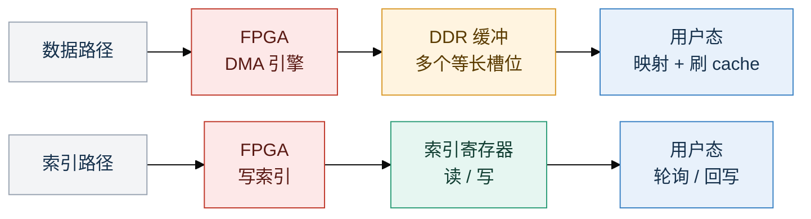

FPGA 通过 DMA 把采集数据写进 DDR，Linux 用户态再读走，是高速采集设备（如激光雷达）里常见的一条链路。很多实现用 `/dev/mem` 直接映射物理地址，能跑通，但地址、cache 和生命周期都靠应用层约定。本文只讨论这条链路的数据面迁移：为什么换 DMA-BUF、固定物理地址时怎么选、cache 怎么同步、环怎么维护、怎么验证。控制面（寄存器与中断）单独处理，不在主线里。

## 1. 概述

结论有三条：

1. 数据面换 DMA-BUF 是正确方向；控制面仍要单独换 UIO 或寄存器驱动。
2. 固定物理地址的 FPGA 场景，优先 u-dma-buf；dma-heap 和主线 udmabuf 的运行时地址对不上。
3. 迁移的关键不是 API，而是三件事：地址契约、cache 同步、环所有权。

本文讨论的范围限定如下：

| 在主线内 | 不在主线内 |
| --- | --- |
| 数据面 buffer 的分配、映射、cache 同步、环维护 | 寄存器与中断（控制面） |
| 固定物理地址场景的 u-dma-buf 落地 | DMA-BUF 内核实现细节、其他子系统的延伸用法 |

读者不需要熟悉内核 DMA 子系统。只要知道 FPGA 会直接读写 DDR、CPU 读之前要处理 cache，就能跟上后面的内容。

## 2. 现状：/dev/mem 链路怎么跑

FPGA 把数据写进 DDR 的一组等长槽位，同时把写索引加一。用户态轮询写索引，发现新槽位后，用 `/dev/mem` 映射该槽位，做一次 cache 维护，再 `memcpy` 到业务缓冲，最后回写读索引。

图 1　数据面和索引面是两条独立通路。FPGA 按物理地址写数据，用户态靠索引判断哪一槽可读。

这条链路能跑，但成本集中在应用层：

1. **地址是常量**：换板子、换 FPGA 逻辑或改预留布局，用户态代码要同步改。
2. **映射次数多**：每个槽位单独 `mmap`，槽位越多，启动和管理越麻烦。
3. **每包都要刷 cache 再拷贝**：帧率越高，这部分开销越明显。
4. **权限高、出错静默**：需要物理内存权限；映射错物理段会写坏别的内存；索引越界可能静默覆盖。

问题不在零拷贝，而在地址、cache、生命周期都要应用层自己保证。

## 3. DMA-BUF 在采集链路里负责什么

可以把 DMA-BUF 理解成内核提供的一块共享缓冲：驱动分配内存，用户态拿到一个 fd，可以 `mmap` 读写。这块内存的地址和生命周期由内核管，用户态不需要知道物理地址。

它解决三件事：

- 地址由驱动管，应用层不再持有物理地址；
- 生命周期由内核引用计数，最后一个引用释放才回收；
- cache 同步有标准 ioctl，不用自己写平台相关的刷 cache 代码。

它不解决三件事：

- 不负责分配内存，内存仍由驱动或分配器给出；
- 不提供"这一帧归谁"的协议，环的所有权仍要自己维护；
- 不等待 FPGA 写完，读完一帧的前提仍是你自己的索引协议。

### 3.1 SYNC ioctl 的语义

采集链路里只需要关心 `DMA_BUF_IOCTL_SYNC`。flags 以 CPU 视角定义：

| 场景 | 调用 | 作用 |
| --- | --- | --- |
| CPU 要读 | `START \| READ` | 丢弃 cache 里的旧数据 |
| CPU 读完 | `END \| READ` | 通常不用回写 |
| CPU 要写 | `START \| WRITE` | 由驱动决定 |
| CPU 写完 | `END \| WRITE` | 把数据刷到主存 |

两个注意点：

1. SYNC 只有驱动实现了才有效。不是所有 dma-buf 都会真的做 cache 维护，迁移前要确认驱动支持。
2. 如果映射是 non-cacheable，SYNC 是多余的。此时要保证的是索引与数据的读写顺序。

### 3.2 核心差异对照

| 维度 | `/dev/mem` | DMA-BUF（udmabuf / dma-heap） |
| --- | --- | --- |
| 地址管理 | 用户态硬编码物理地址 | 内核分配，fd 句柄抽象；CMA heap 才保证物理连续 |
| Cache 同步 | 手写架构相关指令 | 标准 SYNC ioctl，跨平台接口；是否生效取决于驱动 |
| 越界防护 | 可映射任意物理段，地址算错会静默损坏 | 只能拿 fd 对应的 buffer，不能指定任意物理段 |
| 权限模型 | `CAP_SYS_RAWIO` 全局裸权限 | 设备节点权限，作用域限定在具体 buffer |
| 生命周期 | 应用层手动维护 | 内核引用计数自动管理 |
| 硬件零拷贝扩展 | 难以对接 GPU/NPU | fd 传递，便于对接其他设备 |
| 车规认证举证 | 自研地址与 cache 逻辑都要举证 | 自研代码面更小；主线实现可复用，认证结论仍需自证 |

这张表是概念级对照。具体到固定物理地址的 FPGA 场景，地址能不能对上、SYNC 是否有效，仍取决于 exporter 和驱动；第 4 章收敛到 u-dma-buf。

DMA-BUF 的价值不是"更快"，而是把地址、cache、生命周期从应用层收回内核。

## 4. 选型：固定物理地址用 u-dma-buf

FPGA 的 DMA 基址通常是固定的：要么写死在逻辑里，要么由寄存器配置。用户态从 dma-heap 分配到的是一块运行时地址，拿不到物理地址，也没法保证落在 FPGA 约定的位置。所以这类场景优先 u-dma-buf。

u-dma-buf 做的事很直接：

- 设备树预留一段物理内存；
- 驱动创建一个设备节点；
- 用户态 `open` 后 `mmap`，直接读写这块内存；
- sysfs 暴露物理地址，启动时和 FPGA 约定核对；
- 驱动提供 cache 同步接口。

具体接口和版本差异见官方 [Readme.md](https://github.com/ikwzm/udmabuf/blob/master/Readme.md)。

另外两条路为什么不展开：

- dma-heap 的地址不可见，除非 FPGA 有基址寄存器，或者平台有 IOMMU；
- 主线 udmabuf 走 memfd，页不保证物理连续，不适合固定地址。

u-dma-buf 的代价也要说清楚：它是树外驱动，要自己维护和举证；设备树属性随版本变化，不要照抄别家的配置。

落地前先核对三件事：

1. 设备树预留的物理地址，必须和 FPGA 逻辑里的基址一致。
2. 用户态 `mmap` 的长度，必须覆盖槽位数乘槽长。
3. 驱动提供的同步接口，能在当前内核版本上正常工作。

## 5. cache 一致性与地址契约

FPGA 写 DDR 不经过 CPU cache。CPU 读之前，如果 cache 里有旧数据，就会读到脏值；CPU 写之后，如果没刷回主存，FPGA 可能读到旧值。是否要软件处理，取决于 FPGA 接的是哪种端口。

| 端口 | 是否一致 | 软件要做什么 |
| --- | --- | --- |
| 非一致 DMA 端口 | 否 | 读前 invalidate，写后 clean |
| 一致端口 | 是 | 不需要 cache 维护，但索引顺序仍要保证 |

三种做法只能选一种：

1. 一致端口，硬件管一致性；
2. 非一致端口加显式 SYNC，软件在读写前后刷 cache；
3. 非一致端口加 non-cacheable 映射，绕开 cache，代价是 CPU 读带宽下降。

不要混用。同一块 buffer 一半 cacheable、一半 non-cacheable，会出现"有时对、有时错"的偶发故障，很难复现。

地址契约也简单：FPGA 需要一个地址，来源只有两种。固定物理地址，由设备树预留；或者基址寄存器，由内核驱动写入。如果 FPGA 没有基址寄存器，就只能用固定地址，这也是 u-dma-buf 的适用条件。

参考资料：

- DMA-BUF 驱动侧：[dma-buf.html](https://www.kernel.org/doc/html/latest/driver-api/dma-buf.html)
- DMA-BUF 用户态 ioctl：[dma-buf.h](https://github.com/torvalds/linux/blob/master/include/uapi/linux/dma-buf.h)
