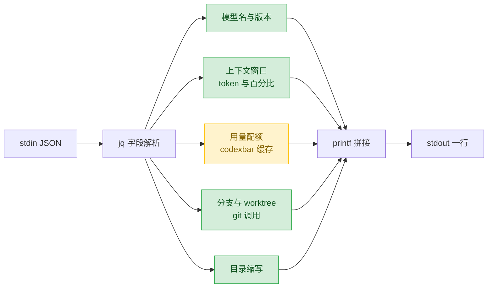

Claude Code 界面底部有一行状态栏，`~/.local/bin/claude-statusline.sh` 就是渲染它的脚本。它把当前会话的模型、上下文占用、git 分支和当前目录压成一行：

```
🤖 Sonnet 4.6 (1M context) | 🧠 92K (9%) | 🔀 feature/pipeline | 📁 ~/project/module/camera
```

## 1. 脚本与功能

脚本是一段 bash，不到 120 行，除 `jq`、`git`、`awk` 外没有依赖。启用方式是在 `~/.claude/settings.json` 里声明一行命令：

```json
{ "statusLine": { "type": "command", "command": "bash ~/.local/bin/claude-statusline.sh" } }
```

它渲染的内容按段划分，每段相互独立：

| 段 | 内容 | 来源 |
|---|---|---|
| 🤖 | 模型展示名，缺失版本号时自动补 | `model.display_name` 与 `model.id` |
| 🧠 | 上下文占用 token 数与百分比 | `context_window` |
| 🔀 | 当前 git 分支名 | `git rev-parse` |
| 🌲 | worktree 标记 | `workspace.git_worktree` |
| 📁 | 当前目录，家目录缩写成 `~` | `workspace.current_dir` |

所有段都是可选的。不在 git 仓库里就没有 `🔀` 段，字段缺失时对应段整体消失，不会留下 `🔀 ` 这样的空壳。脚本另外实现了一条 5 小时与周配额的采集链路，调用外部 CLI `codexbar` 取数，但没有接进输出，详见 3.3 节。

## 2. 原理：契约与 payload

statusline 的机制是一个进程契约：CLI 把会话状态以 JSON 写进命令的 stdin，命令把渲染结果写进 stdout，stdout 的内容就是状态栏。三条硬约束随之而来：命令必须是一行可执行程序，全部解析由脚本承担；stdout 即渲染结果，调试输出必须走 stderr；它是渲染路径上的同步调用，任何阻塞都会体现为界面卡顿。

实测 payload（Claude Code 2.1.233）的主要字段：

| 字段 | 含义 | 备注 |
|---|---|---|
| `model.id` / `model.display_name` | 模型标识与展示名 | 展示名可能不含版本号 |
| `context_window.total_input_tokens` | 上下文占用 token 数 | 与 `used_percentage` 配套 |
| `workspace.current_dir` | 实时工作目录 | 跟随 `cd` 变化 |
| `workspace.project_dir` | 会话启动目录 | 取自 `originalCwd`，不跟随 `cd` |
| `workspace.git_worktree` | worktree 名称 | 可选，仅当 cwd 位于 linked worktree |

三个字段的语义与字面直觉不符，是踩坑高发区：

- `project_dir` 读起来像「项目根目录」，实际取自 `e.project.originalCwd`，即会话启动那一刻的目录，用户 `cd` 之后它不变。如果会话从非 git 仓库的目录启动（例如 `repo` 工具管理的多仓库工作区根目录），用它做 `git -C` 永远取不到分支。
- `current_dir` 才跟随 `cd`，是分支解析的正确输入。
- `git_worktree` 是字符串形式的 worktree 名，不是含 `branch` 字段的对象，分支信息仍需问 git。

## 3. 设计与实现

### 3.1 流水线

脚本是单向流水线，没有分支嵌套，各部件产出的都是可选段：



可选段由预拼字符串实现：先拼好带分隔符的片段，为空则整段不出现。

### 3.2 逐段取舍

模型名用正则从 `model.id` 尾部提取主次版本，仅在 `display_name` 未包含时追加，避免 `Sonnet 4.6 (1M context) 4.6` 这样的重复。token 数按量级折算为 `1.2M` / `92K` / `847`，除法交给 `awk`，因为 bash 的 `$(( ))` 只有整数运算，精度不足以做小数展示。家目录前缀替换为 `~`，用 bash 参数展开而非 `sed`，省一次进程。百分比按绿、黄、红三级着色（`p < 50` 绿，`50 ≤ p ≤ 80` 黄，`p > 80` 红），输出裸 ANSI 转义序列。

配额来自外部 CLI `codexbar`，单次调用数十到数百毫秒，放进渲染路径会拖慢界面。解法是读旧值加后台刷新：

```bash
_refresh() {
  ( env -u CLAUDECODE codexbar usage --provider claude --format json 2>/dev/null \
      | jq -r '.[0].usage | "\(.primary.usedPercent // 0)|\(.secondary.usedPercent // 0)"' \
      > "${CACHE}.tmp" 2>/dev/null && mv "${CACHE}.tmp" "$CACHE"
  ) &
}
```

刷新跑在后台子进程里（`&`），不阻塞本次渲染；结果先写 `.tmp` 再 `mv`，避免读到半截文件，因此本次渲染读到的永远是上一轮缓存值，用延迟一次刷新换取零阻塞。缓存以文件 mtime 判龄，超过 300 秒才触发刷新。`env -u CLAUDECODE` 剥掉 Claude Code 注入的环境变量，部分工具会据此判定自己运行在嵌套会话中而改变行为。

分支解析按第 2 节的字段语义，顺序为 `current_dir` 再到 `project_dir`，任一命中即停：

```bash
GIT_BRANCH=""
for d in "$CWD" "$PROJ_DIR"; do
  if [[ -z "$GIT_BRANCH" && -n "$d" ]]; then
    GIT_BRANCH=$(git -C "$d" rev-parse --abbrev-ref HEAD 2>/dev/null || echo "")
  fi
done
```

分支段用预拼串，不在输出语句里堆条件。worktree 标记由 `workspace.git_worktree` 驱动，只负责输出 `🌲`，分支名仍以 git 为准。

### 3.3 冗余与边界

| 项 | 说明 |
|---|---|
| 头部注释的格式说明 | 注释描述「user@host/branch + 模型/用量」两行格式，实际只渲染一行，`WHO` 与 `PROJECT` 计算后未使用 |
| `VER`、`C5`、`CW` | 计算后未进入输出，属未接线的中间变量，配额链路也因此只采集不显示 |
| `jq` 调用次数 | 单次渲染约 8 次 `jq`，每次一个进程；字段量再增长时应合并为一次调用输出多值 |
| `printf '%b'` 加变量插值 | 格式串含插值内容，分支名若含 `%` 会被当作格式符；实际极少出现，属可接受边界 |

可改进的有三处：多次 `jq` 合并为一次调用；把头部注释里的两行格式真正实现，补齐 user@host 与 5h/wk 配额；未接线的中间变量要么接线要么删除，让代码与注释重新对齐。

## 附录：完整脚本

```bash
#!/usr/bin/env bash
# Claude Code statusline for tmux
set -euo pipefail
# Claude Code Custom StatusLine
# Format:
#  💻 user@hostname:project_name | 🔀 branch_name
#  🤖 Model | 🧠 Context | 5h (%) | wk (%)
# Note: Claude Code renders its own token counter on the right side

input=$(cat)

# ── Model ──────────────────────────────────────────────
MODEL=$(echo "$input" | jq -r '.model.display_name // "?"')
MODEL_ID=$(echo "$input" | jq -r '.model.id // ""')

# Append version only if display_name doesn't already contain it
VER=""
if [[ "$MODEL_ID" =~ ([0-9]+)-([0-9]+)$ ]]; then
  VER_STR="${BASH_REMATCH[1]}.${BASH_REMATCH[2]}"
  [[ "$MODEL" != *"$VER_STR"* ]] && VER=" $VER_STR"
fi

# ── Context Window ─────────────────────────────────────
CTX_PCT=$(echo "$input" | jq -r '.context_window.used_percentage // 0')
TOTAL_IN=$(echo "$input" | jq -r '.context_window.total_input_tokens // 0')

fmt_tok() {
  local n=$1
  if (( n >= 1000000 )); then
    awk "BEGIN { printf \"%.1fM\", $n / 1000000 }"
  elif (( n >= 1000 )); then
    awk "BEGIN { printf \"%dK\", $n / 1000 }"
  else
    printf "%d" "$n"
  fi
}

CTX_TOK=$(fmt_tok "$TOTAL_IN")

# ── CodexBar (300s cache TTL) ───────────────────────────
CACHE="/tmp/statusline-codexbar-cache"
S_PCT=0
W_PCT=0

_refresh() {
  ( env -u CLAUDECODE codexbar usage --provider claude --format json 2>/dev/null \
      | jq -r '.[0].usage | "\(.primary.usedPercent // 0)|\(.secondary.usedPercent // 0)"' \
      > "${CACHE}.tmp" 2>/dev/null \
    && mv "${CACHE}.tmp" "$CACHE"
  ) &
}

if [[ -f "$CACHE" ]]; then
  age=$(( $(date +%s) - $(stat -c %Y "$CACHE" 2>/dev/null || echo 0) ))
  (( age > 300 )) && _refresh
  IFS='|' read -r S_PCT W_PCT < "$CACHE" 2>/dev/null || true
else
  _refresh
fi

S_PCT=${S_PCT:-0}
W_PCT=${W_PCT:-0}

# ── Colored Percent (ANSI: green→yellow→red) ──────────
cpct() {
  local p=${1:-0}
  local c=32
  (( p >= 50 )) && c=33
  (( p > 80 )) && c=31
  printf '\033[%dm%d%%\033[0m' "$c" "$p"
}

C5=$(cpct "$S_PCT")
CW=$(cpct "$W_PCT")

# ── Identity ───────────────────────────────────────────
PROJECT=$(echo "$input" | jq -r '.workspace.project_dir // .cwd // ""' | xargs basename)
WHO="${USER}@$(hostname -s)${PROJECT:+:${PROJECT}}"

# ── Git Branch & Worktree ────────────────────────────
# current_dir follows `cd`; project_dir is the session's original cwd and never
# moves. Try the live directory first, then the project root, so the branch still
# shows after cd-ing out of a repo.
CWD=$(echo "$input" | jq -r '.workspace.current_dir // .cwd // ""')
PROJ_DIR=$(echo "$input" | jq -r '.workspace.project_dir // ""')
WORKTREE_NAME=$(echo "$input" | jq -r '.workspace.git_worktree // empty')

GIT_BRANCH=""
for d in "$CWD" "$PROJ_DIR"; do
  if [[ -z "$GIT_BRANCH" && -n "$d" ]]; then
    GIT_BRANCH=$(git -C "$d" rev-parse --abbrev-ref HEAD 2>/dev/null || echo "")
  fi
done

BRANCH_PART=""
if [[ -n "$GIT_BRANCH" ]]; then
  BRANCH_PART=" | 🔀 ${GIT_BRANCH}"
  if [[ -n "$WORKTREE_NAME" ]]; then
    BRANCH_PART+=" 🌲"
  fi
fi

# ── Current Directory (with ~ abbreviation) ───────────
CWD_PART=""
if [[ -n "$CWD" ]]; then
  [[ "$CWD" == "$HOME"* ]] && CWD="~${CWD#"$HOME"}"
  CWD_PART=" | 📁 ${CWD}"
fi

# ── Output ─────────────────────────────────────────────
printf '%b\n' "🤖 ${MODEL} | 🧠 ${CTX_TOK} (${CTX_PCT}%)${BRANCH_PART}${CWD_PART}"
```
