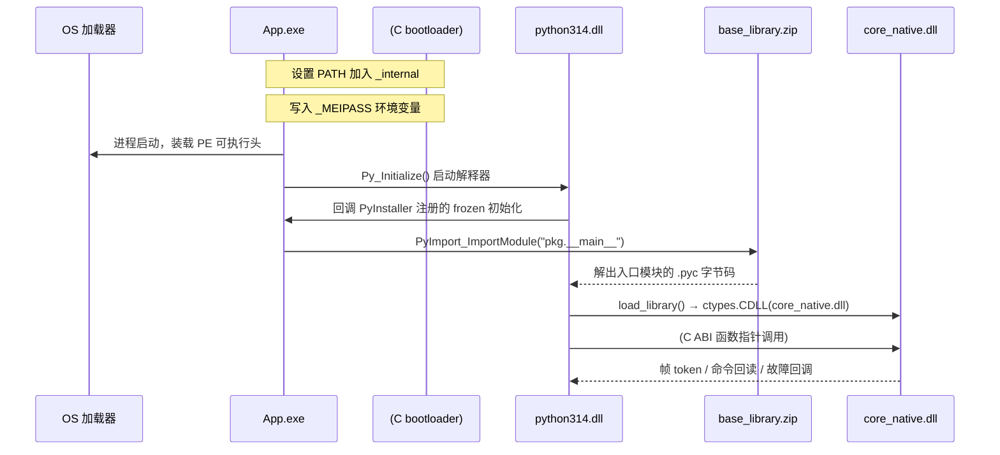

一个用 PySide6 纯 Python 加 C++ 原生核心加 ctypes C ABI 桥构建的桌面客户端，用 onedir 方式打包后，启动器并不是 Python 写的，它是 PyInstaller 编译的纯 C 引导程序；它加载 `python3*.dll` 拉起 CPython 解释器，解释器从 `base_library.zip` 解出字节码跑入口模块，其中再经 ctypes 动态绑定并调用 C++ 核心 DLL。实测环境：CPython 3.14.7（x64 官方版）、PySide6 6.11.1、numpy 2.5.2、PyInstaller 6.22.1。

## exe 里到底有什么

很多人以为打包后的启动器是"一个包含了所有代码和依赖的自包含程序"。其实 PyInstaller 默认生成 onedir（目录式）发行：`App.exe` 只是一个几 MB 的 C 语言启动引导器（bootloader），真正的业务代码、Python 解释器、所有三方库以独立文件形式躺在同目录的 `_internal\` 下。

把产物翻一遍，得到这张"全家福"（几十个 DLL 按职责归类）：

```mermaid
flowchart LR
    subgraph INT["_internal\\（运行时搜索根）"]
        PY["python314.dll · python3.dll<br/>CPython 解释器本体"]:::py
        Z["base_library.zip<br/>PYZ：全部 Python 字节码 .pyc"]:::py
        C["core_native.dll<br/>自研 C++ 核心"]:::c
        R["numpy.libs / pydantic_core / psutil<br/>原生扩展二进制"]:::py
        Q["PySide6\\ + shiboken6\\<br/>Qt 各 dll + 插件 + 软件 GL"]:::qt
        SDK["厂商采集 SDK 各 dll"]:::c
        VC["msvcp140 / VCRUNTIME140(_1) / ucrtbase<br/>MSVCR100（旧 SDK 的 VS2013 依赖）"]:::os
        API["api-ms-win-* 系列<br/>UCRT API 集"]:::os
    end
    subgraph EXE["顶层"]
        E["App.exe<br/>PyInstaller bootloader<br/>纯 C PE"]:::boot
    end
    E --> PY
    E --> Z
    E --> C
    E --> R
    E --> Q
    E --> SDK
    E --> VC
    E --> API
    classDef boot fill:#1D4ED8,stroke:#93C5FD
    classDef py fill:#4C1D95,stroke:#A78BFA
    classDef c fill:#065F46,stroke:#6EE7B7
    classDef qt fill:#0F766E,stroke:#5EEAD4
    classDef os fill:#26384A,stroke:#64748B
```



*图 1-1：onedir 产物全景。深蓝=启动器，紫色=Python 生态，绿色=核心，青=Qt，深灰=系统运行库。本文以 96 个 DLL 的实际产物为例。*

## Python 代码去哪了

答案出乎很多人意料：源码里的 `.py` 在产物里一个都看不见。实际扫描 `_internal\` 的结果是：

| 搜索 | `.py` 文件数 | `.pyc` 文件数 |
| --- | --- | --- |
| `_internal\` 全域递归 | 0 | 0（无散落文件） |
| `_internal\base_library.zip` | 0 | 155 |

业务目录下所有 `.py`（入口脚本、各 widget / services / panels 模块），全部被 PyInstaller 编译成 `.pyc` 字节码，然后塞进 `base_library.zip` 这个 PYZ（Python Zip）容器里。


*图 2-1：源码到字节码到 PYZ 容器。`.py` 被就地编译压缩，产物里没有明文 Python。*

三个好处：

1. **查找快**：几百个 `.pyc` 存成一个 zip，运行时按模块名寻址，比散文件 IO 更省；
2. **体积小**：字节码加 zip 压缩；
3. **一个不可变单元**：zip 只读，防误改模块文件。

有一个例外：`_internal\pkg\resources` 是真实目录而非 zip，里面是 PyInstaller 判定为"数据而非代码"的资源（`config.toml`、`style.qss`、调色板、主题图标），必须按路径逐文件访问，所以原样保留。

## 谁拉起解释器，谁调用 C++ 核心

发起者就是启动器自身。用二进制扫描确认 exe 体内的 PyInstaller 挂件签名（`PyInstaller`、`pyi-`、`pyi_rth`、`_MEIPASS` 全部命中），证实这是 PyInstaller 编译的 C bootloader，不是 Python 写的。

从双击 exe 到 Python 跑起来，走的是 PyInstaller bootloader 的标准流程：



*图 3-1：从双击 exe 到 Python 跑起来的完整时序。启动器把 `_internal` 加入 PATH 并写入 `_MEIPASS`，拉起解释器、回调 frozen 初始化，从 PYZ 解出入口模块，最后经 ctypes 调用 C++ 核心并接收帧与故障回调。*

- **Python 解释器本体** = `_internal\python314.dll` 加 `python3.dll`，官方 CPython 的 Windows 64 位共享库。
- **入口脚本** = zip 内的 `pkg/__main__`（对应源码 `main.py` 的字节码）。
- **主循环** = `QApplication` 起 Qt 事件循环加后台采集线程。

### 跨语言调用 C++ 核心

核心 DLL（18 MB，C++17）不是普通 DLL，它是用 ctypes 经 C ABI 动态绑定的。机制大致如下。

**加载路径搜索**：打包后 `sys.frozen == True`，按此优先序探：

```mermaid
flowchart LR
    A["NATIVE_DLL 环境变量"]:::env
    B["_internal\\core_native.dll<br/>(sys._MEIPASS)"]:::c
    C["exe 旁 core_native.dll"]:::c
    D["开发期 CMake build\\bin"]:::env
    E["ctypes.CDLL(path)"]:::boot
    F["bind() 按签名表绑定"]:::c
    G["找不到 → 降级 sim 后端"]:::warn
    A --> E
    B --> E
    C --> E
    D --> E
    E --> F
    E --> G
    classDef env fill:#1D4ED8,stroke:#93C5FD
    classDef c fill:#065F46,stroke:#6EE7B7
    classDef boot fill:#26384A,stroke:#64748B
    classDef warn fill:#B26A00,stroke:#FCD34D
```



*图 4-1：核心 DLL 搜索顺序。产物里 DLL 在 `_internal\`，命中路径 2。*

然后 `bind(dll)` 把签名表里的每个符号（`open`、`start`、`get_param`、`exec_cmd`、`frame_borrow` 等）按显式签名绑到 DLL 导出：

```python
dll = ctypes.CDLL(path)   # 加载
bind(dll)                 # 按 _FUNCS 签名表绑定 C ABI
```

跨语言边界三件事：

1. **结构体显式对齐**：帧 token 与 envelope 结构体用 `ctypes.sizeof` 运行时断言字节数，杜绝布局漂移；
2. **释放 GIL**：耗时 C++ 调用期间放锁，不卡 Qt GUI 线程；
3. **回调走 CFUNCTYPE**：采集线程经 C ABI 回调 Python（帧、故障、元数据），外层包安全包装防异常外传。

其余 DLL 加载平凡得多：厂商 SDK 是核心 DLL 的依赖，由 OS 加载器在 `_internal\` 就近解析（含其线程与运行库依赖）；Qt、Python、NumPy 由 bootloader 加 Python import 机制同理处理。

## 整体调用链

```mermaid
flowchart LR
    subgraph CBOOL["C 层"]
        BL["PyInstaller bootloader<br/>(纯 C PE)"]:::boot
        PY["python314.dll<br/>CPython"]:::py
        DLL["core_native.dll<br/>C++ 核心 + 厂商 SDK"]:::c
    end
    subgraph ZIP["PYZ 容器"]
        BC["base_library.zip<br/>全部业务 .pyc"]:::py
        RSC["resources\\<br/>config.toml · qss · palette"]:::os
    end
    subgraph PYTHON["Python 层"]
        M["pkg.__main__"]:::py
        QT["PySide6 / shiboken6<br/>Qt Widgets + OpenGL"]:::qt
        C["ctypes C ABI（native.py）"]:::c
    end
    U["用户双击 App.exe"]:::boot
    U --> BL
    BL --> PY
    PY --> BC
    BC --> M
    M --> QT
    M --> C
    C --> DLL
    classDef boot fill:#1D4ED8,stroke:#93C5FD
    classDef py fill:#4C1D95,stroke:#A78BFA
    classDef c fill:#065F46,stroke:#6EE7B7
    classDef os fill:#26384A,stroke:#64748B
    classDef qt fill:#0F766E,stroke:#5EEAD4
```



*图 5-1：全链路。C 启动器嵌 Python，从 PYZ 拿字节码，Python import 各模块并 ctypes 调 C 核心。*

## 结论与常见误解

| 误解 | 实际 |
| --- | --- |
| exe 是 Python 写的 | 错，是 PyInstaller 的纯 C bootloader |
| 源码还是 `.py` 在产物里 | 错，全部编译成 `.pyc` 塞进 `base_library.zip` |
| 核心 DLL 是普通链接 | 错，用 ctypes C ABI 动态绑定，显式结构体对齐加释放 GIL |
| exe 自带解释器 | 半对，单文件里没有，但 onedir 的 `python314.dll` 就是那份解释器 |
| 能搬到别处跑 | 对，自包含，只要目标机是 x64 且带兼容 VC 运行库（或产物自带这些 dll） |

带走一句话：这个几 MB 的启动器只是"点火开关"，真正干活的是它点着的 CPython 火焰（`python314.dll`），燃料是 zip 里的字节码，而跨语言那颗"发动机"（C++ 核心）靠 ctypes 铆接，三者缺一不可。
