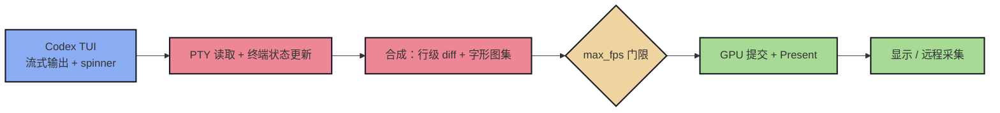

> 原文链接: [CSDN](https://blog.csdn.net/stallion5632/article/details/165613846)

调优结论是：Codex 等 TUI 的主要 CPU 成本来自 PTY 更新与终端状态合成，近似随屏幕更新次数增长，而不是由 `max_fps` 决定。确定有效的只有关闭滚动条与限帧；当前配置另关闭光标闪烁，并保留输入法、剪贴板、`HOME` 和快捷键等行为配置。

## 渲染成本模型与调优原则



主要成本发生在 B 到 C，每次屏幕更新约消耗 0.8～1.4 ms CPU。`max_fps` 位于后续门限，只影响 GPU 提交和显示，因此 15、30、60 fps 的 CPU 结果分别为 33.4%、32.4%、33.8%，差异落在噪声内。

调优按两个标准执行：先降低 `wezterm-gui` 在 TUI 流式输出时的 CPU 开销，再考虑观感。如果性能收益处于 ±20% 测量噪声内，而配置明显损害字体或交互，就保留原有观感。

## 配置项与保留理由

| 分组 | 配置 | 保留理由 |
| --- | --- | --- |
| 帧率与后端 | `max_fps = 30` | 降低 GPU 与续航开销；CPU 无可辨识收益，嫌不流畅可调回 60 |
|  | `animation_fps = 10` | WezTerm 自身动画步进帧率，写死默认值以防误调高 |
|  | `front_end = "WebGpu"` | 当前版本使用 `OpenGL` 或 `Software` 时启动即失败 |
|  | `webgpu_power_preference = 'HighPerformance'` | 机器无独立显卡时无实际作用；`LowPower` 实测更慢 |
|  | `cursor_blink_rate = 0` | 去掉周期性重绘源，且不影响使用 |
| 标签栏 | `use_fancy_tab_bar = true` | 决定标题字体和字号；改为 `false` 后回退内置字体，观感明显退化 |
|  | `hide_tab_bar_if_only_one_tab = false` | F8、F9、F10 和 `Alt+1..9` 的多标签工作流中大多不生效 |
|  | `integrated_title_button_color = 'Auto'` | 按钮颜色随背景自适应，只影响观感 |
| 滚动条与声音 | `enable_scroll_bar = false`、`audible_bell = 'Disabled'` | 滚动条每帧参与绘制；滚轮或 `Shift+PgUp` 可替代，批量输出时也不需要高频响铃 |
| 输入、IME 与剪贴板 | `use_ime = true`、`ime_preedit_rendering = 'Builtin'` | 中文输入必需，`Builtin` 可避免流式输出时 IME 窗口闪烁 |
|  | `enable_csi_u_key_encoding = true` | 将 `Ctrl+Enter` 等组合键作为独立编码传给 TUI |
|  | `use_dead_keys = false` | X11 概念，Windows 下无效果，保留用于跨平台一致性 |
|  | `canonicalize_pasted_newlines = "LineFeed"` | 将多行粘贴统一为 `\n`，避免额外回车 |
| 环境与显示 | `default_prog = pwsh -NoLogo` | 减少一次 logo 输出 |
|  | `HOME = C:\Users\Administrator` | 不改成 `/d/WSL`，否则 SSH 无法找到 Windows 私钥 |
|  | `scrollback_lines = 10000` | 足够覆盖一次长会话，继续调大只增加内存 |
|  | `unicode_version = 15`、`line_height = 1.2`、`font_size = 13`、`window_background_opacity = 1.0` | 保留显示效果；不透明背景避免每帧混合成本 |
|  | `window_close_confirmation = 'NeverPrompt'`、`switch_to_last_active_tab_when_closing_tab = true` | 保留多标签操作习惯 |

按键与鼠标绑定属于功能配置，与 CPU 无关，因此保持现状：左键抬起复制；右键有选区时复制，否则粘贴；中键粘贴；`Ctrl+C` 有选区时复制，否则透传 `^C`（没有这条分支就无法打断前台进程）；`Ctrl+Shift+V` 粘贴；`Ctrl+F8` 和 `Ctrl+F10` 启动 SSH keepalive（300s 上限、退避 60s，分别连接 `172.16.40.193` 和 `172.16.48.122`）；`Ctrl+F9` 使用 tssh 直连；`Alt+1..9` 切换标签。

## 实测结果与无效方案

测试结果以单核占用表示，测量噪声约为 ±20%：

| 场景 | wezterm-gui |
| --- | --- |
| 空闲窗口稳态 | 4.7% |
| 仅动画标题（10 Hz spinner） | 14.1%（retro tab bar 为 8.8%～10.7%，未采用） |
| 流式刷屏（250 次/秒） | 33%～56% |
| 同时对照 `max_fps` 15 / 30 / 60 | 33.4% / 32.4% / 33.8% |
| 更新频率 10 / 50 / 250 次/秒 | 14.8% / 37.5% / 35.7%（约 50 次/秒起饱和） |
| 生产窗口（真实 Codex 会话） | **58.6%**（同窗口 `codex.exe` 2.3%、OpenConsole 1.4%） |
| 缩小窗口（60×20） | 46.4%，参考区间为 33%～52%，属于噪声内波动 |

CPU 开销主要集中在 `wezterm-gui`，随更新次数增长，并在约 50 次/秒后饱和。帧率上限、标签栏形态和窗口大小都没有稳定、可区分的 CPU 收益。

| 已证伪或不可用方案 | 结果 |
| --- | --- |
| `front_end = 'OpenGL'` / `'Software'` | GUI 启动失败，进程立即退出 |
| `webgpu_power_preference = 'LowPower'` | 能启动，但占用升至 54.2% |
| `use_fancy_tab_bar = false` | 约有 3% 收益，但标题字体和字号退化，已回退 |
| `hide_tab_bar_if_only_one_tab = true` | 多标签场景不生效 |

验证配置时先运行 `wezterm ls-fonts`。命令能输出主字体，说明配置语法和取值可加载。采样 `TotalProcessorTime` 时必须预留稳定期，避免字体图集生成和着色器编译污染启动后的前几秒。

## 完整配置

```lua
local wezterm = require 'wezterm'
local act = wezterm.action
local config = {}

config.line_height = 1.2
config.font_size = 13
config.harfbuzz_features = { 'calt=1', 'clig=1', 'liga=1' }
config.window_padding = { left = 8, right = 8, top = 8, bottom = 8 }
config.window_background_opacity = 1.0
config.window_close_confirmation = 'NeverPrompt'
config.initial_rows = 30
config.initial_cols = 100
config.audible_bell = 'Disabled'
config.switch_to_last_active_tab_when_closing_tab = true
config.use_ime = true
config.ime_preedit_rendering = 'Builtin'
config.use_dead_keys = false
config.enable_csi_u_key_encoding = true
config.canonicalize_pasted_newlines = "LineFeed"
config.unicode_version = 15
config.scrollback_lines = 10000
-- 保留 fancy tab bar：retro tab bar 的标题只能用终端字体（本机 JetBrains Mono 缺失，回退内置字体）与终端字号，观感明显变差
-- 代价可接受：标题高频动画场景实测 14.1% -> 8.8/10.7%（±20% 噪声），流式输出场景无差异
config.use_fancy_tab_bar = true

config.hide_tab_bar_if_only_one_tab = false
-- codex 流式输出时按 30fps 渲染，GPU 与续航收益
config.max_fps = 30
config.animation_fps = 10
config.integrated_title_button_color = 'Auto'
-- 滚动条同样每帧参与绘制，TUI 场景收益低
config.enable_scroll_bar = false
config.hide_mouse_cursor_when_typing = false
-- 启用 GPU 加速
config.webgpu_power_preference = 'HighPerformance'
config.front_end = "WebGpu"
-- 禁用光标闪烁
config.cursor_blink_rate = 0
-- 配色方案
config.color_scheme = 'Dracula'
config.default_prog = { 'pwsh.exe', '-NoLogo' }

config.set_environment_variables = {
  HOME = [[C:\Users\Administrator]],
}

config.mouse_bindings = {
  { event = { Up = { streak = 1, button = 'Left' } }, mods = 'NONE',
    action = wezterm.action_callback(function(window, pane)
      local sel = window:get_selection_text_for_pane(pane) or ''
      if sel ~= '' then
        window:perform_action(act.CopyTo('Clipboard'), pane)
        window:perform_action(act.ClearSelection, pane)
      end
    end),
  },
  { event = { Down = { streak = 1, button = 'Right' } }, mods = 'NONE',
    action = wezterm.action_callback(function(window, pane)
      local sel = window:get_selection_text_for_pane(pane) or ''
      if sel ~= '' then
        window:perform_action(act.CopyTo('Clipboard'), pane)
        window:perform_action(act.ClearSelection, pane)
      else
        window:perform_action(act.PasteFrom('Clipboard'), pane)
      end
    end),
  },
  { event = { Down = { streak = 1, button = 'Middle' } }, mods = 'NONE',
    action = act.PasteFrom('Clipboard') },
}

config.keys = {
  { key = 'V', mods = 'CTRL|SHIFT', action = act.PasteFrom('Clipboard') },
  { key = 'c', mods = 'CTRL',
    action = wezterm.action_callback(function(window, pane)
      local sel = window:get_selection_text_for_pane(pane) or ''
      if sel ~= '' then
        window:perform_action(act.CopyTo('Clipboard'), pane)
        window:perform_action(act.ClearSelection, pane)
      else
        window:perform_action(act.SendKey { key = 'c', mods = 'CTRL' }, pane)
      end
    end),
  },
  { key = 'F8', mods = 'CTRL',
    action = act.SpawnCommandInNewTab {
      args = { 'powershell.exe', '-NoProfile', '-ExecutionPolicy', 'Bypass',
               '-File', [[C:\Users\Administrator\bin\ssh-keepalive.ps1]],
               '-MaxDurationSec', '300',
               '-MaxBackoff',     '60',
               'xxx@172.16.40.193' },
    },
  },
  { key = 'F9', mods = 'CTRL',
    action = act.SpawnCommandInNewTab {
      args = { 'tssh.exe', 'dgliu@172.16.48.122' },
    },
  },
  { key = 'F10', mods = 'CTRL',
    action = act.SpawnCommandInNewTab {
      args = { 'powershell.exe', '-NoProfile', '-ExecutionPolicy', 'Bypass',
               '-File', [[C:\Users\Administrator\bin\ssh-keepalive.ps1]],
               '-MaxDurationSec', '300',
               '-MaxBackoff',     '60',
               'xxx@172.16.48.122' },
    },
  }
}

config.default_cursor_style = 'SteadyBar'

for i = 1, 9 do
  table.insert(config.keys, {
    key = tostring(i),
    mods = 'ALT',
    action = act.ActivateTab(i - 1),
  })
end

----------------------------

-- color scheme colors for easy access
local scheme_colors = {
    catppuccin = {
        macchiato = {
            rosewater = "f4dbd6",
            flamingo = "f0c6c6",
            pink = "f5bde6",
            mauve = "c6a0f6",
            red = "ed8796",
            maroon = "ee99a0",
            peach = "#f5a97f",
            yellow = "#eed49f",
            green = "#a6da95",
            teal = "#8bd5ca",
            sky = "#91d7e3",
            sapphire = "#7dc4e4",
            blue = "#8aadf4",
            lavender = "#b7bdf8",
            text = "#cad3f5",
            crust = "#181926",
        }
    }
}

local colors = {
    border = scheme_colors.catppuccin.macchiato.lavender,
    tab_bar_active_tab_fg = scheme_colors.catppuccin.macchiato.mauve,
    tab_bar_active_tab_bg = scheme_colors.catppuccin.macchiato.crust,
    tab_bar_text = scheme_colors.catppuccin.macchiato.crust
}

-- tab bar

local function tab_title(tab_info)
    local title = tab_info.tab_title
    -- if the tab title is explicitly set, take that
    if title and #title > 0 then
        return title
    end
    -- Otherwise, use the title from the active pane
    -- in that tab
    return tab_info.active_pane.title
end

wezterm.on(
    "format-tab-title",
    function(tab, tabs, panes, config, hover, max_width)
        local title = " " .. tab.tab_index .. ": " .. tab_title(tab) .. " "
        local left_edge_text = ""
        local right_edge_text = ""

        -- ensure that the titles fit in the available space,
        -- and that we have room for the edges.
        -- title = wezterm.truncate_right(title, max_width - 2)

        if tab.is_active then
            return {
                { Background = { Color = colors.tab_bar_active_tab_bg } },
                { Foreground = { Color = colors.tab_bar_active_tab_fg } },
                { Text = left_edge_text },
                { Background = { Color = colors.tab_bar_active_tab_fg } },
                { Foreground = { Color = colors.tab_bar_text } },
                { Text = title },
                { Background = { Color = colors.tab_bar_active_tab_bg } },
                { Foreground = { Color = colors.tab_bar_active_tab_fg } },
                { Text = right_edge_text },
            }
        end
    end
)

return config
```
