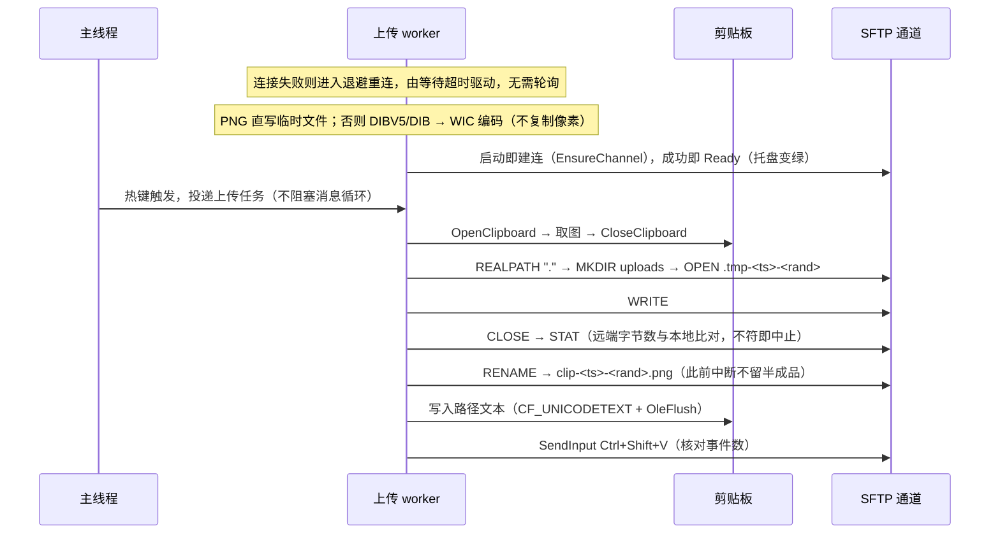

[picopaste](https://github.com/DeguiLiu/picopaste) 把 Windows 截图送到 Linux 的步骤压缩为一次热键：截图进入剪贴板后按 `alt+shift+v`，工具通过已有 SSH 通道上传图片，将远端绝对路径写入剪贴板并注入当前焦点窗口。Linux 端不安装新服务、不开放额外端口，也不需要工具接触 SSH 凭据。

## 使用方式与问题边界

典型场景：编辑器、终端、构建流程和 Claude Code 运行在 Linux 主机，而操作界面和截图工具运行在 Windows。手工执行 `scp`、使用共享目录或借助中转工具，都需要重新输入路径或切换注意力。单日重复十余次，累积的时间与注意力开销相当可观。

获取 release 中的 `picopaste.exe`，或自行构建，在其同级目录放置 `picopaste.ini`：

```ini
[picopaste]
host = user@your-linux-host
hotkey = alt+shift+v
```

运行后托盘图标会出现，连接建立期间最多短暂显示黄色，成功后变为绿色。截取图片并按热键即可上传。仓库地址是 <https://github.com/DeguiLiu/picopaste>，许可为 MIT。

## 单进程链路与远端依赖

远端使用 stock `sshd` 自带的 `sftp-server` 子系统，绝大多数 Linux 开发机默认已经开启。Windows 侧只有一个进程，不实现 SSH 协议，而是驱动系统已有的 `ssh`：

```bash
ssh -o ClearAllForwardings=yes -s <host> sftp
```

`-s` 请求 SFTP 子系统，stdin/stdout 随之成为 SFTP 字节流，全程不经过远端 shell。认证、密钥、ssh-agent、known_hosts 和 `~/.ssh/config` 交由系统 OpenSSH 处理；工具不读取凭据，也默认不修改 `~/.ssh/config`。

`ClearAllForwardings=yes` 用于屏蔽 SSH 配置中可能存在的端口转发，因为当前通道只需要 SFTP 子系统，不需要建立隧道。

```mermaid
flowchart LR
    subgraph W["Windows 客户端 · 单进程 picopaste.exe"]
        HK["全局热键 · RegisterHotKey MOD_NOREPEAT"]:::win
        ML["主线程消息循环 · GetMessageW（阻塞，无定时器）"]:::win
        TRAY["托盘 · Shell_NotifyIconW + TaskbarCreated 重挂"]:::win
        CLIP["剪贴板采集 · PNG 快路径 / DIB → WIC"]:::win
        UP["上传 worker · SFTP 状态机"]:::win
        INJ["焦点守卫 + SendInput · 核对注入事件数"]:::win
        JOB["Job Object · KILL_ON_JOB_CLOSE + MEMORY_LIMIT"]:::win
    end
    subgraph R["Linux 远端 · 零代码"]
        SSHD["sshd · sftp-server 子系统"]:::lnx
        DIR["/tmp/picopaste（默认，客户端经 SFTP 创建）"]:::lnx
        CC["Claude Code · 按路径读取图片"]:::ext
    end
    HK --> ML
    ML --> UP
    UP --> CLIP
    ML --> TRAY
    UP --> SSHD
    SSHD --> DIR
    UP --> INJ
    INJ --> CC
    CC --> DIR
    JOB -.-> SSHD
    classDef win fill:#1f3a5f,stroke:#4a90d9
    classDef lnx fill:#1f4a2f,stroke:#4aa96c
    classDef ext fill:#4a3a1f,stroke:#d9a441
```



用户侧始终只有一个进程，Linux 远端没有引入新组件。

## SFTP 上传的原子性

`scp` 并不是这里的重点。OpenSSH 9.0 及以上版本的 `scp` 默认使用 SFTP，远端路径不再经过 shell 展开，`~` 与引号的行为容易与预期不同。使用 `ssh 'cat > path'` 又依赖远端的 `sh`、`mkdir`、`cat` 和 `wc`，还需要自行处理引号；传输期间目标文件名已经存在半成品。

picopaste 选择在同一条连接内使用 SFTP v3。自行实现 SFTP v3 只需要 **10 个报文**，每一步都能获得明确的成功或失败码，并可在同一条连接内比对字节数：



只有 `STAT` 确认字节数一致后才执行 `RENAME`，因此 Claude Code 不会读到尚未传输完成的文件。
