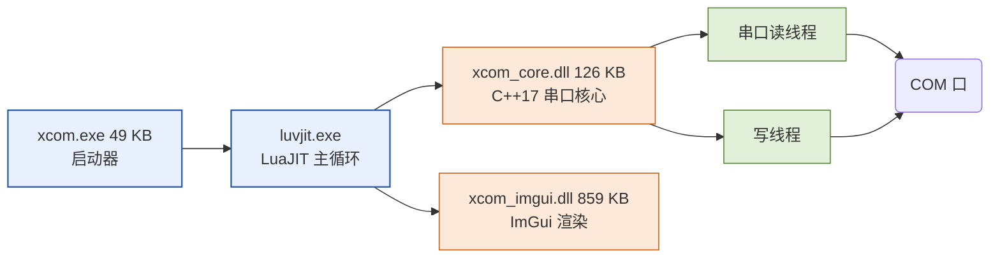
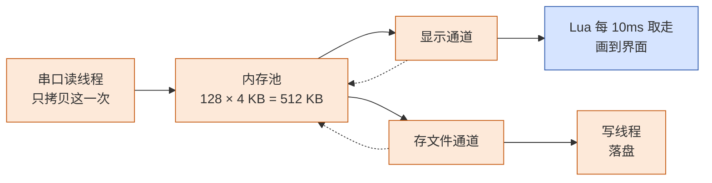
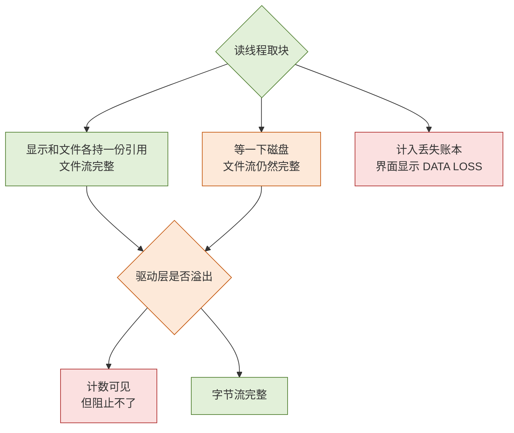

[XCOM](https://github.com/DeguiLiu/xcom_lua) 的核心取舍是：串口收发与内存管理放在 C++，界面和业务扩展放在 LuaJIT；接收数据只复制一次，显示和文件通道共享固定大小的内存池。压缩包为 3.93 MB，Windows 10/11 x64 绿色版解压即用，接收池固定为 512 KB，不随数据量增长。

| 你关心的 | XCOM 的答案 |
| --- | --- |
| 多小 | 压缩包 3.93 MB，绿色版解压即用 |
| 内存占用 | 固定大小，不随数据量增长（接收池恒为 512 KB） |
| 会不会丢数据 | 只要有日志在，字节流完整；真丢了会亮横幅告诉你，不隐瞒 |
| 改功能要编译吗 | 不用。界面和逻辑都是 Lua，改脚本保存即生效 |
| 能扩展吗 | `scripts/` 下放一个 `.lua` 文件就是插件，几行代码自动应答设备 |
| 支持什么系统 | Windows 10/11 x64 |

## 进程结构与技术取舍

XCOM 启动后在同一进程中协作三个部分：



`xcom.exe` 只有 49 KB，作用是隐藏控制台窗口。Lua 层负责按钮、菜单、配置和脚本；`xcom_core.dll` 大小为 126 KB，负责串口打开、读写、超时和断线重连；`xcom_imgui.dll` 大小为 859 KB，负责 ImGui 渲染。

这种划分让界面改动不需要重新编译 C++：时间戳格式、报文解析和数据标色都可在文本脚本中调整。Lua 调用 C++ 直接进行，批量字节一次性交给渲染层，不在 Lua 中逐字节拼接；单线程界面也不需要为共享状态加锁。

Lua 与主循环同线程，脚本中的慢代码会阻塞界面。因此耗时工作必须放回 C++，接收链路尤其不能在 Lua 中逐字节处理。

## 固定接收池与双通道背压

串口数据只在读线程复制一次，写入固定内存池：128 块、每块 4 KB，共 512 KB。显示通道和存文件通道各自持有同一块内存的引用，最后使用者归还池块。



这种方式有两点收益：内存占用固定，收取更多数据也不会膨胀；两个使用者共享同一块内存，不需要分别复制，避免显示复制成功而文件复制失败。

两条通道采用不同背压策略：

- 存文件通道宁可等待。池子暂时没有空闲块时，读线程等待磁盘写完，文件流不丢失；界面提示“存储跟不上”。
- 显示通道允许滞后。拿不到块时画面慢一拍，但完整字节流已经安全写入文件。
- 池子为文件通道保留 96 块，即 384 KB。显示通道只有在剩余块数多于 96 时才能取块，不能耗尽文件通道的保底。

按最高支持速率，一块 4 KB 约装 44 ms 数据，96 块约提供 4 秒多余量，显示侧另有 1 秒多。按 10 ms 一轮的处理节奏，偶发调度延迟不会立即造成阻塞。

## 丢失可观测性与扩展边界



只要存在文件日志，应用层接收到的字节流就是完整的。若发生驱动层串口缓冲溢出，XCOM 无法阻止，但会计数并在界面显示 `DATA LOSS` 横幅，同时记录缺口在数据流中的位置。软件不把“未观测到丢失”当成“绝对不会丢失”。

`/scripts` 目录下的每个 `.lua` 文件都可作为插件。下面的示例在收到 `AT` 后延迟 10 ms 回复 `OK`：

```lua
on.receive(function(text)
    if text:match("^AT\r?\n?$") then
        sys.timer_start(10, function() uart.send("OK\r\n") end)
    end
    return text
end)
```

接口按职责分成几类：

| 接口 | 用途 |
| --- | --- |
| `uart` | 收发串口 |
| `on` | 注册“收到数据”、“发送数据”这样的钩子 |
| `filter` | 决定哪些数据要显示、哪些不要 |
| `log` | 往日志面板写字 |
| `wave` | 把数据推给波形图 |
| `sys` | 定时器、文件操作 |

保存脚本后自动热重载，不需要重启。若新版本存在语法错误，程序保留原来可用的版本；每个插件独立隔离，连续出错 3 次后自动停用并在日志面板提示，不影响其他插件和主程序。
