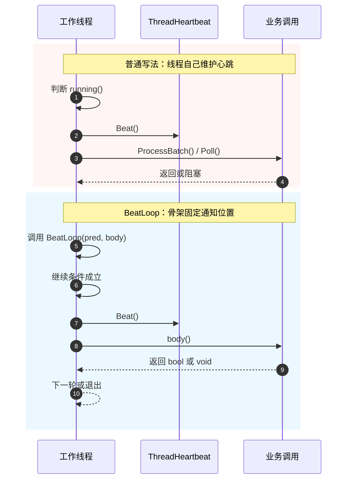
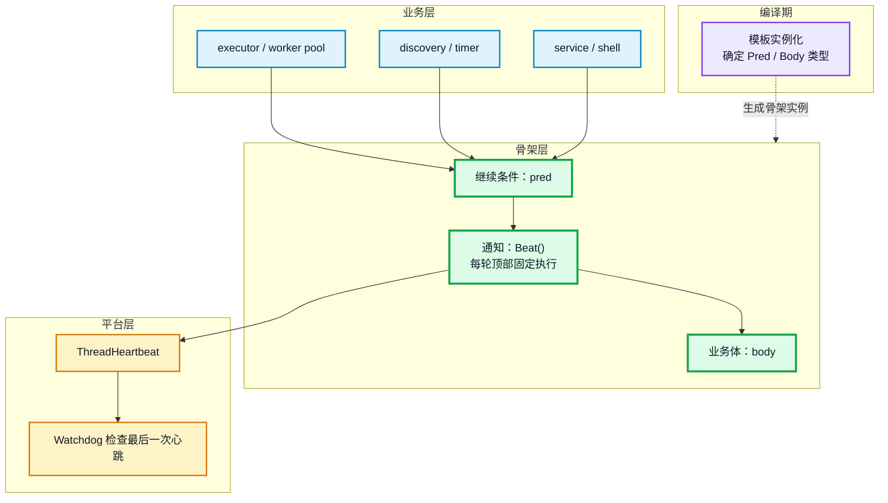
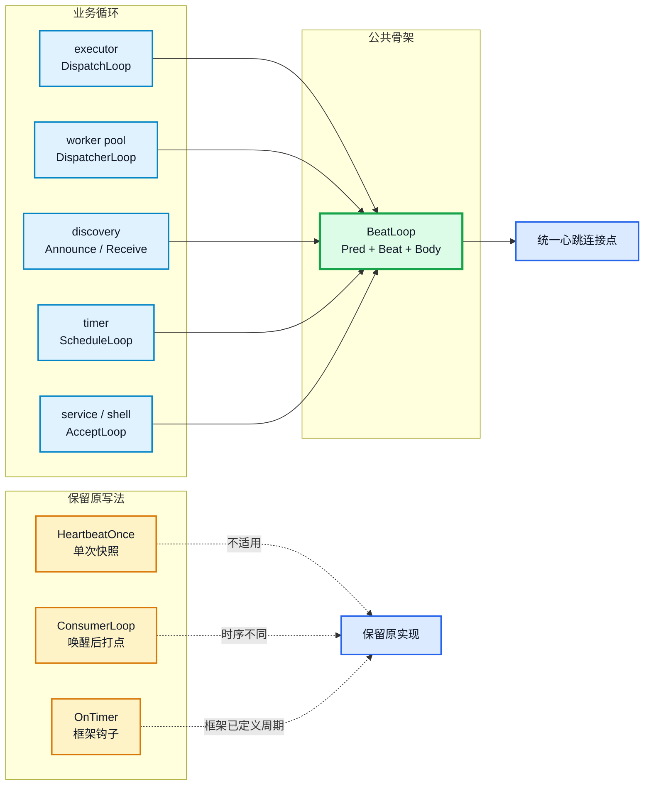

嵌入式系统常用看门狗监控线程：每个线程在循环中周期性上报心跳，表示自己仍在运行；看门狗独立检查各线程最后一次心跳的时间，超过阈值就告警或复位。本文把“每轮循环都必须先上报一次心跳”称为横切不变式：它每轮都要满足，但不属于消息处理、事件等待或连接接收这些业务逻辑。

把心跳调用 `ThreadHeartbeat::Beat()` 复制到每个线程里，代码可以工作，但这条规则只能靠人工维护。新增循环时漏写、放错位置，都会让看门狗得到错误的心跳判断。

**结论：心跳必须固定在每轮循环的同一位置。与其让每个线程重复维护，不如收进一个编译期循环骨架。**

目录：

1. 背景：从心跳约束到 AOP
2. 问题：普通循环如何丢失心跳
3. 实现：用模板把通知收进循环骨架
4. 接口：连接点、退出语义与编译期组合
5. 边界：例外场景、代价与适用条件

## 1. 背景：从心跳约束到 AOP

以 [newosp](https://github.com/DeguiLiu/newosp) 为例，项目中有 8 个文件（含 7 个业务头文件）、12 处“判空后调用 `Beat()`”的代码，分散在执行器、线程池、服务发现、定时器、服务端和命令行等模块的循环里。

这些循环处理的业务不同，但共同约束相同：

- **业务主体**：处理消息、等待事件、接收连接；
- **横切关注点**：在每轮业务前上报心跳；
- **重复位置**：多个模块的线程循环；
- **共同约束**：每轮都要执行，不能由业务分支决定。

这条“每轮循环都必须满足、但不属于业务逻辑”的约束，就是横切不变式。在 AOP（Aspect-Oriented Programming，面向切面编程）中，它属于横切关注点。

AOP 的概念由 Xerox PARC 的 Kiczales 等人在 1997 年 ECOOP 论文中系统提出。常用概念包括：

- **切面（aspect）**：描述横切行为本身；
- **连接点（join point）**：程序执行中可以插入行为的位置；
- **切点（pointcut）**：选定一组连接点；
- **通知（advice）**：定义连接点上的动作，常见形式有 `before`、`after` 和 `around`；
- **织入（weaving）**：把切面合并进业务代码的过程。

其中，`around` 在业务前后都插入动作，可以包住业务执行；`before` 只在业务执行前插入动作。此前的 [《MCU 周期服务的共享状态：读改写原子性、拒绝重入与锁的位置》](https://deguiliu.github.io/tech-notes/posts/practice/mcu_periodic_service_concurrency/) 在 C 中用函数指针和手工分发实现 `around` 通知，把锁从事务代码中分离。本文只在业务前上报一次心跳，属于 `before` 通知，并用 C++ 函数模板完成编译期组合。

本例的 AOP 概念对应如下：

| AOP 概念 | 本例中的对应物 |
| --- | --- |
| 切面 | “每轮业务前上报心跳”这条公共规则 |
| 连接点 | 继续条件成立后、业务体执行前的循环顶部 |
| 切点 | 选择使用 `BeatLoop` 的循环 |
| 通知 | `if (hb != nullptr) hb->Beat()` |
| 织入 | 模板实例化后将通知放进循环骨架 |

这里的方案不是通用 AOP 系统。它不扫描类名，不按表达式匹配方法，不生成动态代理，也不拦截任意函数。它只为一种固定循环结构定义一个固定连接点。

## 2. 问题：普通循环如何丢失心跳

看门狗要求被监控线程周期调用 `ThreadHeartbeat::Beat()`。普通线程循环可能这样写：

```cpp
void Executor::DispatchLoop() {
  while (running_.load(std::memory_order_relaxed)) {
    if (heartbeat_ != nullptr) {
      heartbeat_->Beat();
    }

    const uint32_t processed = BusType::Instance().ProcessBatch();
    if (processed == 0) {
      sleep_.OnIdle();
    } else {
      sleep_.OnBusy();
    }
  }
}
```

接收连接的线程可能这样写：

```cpp
void Shell::AcceptLoop() {
  while (running_.load(std::memory_order_relaxed)) {
    if (heartbeat_ != nullptr) {
      heartbeat_->Beat();
    }

    const int result = socket_api::Poll(&pfd, 1, 200);
    if (result == 0) {
      continue;
    }
    if (result < 0 && errno != EINTR) {
      break;
    }

    AcceptOneConnection();
  }
}
```

两段代码都没有明显错误。问题在于相同的心跳规则散落在各个模块中。每个循环都要自行保证：

> 只要进入一轮正常工作，就先完成一次心跳。

复制代码后，规则通常有三种失效方式：

- 新增线程时忘记调用 `Beat()`，看门狗可能把仍在运行的线程判为超时；
- 把 `Beat()` 放进某个业务分支，空闲路径不再上报；
- 把 `Beat()` 放到 `Accept()`、`WaitFor()` 或 `PreciseSleep()` 后面，阻塞调用可能先耗尽看门狗的超时时间。

这类问题可以靠代码评审发现，但评审者必须逐个检查循环。规则写在文档里，执行却分散在调用方，维护成本随代码数量增长。

下图对比两种写法。关键差异是控制权的位置不同：普通写法由线程自己调用心跳，骨架写法由公共流程调用心跳。



*图 1：两种写法的心跳调用者不同。看门狗周期读取最后一次心跳，超时后告警或复位。*

## 3. 实现：用模板把通知收进循环骨架

### 3.1 骨架实现

重构后，线程只描述继续条件和业务体：

```cpp
detail::BeatLoop(
    heartbeat_,
    [this]() {
      return running_.load(std::memory_order_relaxed);
    },
    [this]() {
      const uint32_t processed = BusType::Instance().ProcessBatch();
      if (processed == 0) {
        sleep_.OnIdle();
      } else {
        sleep_.OnBusy();
      }
    });
```

公共骨架如下：

```cpp
template <typename Pred, typename Body>
inline void BeatLoop(ThreadHeartbeat* hb, Pred&& pred, Body&& body) noexcept {
  while (pred()) {
    if (hb != nullptr) {
      hb->Beat();
    }

    if constexpr (std::is_same_v<decltype(body()), bool>) {
      if (!body()) {
        break;
      }
    } else {
      body();
    }
  }
}
```

它把执行顺序固定为：

1. 调用继续条件 `pred()` 判断是否继续；
2. 继续条件成立后调用 `Beat()`；
3. 调用 `body()` 执行业务；
4. 回到下一轮判断。

只要使用 `BeatLoop`，心跳就不再是业务体里的可选语句，而是公共流程中的固定步骤。

下图给出三层结构。模板实例化发生在编译期，运行期只看到具体的循环和调用。



*图 2：业务层只提供继续条件和业务体；骨架层固定通知位置；平台层负责心跳存储和超时检查。*

### 3.2 调用拓扑与迁移结果

这张拓扑图的作用不是列清单，而是验证适用范围：多个互不相关的线程循环接入同一条心跳约束，不符合该连接点的路径仍保留原实现。

骨架实际接入 9 个调用点，覆盖 executor、worker pool、discovery、timer、service 和 shell，共 7 个业务头文件。原先 8 个文件（含 7 个业务头文件）中的 12 处心跳代码，另外 3 处不符合“每轮顶部上报”这个连接点，保留原写法。



*图 3：5 类业务循环汇聚到一个骨架；另外 3 处因连接点不同保留原有实现。*

迁移调用点包括 executor 的 `DispatchLoop`、worker pool 的 `DispatcherLoop`、discovery 的 `AnnounceLoop` 和 `ReceiveLoop`、timer 的 `ScheduleLoop`，以及 service 和 shell 的 `AcceptLoop`。重构后，7 个业务头文件合计删除约 100 行重复代码；以后新增同类循环时，业务代码不必再复制空指针检查和 `Beat()` 调用。

维护收益是：心跳位置集中在 `BeatLoop`，空指针判断只保留一份，`Pred` 与 `Body` 的调用关系由编译器检查，也可以通过搜索裸 `heartbeat_->Beat()` 检查是否有代码绕过骨架。

## 4. 接口：连接点、退出语义与编译期组合

### 4.1 连接点是每轮顶部

本例把连接点定义为：**继续条件成立后、业务体执行前的每轮顶部**。在 AOP 术语中，这相当于循环级的 `before` 通知。

```text
继续条件成立
    ↓
Beat()
    ↓
body()，可能发生阻塞
    ↓
进入下一轮
```

选择这个位置有三个原因：

1. `Beat()` 先于 `Accept()`、`WaitFor()` 和 `PreciseSleep()` 执行；
2. 所有正常迭代都经过同一个位置，不依赖业务分支；
3. 线程刚进入循环就能完成首次心跳。

这个位置只定义心跳的执行顺序，不改变 `body()` 的耗时。阻塞对心跳间隔的影响见第 5 章。

### 4.2 `void body` 和 `bool body`

大多数循环由继续条件控制退出，业务体返回 `void`：

```cpp
BeatLoop(
    heartbeat_,
    [this] { return running(); },
    [this] {
      DispatchBatch();
    });
```

接收连接的循环可能因业务体内部出现致命错误而退出，因此让 `body()` 返回 `bool`：

```cpp
BeatLoop(
    heartbeat_,
    [this] { return running(); },
    [this]() -> bool {
      const int result = socket_api::Poll(&pfd, 1, 200);
      if (result == 0) {
        return true;   // 原来的 continue
      }
      if (result < 0 && errno != EINTR) {
        return false;  // 原来的 break
      }

      AcceptOneConnection();
      return true;
    });
```

`if constexpr` 在编译期区分两种签名：

- `void body()`：每轮执行一次，退出由继续条件决定；
- `bool body()`：返回 `false` 时提前结束循环。

### 4.3 与运行期多态的区别

如果使用运行期多态，可以把业务体包装成 `std::function`：

```cpp
using Body = std::function<void()>;

void RunLoop(Body body) {
  while (running()) {
    Beat();
    body();
  }
}
```

`BeatLoop` 改用函数模板接收 lambda：

```cpp
template <typename Pred, typename Body>
void BeatLoop(ThreadHeartbeat* hb, Pred&& pred, Body&& body);
```

模板实例化在编译期完成三件事：确定 `Pred` 与 `Body` 的具体类型、固定心跳与业务体的调用顺序、生成对其他函数的直接调用。它不经过运行期代理，也不依赖虚函数分派。

从设计模式角度看，这个方案同时包含几个侧面：

| 视角 | 对应结构 | 准确说法 |
| --- | --- | --- |
| AOP | 心跳是横切关注点 | 解释为什么要把公共行为从业务体中抽出 |
| 高阶函数 | 继续条件和业务体作为参数传入 | 调用方把行为交给骨架执行 |
| 模板方法式骨架 | `BeatLoop` 固定循环步骤 | 借鉴模板方法的控制思想，但不是继承式 GoF Template Method |
| 策略组合 | 继续条件和业务体是两种策略 | 一个决定是否继续，一个定义单轮工作 |
| Policy-based Design | 模板参数在编译期确定行为 | 通过类型系统完成组合，不依赖虚函数 |

因此，`BeatLoop` 可以说是把横切关注点编译期组合进循环，但不能说它具备完整 AOP 框架的匹配、代理和织入能力。

## 5. 边界：例外场景、代价与适用条件

### 5.1 不适用的场景

第一类是没有循环连接点。`HeartbeatOnce()` 是一次网络探测前的单次上报；`OnTimer` 是事件循环的定时器钩子，周期触发就是它的执行语义。

第二类是心跳时机不固定。有的消费者循环要在等待信号量之后、开始处理数据之前上报一次，心跳时机与唤醒事件绑定，并不等于“循环刚开始”。强行使用 `BeatLoop` 会改变心跳时序。

此外，ISR、需要 CPU 并行或复杂事务边界的场景也不适合。公共骨架不应为了覆盖更多代码而持续增加参数；切点越宽，骨架越难读，行为也越难验证。超出固定切点的代码保留原写法，通常更清楚。

### 5.2 代价

使用骨架的代价需要集中计入设计判断：

- `continue` 和 `break` 要改写为返回值，业务控制流不再保持原样；
- 长业务体放进 lambda 后，可读性可能不如原生 `while`；
- 每种模板参数组合可能生成一份代码，极小容量的固件需要检查代码体积；
- 函数模板声明为 `noexcept` 时，`pred()` 和 `body()` 必须遵守项目的无异常约定；
- `BeatLoop` 只能固定心跳位置，不能消除业务体中的阻塞。业务体长时间阻塞时，线程仍无法及时开始下一轮；阻塞问题需要事件驱动、协程或线程池等其他机制处理。

### 5.3 适用条件

`BeatLoop` 适合以下条件：

1. 有一条需要在多处重复执行的不变式；
2. 不变式依附于固定的循环流程；
3. 不变式的执行位置可以明确规定；
4. 违反不变式会导致同类问题，适合统一处理。

`BeatLoop` 不是给所有循环加一层抽象，也不是通用 AOP 框架。它只解决一个范围明确的问题：把“每轮顶部必须上报心跳”从调用方移到公共流程。适用范围清楚时，它能减少重复代码；超出范围时，保留普通循环更合适。

完整实现见 [newosp](https://github.com/DeguiLiu/newosp) 的 `include/osp/platform.hpp`，骨架引入的 diff 见提交 [8c9c494](https://github.com/DeguiLiu/newosp/commit/8c9c494)。

相关实现与文章：

- [newosp 仓库](https://github.com/DeguiLiu/newosp)
- [BeatLoop 实现提交 8c9c494](https://github.com/DeguiLiu/newosp/commit/8c9c494)
- [MCU 周期服务的共享状态：读改写原子性、拒绝重入与锁的位置](https://deguiliu.github.io/tech-notes/posts/practice/mcu_periodic_service_concurrency/)
- [MCU 任务监控：怎样发现任务卡死并正确喂狗](https://deguiliu.github.io/tech-notes/posts/architecture/mcu_thread_heartbeat_liveness/)
- [newosp 事件驱动架构：零堆分配传感器数据流水线](https://deguiliu.github.io/tech-notes/posts/architecture/newosp_event_driven_architecture/)
- [C++ 协程：优化阻塞型任务的调度性能](https://deguiliu.github.io/tech-notes/posts/performance/cpp_coroutine_waiting_task_scheduling/)
