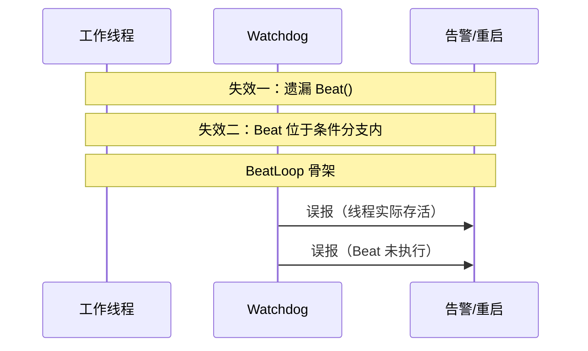
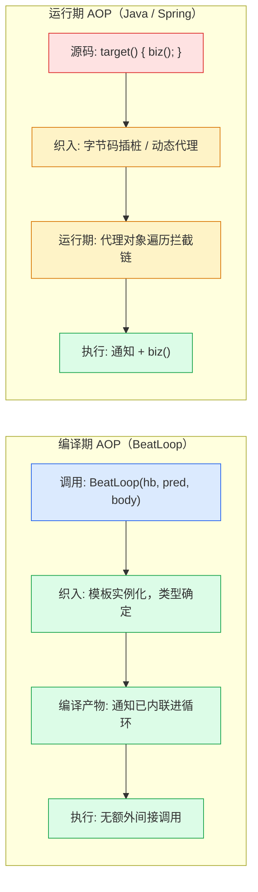
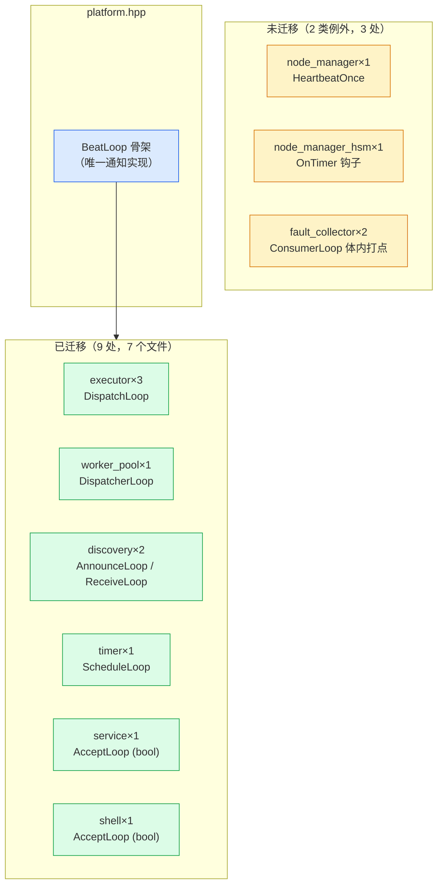

> 原文链接: [CSDN](https://blog.csdn.net/stallion5632/article/details/164835803)

[newosp](https://github.com/DeguiLiu/newosp) 用 `detail::BeatLoop(hb, pred, body)` 这一个函数模板，把嵌入式线程循环里重复了 12 处的"每轮必须上报心跳"横切不变式收进固定骨架。打点（Beat）由骨架拥有，循环体无法跳过它，遗漏心跳从"运行期看门狗误报"变成"结构上不存在"。完整实现见 newosp 的 `include/osp/platform.hpp`。

## 问题: 写在规范里却靠人工维持的不变式

newosp 是面向资源受限的嵌入式 C++ 纯头文件库，热路径遵循 MCU 级约束：`-fno-exceptions -fno-rtti`、零堆分配。看门狗体系（`watchdog.hpp`）要求每个被监控线程在主循环里周期调用打点，即 `ThreadHeartbeat::Beat()`（一次 relaxed 原子 store）；冷路径的 `Check()` 扫描超时线程并回调。`ThreadHeartbeat` 定义在 `platform.hpp`，所有模块可直接使用，不强制依赖 `watchdog.hpp`。

这条不变式的问题不在实现（`Beat()` 只有三行），在散布。重构前统计：8 个文件、12 处相同的"空检查加打点"样板，嵌在各模块互不相干的循环里：

```cpp
// 重构前：executor / worker_pool / discovery / timer / service / shell
// 每个文件各有一份这样的循环，Beat 的有无与位置依赖人工拷贝
while (running_.load(std::memory_order_relaxed)) {
  if (heartbeat_ != nullptr) {   // 横切关注点
    heartbeat_->Beat();
  }
  /* 各模块业务：ProcessBatch / PreciseSleep / poll+accept 等 */
}
```

散布的代价体现为三类失效方式。

**失效一：遗漏。** 新增线程循环未写入 `Beat()`，看门狗在超时后误报线程失活。代码评审中"缺少三行"比"逻辑写错"更隐蔽。

**失效二：位置在条件分支内。** `Beat()` 被放进某个 `if` 分支，空闲路径不经过该分支，心跳停止更新。

**失效三：位置在阻塞调用之后。** `Beat()` 位于循环体中部，其前的业务调用（`Accept`、`WaitFor`、`PreciseSleep`）可能阻塞至超过看门狗超时阈值。看门狗能检测到超时，但无法区分"线程终止"与"Beat 被阻塞调用延迟"。



*图 1：失效一与失效二造成的看门狗误报。线程实际存活、Beat 未执行时，Watchdog 无法区分，只能告警或重启；失效三是阻塞调用把心跳推迟，见正文。*

三类失效的共同根因是：不变式（每轮必须打点）的维持责任在调用方，而非骨架。调用方有多种方式违反它，骨架只有一种方式遵守它。这正是 AOP 语境下的横切关注点（cross-cutting concern）：liveness 上报散落在多个宿主逻辑（总线派发、定时器调度、accept 循环）中，依赖约定维持。

## 编译期 AOP: 概念对应与织入时机

AOP 有三个核心概念：连接点（join point）、切点（pointcut）、通知（advice）。Java Spring AOP 在运行期或字节码期织入；C++ 模板可以在实例化时确定通知与连接点的绑定，把同类结构前移到编译期。

| AOP 概念 | 运行期 AOP 的落法 | BeatLoop 的落法 |
| --- | --- | --- |
| 连接点（join point） | 方法调用前后 | `while` 每轮迭代的顶部 |
| 切点（pointcut） | 表达式匹配类或方法名 | 选择调用 `BeatLoop` 而非裸 `while` |
| 通知（advice） | 反射或字节码插桩 | 骨架内的 `if (hb) hb->Beat()` |
| 织入（weaving） | 运行期代理 | 模板实例化，编译期展开 |



*图 2：两条织入路径的对比。编译期 AOP 在模板实例化时已把通知写进目标代码；运行期 AOP 在对象创建后插入拦截链。*

两条路的根本差异在织入时机。运行期 AOP 在对象创建、代码编译完成之后插入拦截链，通知是否执行取决于代理是否生效、拦截链是否完整。编译期 AOP 在模板实例化时已将通知写入目标代码：调用 `BeatLoop` 后不存在"代理未生效"的状态，骨架是唯一执行路径。

## 骨架实现

重构后 12 处样板收敛为 1 个骨架函数：

```cpp
template <typename Pred, typename Body>
inline void BeatLoop(ThreadHeartbeat* hb, Pred&& pred, Body&& body) noexcept {
  while (pred()) {
    if (hb != nullptr) {      // 通知：空检查由骨架统一执行
      hb->Beat();             // 打点：每轮迭代的固定位置
    }
    if constexpr (std::is_same_v<decltype(body()), bool>) {
      if (!body()) {          // bool body：可由体内主动终止
        break;
      }
    } else {
      body();                 // void body：仅由谓词终止
    }
  }
}
```

### 模板参数: 全内联，零开销

`Pred` 与 `Body` 是模板参数而非 `std::function`。`std::function` 有两个嵌入式不可接受的代价：类型擦除引入的间接调用（编译器无法跨函数指针内联 lambda 体），以及超出小对象缓冲时的堆分配。

模板参数消除了这两点：每个使用 `BeatLoop` 的调用点生成一个专属实例（`BeatLoop<Pred, Body>` 的具体类型组合），lambda 是具名类型，`body()` 在实例化后是直接调用，编译器普遍内联，生成代码与手写 `while` 循环等价：每轮迭代仍是一次 relaxed 原子 store 加一次分支判断，无新增原子操作、无间接调用。这也是"模板参数优于函数指针加 ctx、优于 virtual"这条分派优先级在本库的一致应用：类型信息放在类型系统中（编译期使用），而非放在对象中（运行期读取）。

### 连接点选择: 每轮迭代顶部

通知的位置是 AOP 设计中需要明确界定的部分。`@Before`、`@Around`、`@After` 在方法级语义清晰；循环级需要重新定义。BeatLoop 将打点固定在唯一连接点：谓词成立之后、循环体执行之前。

```
pred() 成立 → Beat() → 业务执行（可能阻塞）→ pred() 成立 → Beat() → ...
```

该位置有三个设计理由：

1. **先于阻塞点。** `Accept`、`WaitFor`、`PreciseSleep` 都可能阻塞至接近或超过看门狗超时阈值。`Beat()` 位于它们之前，单次阻塞最多延迟一轮心跳；若位于其后，阻塞期间心跳完全停止更新。
2. **每轮必经。** `while` 的语义保证谓词成立时循环体必然执行，"每轮顶部"与"每轮必然"重合，无路径可绕过。
3. **首轮即上报。** 进入循环的第一件事是打点，线程注册看门狗槽位与首次心跳之间的间隔被压到最小。

### 双签名: if constexpr 区分两种退出方式

循环体有两种退出需求。自旋类循环（executor、timer、discovery、worker_pool）仅由外部谓词终止，body 返回 void；accept 类循环（service、shell）可能因致命错误（fd 被关闭、`poll` 返回错误）在体内主动终止，body 返回 bool，false 即退出循环。

`if constexpr` 按 `decltype(body())` 在编译期二选一，两种 body 类型各自生成独立的骨架代码，运行期无额外分支。同一骨架服务两种宿主形态，公共语义（Beat 位于每轮顶部）保持不变。

```cpp
// 自旋类（void body）：executor DispatchLoop
detail::BeatLoop(heartbeat_,
    [this]() { return running_.load(std::memory_order_relaxed); },
    [this]() {
        uint32_t processed = BusType::Instance().ProcessBatch();
        if (processed == 0) { sleep_.OnIdle(); }
        else { sleep_.OnBusy(); }
        // void 返回：循环终止仅由谓词决定
    });

// accept 类（bool body）：shell AcceptLoop
detail::BeatLoop(heartbeat_,
    [this]() { return running_.load(std::memory_order_relaxed); },
    [this]() -> bool {
        int pr = socket_api::Poll(&pfd, 1, 200);
        if (pr == 0) return true;                     // 原 continue：超时重试
        if (pr < 0 && errno != EINTR) return false;   // 原 break：致命错误
        // ...
        return true;
    });
```

`continue` 对应 `return true;`，`break` 对应 `return false;`。这是骨架化的转换成本，在最后一节讨论。

## 织入点分布、收益与两类例外

重构后 12 处裸 Beat 样板变为 9 个 `BeatLoop` 调用点，余下 3 处有意保留：



*图 3：织入点分布。9 处循环迁移到骨架，3 处停留在原样，属于有意保留的例外。*

**迁移收益。** 以提交 `35bc229` 的 diff 统计：9 处线程循环全部迁移完成，行为保持不变；7 个业务头文件的循环样板净删除约 100 行，此后每个新线程循环不再重复携带打点样板，打点逻辑从"每处各自维护"变为"单点维护"。看门狗误报的根因之一被移除。

**第一类例外：宿主不是循环。** `node_manager.hpp` 的 `HeartbeatOnce()` 在一次网络探测前手动打点（单次快照上报，无循环结构）；`node_manager_hsm.hpp` 的 `OnTimer` 是 `EventLoop` 的定时器钩子，钩子按固定周期触发，打点本身就是周期任务的内容。连接点不存在，无法套用循环骨架。

**第二类例外：结构相同但打点时机不固定。** `fault_collector.hpp` 的 `ConsumerLoop` 在进入循环前打点一次（启动后首次 `ProcessBatch` 前上报存活），循环体内 `wake_sem_.WaitFor(10ms)` 之后再打一次（唤醒后先上报存活再继续处理）。打点时机不符合"每轮顶部"，若强行套用 BeatLoop 会把体内那次挪至顶部，改变时序。迁移需要支持多连接点的变体，当前维持原样。

两类例外共同说明：切点的适用范围需要与被织入的不变式严格对应。BeatLoop 覆盖"每轮循环顶部必打点"这一种形态；超出该形态的 Beat 调用是有意保留的信号，标记"此处属于另一种机制"。扩大骨架去适配非循环场景，属于过度抽象。

## 骨架的测试、特点与边界

骨架接管了 9 处循环，其正确性需要独立测试。4 个 `[platform][beatloop]` 用例覆盖维度组合（正常、立即退出、空指针、体内终止）：

```cpp
// 1. 正常路径：5 次迭代，谓词控制退出，Beat 被触发
TEST_CASE("BeatLoop beats per iteration while predicate holds") {
  osp::ThreadHeartbeat hb;
  REQUIRE(hb.LastBeatUs() == 0);           // 初始态：未打点
  int iterations = 0;
  BeatLoop(&hb,
           [&]() { return iterations < 5; },
           [&]() { ++iterations; });
  REQUIRE(iterations == 5);
  REQUIRE(hb.LastBeatUs() > 0);            // 确认发生了打点
}

// 2. 谓词为 false：body 与 Beat 均不执行
TEST_CASE("BeatLoop false predicate never runs body nor beats") {
  osp::ThreadHeartbeat hb;
  bool ran = false;
  BeatLoop(&hb, [](){ return false; }, [&](){ ran = true; });
  REQUIRE(!ran);
  REQUIRE(hb.LastBeatUs() == 0);           // 谓词失败时不提前打点
}

// 3. 心跳指针为 null：安全执行
TEST_CASE("BeatLoop null heartbeat is safe") {
  int n = 0;
  BeatLoop(nullptr, [&](){ return n < 3; }, [&](){ ++n; });
  REQUIRE(n == 3);
}

// 4. bool body 返回 false：先于谓词终止循环
TEST_CASE("BeatLoop bool body can stop early") {
  osp::ThreadHeartbeat hb;
  int n = 0;
  BeatLoop(&hb, [](){ return true; }, [&]() -> bool { return ++n < 4; });
  REQUIRE(n == 4);                         // body 终止，而非谓词终止
}
```

用例 2 锁定"谓词为 false 时不执行 Beat"的时序语义：骨架的 `while(pred())` 在谓词失败时不进入循环体，`Beat()` 不执行，`hb.LastBeatUs()` 保持 0。该行为是看门狗计时准确性的前提：线程 Stop 后最后一轮不上报狗，看门狗能在超时阈值后按时触发告警，而不是被 Stop 路径的最后一次 Beat 推迟。

用例 4 验证 `if constexpr` 的 bool 分支：谓词恒为 true，循环由 body 返回 false 终止，`n == 4` 说明 `break` 位于骨架的 bool 分支且生效。

### 特点

**错误检测前移到评审与静态检查。** 运行期 AOP 的织入遗漏（代理未生效、拦截链顺序错误）表现为线上行为异常；模板织入在实例化时定型：使用 `BeatLoop` 即不可能遗漏打点。遗漏打点的唯一途径退化为"未使用 `BeatLoop`"，检查方式从"逐行审查循环体"简化为 `grep -r 'heartbeat_->Beat()' include/osp/` 排查残留裸调用，可固化为 CI 门禁。

**类型安全由编译器承担。** `hb` 的空检查由骨架统一执行一次，调用方不再各自判空；`pred` 与 `body` 的返回类型由 `if constexpr` 编译期分派，签名不匹配在实例化阶段报错，而非运行期落入错误分支。

### 代价

**隐式织入带来的可读性下降。** 循环体从函数体内的 `while` 语句变为函数实参，较长的 body（service 的 `AcceptLoop` 约 60 行）在缩进层级和括号匹配上可读性低于原生 while；`continue` 与 `break` 需显式改写为 `return true;` 与 `return false;`。缓解手段是让骨架本体保持简短（18 行）并与 `ThreadHeartbeat` 定义同置一处。

**代码膨胀。** 每个 `(Pred, Body)` 类型组合实例化一份 `BeatLoop`，9 处调用生成 9 份展开。单次展开的骨架开销约十余条指令，在 Cortex-A 级平台可忽略；对 flash 容量受限（如 32KB 级）的 Cortex-M0 平台需评估后决定是否采用。

### 适用边界

该模式要求：存在一条成文的、散布多处的、失效后果为活性误判的不变式，且不变式依附于"循环"这一固定流程结构。ISR 上下文、单次快照上报（`HeartbeatOnce`）、框架钩子（`OnTimer`）、多连接点循环（`ConsumerLoop`）均在范围之外。失效后果是数据错误而非活性丢失的不变式（如锁层级顺序、collect-release-execute 约束），循环骨架不适用，需要依赖 sanitizer 与代码审查。

newosp 的完整实现与全量回归见 [github.com/DeguiLiu/newosp](https://github.com/DeguiLiu/newosp)，骨架引入的完整 diff 见提交 [8c9c494](https://github.com/DeguiLiu/newosp/commit/8c9c494)。
