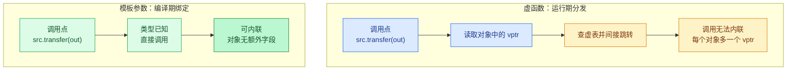
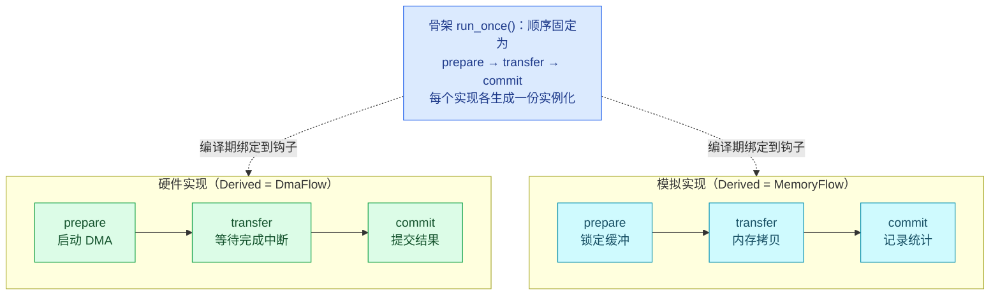
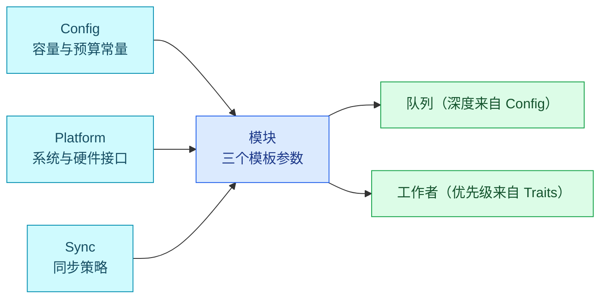
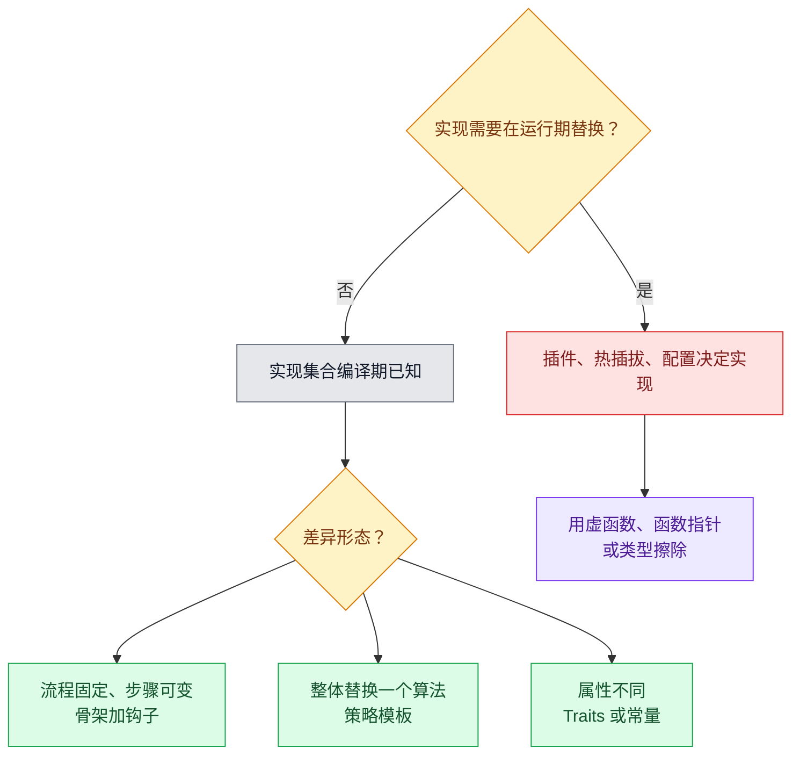

编译期多态解决的问题很具体：调用点能否直接内联，对象上是否还要挂一张虚表。如果实现集合在编译期就固定，把实现类型做成模板参数即可，分发在编译期完成；如果实现需要在运行期替换，模板就帮不上忙，只能用虚函数或函数指针。本文说明前者的做法、代价和适用边界。

示例统一使用一个采集模块：流程固定为“准备缓冲、传输、提交结果”，有两套实现，一套走 DMA 硬件，一套在内存里模拟，用于单元测试和上位机调试。

## 1. 虚函数的三项开销

先看运行期多态的写法：

```cpp
class SampleSource {
public:
    virtual ~SampleSource() = default;
    virtual bool transfer(Sample& out) = 0;
};

bool collect(SampleSource& src, Sample& out)   // 参数是引用，具体类型未知
{
    return src.transfer(out);
}
```

`collect` 只拿到基类引用，编译期不知道真实类型，因此：

| 开销 | 具体表现 |
| --- | --- |
| 每个对象多一个 vptr | 8 字节或 4 字节，逐对象累加 |
| 每次调用多一次间接跳转 | 读取 vptr、查虚表、跳转，无法内联 |
| 类型信息依赖 RTTI | 嵌入式常见做法是 `-fno-rtti`，`dynamic_cast` 随之不可用 |

代价不一定致命。对象数量少、调用频率低时，虚函数带来的可替换性和可读性远大于这几纳秒。问题出现在热路径上：每帧、每个采样点都要调用，或者对象数很多时，间接调用的开销和“编译器无法跨调用点优化”的损失会累积起来。



## 2. 把实现类型做成模板参数

最直接的替代方式是把具体类型交给模板：

```cpp
template <typename Source>
class Collector {
public:
    explicit Collector(Source& src) noexcept : src_(src) {}

    bool step(Sample& out) { return src_.transfer(out); }   // 直接调用

private:
    Source& src_;
};
```

使用处：

```cpp
DmaSource dma;
Collector<DmaSource> fast{dma};

MemorySource sim;
Collector<MemorySource> debug{sim};
```

与虚函数版本的差别只有三点，但决定了很多后续取舍：

- 调用是直接的，`transfer` 通常会被内联进 `step`。
- `Collector` 对象里只有一个引用，没有 vptr。
- 类型不匹配在编译期报错，而不是运行期跳错函数。

`Collector<DmaSource>` 和 `Collector<MemorySource>` 是两份独立代码。这一点在后面的代价一节会反复出现。

模板也不是唯一获得直接调用的途径。如果继承体系在同一个编译单元内可见，编译器配合 `final` 或链接时优化可以去做虚拟化（devirtualization），把虚调用变成直接调用。区别在于代价的位置：去虚拟化依赖编译器能否看全代码，模板绑定只依赖类型，不依赖优化器的判断。

## 3. 骨架加钩子：流程固定，步骤可变

上例是把整个实现作为类型参数。更常见的情况是流程固定、个别步骤不同，例如“准备、传输、提交”三步的顺序不变，只有每步的实现不同。这时可以用模板基类写骨架，派生类提供步骤：

```cpp
template <typename Derived>
class TransferFlow {
public:
    bool run_once(Sample& out)
    {
        auto& self = static_cast<Derived&>(*this);   // 编译期绑定，无虚表
        if (!self.prepare(out)) { return false; }
        if (!self.transfer(out)) { return false; }
        return self.commit(out);
    }

protected:
    TransferFlow() = default;                        // 不允许单独实例化
};

class DmaFlow : public TransferFlow<DmaFlow> {
public:
    bool prepare(Sample& out);
    bool transfer(Sample& out);
    bool commit(Sample& out);
};
```

`TransferFlow<DmaFlow>::run_once` 里的 `static_cast` 目标是编译期确定的，调用 `self.prepare` 就是普通函数调用。这个写法常被称为 CRTP。三处约束要记住：

- 派生类必须把自己作为模板实参传入，写错模板实参不会报错，但行为未定义。
- 基类的构造与析构应设为 `protected` 或至少不公开，避免有人单独实例化骨架。
- 派生类中的同名函数不需要 `override`，也就没有编译器的“签名写错”检查；改名或改签名会导致骨架调用不到，通常表现为编译错误，但提示信息不直观。



骨架的好处是顺序只写一次。跨多个实现共有的错误处理、超时检查和统计也能放进骨架，各实现只关心自己那一步。

开源实现里，[coact](https://github.com/DeguiLiu/coact) 的 `Hsm<Context>` 用的是同一思路：状态表与转移表是编译期常量，`entry/exit/guard/action` 四类钩子由静态函数指针承载，签名在实例化时与具体 Context 绑定。

## 4. 差异只是一个算法时，用策略模板

有些差异来自一个可以整体替换的算法，队列在多核下的同步方式就是一例。这类差异用无状态的策略结构体比继承更贴切：

```cpp
struct IrqMaskSync {                       // 单核：屏蔽中断
    static constexpr bool kUseCas = false;
    static void enter() noexcept;
    static void exit() noexcept;
};

struct CasSync {                           // 多核：原子比较交换
    static constexpr bool kUseCas = true;
    static bool try_acquire() noexcept;
    static void release() noexcept;
};

template <typename Sync>
class RingQueue {
public:
    bool push(const Sample& v) noexcept
    {
        if constexpr (Sync::kUseCas) {
            if (!Sync::try_acquire()) { return false; }
            const bool ok = write(v);
            Sync::release();
            return ok;
        } else {
            Sync::enter();
            const bool ok = write(v);
            Sync::exit();
            return ok;
        }
    }
};
```

`if constexpr` 只实例化被选中的分支，`RingQueue<IrqMaskSync>` 不会为多核路径生成代码。策略结构与 `std::allocator`、`std::hash` 的定制方式一致：没有状态，只提供静态成员，调用点由模板参数决定。

如果策略需要保存运行期状态，它就不再适合这种写法，应该换成普通类或骨架加钩子。

[coact](https://github.com/DeguiLiu/coact) 的事件池就是这种结构：单核后端在中断屏蔽临界区里更新索引，多核后端换成带标签头的 CAS，切换后端只改一个模板实参。

## 5. 编译期属性用 Traits 注入

优先级、预算、容量这类属性，如果每个类型不同，也不必走运行期 setter，直接写成静态常量：

```cpp
struct FastWorker {
    static constexpr int kPriority = 10;
    static constexpr uint32_t kBudgetUs = 200;
};

struct SlowWorker {
    static constexpr int kPriority = 2;
    static constexpr uint32_t kBudgetUs = 5000;
};

template <typename Traits>
class Worker {
    static_assert(Traits::kBudgetUs > 0, "budget must be positive");
public:
    int priority() const noexcept { return Traits::kPriority; }
};
```

好处不止是省一次赋值：属性成为常量后，编译器可以做常量折叠，容量可以直接用于数组维度，越界和非法组合可以在编译期用 `static_assert` 拦下来。代价是属性无法在运行期改变，需要变更时只能重新配置并重新编译。

## 6. 模板装配：把配置与平台变成参数

把前面的手段组合起来，模块的对外形态通常是“若干模板参数决定一切”：

```cpp
struct BoardConfig {
    static constexpr uint8_t kMaxWorkers = 8;
    static constexpr uint16_t kQueueDepth = 64;
};

template <typename Config, typename Platform, typename Sync>
class AcquisitionModule {
    static_assert(Config::kQueueDepth >= 2, "queue too short");
public:
    void run() { /* 用 Platform 访问硬件，用 Sync 保护队列 */ }

private:
    RingQueue<Sync> queue_;
    std::array<Worker<FastWorker>, Config::kMaxWorkers> workers_{};
};
```

容量、平台接口、同步语义各由一个模板参数承担，配置集中在一处，注册表、队列和监控共享同一份常量，不会出现运行期传参不一致的问题。代价是每换一种组合就多一份实例化代码，编译时间也随之上升。



## 7. 需要向固定集合转发时，用组合和定容数组

有些需求看起来像继承，实际是“向一组固定成员广播”，例如依次初始化、依次停止、依次查询状态。这类需求用组合更直接：

```cpp
struct WorkerBase {          // 保留虚表：注册表需要容纳异构实现
    virtual ~WorkerBase() = default;
    virtual void init() noexcept = 0;
};

template <typename Config>
class WorkerRegistry {
public:
    bool add(WorkerBase* w) noexcept
    {
        if (count_ >= Config::kMaxWorkers) { return false; }
        slots_[count_++] = w;
        return true;
    }

    void init_all() noexcept
    {
        for (uint8_t i = 0; i < count_; ++i) { slots_[i]->init(); }
    }

private:
    std::array<WorkerBase*, Config::kMaxWorkers> slots_{};
    uint8_t count_ = 0;
};
```

这里 `WorkerBase` 仍然带虚表，因为注册表要容纳不同的实现。允许这种例外，前提是它只在初始化或低频路径上使用，热路径不走这一层。把它改成完全无虚表需要每个成员类型都写进模板参数，成员超过三四个之后可读性会迅速变差，通常不值得。

## 8. 确实需要运行期擦除时，用函数指针表

有时必须在运行期持有一个异构集合，例如按名字查找的处理入口、板级配置表、与其他语言模块的对接。这时的最小擦除方式是函数指针加 `void*`：

```cpp
struct Entry {
    void* object = nullptr;
    void (*step)(void*, const Sample&) noexcept = nullptr;

    void run(const Sample& s) const noexcept { step(object, s); }
};

template <typename T>
constexpr Entry make_entry(T& obj) noexcept
{
    return Entry{&obj, [](void* p, const Sample& s) noexcept {
        static_cast<T*>(p)->step(s);
    }};
}
```

这实际上等价于手写一张虚表，只是表放在结构体里、按需构造：

| 维度 | 虚函数 | 函数指针表 |
| --- | --- | --- |
| 每对象开销 | 一个 vptr | 两个指针（对象地址与函数地址） |
| 分发 | 查虚表后间接跳转 | 直接读取函数指针后跳转 |
| 能否运行期替换 | 可以（换对象） | 可以（改表项） |
| 与 C 或其他语言调用 | 需要包装 | 直接可用 |

`std::function` 也能做同样的事，但它允许捕获，可能触发堆分配，且标准不保证小对象优化。对禁止动态分配的系统，显式函数指针表更可控。

## 9. 代价清单

代价集中在编译与二进制层面，需要和运行期收益一起权衡：

| 维度 | 虚函数 | 编译期多态 |
| --- | --- | --- |
| 调用开销 | 每次一次间接跳转 | 通常可内联，无间接跳转 |
| 每对象大小 | 多一个 vptr | 无额外字段 |
| 分发时机 | 运行期，可替换 | 编译期，不可替换 |
| 集合形态 | 可异构、可动态增减 | 类型固定，通常配合定容数组 |
| 编译时间 | 受影响小 | 每个组合都实例化，明显变长 |
| 二进制体积 | 一份实现一份代码 | 每个组合一份代码，可能重复膨胀 |
| 错误暴露 | 运行期（跳错实现） | 编译期（模板报错），但报错信息冗长 |
| 跨单元内联 | 通常不能 | 需要实现可见；跨单元要 LTO 或显式实例化 |
| 接口可见性 | 头文件只暴露基类 | 头文件通常包含实现，不方便只发二进制 |
| 调试 | 调用栈清晰 | 大量内联后帧缺失，回溯困难 |

体积这一项容易反直觉。模板不一定更大：它只为真正用到的组合生成代码，而虚函数版本要为每个具体类各留一份实现。组合数量少时模板更小，组合多且代码相似时模板更大，只能实测。

## 10. 什么时候不要用

判断标准只有一条：实现集合是否在编译期确定。



几个容易踩的坑：

- 只有两处相似就抽基类。第二处相似往往还会变，此时抽象方向多半是错的，等到第三处再抽成本更低。
- 钩子越加越多。骨架里出现七八个钩子，说明它在猜未来，此时退回普通函数组合更清楚。
- 策略里塞状态。带状态的策略等于换个名字的虚函数，还失去了运行期替换的灵活性。
- 把热路径和冷路径混在一起。低频的初始化、日志、注册表允许保留虚函数，不必把热路径的写法套到全部代码上。
- 忘记体积预算。增加一个模板参数组合之前，先看它带来的代码体积是否在预算内。

## 11. 怎样验证替代是否成立

写完不等于替代成功，需要确认两件事：间接调用是否真的消失，代价是否在预算内。

```bash
# 1. 是否还有间接调用（ARM 上是 blx，x86 上是 call *reg）
arm-none-eabi-objdump -dC build/app.elf | grep -nE '\bblx\b|call[[:space:]]+\*'

# 2. 是否还有虚表与类型信息
arm-none-eabi-nm -C build/app.elf | grep -i 'vtable\|typeinfo'

# 3. 模板实例化是否造成符号膨胀
arm-none-eabi-nm -C --size-sort -S build/app.elf | tail -20

# 4. 整体体积与段分布
arm-none-eabi-size --format=SysV build/app.elf

# 5. 编译时间
/usr/bin/time -v ninja -j8
```

几点判断依据：

| 检查项 | 期望结果 | 不符合时先查 |
| --- | --- | --- |
| 热路径反汇编 | 无间接调用，函数体可见 | 是否仍有基类引用、是否跨编译单元 |
| 虚表符号 | 只剩允许保留的少数 | 注册表或异常处理引入的类型信息 |
| 符号体积 | 相同逻辑的实例化没有重复大块 | 是否传入了不必要的模板参数组合 |
| 整体体积 | 在预算内，且有对比基线 | 模板实例化与内联带来的膨胀 |
| 编译时间 | 可接受，且改动后未显著变差 | 头文件依赖与实例化数量 |

编译器还能给出更细的信息：GCC 用 `-ftime-report`，Clang 用 `-ftime-trace` 查看哪个模板实例化耗时最多。测量运行时收益时，用周期计数或高分辨率计时器对比两种实现，并且要在优化开启的条件下测，未优化的模板代码没有参考价值。

## 参考实现

文中几类手段在开源项目里都有落地代码可以对照：

- [coact](https://github.com/DeguiLiu/coact)：面向 RT-Thread 单核 MCU 的 header-first C++17 事件框架，状态机骨架用模板参数加静态钩子表绑定，事件池用两个无状态策略切换单核与多核同步后端，容量与优先级由配置模板和 Traits 注入。
- [newosp](https://github.com/DeguiLiu/newosp)：面向嵌入式 Linux 的 C++17 header-only 基础库，`StaticNode` 把消息处理绑定到编译期，消息总线与线程看门狗在热路径上不使用虚调用。

## 总结

编译期多态的做法是把实现类型、算法、静态属性变成模板参数，让分发在编译期完成，从而去掉 vptr 和间接跳转，并让调用可内联。骨架加钩子管流程差异，策略模板管算法差异，Traits 管属性差异，配置模板管容量与平台差异。

它的边界同样明确：只适用于实现集合在编译期固定的场景，代价是编译时间、二进制体积、错误信息长度和调试体验，接口也不方便只以二进制形式发布。需要运行期替换实现时，虚函数或函数指针表更合适。

判断是否值得，别只看代码风格。先确认热路径上确实存在间接调用，再用反汇编、符号体积和编译时间核对：分发是否真的消失了，代价是否在预算内。这两步做完，替换才有依据。
