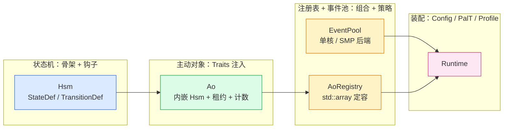
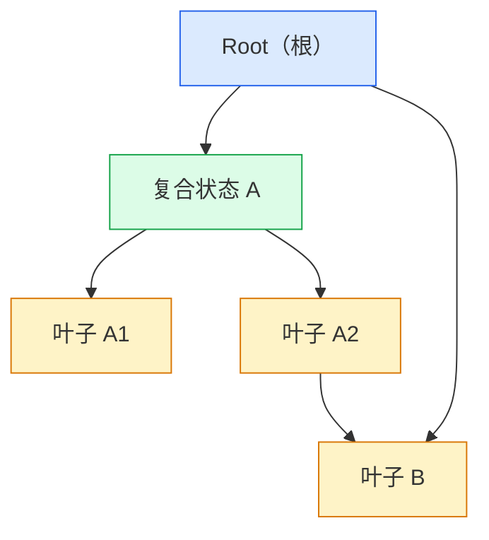
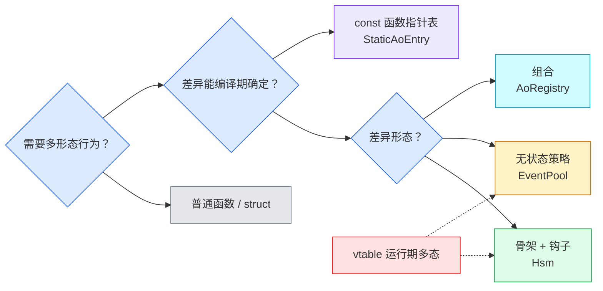

[coact](https://github.com/DeguiLiu/coact) 是面向嵌入式场景的 C++ 事件驱动框架，约束是 `-fno-exceptions -fno-rtti`、业务零堆、无锁。它的框架层（`include/coact/`）用六种编译期手段替代运行期抽象：骨架加钩子（`Hsm<Context>`）处理状态机流程差异，无状态策略（`EventPool<Profile>`）处理算法差异，Traits 注入（`Ao`）处理属性差异，模板装配（`Runtime`）处理平台差异，组合（`AoRegistry`）与运行期擦除（`StaticAoEntry`）守住结构边界。这是一条主线：把"多形态行为"的差异从运行期搬到编译期，代价在编译期一次付清，换来运行期零虚表、零堆。

## 为什么不用虚函数

### 六个手段，一个目标

核心框架的静态多态不是一种写法，而是六种，各有落点，共同服从"编译期确定、运行期少分配"这一个约束：

| 手段 | 核心落点 | 处理哪类差异 |
| --- | --- | --- |
| 骨架加钩子（模板绑定） | `Hsm<Context>`（hsm.hpp） | 状态机流程 |
| 无状态策略（Policy） | `EventPool<Profile>`（pool.hpp） | 单核 / SMP 后端 |
| 静态属性注入（Traits） | `Ao<Context, HsmT, Traits>`（ao.hpp） | 优先级 / 预算 / 直投资格 |
| 模板装配 | `Runtime<Config, PalT, Profile>`（runtime.hpp） | 预算 / 平台 / 并发语义 |
| 组合（Composition） | `AoRegistry<Config>`（ao.hpp） | 定容广播 init/deinit |
| 运行期擦除 | `StaticAoEntry`（static_ao.hpp） | 板级 AO 表 |

后面按这张地图展开：状态机、事件池与装配、注册表与派发表、边界与选型。代码对应 `include/coact/`，仓库见 [github.com/DeguiLiu/coact](https://github.com/DeguiLiu/coact)。

### 虚函数的三项开销

coact 禁 RTTI、业务零堆、跑在 Cortex-M 单核上。虚函数有三项运行期开销：每个对象多一个 vptr、每次调用多一次间接跳转、类型信息依赖 RTTI。这三项和 coact 的约束直接冲突，模板绑定把它们全部移到编译期：

| 维度 | 虚函数（运行时多态） | 模板绑定（编译期多态） |
| --- | --- | --- |
| 分发机制 | 运行期 vtable 间接跳转 | 编译期 `static_cast` 直接内联 |
| 类型信息 | 依赖 RTTI（coact 已禁） | 不需要 |
| 内联 | 跨 TU 通常不可内联 | 模板实例化后普遍内联 |
| 每对象开销 | 一个 vptr | 零 |
| 错误暴露 | 运行期（错类型崩溃） | 编译期（模板实例化失败） |

模板绑定的代价在编译期一次付清：更长的编译时间、更冗长的模板错误信息；换来运行期零间接、零状态、可内联。取舍结论是编译期一次性支付优于运行期持续偿还。

这段取舍在 C 里没有第三条路。C 要实现"骨架加钩子"，要么用函数指针，运行期间接跳转、编译器无法内联；要么用宏，无类型检查、无重载、出错信息是展开后的乱码。模板绑定是 C++ 独有的一条路：编译期分发、可内联、类型安全，三者兼得。这不是语言洁癖，而是 MCU 上"零运行期代价、错误前置到编译期"这个约束的自然结果。

### 框架的四层结构

六种手段落到框架组件上，形成四层组装关系。最内层是状态机，往外是主动对象，再往外是注册表与事件池，最外层是 `Runtime` 装配：



*图 1（蓝=状态机，绿=主动对象，黄=注册表与事件池，粉=装配）：框架组件组装层次。状态机被主动对象内嵌，主动对象注册进注册表，事件池与注册表由 `Runtime` 装配。*

## 状态机: 骨架加钩子

骨架加钩子是这条主线的第一块。`Hsm<Context>` 承载状态机的固定流程（派发、父状态继承、最近公共祖先计算），钩子以函数指针承载，签名由 `Context` 在编译期绑定。状态层级、父子关系、转移弧全部是 `constexpr` 数据，控制流由派发算法统一解释，不在业务代码里写 if-else。



*图 2（蓝=根，绿=复合状态，黄=叶子，实线=父子，虚线=转移）：层次状态机拓扑。三种转移弧在表里各占一种 `TransitionKind`。*

### 状态表与转移表

`StateDef` 的 `parent` 与 `initial_child` 编码出状态树；`TransitionDef` 的 `source/signal/target/kind/guard/action` 编码出转移弧。两个结构都是 `const` 数组，`Hsm` 只存地址、计数、初始状态与最大深度，不拷贝表、不分配：

```cpp
template <typename Context>
struct StateDef {
    int8_t parent;                 // 父状态索引（0 为根）
    void (*entry)(Context&);       // 钩子：进入动作
    void (*exit)(Context&);        // 钩子：退出动作
    const char* name;              // 调试标签
    int8_t initial_child;          // 直接初始子状态
};

template <typename Context>
struct TransitionDef {
    int8_t source;                 // 源状态
    uint16_t signal;               // 触发信号
    int8_t target;                 // 目标状态（External 用）
    TransitionKind kind;           // Internal / Self / External
    bool (*guard)(const Context&, const Event&);  // 钩子：纯函数守卫
    void (*action)(Context&, const Event&);       // 钩子：转移动作
};
```

`Context` 是模板参数，`entry/exit/guard/action` 四类钩子的签名在实例化时与具体 `Context` 绑定。它达到"骨架加钩子"的目的（编译期绑定、零虚表），但绑定媒介是静态函数指针表，而非 `static_cast<Derived*>(this)`。四类钩子各司其职：`guard` 是纯函数（只读、无副作用、返回 bool），`entry` 只发硬件命令，`exit` 只做清理，`action` 是事件响应。

### 三种转移

`TransitionKind` 三值覆盖状态机需要的全部转移语义：

```cpp
enum class TransitionKind : uint8_t {
    External,   // 离开活动子树，进入目标
    Internal,   // 只跑 action，状态不变
    Self        // 退出到源，跑 action，再重入源
};
```

- **Internal**：只执行 `action`，不触发任何 `exit/entry`，用于同一状态内的自更新。
- **Self**：从活动叶子退出到源状态（含源），跑 `action`，再重入源，用于自环与拒收弧。
- **External**：计算源与目标的最近公共祖先（LCA），沿路径退出、跑 `action`、再沿路径进入目标。

非法（状态, 信号）对落到 Self 转移的 reject 弧（计数加 trace），不静默丢弃。这套语义让"复合状态退回到哪一层"由 LCA 决定，而不是手写退出与进入代码。

### 父状态继承与退出路径

派发从活动叶子向上搜索转移弧，受 `max_depth` 限定父跳次数，找不到就到根为止。父状态继承因此"免费"：子状态没有定义某个信号时，搜索自然落到父状态的转移。外部转移的退出与进入路径由 `find_lca`、`exit_to_lca`、`enter_path` 三段完成，全程只遍历索引，不递归、不分配：

```cpp
bool dispatch(Context& ctx, const Event& evt) noexcept {
    int8_t state = current_;
    uint8_t hops = 0;
    for (;;) {
        const TransitionDef<Context>* tran = find_transition(ctx, evt, state);
        if (tran != nullptr) { execute_transition(ctx, evt, state, *tran); return true; }
        const int8_t parent = states_[state].parent;
        if (parent < 0) { return false; }          // 根也未接受该事件
        if (hops >= max_depth_) { return false; }  // 深度上界，安全停止
        state = parent;
        ++hops;
    }
}
```

## 事件池、主动对象与装配

状态机管流程差异，策略与装配管算法与平台差异。这一块的三处落点都是无状态：策略是带 `static constexpr` 的 struct，Traits 是静态属性集，Config 是编译期常量表。

### 事件池: 一套模板，两种后端

事件池的同步后端由 `Profile` 策略在编译期二选一，两个策略都是无状态 struct：

```cpp
struct RttSingleCoreProfile {
    static constexpr bool kUseBatchedReclaim = false;   // 单核：irq-mask，无 CAS
};
struct HostSmpProfile {
    static constexpr bool kUseBatchedReclaim = true;    // SMP：tagged CAS + 批量回收
};
```

`EventPool` 内用 `if constexpr` 按 `Profile` 分流实现：单核后端在 irq-mask 临界区里做索引与头指针更新，不做 CAS、不背 ABA tag；SMP 后端用单 32 位带标签头（`[15:0]` 索引、`[31:16]` ABA tag）加 CAS。同一个模板，两个后端，公共生命周期语义不变。这是 `std::allocator` 与 `std::hash` 定制点风格的无状态策略：单点可替换算法，方法 `noexcept`，不带状态。

### 主动对象: 属性交给 Traits

主动对象把优先级、RTC 预算、直投资格这些静态属性交给 `Traits`，而不是运行期 setter：

```cpp
template <typename Context, typename HsmT, typename Traits>
class Ao : public AoBase {
public:
    LogicalPrio logical_prio() const noexcept override { return Traits::logical_prio(); }
    PriorityClass priority_class() const noexcept override { return Traits::priority_class(); }
    bool direct_eligible() const noexcept override { return Traits::direct_eligible(); }

private:
    Context context_;
    HsmT   hsm_;
    ExecutionLease lease_;
    PendingCounter pending_;
};
```

`Ao` 继承唯一一个带 vtable 的类型擦除基类 `AoBase`，但这条 vtable 只服务注册表与派发器对任意具体 AO 的统一寻址；热路径的派发、租约（`ExecutionLease` 的 CAS）、计数（`PendingCounter` 的原子）都不走 vtable。`HsmT` 留作模板参数（通常是 `Hsm<Context>`），`Traits` 静态注入属性，所以一个 `Ao` 的实例大小只等于 `Context + Hsm + lease + pending`，无虚表、无堆。

### Runtime: 三个模板参数组装框架

最外层用三个模板参数把框架装配起来：`Config` 提供容量与计时常量，`PalT` 提供平台（POSIX 或 RT-Thread），`Profile` 提供并发语义：

```cpp
template <typename Config, typename PalT, typename Profile = coact::HostSmpProfile>
class Runtime {
public:
    using StagingType = Staging<Config, PalT::template QueueBackend>;
    using DispatcherType = Dispatcher<StagingType, PalT, Profile, BreakerBankType>;
    using CoordinatorType = DispatchCoordinator<StagingType, PalT, BreakerBankType>;

private:
    AoRegistry<Config> registry_;
    StagingType  staging_;
    DispatcherType  dispatcher_;
    CoordinatorType coordinator_;
};
```

`Config`（如 `DefaultConfig` 里的 `kMaxAo`、队列容量、派发栈字节）把整块板的预算集中成编译期常量，注册表、监控、断路器共享同一份预算，不存在运行期传参不一致。`Profile` 从 `Runtime` 一路传导到 `Dispatcher` 与 `EventPool`，选单核还是 SMP 只动一个模板实参。

## 注册表与静态派发表

骨架、策略、装配把流程、算法、平台差异都编译期化了，剩下的边界是"向固定集合广播"和"确需运行期擦除"。两者都遵守编译期定容、不动态分配。

### 注册表: 定容数组

注册表把"向固定成员集合传播 init/deinit"做成一个 `std::array` 定容表，容量来自 `Config::kMaxAo`：

```cpp
template <typename Config = DefaultConfig>
class AoRegistry {
    static constexpr uint8_t kCapacity = Config::kMaxAo;   // 编译期定容
    std::array<AoBase*, kCapacity> slots_{};

    AoBase* lookup(TargetId target) const noexcept { ... }   // 1-based O(1) 查找
    bool bind(AoBase* ao, LogicalPrio prio) noexcept { ... } // 校验优先级唯一
    bool bind_at(TargetId target, AoBase& ao, LogicalPrio prio) noexcept { ... }
};
```

`TargetId` 是 1-based 强类型 id，直接索引数组，O(1) 查找。`bind` 校验优先级唯一，`bind_at` 让整块板的 constexpr 域表保持稳定 id。这是组合模式的核心约束：编译期固定成员、展平为固定数组循环、无递归。寄存器表、事件池、监控、断路器共享同一个 `Config`，所以 AO 预算跨组件一致。

### 静态派发表: 唯一一处函数指针

确需把派发调用擦成裸函数指针时，`StaticAoEntry` 是全仓库唯一的擦除点：

```cpp
struct StaticAoEntry {
    using DispatchFn = void (*)(void*, const Event&) noexcept;
    void* object = nullptr;
    DispatchFn dispatch = nullptr;
    LogicalPrio logical_prio = kInvalidPrio;
    // ...

    void dispatch_event(const Event& event) const noexcept { dispatch(object, event); }
};

template <typename AoT, typename Traits>
constexpr StaticAoEntry make_static_ao_entry(AoT& ao) noexcept {
    return StaticAoEntry{ &ao, [](void* o, const Event& e) noexcept {
        static_cast<AoT*>(o)->dispatch(e);
    }, Traits::logical_prio(), /* ... */ };
}
```

`make_static_ao_entry` 把一个具体 `Ao` 的 `dispatch` 擦成 captureless 函数指针加 `void*`，供板级定义的 AO 表使用。它是运行期多态的最后兜底，首选仍是模板。

## 边界与选型

前面都在说这些手段怎么用，这一节回到"什么时候不该用"。核心框架把静态多态与运行时多态的关系固定成一张决策表，并立下边界。总序是：静态多态（骨架、策略）优先于运行时多态（vtable），组合优先于继承。



*图 3（蓝=决策问题，绿=骨架加钩子，黄=策略，青=组合，紫=函数指针表，红=被替代的 vtable）：模式选择关系。差异可编译期确定时按形态选骨架、策略或组合，需要运行期擦除时退化为 const 函数指针表，vtable 被前两者替代。*

### 红线

每条红线都对应一处"为用而用"的反模式：

- **钩子数量不超过 7**：钩子失控说明骨架在猜未来，退回普通函数组合。
- **三个相似才抽基类**：出现第三处结构相似才提取骨架或策略；两处时容忍重复。
- **基类不持有派生专属状态**：静态钩子风格下基类不持实例状态。
- **策略无状态、方法 `noexcept`**：有状态策略改用骨架加钩子或独立类。
- **表即数据**：状态表与命令表只拼表项，不嵌控制流。
- **静态多态优先于 vtable，组合优先于继承**：继承只出现在骨架加钩子形态里。
- **拒绝运行动态池与工厂**：确需运行期擦除时用 const 函数指针表（`StaticAoEntry`），但首选模板。

### 决策表

| 场景特征 | 选骨架 + 钩子 | 选策略 | 选组合 | 选擦除 |
| --- | --- | --- | --- | --- |
| 差异是钩子方法集合（流程同、多处不同行为） | 是（`Hsm<Context>`） | - | - | - |
| 差异是一个无状态算法（同骨架、单点替换） | - | 是（`EventPool<Profile>`） | - | - |
| 需要向固定集合广播或传播（init/deinit） | - | - | 是（`AoRegistry`） | - |
| 确需运行期擦除（板级 AO 表） | - | - | - | 是（`StaticAoEntry`） |
| 需要 vtable 运行期多态 | 否，用骨架加钩子 | 否，用策略 | - | - |

无法对号入座时，有一条朴素的兜底：先写两个直接的普通函数或 struct，等第三个相似实例出现再回到本表。

### 结论

核心框架的静态多态是两条正交的翼：骨架与策略管流程与算法差异，组合与擦除管结构与边界差异。`Hsm<Context>` 用模板绑定把状态机骨架与钩子钉在编译期；`EventPool<Profile>` 用无状态策略选单核或 SMP 后端；`Ao` 用 `Traits` 注入静态属性；`Runtime<Config, PalT, Profile>` 用三个模板参数装配预算、平台与并发语义；`AoRegistry` 与 `StaticAoEntry` 守住定容广播与运行期擦除的边界。它们共同兑现一个约束：运行期零虚表、零堆、零运行时分支、零 if-else 链，差异在编译期收敛为少数钩子或几张数据表并一次付清代价。

对写惯了 C 的嵌入式工程师，接受 C++17 的关键不在语法，而在一个可以验证的事实：`Hsm<Context>` 的模板绑定、`EventPool<Profile>` 的 `if constexpr`、`Runtime` 的模板装配，把原本要靠函数指针、宏或全局配置硬凑的静态多态，做成了编译器能检查、能内联、能在编译期报错的类型系统。代价是编译时间变长、错误信息变长，收益是上线后少一类"错类型、错分支、错顺序"的缺陷。守得住那几条边界（钩子不超过 7、三相似才抽基类、静态多态优先于 vtable），这些机制就是把"骨架与钩子"写进类型系统的正确方式；守不住，它们就退化为猜未来的过度抽象。完整代码见 [DeguiLiu/coact](https://github.com/DeguiLiu/coact)。
