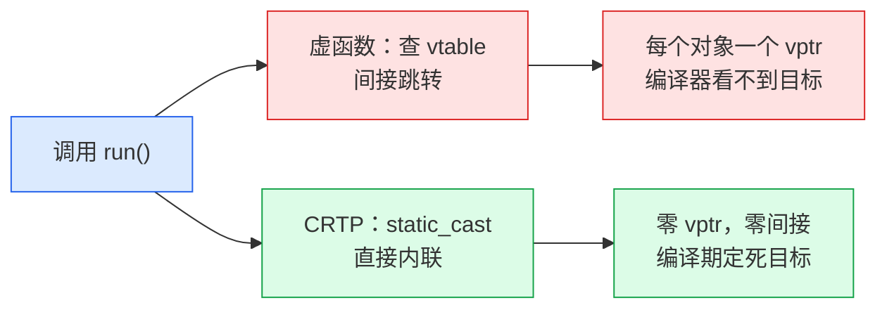

> 原文链接: [CSDN](https://blog.csdn.net/stallion5632/article/details/164815930)

CRTP（Curiously Recurring Template Pattern，奇异递归模板模式）是 C++ 用模板实现编译期多态的经典手法。它让基类在编译期就知道子类是谁，从而直接调用子类方法、直接内联，不查虚表、不留 vptr，代价从运行期搬到了编译期。一个真实落地是嵌入式框架 coact（[github.com/DeguiLiu/coact](https://github.com/DeguiLiu/coact)），第五节以它的状态机为例。

## 它解决了什么

普通继承里基类不知道子类是谁。想让基类调用子类方法，只能写虚函数，运行期查 vtable 跳转。CRTP 换一条路：把子类名当模板参数传给基类，让基类在编译期"认领"自己的子类。

虚函数和 CRTP 解决的是同一个问题：基类代码里要调用"由子类决定"的那部分逻辑。差别只在于这一步发生在运行期还是编译期。两者都能让"基类定义骨架、子类填充细节"，但对运行期的影响完全不同。

| 维度 | 虚函数（运行期多态） | CRTP（编译期多态） |
| --- | --- | --- |
| 分发机制 | 运行期查 vtable | 编译期 `static_cast` |
| 每对象开销 | 一个 vptr | 零 |
| 内联 | 通常不能 | 能 |
| 类型错误 | 运行期暴露 | 编译期暴露 |

## 最小示例与三条原理

先看一个最小例子，后面三条原理都围绕它展开。

```cpp
template <typename D>
struct Base {
    void run() { static_cast<D*>(this)->do_work(); }
};

struct Worker : Base<Worker> {
    void do_work() { /* 具体逻辑 */ }
};
```

`Worker : Base<Worker>` 是"奇异"的地方：子类继承一个"以自己为参数"的基类，看起来像循环引用。基类里的 `static_cast<D*>(this)` 在编译期就定死了目标类型。

"奇异递归"四个字描述的正是这个写法本身：模板类 `Base<D>` 出现在自己的继承列表里（`Worker : Base<Worker>`），`Worker` 的定义又依赖 `Base`，两者互相引用，形成一层看似循环的递归。1995 年 Coplien 提出这个名字，指的就是这种"子类继承以自己为参数的基类"的反常形态。它并不是真的递归，模板实例化在编译期展开一次就结束，不会无限套娃。

### 模板按需实例化

写 `Worker : Base<Worker>` 时，编译器把 `Base<Worker>` 当成具体类型实例化，模板参数 `D` 被替换成 `Worker`。于是基类代码里的 `D` 就是 `Worker`，基类"知道"了子类。

这是最关键的一步：模板不是运行期的类型擦除，而是编译期的代码生成。每换一个子类，编译器就生成一份针对它的基类代码。

### 成员函数延迟实例化

`Base<D>` 里用到 `D` 的代码（`static_cast<D*>(this)->do_work()`）不在定义基类时就检查，而是等真正调用 `run()` 时才实例化。那时 `Worker` 已完整定义、`do_work()` 存在，所以能编译通过。

C++ 模板的成员函数是"用到才实例化"的。正因为 `run()` 在 `Worker` 定义之后才被调用，编译器那时已经看得到 `Worker::do_work`，这一步才不会因为"类型未完整"而报错。

### 静态向下转型

`this` 的类型是 `Base<Worker>*`，但它实际指向的一定是 `Worker`（因为 `Worker` 继承了 `Base<Worker>`）。`static_cast<D*>(this)` 就是 `static_cast<Worker*>(this)`，是编译期就确定的合法转换，不需要运行期类型检查。

`static_cast` 在这里是"安全的下转"：编译器能证明 `this` 一定指向 `Worker`，所以它敢直接转换，而不是像 `dynamic_cast` 那样运行期查 RTTI。

## 和虚函数的差别



虚函数在每个对象里存一个 vptr，运行期通过它查表跳转，编译器看不到目标、无法内联。CRTP 在编译期就把"调谁"写死，编译器直接内联 `Worker::do_work`，不查表、不留 vptr。

两者的本质差别是"类型信息放在哪"：虚函数把类型信息放在对象里（vptr），运行期读；CRTP 把类型信息放在类型系统里（模板参数），编译期用。放在类型系统里，编译器就能在生成代码时把一切定死。

## 误区、代价与边界

CRTP 不是万能的多态替代，有几处用起来容易踩坑。

**不能装进统一容器。** `Base<WorkerA>` 和 `Base<WorkerB>` 是两个不同的类型，没有共同基类，所以写不了 `std::vector<Base*>` 这样的异构容器。要运行期混装不同子类，还是得回到虚函数。

**构造与析构期间不能调派生方法。** 基类构造函数执行时，派生部分还没构造完，此时 `static_cast<D*>(this)` 后调用派生方法读到的是未初始化状态。派生析构完成后，基类析构里再调派生方法同样是悬空。

**基类不能持有派生专属状态。** 状态应该归派生类，基类只放与"骨架流程"相关的公共部分，否则基类和派生耦合过死，换一个子类就要动基类。

收益和代价并存：零运行期开销、可内联、类型安全、错误在编译期暴露；代价是编译变慢、报错变长，每个子类还会实例化出一份基类代码，二进制可能变大。

所以它适合需要多态但付不起虚函数开销的场景，比如 MCU、热路径；不适合运行期才知道具体类型的场景，也就是上面第一条"不能装进统一容器"的情况。

## 落地形态与选型

coact 是一个面向 RT-Thread MCU 的 C++17 事件驱动框架，代码在 [github.com/DeguiLiu/coact](https://github.com/DeguiLiu/coact)。它的状态机 `Hsm<Context>` 是"骨架加钩子"在嵌入式里的真实落地。

coact 用的不是上面 `Base<Derived>` 的经典写法，而是"模板参数绑定"：把 `Context` 当模板参数，钩子用函数指针承载，签名在编译期与 `Context` 绑定。目的和 CRTP 一样（编译期绑定、零虚表），但绑定媒介是函数指针表而非 `static_cast<Derived*>(this)`：

```cpp
template <typename Context>
struct StateDef {
    int8_t parent;                 // 父状态索引
    void (*entry)(Context&);       // 钩子：进入动作
    void (*exit)(Context&);        // 钩子：退出动作
    const char* name;
    int8_t initial_child;
};

template <typename Context>
struct TransitionDef {
    int8_t source;
    uint16_t signal;
    int8_t target;
    TransitionKind kind;           // Internal / Self / External
    bool (*guard)(const Context&, const Event&);  // 纯函数守卫
    void (*action)(Context&, const Event&);       // 转移动作
};

template <typename Context>
class Hsm {
public:
    bool dispatch(Context& ctx, const Event& evt) noexcept;
};
```

为什么嵌入式要这样写？MCU 上 `-fno-rtti`、业务零堆、Cortex-M 单核，虚函数的 vptr 和间接跳转都付不起。`Hsm<Context>` 把状态机派发（从活动叶子向上找转移、父状态继承、退出与进入路径）做成固定骨架，把 entry/exit/guard/action 四个钩子交给 `Context`，编译期就把调用目标定死、直接内联。

同一套框架里，这套手法还和另外两种编译期手段配合：无状态策略（`EventPool<Profile>` 选单核或 SMP 后端）和 Traits 注入（`Ao` 的优先级与预算属性），细节见同目录的编译期多态一文。

CRTP 家族在工程里有三种常见形态，按"差异点粒度"递减：

| 形态 | 写法 | 适合 | coact 落点 |
| --- | --- | --- | --- |
| 经典 CRTP | `Base<Derived>` 加 `static_cast` | 基类持状态，多钩子 | - |
| 模板参数绑定 | `Hsm<Context>` 函数指针钩子 | 骨架加少量钩子 | `Hsm<Context>` |
| 无状态策略 | `struct Policy { static apply(); }` | 单点算法替换 | `EventPool<Profile>` |

三者差别在差异点粒度：经典 CRTP 让基类持有派生状态和钩子，适合"流程里的多个钩子"；模板参数绑定把钩子做成函数指针表、基类不持派生状态，适合"状态机骨架"；无状态策略只剩一个静态算法函数，适合"单点算法"。三者服务同一件事：把差异钉在编译期，避免虚表和堆。coact 的完整实现和选择理由都在 [github.com/DeguiLiu/coact](https://github.com/DeguiLiu/coact)。
