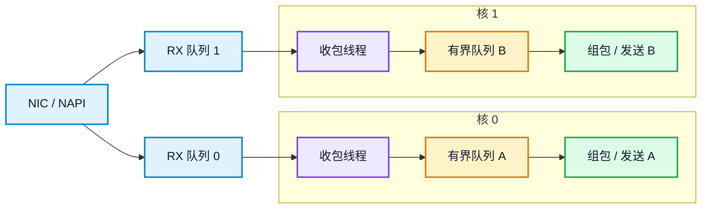
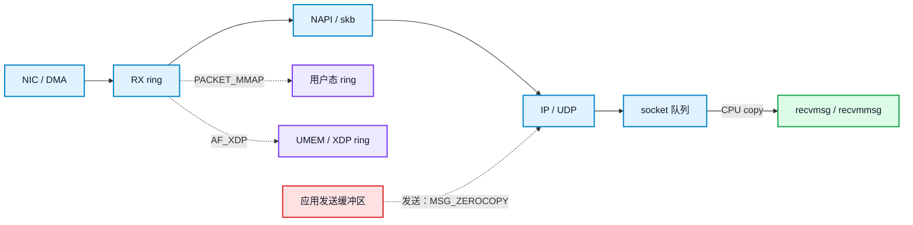

**结论：网络实时性能首先取决于应用怎么收包、怎么排队、怎么分配内存，然后才是内核参数。对同一路传感器数据流，即使 SoC 有多个核，也应把收包、组包和发送固定在一个 CPU 核；多核用于不同数据流或不同职责。推荐顺序是：单一收包线程 + 阻塞 `recvmmsg`（多 fd 用 `poll`，fd 少且编号受控可用 `select`） → 批量收发 → 有界队列与队列满处理 → 内存池/零拷贝 → IRQ/NAPI/包分发 → CPU 隔离与实时调度 → 定时器。**

本文以 UDP 为主，示例假定多核 ARM Linux、网卡名为 `eth0`。嵌入式平台的约束与服务器不同：RAM 小、通常没有 swap、DMA/CMA 连续内存有限、cache 一致性要自己处理、内核和驱动来自厂商 BSP，实时性还受功耗和散热限制。下面的参数和命令要按板级实际情况替换，不能直接照搬。

本文借用 lwIP 的五个设计原则：

1. 用描述符传递数据，不在每一层复制 payload；
2. 用一个明确的执行上下文串行化协议处理，减少锁竞争；
3. 中断或驱动入口只做最小工作，耗时处理放到线程；
4. 用固定池和有界队列管理内存，而不是在热路径临时分配；
5. 明确缓冲区所有权和回收责任，避免共享数据被提前释放。

## 1. 工业传感器平台：约束与目标

### 1.1 工业传感器平台的约束

工业传感器平台通常有固定或准固定采样周期、长期无人值守、看门狗、无风扇散热和受限 RAM。网络侧数据形态差异很大：红外模组经网络输出时往往是整帧数据拆成多个包，单帧几十 KB 到数百 KB；激光雷达常见高速点云数据报，包速率高、可能短时突发；温度、振动和控制命令则可能是低频小包。优化目标不是峰值吞吐，而是可预测的 p99 延迟、明确的丢包策略、不会因内存不足被系统杀死，并能长期稳定运行。

| 数据类型 | 典型形态 | 优化重点 |
| --- | --- | --- |
| 红外模组 | 经网络输出时为整帧数据，单帧几十 KB 到数百 KB，帧率通常固定 | 大缓冲、帧重组、零拷贝、带宽和内存上限 |
| 激光雷达 | 点云数据报，常见接近 MTU，包速率高，可能短时突发 | 批量收包、丢包统计、时间戳和队列深度 |
| 温度、振动、控制命令 | 低频小包 | 低延迟、优先级、队列满时的丢弃策略 |

这类平台的 Linux 往往来自厂商 BSP，内核版本、网卡驱动、PREEMPT_RT 和 AF_XDP 支持都不完整。下面的参数示例只表示调整方向，必须用板级基线和 A/B 测试确认，不能当成通用默认值。

### 1.2 三个指标不能混在一起

| 指标 | 关注点 | 常见工具 |
| --- | --- | --- |
| 吞吐 | 单位时间处理多少包/字节 | `iperf3 -u`、应用计数 |
| 延迟 | 单包从发送到接收的时间 | `sockperf`、硬件时间戳 |
| 抖动 | p99、p99.9、最大值与平均值的差距 | `sockperf`、`cyclictest` |
| 丢包 | NIC ring、softnet backlog、socket 缓冲 | `ethtool -S`、`/proc/net/softnet_stat`、`nstat` |
| CPU | 总占用、softirq、单核饱和度 | `top`、`perf`、`mpstat` |

实时控制更关心 p99/p99.9 和最大抖动；吞吐测试必须同时记录丢包和 CPU，否则“吞吐高”可能只是把包丢在了更早的环节。

### 1.3 应用架构：单一收包线程 + 有界队列

多线程同时读写同一个 UDP socket，会引入锁竞争和唤醒抖动。更可控的结构是：每个接收队列由一个收包线程负责批量收包；单路或少量固定 socket 用阻塞 `recvmmsg`，多 fd 时优先用 `poll`，fd 少且编号受控可用 `select`。收到的消息进入有界队列，CPU 密集型处理交给工作线程。队列满时明确丢弃、降级或让上游降速，而不是无限堆积。

**核绑定规则：同一路传感器数据流的收包、组包、发送固定在一个 CPU 核。** 多核用于不同数据流、不同网卡队列，或控制、日志、看门狗等不同职责；不是把同一路流拆到多个核。这样做的原因是同一路流的数据和元数据留在同一核的缓存中，避免跨核队列、锁竞争、缓存失效和包序抖动。单路流处理不过来时，优先优化零拷贝、批量和处理耗时；不要靠增加线程把同一路流拆散。



*图 1：每个核独立完成收包、入队、组包和发送。收包线程可用阻塞 `recvmmsg`；多 fd 时优先用 `poll`，fd 少且编号受控可用 `select`。*

### 1.4 基线测量

```bash
# UDP 吞吐与丢包
iperf3 -u -c <server_ip> -b 1G -l 1400 -t 60

# 延迟与抖动（工具按板级可用性选择）
sockperf ping-pong -i <server_ip> -p 12345 -m 1400

# 调度延迟
cyclictest -m -p 80 -i 1000 -l 10000 -a 2

# 网卡统计、softnet 丢包、协议栈错误
ethtool -S eth0
cat /proc/net/softnet_stat
nstat -az
```

每次只改一个变量，记录吞吐、p99、丢包和 CPU。没有基线，就无法判断参数是改善了延迟，还是只是把瓶颈推到了下一层。

有了指标和架构约束，下一章看 lwIP 的五个原则如何映射到 Linux。

## 2. 架构原则：lwIP 的五个设计

lwIP 是资源受限环境里的 TCP/IP 协议栈，它的很多选择可以直接映射到 Linux 应用设计。

| lwIP 机制 | 解决的问题 | Linux 对应做法 |
| --- | --- | --- |
| `pbuf` 链 | 用描述符串起多段数据，减少 payload 复制 | 驱动 ring/skb；用户态 `PACKET_MMAP`、`AF_XDP`、`MSG_ZEROCOPY` |
| `tcpip_thread` + mailbox | 单线程串行化协议栈，减少锁 | 一个收包线程/队列；多 fd 时用 `poll`，fd 少且编号受控可用 `select`，不要让多线程抢同一个 socket |
| `netif->input` / `tcpip_input` | 驱动入口只投递，耗时处理在协议线程 | 内核 NAPI/softirq；应用非阻塞、批量收包 |
| `PBUF_POOL` / `MEMP_NUM_PBUF` | 固定池、有界内存 | 静态缓冲池、`SO_RCVBUF`、ring/UMEM（用户态内存区）容量 |
| `pbuf_ref`/`pbuf_free`、`TCP_WRITE_FLAG_COPY` | 明确所有权和零拷贝契约 | `MSG_ZEROCOPY` 完成通知、`PACKET_MMAP` ring 所有权 |

### 2.1 描述符传递，而不是逐层复制

lwIP 用 `pbuf` 描述一段数据，多个 `pbuf` 可以串成一个包；`pbuf_cat`/`pbuf_chain` 只链接描述符，`pbuf_copy` 才真正复制。Linux 内核里对应的是 skb 和驱动 ring；用户态要减少拷贝，可以走 `PACKET_MMAP`、`AF_XDP` 或 `MSG_ZEROCOPY`。

关键不是“零拷贝”这个词，而是所有权：缓冲区由谁分配、谁锁定、什么时候可以释放。lwIP 用 `pbuf_ref`/`pbuf_free` 管这件事，Linux 零拷贝接口用完成通知和 ring 状态管这件事。

### 2.2 单线程串行化，减少锁竞争

lwIP 在 OS 模式下把协议处理集中到 `tcpip_thread`，驱动或应用通过 mailbox、`tcpip_callback` 投递任务。Linux 应用可以借用这个思路：一个 socket 由一个收包线程负责，其他线程只消费队列中的消息，不直接抢 socket。

多线程收同一个 socket 通常不会更快，反而会增加锁竞争、唤醒抖动和缓存失效。需要多核并行时，优先用多个 socket + `SO_REUSEPORT`，或者一个收包线程加多个工作线程。

### 2.3 中断入口最小化

lwIP 的驱动入口只把 pbuf 交给协议栈，解析、回调和业务处理不在中断里做。Linux 内核已经用 NAPI 把大部分收包工作移到 softirq；应用层同样要避免在信号处理、定时器回调或高优先级线程里做阻塞操作。

### 2.4 固定池和有界队列

lwIP 用 `PBUF_POOL_SIZE`、`MEMP_NUM_PBUF`、`TCP_SND_BUF`、`UDP_RECVMBOX_SIZE` 控制内存和队列。Linux 应用要对应地设置静态缓冲池、`SO_RCVBUF`、`netdev_max_backlog`、ring/UMEM（用户态内存区）容量，并为队列满设计丢弃、降级或让上游降速的策略。

这五个原则落到 Linux 应用层，就是下一章的 socket 初始化、收包循环、内存池、零拷贝和队列处理。

## 3. 应用层：收包、队列与零拷贝

### 3.1 socket 初始化

UDP socket 的阻塞方式要和收包循环匹配。使用 `poll`/`select` 时保持非阻塞，并在 `recvmmsg` 中带 `MSG_DONTWAIT`：

```c
/* poll/select 模式：非阻塞 socket */
int fd = socket(AF_INET, SOCK_DGRAM | SOCK_NONBLOCK | SOCK_CLOEXEC, 0);

int rcvbuf = 4 * 1024 * 1024;
setsockopt(fd, SOL_SOCKET, SO_RCVBUF, &rcvbuf, sizeof(rcvbuf));

int lowat = 1;
setsockopt(fd, SOL_SOCKET, SO_RCVLOWAT, &lowat, sizeof(lowat));
```

`SO_RCVBUF` 要小于等于 `net.core.rmem_max`；`SO_RCVLOWAT` 决定何时唤醒，设得太大会增加延迟，设得太小会增加唤醒次数。低延迟场景通常从 1 开始，再根据批量处理能力调整。

如果使用 3.2 节的阻塞 `recvmmsg`，socket 不要设置 `SOCK_NONBLOCK`；如果使用 `poll`/`select`，则保持非阻塞。两种模式不要混用，否则阻塞收包会立刻返回 `EAGAIN`。

多个工作线程的场景可以用 `SO_REUSEPORT`，让每个工作线程有独立 socket：

```c
int one = 1;
setsockopt(fd, SOL_SOCKET, SO_REUSEPORT, &one, sizeof(one));
```

`SO_REUSEPORT` 由内核按四元组哈希分流，不是让多个线程共享同一个 socket。工作线程数量不要超过可用 CPU 核数。

### 3.2 收包循环：recvmmsg、poll 与 select

单路或少量固定 socket、独占核心的传感器任务，优先用阻塞 `recvmmsg`。它少一层事件循环，路径更短，也更容易分析 p99。多个固定 fd 用 `poll`；fd 很少且编号受控时可以用 `select`。

| 方式 | 适用场景 | 优点 | 代价 |
| --- | --- | --- | --- |
| 阻塞 `recvmmsg` | 单 socket 或固定少量 socket，独占线程 | 路径短、实现简单 | 退出和多 fd 需要额外机制 |
| `poll` | 少量到中等数量 fd，外加 eventfd 退出 | 不依赖 `FD_SETSIZE`，可同时等多个 fd | fd 多时线性扫描 |
| `select` | fd 数量少且 fd 编号小于 `FD_SETSIZE` | 兼容性最好 | `fd_set` 默认上限 1024，fd 编号可能超限；每次调用要重建集合 |
| `io_uring` | 高批量、内核和驱动支持 | 减少 syscall 和唤醒 | BSP 支持不确定，复杂度高 |
| `SO_BUSY_POLL` | 专用核、极低延迟 | 降低唤醒延迟 | 持续占用 CPU，增加功耗和发热 |

单路收包的最短路径（阻塞 socket，不要设置 `SOCK_NONBLOCK`）：

```c
for (;;) {
    int m = recvmmsg(fd, msgs, BATCH, 0, NULL);
    if (m > 0) {
        process_batch(msgs, m);
        continue;
    }
    if (m < 0 && errno == EINTR) {
        continue;
    }
    if (m < 0) {
        handle_error();
        break;
    }
}
```

阻塞循环需要有明确的退出方式：由另一个线程 `shutdown`/`close`，或设置 `SO_RCVTIMEO`，或用 `eventfd` 唤醒。不要在信号处理函数里做业务处理。

多个固定 fd 用 `poll`，`stop_fd` 可由 `eventfd` 创建，并把退出事件放进同一个等待集合：

```c
struct pollfd pfds[2] = {
    { .fd = fd,      .events = POLLIN },
    { .fd = stop_fd, .events = POLLIN },
};

for (;;) {
    int n = poll(pfds, 2, timeout_ms);
    if (n < 0) {
        if (errno == EINTR) continue;
        handle_error();
        break;
    }
    if (pfds[1].revents & POLLIN) {
        break;
    }
    if (pfds[0].revents & POLLIN) {
        for (;;) {
            int m = recvmmsg(fd, msgs, BATCH, MSG_DONTWAIT, NULL);
            if (m > 0) {
                process_batch(msgs, m);
                continue;
            }
            if (m < 0 && (errno == EAGAIN || errno == EWOULDBLOCK)) {
                break;
            }
            if (m < 0 && errno == EINTR) {
                continue;
            }
            handle_error();
            break;
        }
    }
}
```

`revents` 还要检查 `POLLERR`/`POLLHUP`，不能只看 `POLLIN`。

`select` 也能处理少量 fd，但它受 `FD_SETSIZE` 限制，且限制的是 fd 编号，不只是并发数量。嵌入式设备并发 socket 通常不超过 1024，但进程还可能打开日志、设备节点、eventfd 等其他 fd，编号超过 1023 时 `select` 会失败或行为不可靠。因此优先 `poll`，`select` 只用于 fd 很少且编号可控的旧代码。

`recvmmsg` 减少 syscall 次数，但不是零拷贝。每个 `mmsghdr` 的 `msg_len` 要检查；收到超长 UDP 包时用 `MSG_TRUNC` 判断是否被截断。发送侧对应 `sendmmsg`，适合一次提交多个小包。

`SO_RCVLOWAT` 可以配合批量处理，让一次唤醒处理更多包；但它会增加等待时间，必须用 p99 验证。

只有在完整 Linux 且 fd 数量很大、增删频繁、事件率很高时，才需要把 `epoll` 作为可选方案评估；它不是嵌入式 ARM 或 lwIP/RTOS 的通用前提。轮询方式本身不是问题，前提是 fd 数量、事件率和每次处理的耗时有测量依据。

### 3.3 多核与 socket 分工

三种常见结构：

- **单一收包线程**：一个线程阻塞 `recvmmsg`；多个固定 fd 用 `poll`，fd 很少且编号受控可用 `select`。适合控制类、包量中等的场景。
- **每核一个 socket**：每个工作线程用 `SO_REUSEPORT` 绑定同一端口，内核按四元组哈希分流。同一路流仍然落在同一个 socket、同一个核；不同流才分散到多个核。
- **一个收包线程 + 多个工作线程**：收包线程只做分类和入队，工作线程做解析、计算和发送。同一路流应固定给同一个工作线程和同一个核，不能按包轮询到多个工作线程。

不要默认“线程越多吞吐越高”。线程数超过可用核心数会增加上下文切换和缓存失效；RPS/RFS 和 `SO_REUSEPORT` 也不能替代有界队列和队列满处理。

### 3.4 内存池与零拷贝

**内存池**

热路径不要调用 `malloc/free`。启动时分配固定大小的缓冲池或 ring，运行时只做入池/出池：

```c
struct packet_buf {
    uint8_t data[2048];
    size_t len;
};

static struct packet_buf pool[POOL_SIZE];
```

用 `posix_memalign`/`aligned_alloc` 按缓存行或 DMA 要求对齐；用 `mmap` + `MAP_POPULATE` 预缺页。实时线程可用 `mlockall` 锁定内存，需要足够的 `RLIMIT_MEMLOCK` 或 `CAP_IPC_LOCK`；无 swap 的板卡无需 `swapoff`，有 swap 时关闭并保留物理内存余量，避免内存耗尽。队列必须有界，池耗尽时明确丢弃、降级或让上游降速。

**零拷贝路径**



*图 2：普通 socket 路径与三种零拷贝路径。零拷贝减少 CPU 拷贝，但不消除 DMA、协议栈和缓冲区生命周期成本。*

| 路径 | 减少的拷贝 | 代价 | 适用场景 |
| --- | --- | --- | --- |
| `PACKET_MMAP`/TPACKET_V3 | 内核到用户的包拷贝 | 绕过协议栈、ring 管理、`CAP_NET_RAW` | 自定义协议、专用收发 |
| `AF_XDP` | 内核到用户、部分 skb 开销 | 驱动支持、UMEM 管理 | 高吞吐、可绕过协议栈 |
| `MSG_ZEROCOPY` | 发送时用户到内核的拷贝 | 缓冲区页锁定、完成通知 | 大块发送 |
| `sendfile`/`splice` | 文件页缓存到 socket 的用户拷贝 | 主要面向 TCP | 文件流发送 |
| `recvmmsg`/`sendmmsg` | 不减少数据拷贝 | 只减少 syscall | 批量收发 |

`MSG_ZEROCOPY` 示例：

```c
int one = 1;
setsockopt(fd, SOL_SOCKET, SO_ZEROCOPY, &one, sizeof(one));
send(fd, buf, len, MSG_ZEROCOPY);
```

发送缓冲区在完成通知到达前不能修改或释放，完成事件从 `MSG_ERRQUEUE` 读取。小包使用零拷贝往往不划算，因为页锁定和完成通知的成本会超过拷贝本身。

`PACKET_MMAP` 和 `AF_XDP` 绕过标准 UDP 栈，适合自定义协议或专用采集；需要标准 socket 语义、TCP 重传和拥塞控制时，不要为了“零拷贝”绕开协议栈。嵌入式 BSP 的驱动未必支持 AF_XDP 零拷贝模式，选型前先确认内核版本和网卡能力。

### 3.5 定时器与唤醒

事件循环里不要用 `sleep` 轮询。使用 `poll` 时，定时任务用 `timerfd`，与 socket 一起放进同一个等待集合；只用阻塞 `recvmmsg` 时，用 `SO_RCVTIMEO` 或独立定时线程。跨线程唤醒用 `eventfd` 或 pipe。实时线程用绝对时间睡眠，避免相对睡眠累积漂移：

```c
clock_nanosleep(CLOCK_MONOTONIC, TIMER_ABSTIME, &next, NULL);
```

实时线程的 CPU 隔离和调度优先级放到第 4 章说明；内存锁定见 3.4 节。

### 3.6 队列满时的处理策略

任何队列都必须有上限，并明确满了怎么办：

- 丢弃最旧包：降低延迟，适合实时控制；
- 丢弃最新包：保留历史，适合记录类业务；
- 阻塞生产者：只适合非实时线程，不能在 ISR 或收包线程里阻塞；
- 降级处理：降低采样率或分辨率，保证关键路径。

队列深度要按突发长度和 p99 目标计算。队列越深，抗突发能力越强，但排队延迟和内存占用也越高。丢包计数要暴露到监控，否则优化无法闭环。

应用层的收包、队列和内存结构确定后，下一章再逐项说明内核参数为什么这样设。

## 4. 内核层：参数、中断与实时调度

**本章要点：工业传感器平台调内核参数的目标是降低 p99、避免内存耗尽、保证长期稳定，不是追求峰值吞吐。每个参数都要有测量依据和回退方案。**

### 4.1 先固定平台假设

以下以 2/4 核 ARM、无 swap、内存受限、UDP 传感器数据加控制命令的工业板卡为例。不同板卡的网卡队列数、IRQ 数、内核版本和驱动能力不同，参数值只表示方向。

工业场景的判断标准与服务器不同：

- 采样周期固定，尾延迟比平均吞吐重要；
- 不同传感器数据形态不同：红外模组多为整帧大块数据，激光雷达多为高速小/中包，状态量为低频小包；不能只按小包设计；
- 设备可能无风扇，busy poll 和实时调度会带来功耗和温升；
- 长期无人值守，内存耗尽、看门狗复位和配置漂移比峰值性能更不可接受；
- 厂商 BSP 可能缺少多队列、RPS、AF_XDP 或硬件时间戳。

### 4.2 网络内存与队列参数

| 参数 | 作用 | 为什么在传感器平台调整 | 代价与边界 |
| --- | --- | --- | --- |
| `net.core.rmem_max` | 允许应用设置更大的 `SO_RCVBUF` | 短时突发时吸收排队，避免 socket 层丢包 | 只设上限，不自动放大 socket；按最大突发乘并发 socket 数估算 |
| `net.core.wmem_max` | 允许更大的 `SO_SNDBUF` | 控制命令或批量遥测短时突发 | 内存占用；发送队列过大会增加排队延迟 |
| `net.core.rmem_default` | 未显式设置 socket 的默认接收缓冲 | 减少每个应用重复设置 | 默认值过大会浪费内存；建议应用显式设置 |
| `net.core.netdev_max_backlog` | RPS/NAPI 的 softnet backlog 上限 | 突发时避免 softnet 层直接丢包 | 增加内存和排队延迟；单核或低流量可保持默认 |
| `net.core.netdev_budget` | 单次 softirq 处理包数预算 | 降低可减少 softirq 占用时间，改善调度延迟 | 过低会在突发时处理不完；按 p99 和 dropped 调整 |
| `net.core.netdev_budget_usecs` | 单次 softirq 时间预算 | 限制 softirq 占用 CPU 的时长 | 过低增加唤醒次数，过高增加调度延迟 |
| `net.ipv4.udp_mem` | UDP 全局内存压力阈值 | 出现 `UdpRcvbufErrors` 且内存充足时再调 | 会挤占其他内存；不能替代应用读取速度 |
| `net.core.busy_poll`/`busy_read` | socket 忙轮询，降低唤醒延迟 | 控制类小包、专用 CPU 核 | 持续消耗 CPU、功耗和发热；需要驱动支持 |
| `net.core.rps_sock_flow_entries` | RFS 流表规模 | 多核时让包跟随应用所在 CPU，提升缓存局部性 | 占用内存；只在启用 RPS/RFS 时有意义 |

`net.core.rmem_max` 和 `wmem_max` 不是越大越好。先测出最大突发长度，再按“突发包数 × 包大小 × 并发 socket 数”估算；同时给其他进程和页缓存留出余量。工业设备内存受限，缓冲区过大只会把丢包变成排队延迟，最后仍可能在别处丢。

`netdev_budget` 和 `netdev_budget_usecs` 也不要照搬服务器值。传感器采样周期固定时，softirq 长时间占用 CPU 会推迟控制线程；可以适当降低预算，让 softirq 更早让出 CPU，但突发时可能处理不完。是否调整看 `/proc/net/softnet_stat` 的 dropped 和 p99，而不是只看吞吐。

### 4.3 中断、NAPI 与包分发

NAPI 是驱动收包机制，不是 `ethtool` 的开关。大多数驱动默认使用 NAPI；能调的是中断合并、IRQ 亲和性和包分发。

| 参数/操作 | 作用 | 工业传感器场景的理由 | 代价 |
| --- | --- | --- | --- |
| `ethtool -C rx-usecs` | 合并 RX 中断 | 采样周期固定、包量中等时，低合并可降低尾延迟；高包量时适度合并降低 CPU | 过低增加中断和 CPU，过高增加排队延迟 |
| `smp_affinity_list` | 绑定 IRQ 到 CPU | 避免 IRQ 在核间迁移，稳定缓存和调度 | 绑错核会与控制线程、工作线程争 CPU |
| RSS/RPS/RFS | 多核分流 | 4 核平台可把不同队列/流分给多个收包线程；RFS 提升缓存局部性 | 单核/双核收益有限；跨核缓存未命中和调度开销 |
| XPS | 选择 TX 队列/CPU | 发送控制命令时减少跨核迁移 | 配置复杂，需网卡多队列支持 |

低延迟控制链路要把同一路流的 RX IRQ、收包线程、组包线程和 TX 路径绑到同一个核，控制线程可以放到另一个隔离核。高吞吐采集链路可以让多队列 IRQ 分散到多个核，再由 `SO_REUSEPORT` 每个核一个 socket；这里的分散单位是“流/队列”，不是同一路流里的单个包。

RSS 和 `SO_REUSEPORT` 都按流哈希选择队列/socket，同一路流通常固定在一个核；RPS 是软件分流，可能把处理移到别的核，RFS 用来让处理跟随应用所在核。XPS 选择发送队列/CPU，应与接收和组包所在核对齐，避免发送时再次跨核。

单核或双核工业板卡通常不需要 RPS/RSS。把 IRQ 和应用都挤到同一个核，或把中断分到另一个核但共享缓存，可能比默认更差；必须测 p99 和 CPU。

### 4.4 CPU 隔离、实时调度与内核编译选项

只有在核数足够时才考虑隔离。4 核平台可以留一个管理核处理内核线程、日志和看门狗，把控制/网络线程放到隔离核：

```text
isolcpus=2,3 nohz_full=2,3 rcu_nocbs=2,3
```

```bash
taskset -c 2 chrt -f 80 ./sensor_app
```

`chrt -f 99` 容易饿死内核线程，不建议直接使用。保留 `sched_rt_runtime_us` 的内核运行时间，不要为了“更实时”把它设为 -1；否则一次死循环就可能让看门狗无法运行。

| 编译选项 | 理由 | 代价 |
| --- | --- | --- |
| `CONFIG_PREEMPT_RT` | 控制循环需要更小的调度延迟 | 吞吐下降、驱动兼容性风险；需 `cyclictest` 验证 |
| `CONFIG_HIGH_RES_TIMERS` | 周期采样、超时和定时器需要微秒级精度 | 短周期定时器会增加唤醒；不是所有定时器都需要高精度 |
| `CONFIG_HZ=1000` | 1 ms 级周期任务更容易对齐 | tick 开销增加；有 hrtimer 时不是唯一手段 |
| `CONFIG_NO_HZ_IDLE` | 空闲时停止 tick，降低功耗和空闲抖动 | 对满载网络路径帮助有限 |
| `CONFIG_NO_HZ_FULL` + `CONFIG_RCU_NOCB_CPU` | 隔离核减少 tick 和 RCU 回调干扰 | 配置复杂，必须配合 `isolcpus`/`nohz_full` |
| `CONFIG_NET_RX_BUSY_POLL` | 支持 `SO_BUSY_POLL` 低延迟收包 | 持续占用 CPU，增加功耗和发热 |
| `CONFIG_XDP_SOCKETS` | 支持 AF_XDP | 驱动和内核版本要求高，开发复杂度大 |

`CONFIG_HZ` 不是越大越好。传感器周期如果是 1 ms，1000 Hz tick 可以和周期对齐；但 hrtimer 也能提供高精度定时，是否提高 HZ 要看 tick 开销和测量结果。`PREEMPT_RT` 也不是默认选项：它降低调度延迟，但会牺牲吞吐，并可能暴露厂商驱动的锁/中断问题。

### 4.5 PTP 与硬件时间戳

工业传感器常需要把多路红外、激光雷达或控制事件的采样时间放在同一时间轴上。只用应用层 `clock_gettime` 记录时间，会受线程调度、排队和中断延迟影响，误差可能大于传感器周期。PTP（Precision Time Protocol，精确时间协议）用来解决这个问题。

PTP 不传输传感器数据，只让网络中的设备交换很小的对时报文，估算链路延迟和时钟偏差。网络里有一个提供基准时间的主时钟，其他设备作为从时钟跟随它。Sync、Follow_Up、Delay_Req 等报文很小，但会按所选 profile（同步配置）周期发送；高精度 profile 下发送更频繁。它优化的是时间一致性，不是吞吐。

要达到微秒级精度，时间戳必须在网卡或 PHY（网口物理层芯片）收到、发出报文时记录，而不是等数据送到应用层再记录。相关组件各管一件事：

| 组件 | 作用 |
| --- | --- |
| PHC | 网卡上的硬件时钟，PTP 用它维护高精度时间 |
| 硬件时间戳 | 记录报文到达或离开网卡/PHY 的时刻 |
| `ptp4l` | 按 PTP 协议和主时钟交换报文、计算偏差 |
| `phc2sys` | 把 PHC 时间同步到 Linux 系统时钟 |

内核和驱动需要相应能力：

- `CONFIG_PTP_1588_CLOCK` 提供 PTP 时钟框架；
- 网卡驱动要提供 PHC 和硬件时间戳；
- PHY 时间戳需要 `CONFIG_NETWORK_PHY_TIMESTAMPING`；
- 应用通过 `SO_TIMESTAMPING` 请求硬件时间戳，驱动通常用 `SIOCSHWTSTAMP` 配置哪些报文需要打时间戳。

先确认网卡能力：

```bash
ethtool -T eth0
```

PTP 报文应使用独立优先级或队列，避免排在大帧和突发数据后面。它不需要跟随数据流放大 `SO_RCVBUF`，但需要稳定的时间戳路径和较低的排队延迟。如果只有单设备、没有多传感器时间对齐需求，PTP 可能不必要；用单调时钟记录本机时间即可。

**调参后的验证：** 每次只改一个变量，记录 p99/p99.9、最大抖动、NIC/softnet/socket 三层丢包、CPU 和温度；至少做 24 小时长稳、断电重启、网线拔插、对端停止发送和突发流量测试。参数要写入镜像或启动配置并能回退；只有目标板、目标内核和目标流量模型上通过测试的参数，才能进入量产配置。

## 参考资料

- [Linux kernel: Scaling in the Linux Networking Stack](https://docs.kernel.org/networking/scaling.html)
- [Linux kernel: High Resolution Timers](https://docs.kernel.org/timers/highres.html)
- [Linux kernel: MSG_ZEROCOPY](https://docs.kernel.org/networking/msg_zerocopy.html)
- [Linux kernel: AF_XDP](https://docs.kernel.org/networking/af_xdp.html)
- [Linux kernel: Packet MMAP](https://docs.kernel.org/networking/packet_mmap.html)
- [Linux kernel: Timestamping](https://docs.kernel.org/networking/timestamping.html)
