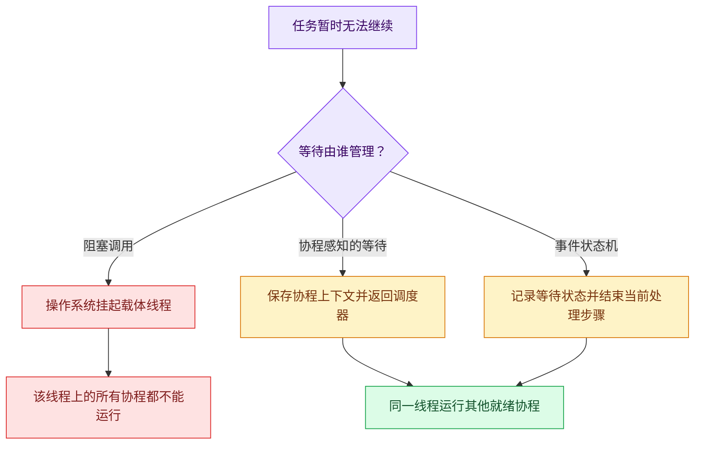
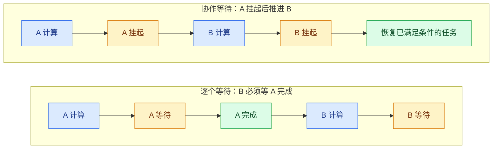
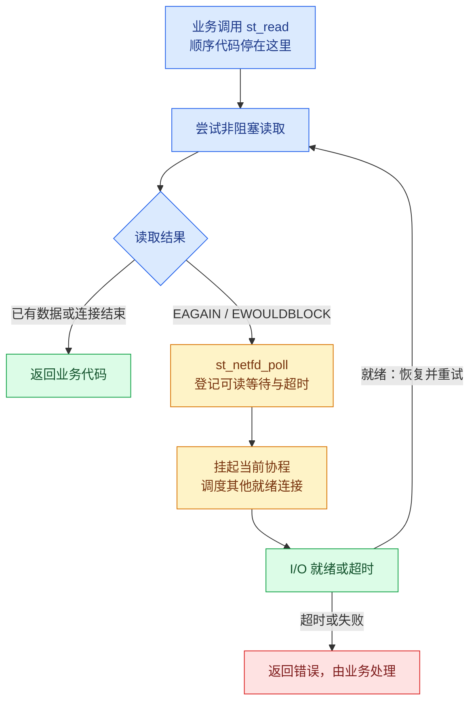
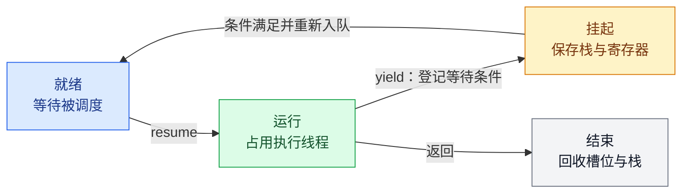
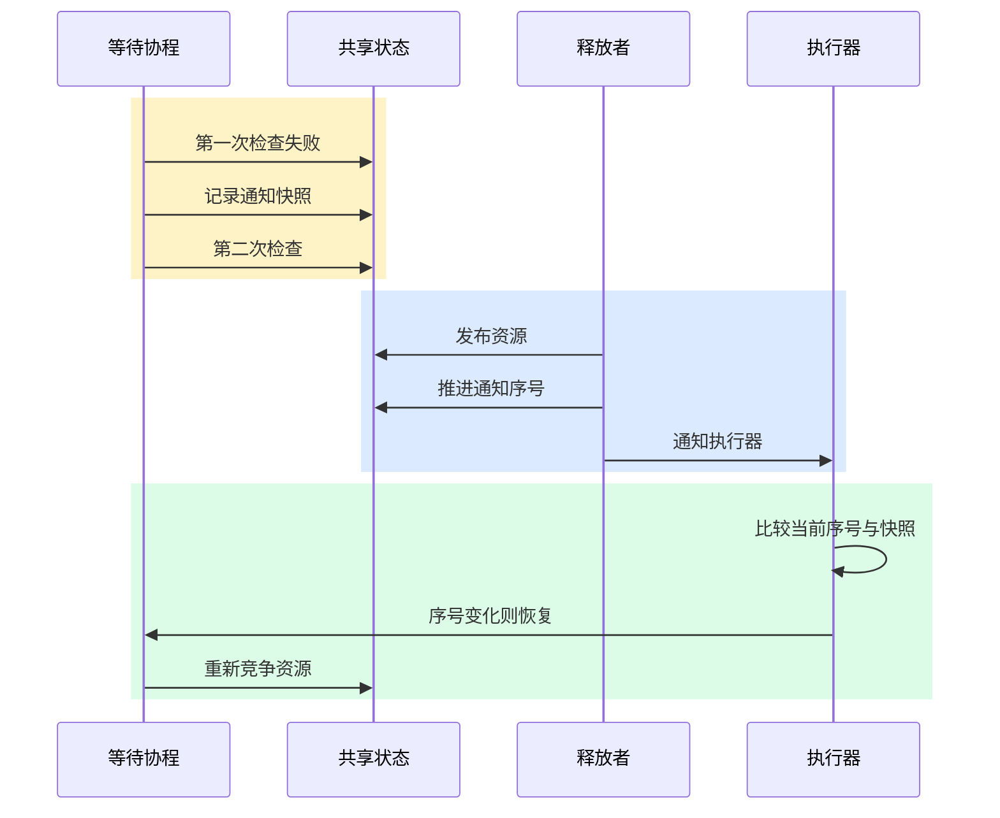
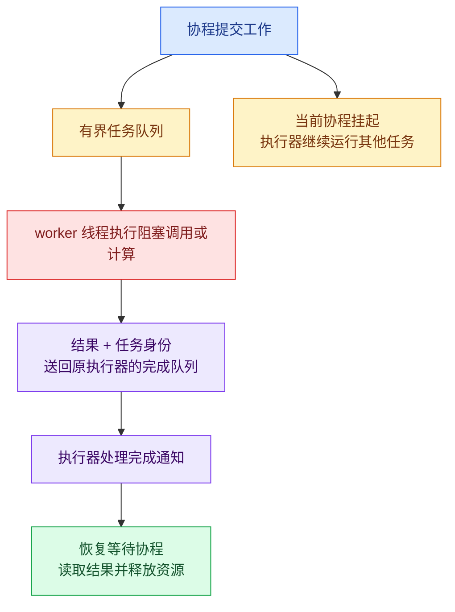
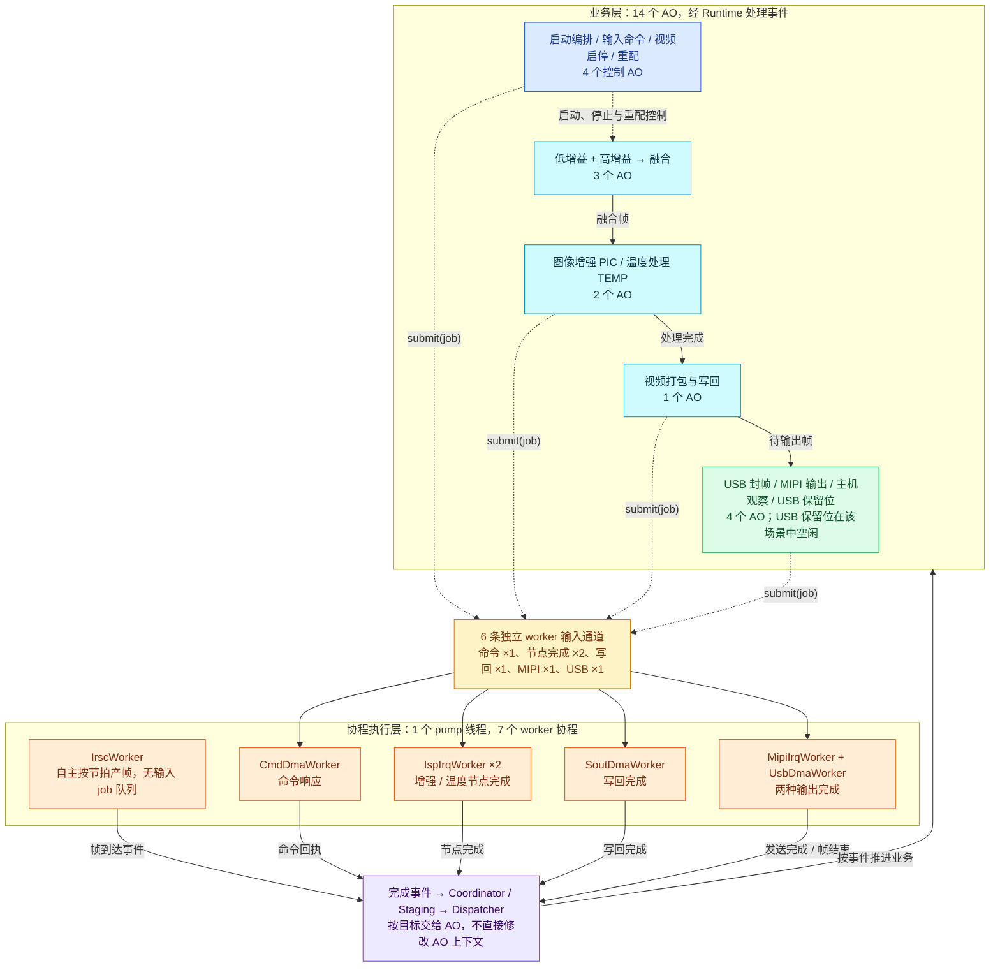

## 1. 用协程组织等待，而不是增加线程

**本文讨论的是：在单核、等待密集且等待可以交给调度器管理的场景中，为什么用协程承载任务，而不是为每个任务配置一个线程。** 核心理由不是协程增加了算力，而是任务等待时不必独占线程；多个任务可以共享执行载体，同时保留顺序调用流程。

网络服务器和嵌入式设备经常遇到同一种情况：任务的大部分时间不在计算，而在等待。服务器等待客户端发来下一段数据，图像链路等待 DMA 完成，控制程序等待设备执行命令。这些等待属于不同任务，本来可以重叠；如果软件逐个等待，就会把本可用于推进其他工作的时间浪费掉。

协程让业务代码仍按顺序写，等待发生时把执行权交还调度器，让同一个线程去跑别的任务。条件满足后，任务从挂起点继续。本文以有栈、协作式协程为对象，先说明为什么不采用“一任务一线程”，再用 State Threads 解释等待如何被接管，最后分析 coact 的 ISP 示例如何把 7 个 worker 收到一个 pump 线程上。

### 1.1 为什么不直接使用线程

**线程能解决等待重叠，但在本文场景中，没有必要让每个等待中的任务各占一个线程。** 一个线程阻塞后，操作系统确实可以运行其他线程；问题在于，本文需要的是并发管理设备等待，不是增加 CPU 计算并行。

| 不采用一任务一线程的理由 | 协程如何应对 | 必须保留的边界 |
|---|---|---|
| 单核不能靠增加线程获得计算并行 | 在一个执行载体上轮流推进就绪任务 | 协程也不增加算力 |
| 独立线程需要各自的栈与调度资源 | 任务数与载体线程数分离 | 有栈协程仍有独立栈，是否省内存要实际核算 |
| 抢占增加共享状态可能发生的交错 | 同一执行器内只在挂起或返回时切换任务 | 跨挂起点、跨线程和中断访问仍需同步设计 |
| 大量短等待需要反复切换执行者 | 用协作式上下文切换推进其他就绪任务 | 切换路径更短不等于整体吞吐一定更高 |

固定线程池可以限制线程数量，但如果池内执行的仍是阻塞调用，等待就仍会占住 worker；所有 worker 都在等待时，后续就绪工作只能排队。协程的不同之处，是把等待登记给调度器后让出载体，而不只是限制载体数量。非阻塞 I/O 加事件状态机也能做到这一点；选择协程，是为了同时保留顺序调用链，避免为每个等待点拆分回调和中间状态。

这里的“不使用线程”，准确说是**不为每个等待任务单独创建线程**，不是整个系统不需要线程。协程仍需执行载体，多核计算和无法改造的阻塞调用也仍适合交给线程。等待接口没有接入调度器，或者一段计算迟迟不让出执行权，就不能仅靠协程解决。

### 1.2 先分清计算、线程阻塞与协程挂起

“阻塞任务”不是一种足够精确的分类。需要区分任务正在消耗 CPU，还是任务无法继续、却占住了执行线程。

| 情况 | 实际发生的事 | 适合的处理方式 |
|---|---|---|
| 矩阵乘法、图像滤波 | CPU 正在执行指令 | 算法优化、向量化、多核任务划分 |
| DMA 已启动，等待中断 | 硬件工作，软件暂时无事可做 | 完成事件、协程挂起 |
| 非阻塞网络读取暂时无数据 | 当前不能继续读取 | 就绪通知与协程挂起 |
| 旧驱动的同步 `ioctl` 长时间不返回 | 内核线程被调用占住 | 有界 worker 线程隔离 |
| 等待互斥锁 | 其他执行者持有资源 | 缩短临界区、调整所有权，或使用协程感知的等待 |

**线程阻塞和协程挂起是两件事。**



例如，同样是等待 10 ms：`std::this_thread::sleep_for` 让调用线程休眠；协程感知的定时等待则登记恢复条件，再返回调度器。前者使该线程暂时不能处理其他任务，后者只暂停当前协程。第 3.2 节会比较这两种等待在切换路径上的差别。

协程不会自动接管阻塞调用。业务绕过适配层直接调用阻塞函数，执行器照样被卡住。

### 1.3 协程优化的对象：等待占用，而不是计算量

设一个请求需要 CPU 执行时间 `C`，外部等待时间 `W`，同时有 `N` 个相互独立的请求。

单线程逐个执行，忽略调度开销时：

```text
T_serial ≈ N × (C + W)
```

若等待能重叠，单个 CPU 执行载体可以在 A 等待时推进 B。总 CPU 工作量仍然是 `N × C`，外部设备等待也仍然存在，只是不再全部串行叠加。



*图中表示执行先后与挂起关系，不按时间比例绘制。*

对稳定运行的系统，可以用两个约束检查“加协程就能提高吞吐”的说法：

```text
CPU 上限：λ × C ≤ P
并发需求：L = λ × R
```

其中 `λ` 是完成吞吐量，`P` 是可用 CPU 核数，`L` 是平均在途请求数，`R` 是平均响应时间。第二式是稳定系统中的 Little 定律，不能把它当作尾延迟保证。

如果平均响应时间约 10 ms、目标吞吐量为 1000 次/s，平均需要约 10 个在途请求。用 10 个线程还是 10 个协程承载，是执行资源的选择；如果设备每秒只能完成 100 次，增加执行资源也无法获得 1000 次/s。

协程主要改变的是**等待期间的线程占用与任务组织成本**。CPU、设备带宽、队列容量仍然构成独立上限。

因此，本文采用协程有明确的适用条件，而不是把所有任务都改成协程：

| 场景 | 更合适的执行模型 | 原因 |
|---|---|---|
| 多核、CPU 密集 | 线程或线程池 | 协程共享线程，不增加并行度 |
| 单核、等待密集、等待可调度 | 协程 | 等待时让出载体，线程数不随任务数增长 |
| 单核、存在频繁的不可调度阻塞 | 协程 + 有界线程池 | 可调度部分交给协程，阻塞调用隔离 |
| 等待不可调度且调用简单 | 线程池 | 协程接不住，线程隔离成本更低 |

下面沿协程的工作路径展开：State Threads 说明如何把等待交给调度器，第 3 章说明挂起、恢复与资源管理的约束，coact 的 ISP 示例说明这些机制在单核场景中如何落地。

## 2. State Threads 的启示：协程的收益与前提

理解协程，关键是看一次等待怎样从业务调用交给调度器。State Threads 保留顺序调用链，同时用非阻塞 I/O 和就绪通知管理等待：当前协程挂起，承载它的线程继续服务其他连接。这一章借它解释协程减少线程占用的机制与前提，第 4 章再分析 coact ISP 链路中的具体实现。

### 2.1 顺序调用链与连接并发

网络连接的并发处理，大致有三种写法：

| 方式 | 直接收益 | 主要代价 |
|---|---|---|
| 每个连接一个线程 | 接收、处理、发送按顺序写，局部状态留在调用栈上 | 大量连接对应大量内核线程，资源与调度负担随之增加 |
| 非阻塞 I/O + 事件状态机 | 少量线程管理大量连接，等待不独占线程 | 需要显式保存跨事件状态，复杂协议的处理流程容易被拆散 |
| State Threads 有栈协程 | 保留顺序调用链，同时复用事件驱动的 I/O 等待 | 必须遵守库的 I/O 与协作调度规则，每个协程仍需保存栈 |

三种写法都能让等待重叠，区别在调用链放在哪。每连接一线程把它放在内核线程栈上；事件状态机把它拆成回调和显式状态；State Threads 把它留在协程栈上，只把等待登记交给调度器。

State Threads 真正有用的地方，是把连接并发数和内核线程数拆开，同时保留顺序调用链。切换便宜只是附带的好处。SRS 采用 State Threads，面对的也是同一类问题：服务器要同时维持大量连接，又不想为每个连接保留一个内核线程；协程让连接处理保持顺序写法，调度器负责在等待之间切换。

一个代理连接要依次完成“接收请求 → 连接上游 → 发送请求 → 读取响应 → 返回客户端”，每一步都可能等网络；协程栈把这条链留着，业务代码不用为每个等待点拆回调。

等待的交接落在一个具体的 I/O 调用里。看 `st_read()`：先尝试非阻塞读取，遇到 `EAGAIN` 就登记可读等待并挂起，I/O 就绪或超时后再恢复重试。



业务代码看起来还是同步的，底层却用非阻塞读取，两者并不矛盾。协程在调用者看来还没返回，线程已经去服务别的连接了。I/O 就绪也不等于请求读完，`st_read()` 可能只返回一部分数据，分段、关闭和超时仍要协议层处理。

### 2.2 调度器无法接管的等待

State Threads 有一条硬规则：socket I/O 必须走库里的 I/O 函数，否则调度器管不了它的阻塞。这条规则把协程的边界画得很清楚：它能接管的只是经过调度器的等待；接管不了的阻塞，仍旧压在执行线程上。

| 前提 | 违反时发生什么 | 工程动作 |
|---|---|---|
| 等待经过调度器管理的接口 | 未适配的 socket、同步解析或驱动调用直接阻塞载体线程 | 审计调用链，把不可改造的调用隔离到有界线程池 |
| 执行片段有上界 | 长计算让同一载体上的其他协程得不到推进 | 拆成有界片段，或交给计算线程 |
| 唤醒条件可检查、状态有明确所有者 | 丢失唤醒，或恢复后继续使用已关闭的对象 | 资源状态与通知状态分离，跨 yield 重新校验 |
| 容量有预算 | 栈、连接缓冲与在途请求无上限，内存随并发线性增长 | 同时限制栈、缓冲、队列和在途数 |
| 并行需求与载体数量匹配 | 单载体无法利用多核，CPU 密集时协程只是排队 | 多执行器分片，或保留线程做并行计算 |

落到工程上，就是四个问题：等待是否经过调度器？执行片段有没有上界？唤醒条件能不能检查？容量和并行需求是否匹配？有一个答不上来，协程的收益就会被抵消：交不出去的等待退回线程，不够的并行退回计算执行器或分片。

所以顺序不能反：先确认等待能被调度器接管，再谈协程能带来什么。线程池仍适合计算并行和阻塞隔离，事件状态机仍适合复杂状态管理，三者可以混用。

网络 I/O 只覆盖了等待的一部分。要把同样的思路用于设备任务，还需要说明协程由谁执行、如何切换、怎样可靠恢复，以及哪些工作不能留在执行器里。

## 3. 协程如何挂起、恢复与隔离阻塞

协程方案不是把线程函数换个入口就完成了。它需要执行载体、上下文切换、可靠的唤醒协议和有界执行片段。下面围绕这四项展开；线程只作为执行载体或阻塞隔离手段参与其中。

### 3.1 执行载体与并行能力

操作系统调度的单位是线程；协程执行器决定当前线程下一段跑哪个任务。线程能提供真正的并行，协程只能在已有线程上组织任务，二者层次不同。

| 工作类型 | 执行安排 | 原因 |
|---|---|---|
| 可异步等待的网络或设备操作 | 少量执行线程承载多个协程 | 等待时让出载体，继续处理就绪任务 |
| CPU 密集型计算 | 按 CPU 预算配置计算线程 | 多个协程共享一个线程不会增加计算并行度 |
| 无法异步化的同步调用 | 有界阻塞线程池 | 阻塞一个 worker，而不是整个协程执行器 |

选型时先记住两点：协程不增加算力，线程池也不自动让等待重叠。如果用多个执行器，还要决定任务怎么分片、连接归谁、完成通知送回哪里。固定归属最省同步；跨执行器迁移，就要额外处理生命周期。

### 3.2 上下文切换的保存与代价

有栈协程在挂起时保存栈与寄存器上下文，恢复后从挂起点继续。普通函数的局部变量和调用链留在协程栈上，所以深层调用也可以挂起；无栈协程只保存有限的状态机帧，挂起点受语言和编译器约束。本文讨论的是前者。



同一协作式执行器内，任务切换只发生在 `yield` 或返回时；承载执行器的线程仍可能被操作系统抢占。下面对比两种切换路径：

| 维度 | 线程切换 | 协程切换 |
|---|---|---|
| 触发点 | 任意指令边界，可被抢占 | 只在显式挂起或返回时 |
| 执行路径 | 用户态 → 内核 → 调度器 → 用户态 | 用户态保存与恢复上下文 |
| 保存内容 | 寄存器、栈指针、浮点/SIMD 状态，可能还有地址空间 | 寄存器、栈指针与恢复入口 |
| 缓存影响 | 可能换核，cache 与 TLB 局部性被破坏 | 通常留在同一核，但仍会切换栈工作集 |
| 可预测性 | 受系统负载与调度策略影响 | 由代码中的等待点决定 |
| 代价 | 一次内核往返，通常更高 | 明显更低，但不是零 |

从表里能看出两点。协程切换便宜，不代表整体吞吐更高；切换次数、缓存局部性和唤醒延迟都要算进去。线程在单核上也能“并发”，但那只是时间片轮转，不会增加算力，还会带来业务控制不了的抢占点。单核上线程切换不带来并行收益，协程的用户态切换更轻，这是单核场景选协程的直接理由之一。第 4.2 节会结合单核目标展开。

### 3.3 唤醒条件的检查

保存上下文只完成了一半工作。等待许可、缓冲区或设备完成通知时，还必须保证资源释放与协程挂起之间不会漏掉通知。否则会出现资源已经可用、任务却一直不再运行的情况，即丢失唤醒。

一种通用做法是把**资源状态**与**通知状态**分开：资源状态表示能否消费，通知状态表示条件是否变化。等待者先检查资源，再记录通知快照，然后再次检查；仍不满足才携带快照挂起。释放者先发布资源，再推进通知状态。恢复后必须重新检查资源，而不能把“收到通知”当成“拿到资源”。



*图示释放发生在第二次检查附近的一种交错，不表示固定的先后顺序。*

有三个细节容易忽略：通知不等于所有权，恢复后还要重新竞争资源；序号变化不代表按 FIFO 拿到资源，多个等待者可能一起醒来；超时、取消和资源释放各有规则，不能把“超时为零”当成绝不挂起。这些细节是协程方案的隐性成本。线程用条件变量和互斥量时，语义由系统库兜底；自己实现协程唤醒，就要把这些规则补齐。

### 3.4 长计算与阻塞调用的隔离

协作式调度没有时间片。如果某个协程连续计算 100 ms 而不挂起，同一执行器上的其他协程就要等 100 ms。因此响应时间取决于**最长的不挂起片段**，而不是线程优先级。要把长计算拆成有界片段，或者交给计算线程；否则“协程化”只是把阻塞从 I/O 换成了 CPU。

执行器本身也需要有人驱动。通知通常只推进一个序号，不会自动唤醒宿主线程；宿主循环若持续轮询，会占用 CPU，若睡得过久，又会增加唤醒延迟。**协程减少的是被阻塞的线程数量，不等于降低空闲 CPU 占用。** 是否省 CPU，还要看宿主循环怎么休眠、怎么被通知。

改不动的同步调用不要藏进协程函数。把它放到有界线程池里：协程提交任务后挂起，worker 执行阻塞调用，完成后把结果和任务身份送回原执行器。



队列和线程数必须同时受限。线程太少，阻塞任务排队；线程无上限，又回到调度与内存压力。计算任务与长阻塞任务混用一个小池子，还会让计算任务排在阻塞调用后面，必要时分开预算。完成路径则要明确四件事：队列满时拒绝还是延后；完成通知无法投递时如何留下终态；超时后结果才返回如何识别；取消之后底层是否真的停止。逻辑取消不等于物理停止，确认执行者不会再访问缓冲区之前，资源不能回收。

至此，协程方案的条件已经明确：等待能挂起，唤醒不丢失，连续执行时间有上界，无法接管的阻塞被隔离。下面看 coact 的 ISP 示例如何用一个 pump 承载多个 worker，而不改变业务完成协议。

## 4. coact ISP 示例：用一个 pump 承载 7 个 worker

本章使用 [coact 开源项目](https://github.com/DeguiLiu/coact) 的 [ISP Pipeline 示例](https://github.com/DeguiLiu/coact/tree/abc3c53162f01594f4f90db5f4e9286c6dee7d7f/examples/isp_pipeline)，国内可访问 [Gitee 镜像](https://gitee.com/liudegui/coact)。它是一个 C++17 嵌入式事件框架；这里仅借助它观察执行模型，不展开框架的全部接口。

这个示例用同一套 AO、事件和 worker 代码，对比两种后端：7 个 pthread worker，以及单 pump 线程上的 7 个协程。它要回答的不是“协程是否全面优于线程”，而是“在这条单核 MCU 链路上，哪种执行模型更合适”。

示例模拟红外图像从输入、双增益处理、融合，到图像增强、温度数据处理和输出。多个设备操作有独立的完成时间，数据持续到达，启动和停机又要遵守顺序。把 worker 从独立线程搬到共享线程上的协程后，恰好能检查两件事。一是哪些等待能重叠，二是哪些状态和容量约束还得保留。

示例以主动对象（Active Object，AO）和层次状态机（HSM）保存业务状态。AO 收到事件，检查条件、提交工作并返回；worker 完成后再发事件推进状态。这里的 run-to-completion 指一次事件处理到返回，不是同步等待整项设备操作结束。worker 可以由线程承载，也可以由协程承载，业务状态不随执行载体改变。

### 4.1 14 个 AO 与 7 个 worker 的装配关系

示例在 `main.cpp` 中绑定了 14 个 AO，并创建 7 个 worker 实例。AO 管理启动、帧处理、视频启停、重配和输出状态；worker 模拟产帧、命令响应、DMA 与中断完成。未定义 `ISP_DEMO_CORO` 时，每个 worker 由独立 pthread 承载；定义该宏时，这 7 个 worker 的执行逻辑由一个 pump 线程上的有栈协程承载。两种后端共用同一套 AO、事件与 worker 代码。

图按实际装配关系重绘。AO 按职责分组，worker 单独画，免得业务链路和线程关系混在一起。分组里的数字相加是 14；双增益分支和 PIC/TEMP 分支是逻辑数据流，不表示多个 CPU 核同时计算。



图可以沿两个方向看。沿业务层走，是帧经过各处理阶段的路径；沿“AO → job → worker → 完成事件 → AO”走，是一次异步操作的往返。协程换掉的是 worker 的执行载体，AO 和整条事件管线都没动。

六条 worker 输入通道彼此独立，没有共用一条工作队列。第七个 `IrscWorker` 按节拍自己产帧，所以没有输入 job 队列。完成事件只负责通知，不搬运整帧像素；帧数据留在 DDR 模型里，事件只带帧号和槽位这些描述信息。

### 4.2 为什么不保留 7 个独立 worker 线程

ISP pipeline 选协程，原因可以压成一句话：目标平台是单核，7 个 worker 的等待都能经 PAL 适配为 yield；协程把 7 个执行载体收成一个 pump，去掉了 worker 之间的抢占和加锁。它换来的不是更高算力，而是更贴合单核的执行语义。

pthread 模式用于对照原有行为，协程模式用于验证单核协作调度下的业务正确性。这个问题不能只看绝对延迟或吞吐，而要看单核平台上哪种模型更合适。

在这条链路上，线程方案的问题集中在三个方面：没有并行收益，抢占点不受控，切换路径更长。协程恰好把这三处收紧。资源账则要单独算：协程不一定更省内存。

**单核没有并行收益。** 目标设备是单核 MCU，7 个线程只能按优先级和时间片轮流占有 CPU。总工作量不变，多出来的是调度决策、时间片和抢占点。协程把 7 个 worker 的等待收在一个 pump 上，不损失本来就不存在的并行度。多核 host 上 pthread 模式确实能让多个 worker 同时推进，但那不是目标平台的模型；拿它当性能基线，容易把“多核并行”误当成“线程模型更好”。

**抢占点不受控，同步成本会扩散。** 线程可以在任意指令边界被切走。只要两个 worker 共享可变结构，就得加锁或用原子操作。示例里有个直接证据：pthread 模式下，事件池会被 Dispatcher 和 7 个 worker 同时分配、回收；POSIX PAL 的 `irq_save()` 是空操作，所以 `main.cpp` 必须额外注入自旋临界区。少了这个临界区，压力一上来，空闲链表就会被并发写坏。协程模式下 worker 不会同时执行，这类竞争自然消失。但“不同时访问”不等于“状态不会变”。协程 A 检查过的对象，仍可能在 B 运行后被关闭或替换；跨 yield 的假设还是要逐个检查。

**切换路径不同。** 线程切换要经过内核调度器，协程切换只做用户态上下文保存和栈切换。示例里的等待大多是几十微秒级的设备完成延迟，切换与唤醒开销在总时间里的占比不能忽略。协程省掉的是内核往返，省不掉缓存代价：栈切换照样改变工作集，多个协程的数据超过 cache 时，该缺的缓存还是缺。单核上更关键的是切换时机能不能由代码控制。线程的调度顺序不受测试控制；同样跑 66 项自检，pthread 模式下的交错会随负载变化，协程模式按固定槽位扫描，拒绝计数、帧序和完成顺序更容易复现。这里的收益是**可观测性和确定性**，不能直接换算成吞吐。

**资源账要另算。** 线程需要栈和内核对象，协程也需要栈和槽位元数据。这个示例没靠协程省内存：host 协程后端预留 16 个 256 KiB 栈槽，合计 4 MiB；RT-Thread 的线程资源是 8 个 4 KiB 栈槽。如果目标只是省内存，调线程栈和优先级通常更直接。选协程是为了执行语义、切换路径和单核建模，不是因为“协程一定更省资源”。

两种后端的差别：

| 维度 | 7 个 pthread worker | 单 pump 协程 |
|---|---|---|
| 并行能力 | 多核可真正并行；单核分时 | 单核协作，无同时执行 |
| 抢占 | 任意指令边界 | 仅在 yield 点 |
| 共享状态 | 需要锁或原子操作 | 无同时访问，跨 yield 仍需检查 |
| 切换 | 内核调度器 | 用户态上下文切换 |
| 可复现性 | 受系统调度影响 | 扫描顺序固定，交错可复现 |
| 阻塞调用 | 只阻塞一个 worker | 阻塞整个 pump |
| 适用场景 | 多核计算、阻塞隔离 | 单核语义、大量短等待 |

最后一行也是适用边界。worker 里如果出现改不动的阻塞调用，或者单次执行片段没有上界，协程模式反而更脆弱。这时要保留线程隔离，或者把执行器按核分片，别把所有工作都塞进一个 pump。

所以在这个场景里，协程比 7 个线程更合适。它靠的不是更低的切换开销，而是没有并行损失、减少了抢占和锁、交错可复现。换成多核 host、worker 又能真正并行时，结论就要重新算。

### 4.3 单次节点完成的路径

以图像增强节点为例，`isp_chain.hpp` 中的路径可以分成五步：

1. **AO 处理当前帧。** `FusedNodeBase::process()` 执行示例中的字节变换，将结果写入对应 DDR 区。
2. **AO 登记在途工作。** `request_irq()` 向节点 worker 提交带帧号的 job，成功后保存该帧描述符，等待节点完成。
3. **worker 等待模拟设备。** `IspIrqWorker::execute()` 调用 `g_pal->sleep_us(50U)` 模拟完成延迟。在协程模式下，这次等待经 PAL 适配为 yield，pump 可以继续推进其他 worker。
4. **worker 提交完成事件。** 等待结束后，worker 将 `kIspNodeDone` 和对应帧号送回事件管线。
5. **AO 确认并推进下游。** `complete_irq()` 根据帧号查找已登记描述符，匹配后才向下游发送该帧完成事件；不匹配的通知按陈旧事件计数。

这里同时存在两种“等待”：AO 等的是业务完成条件，worker 协程等的是执行恢复条件。AO 不需要占用协程栈来保存自己的状态；worker 也不需要直接修改 AO 上下文来通知完成。两者由带身份信息的事件连接。

这种分工还保留了过载语义。worker 输入容量不足时，提交会被拒绝并计数，而不是因为换成协程就无限接收任务。节点拒绝时，会生成一条内部完成通知来结束等待，并把这一帧按丢弃处理。不要把它当成一次成功的硬件操作。

还要分清模拟和真实卸载。示例里的字节变换仍同步跑在 AO 步骤内，worker 模拟的只是完成延迟和通知。它能说明异步交互结构，**不代表图像算法已经搬到协程里并行计算，50 μs 也不是设备实测值。**

### 4.4 业务协议与执行载体的分离

无论 worker 由 7 个 pthread 分别承载，还是共用一个 pump，AO 仍提交同类 job、接收同类完成事件，并按相同帧号关联在途工作。

这层边界带来三个实际好处：

- **流程更容易表达。** worker 可以按“取任务 → 执行 → 等待 → 通知”的顺序编写，不必为每个等待点额外拆出业务回调。
- **状态更容易追踪。** 启停、重配、在途计数和异常处理留在 AO/HSM 中，不会随着线程改成协程而转移到另一套隐式流程。
- **执行资源可以单独调整。** 多个模拟 worker 不必各占一个内核线程；各自的输入容量、忙闲和拒绝行为都保留，便于检查单执行载体下的交错。

这与 State Threads 的思路相通：都保留顺序执行流程，把等待复用到少量线程上。区别在于，State Threads 主要围绕连接 I/O 组织流程，coact 示例还用显式状态机管理设备与整条链路。因此，不能仅凭线程数减少就宣称吞吐提升；这里首先获得的是执行模型与业务协议的分离。对这条单核链路来说，这正是选择协程的理由：执行模型可以换，业务协议不用跟着重写。

### 4.5 协程适配的检查项

要让这种结构适合自己的系统，还要检查栈预算、上下文创建、同步操作与真实线程边界：

| 关注点 | 实际代码 | 应如何解释 |
|---|---|---|
| 协程栈 | `StackfulExecutor<16U, 256U * 1024U>` | 每槽独立静态栈，容量可预测；栈本身仍占真实内存，需按调用链核定 |
| 创建上下文 | `thread_create()` 登记请求，pump 才 `arm()` | 保持上下文创建与执行在 pump 线程，不直接复用普通线程的创建语义 |
| 条件变量等待 | `cond_wait()` 解锁，休眠 200 μs，再用 `trylock` 重试 | 这是轮询式适配，不是库内 `CoroSem` 的序号等待协议 |
| 调度载体 | worker 共用 pump；Runtime 与驱动器有各自路径 | “worker 单线程”不等于“整个进程单线程” |

因此，不能把“协程化”扩大成“所有锁都消失”或“整个应用等价于单核抢占式 RTOS”。协作执行只保证 yield 点之间不会切换到同一执行器的其他协程；其他线程、ISR 与共享资源仍需各自的同步设计。

静态栈的收益是预先知道容量，不是栈免费。`corrupted_guards()` 在回收时检查栈端标记，属于事后诊断，不是内存隔离；`stack_watermark()` 当前扫描字节的方式也不能直接当作经过证明的最大栈深测量。工程预算应结合调用链、编译器栈用量和受控压力测试，而不是仅依赖一个诊断数字。

这些问题都能落到具体检查项：还有没有轮询，哪些调用可能卡住 pump，栈容量够不够，完成后资源能不能排空。性能先放一边，行为先验证。

## 5. 验证协程方案的正确性与收益

**先确认等待和完成语义，再测吞吐量。** 否则，遗漏工作、静默丢请求或回收过早，都可能制造吞吐提升的假象。

### 5.1 调度与资源生命周期验证

先把 coact 放到仓库外构建。目录约定与第 4 章示例一致：

```bash
mkdir -p "$HOME/workspace"
git clone https://github.com/DeguiLiu/coact.git "$HOME/workspace/coact"
# If the repository already exists, skip the clone command.
cmake -S "$HOME/workspace/coact" -B /tmp/coact-blog-build \
  -DCMAKE_BUILD_TYPE=RelWithDebInfo
cmake --build /tmp/coact-blog-build -j8
ctest --test-dir /tmp/coact-blog-build \
  -R coro --output-on-failure
```

重点核对五类行为：

1. yield 后局部状态保持，槽位容量耗尽能明确失败。
2. 截止时间、任务唤醒参数与当前协程身份符合预期。
3. 跨线程释放、单许可竞争、无关信号量释放与通知序号边界。
4. 完成、失败、取消与重复完成不会混淆结果读取。
5. 正常结束及失败路径都回收任务槽位、事件引用与业务缓冲区。

测试入口位于 `src/core/test_coro_*.cpp`。这些测试覆盖指定场景，不构成任意并发交错的证明。上述筛选命令也不包含完整 ISP 示例。本文分析版本的根 CMake 未注册 `isp_pipeline_demo` 目标；协程组件测试通过，不等于整条图像链路已通过验证。

本文验证时，在上述源码基线上使用 `RelWithDebInfo` 完成构建，筛选出的 9 项 `coro` 测试全部通过。

第四章的 ISP 示例不参与根 CMake 构建，需要另行编译。在 coact 仓库根目录执行以下命令，显式启用协程模式：

```bash
g++ -std=c++17 -O1 -g -pthread -DCOACT_RTT_STUB -DISP_DEMO_CORO \
  -I . -I include -I examples \
  examples/isp_pipeline/{main,isp_chain,output_itf,recfg_session,sensor_irsc,video_stream}.cpp \
  src/core/pal_posix.cpp src/diag/log_rtthread.cpp \
  -o /tmp/isp_demo_coro
/tmp/isp_demo_coro
```

本次独立编译运行以状态码 0 退出，输出 `RESULT: ALL PASS (fails=0)`、`pool.used=0` 和 `worker pthreads: 0`。最后一项表示没有为七个 worker 分别创建 pthread，不表示整个进程没有线程。这些结果验证了当前 host 模拟的功能与自检场景，不是 ST 与 coact 的性能对比，也不代表真实设备链路或板端验证通过。

### 5.2 线程少了，是否就说明性能更好？

**不能。第 5.1 节验证的是协程版本能否完成业务流程，不是它比线程版本快多少。** `worker pthreads: 0` 只能说明七个 worker 不再各占一个 pthread，不能说明帧处理更快、CPU 占用更低或内存更少。

如果要继续验证调度收益，不必另造矩阵乘法或人工休眠测试，直接比较第 4 章的两种后端：

- **线程版本：** 7 个 worker 分别运行在 pthread 上。
- **协程版本：** 同样的 7 个 worker 运行在一个 pump 线程上，等待时挂起当前协程。

两边使用相同的输入帧、处理逻辑、模拟设备延迟和队列容量。因为本文讨论单核设备，在 host 上比较时还应把两种版本各自的相关线程限制在同一个 CPU 核上，避免把多核并行带来的差异算成调度模型的差异。线程和协程应在计时前创建完成，测量持续处理帧的阶段，而不是混入启动开销。

比较结果要回答三个具体问题：

| 问题 | 记录什么 | 怎样理解结果 |
|---|---|---|
| 同样的时间内，是否完成了同样多的工作？ | 成功输出帧数、拒绝与丢帧数 | 输出更少或丢帧更多，不能算优化 |
| 一帧是否更晚才输出？ | 从输入到输出的耗时，记录中位数和最慢的 1% 帧对应的延迟门槛（P99） | 平均表现接近，也可能有少量帧明显变慢 |
| 完成这些工作占用了多少资源？ | 进程 CPU 时间、线程数、线程与协程栈的配置总量 | 少线程不一定省 CPU，有栈协程也不一定省内存 |

例如，两种版本都能达到目标帧率，协程版也没有增加丢帧和延迟，但 CPU 时间更少，才有依据说它降低了这组负载下的 CPU 开销。如果只是线程数减少，其他指标没有改善，就应把收益写成“减少独立线程、统一管理等待”，而不是“性能提升”。

**本文目前没有这组性能对照数据，因此不报告加速比。** host 模拟的结果也只能说明模拟负载下的表现；真实设备上的中断、DMA 与调度行为，还需要板端测量。

### 5.3 结论：这里为什么采用协程

**这条 ISP 链路采用协程，是因为七个 worker 需要各自等待，却不需要各占一个线程。**

以节点完成通知为例，worker 提交操作后，接下来只是等待设备完成。线程版本让这个 worker 的线程进入等待；协程版本保存当前执行位置，把线程交给其他就绪 worker，等条件满足再继续。两者都能重叠等待，协程的价值是保留各自的顺序流程，同时把这些等待集中到一个执行载体上。

在单核目标上，保留七个线程也不能让 CPU 同时执行七段代码。因此，当等待已经能适配为挂起、每段计算又足够短时，本文选择一个 pump 承载七个协程，而不是保留七个独立 worker 线程。AO 仍负责业务状态和完成确认，协程只改变 worker 在哪里暂停、何时继续，不改变一帧怎样被处理。

这个选择有明确边界：无法改造的阻塞调用会卡住整个 pump，应交给独立线程隔离；需要多核并行的计算，也不能靠增加同一线程上的协程解决。

所以，本文不是要用协程替代所有线程，而是**把“每个任务都要有自己的执行流程”与“每个任务都要有自己的线程”分开**。前者由协程保留，后者在这个等待密集的单核场景中没有必要；具体能节省多少 CPU 时间、是否改善延迟，则由第 5.2 节的对照测量回答。

### 5.4 源码与参考资料

项目入口与外部参考：

- [coact：GitHub 仓库](https://github.com/DeguiLiu/coact)，[Gitee 镜像](https://gitee.com/liudegui/coact)。
- [SRS：State Threads 与网络服务器架构](https://ossrs.net/lts/zh-cn/blog/state-threads-for-internet-applications)
- [State Threads 源码](https://github.com/ossrs/state-threads/tree/srs)：重点看 `io.c` 的 `st_read()`、`st_netfd_poll()` 与描述符非阻塞设置；`public.h` 可核对 API 签名。
