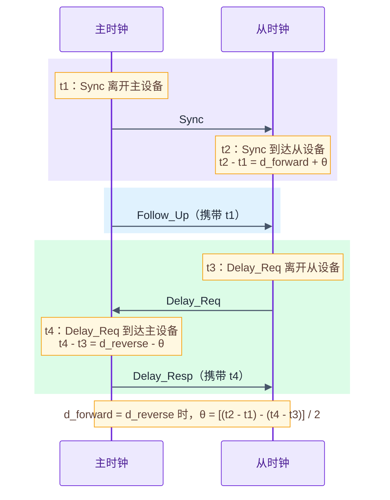
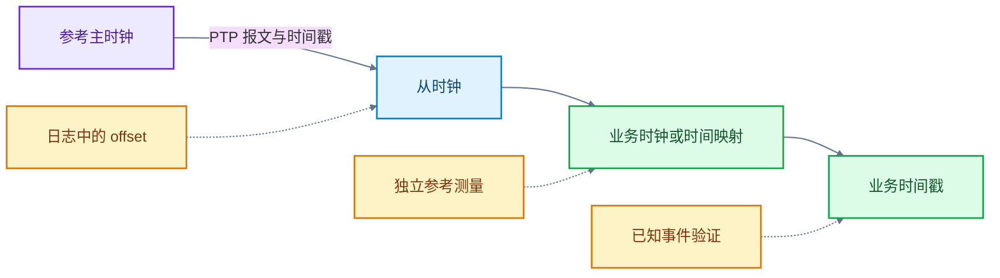
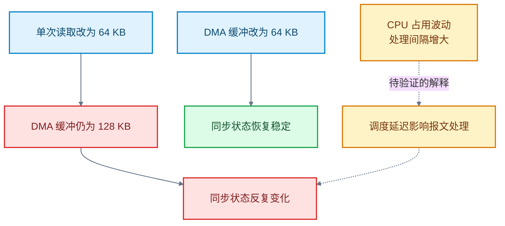

# PTP 授时精度优化：时间戳、链路不对称与系统干扰

> **概述：** 设备显示“PTP 已锁定”，不等于业务时间戳可信。时间戳打在哪里、上下行链路是否对称、报文处理有没有被系统负载打断，都会改变最终误差。下面从传感器采样出发，解释 PTP 如何估计主从偏差，再用几组工程案例说明怎么定位问题和验证修改。

目标读者是熟悉 C/Linux、但不一定了解授时实现的嵌入式工程师。先从设备为什么需要对时讲起，再讨论时间结构体、DMA 缓冲和进程优先级各自能解决什么问题。

## 1. 背景：PTP 同步的是什么，误差又从哪里来

### 1.1 为什么收到数据的时刻，不能代替采样时刻

设想一台移动机器人同时接收相机图像和激光雷达点云。要把图像中的物体与点云位置对应起来，首先要知道两份数据是否采集于同一时刻。数据包先后到达处理器，并不说明传感器先后采样：设备内部处理、缓存和网络传输都可能改变到达顺序。

因此，传感器需要在采样时记录时间戳，处理器再按时间戳关联数据。但每台设备都有自己的计时来源，即使上电时把时间设成相同值，计时速率也可能略有差别。运行一段时间后，“同一时刻”的两个本地读数就会逐渐分开。

时间同步要同时解决两个问题：**当前读数相差多少，以及两只时钟走得是否一样快。**两个本地读数之差是时间偏差；两只时钟走速不同带来的误差是频率偏差。PTP（Precision Time Protocol，精确时间协议）通过网络交换带时间信息的报文，让从设备估计并校正这两种偏差。

这里讨论的是“时间戳能否正确表示采样时刻”。设备时钟对齐，并不等于已经控制相机与雷达同时采样；同步采样还需要设备触发和采样控制配合。

### 1.2 PTP 为什么不能只把主时钟时间发给从设备

如果主设备在时间 `t1` 发出报文，从设备收到后直接把本地时间设成 `t1`，就忽略了报文在途时间。网络传输越慢，从设备设置的时间就越落后。PTP 因此需要估计传输延迟，而不是简单复制报文里的时间。

以双步、端到端延迟测量为例，一次测量涉及四个事件时刻：

| 时间戳 | 事件 | 使用的时钟 |
| --- | --- | --- |
| `t1` | 主设备发送 Sync | 主时钟 |
| `t2` | 从设备接收 Sync | 从时钟 |
| `t3` | 从设备发送 Delay_Req | 从时钟 |
| `t4` | 主设备接收 Delay_Req | 主时钟 |

四个时刻的关系如下。时间轴向下延伸，主时钟记录 `t1`、`t4`，从时钟记录 `t2`、`t3`：



图 1　PTP 双步端到端测量的四个时间戳。报文在途时间与时钟偏差叠加在时间差中；两个方向延迟不对称时，后半段偏差不能完全抵消。

主设备通过 Follow_Up 告知准确的 `t1`，通过 Delay_Resp 返回 `t4`。从设备结合本地记录的 `t2`、`t3` 计算偏差。这里先忽略修正字段和测量期间的频率变化。

设从时钟比主时钟快 `θ`，主到从延迟为 `d_forward`，从到主延迟为 `d_reverse`，则：

```text
t2 - t1 = d_forward + θ
t4 - t3 = d_reverse - θ
```

如果两个方向延迟相同，相减后就能消去传输延迟：

```text
估计时钟偏差 = [(t2 - t1) - (t4 - t3)] / 2
```

从这里可以看出，**时间戳准不准、上下行是否对称，都会直接进入偏差估计。**PTP 通常不会仅凭一个报文完成时钟调整；PTP 持续采样，由时钟调节算法估计偏差和漂移。

### 1.3 为什么已经同步，误差仍然存在

沿着四个时间戳的关系，可以把问题分成三类：

| 问题 | 怎样进入测量结果 | 排查方向 |
| --- | --- | --- |
| 时间戳不准确 | 记录的是应用处理时刻，而不是报文实际进出时刻 | 确认时间戳来源和传递中的截断误差 |
| 上下行延迟不对称 | 两个方向的延迟不能在计算中完全抵消 | 检查网络路径、排队和硬件延迟补偿 |
| 报文处理和时钟调整受干扰 | 报文处理不及时、样本不足或调整中断 | 检查负载、线程调度和时间信息传递 |

例如，主到从延迟比反向多 20 μs，在这个简化模型中，会引入 10 μs 的偏差估计误差。这是说明机制的算例，不是具体平台的实测结果。单纯增加时间戳的小数位，不能消除这种路径误差。

反过来，报文时间戳已经生成后，应用晚读取时间戳，也不等于时间戳数值晚了同样长的时间。问题发生在哪一层，决定要查硬件时间戳、时间结构体，还是线程调度。

### 1.4 主从偏差、时钟偏差和业务时间戳误差不是一回事

以传感器授时为例，网络对时之后，通常还要把时间传给业务使用的时钟。有的平台则需要建立系统时间与采样计数器之间的映射。应先区分三个测量对象：

| 测量对象 | 回答的问题 | 不能证明什么 |
| --- | --- | --- |
| PTP 主从偏差估计 | 根据报文时间戳估算的主从偏差是多少 | 不能单独证明相对外部参考的绝对准确度 |
| 业务时钟偏差 | 业务使用的 PHC 或系统时间是否与参考对齐 | 不能证明采样事件恰好在同一时刻被打戳 |
| 业务时间戳误差 | 最终输出时间与实际采样事件时间相差多少 | 需要同时检查事件时间和时间换算过程 |

PHC（PTP Hardware Clock，PTP 硬件时钟）与系统时钟是不同对象。在 Linux 硬件时间戳部署中，`ptp4l` 通常校准 PHC，再由 `phc2sys` 同步系统时钟；软件时间戳部署则不能机械套用这条路径。



图 2　主从时钟、业务时钟和业务时间戳之间的测量关系。日志中的 `offset` 只能说明第一段，不能代替业务时间戳验收。

`ptp4l` 日志中的 `offset` 通常属于第一类。这个数值反映协议估计结果，不等于业务读取的时钟一定准确，更不等于每个采样事件都带上了正确时间。没有独立参考验证时，不应把日志均值写成绝对授时精度。

### 1.5 均值必须带定义和测试条件

带符号偏差可能正负抵消。例如，两次误差分别为 +100 μs 和 −100 μs，带符号均值为 0，但每次都偏了 100 μs。报告均值时，应注明是带符号均值、平均绝对误差，还是均方根误差（RMS）。

如果关心“绝大多数样本偏了多少”，可以对误差绝对值统计 p99：99% 的有效样本绝对误差不超过 p99。同时记录最大绝对误差和不可用时间，不用一个均值代替全部结果。

两组独立实验的结果如下。这两组结果只用于说明观测结果必须连同条件一起理解：

| 实验条件 | 观测均值 | 说明 |
| --- | --- | --- |
| 软件时间戳，主从直连，通用计算机作主时钟 | 约 13 μs | 每秒采样一次，连续观测 10 小时 |
| 硬件主时钟，L2 传输，从设备软件时间戳 | 约 1.5 μs | 另一组独立实验，观测条件不同 |

两组实验改变了主时钟和传输条件，不能根据这两组实验计算某一项优化的提升倍数，也不能证明“L2 一定比 UDP 准”。

## 2. 沿误差路径定位，不先盲调参数

### 2.1 确认时间戳来源

“软件时间戳”至少要分为内核生成和应用读取时间两种。Linux 内核接收软件时间戳可在驱动把报文交给内核接收栈后生成；发送软件时间戳则在驱动向网络接口提交报文之前生成。这两种软件时间戳不等同于应用线程收到数据后再读取当前时间。

| 时间戳来源 | 记录的时刻 | 排查时关注什么 |
| --- | --- | --- |
| 应用读取时间 | 应用读取当前时间的时刻 | 报文到达应用之间的排队与调度延迟 |
| 内核软件时间戳 | 内核或驱动处理报文的特定时刻 | 生成点与报文实际进出链路之间的延迟 |
| MAC/PHY 硬件时间戳 | 硬件记录的报文进出时刻 | 参考位置、硬件延迟补偿、时间戳关联是否正确 |

**读取晚，不等于时间戳生成晚。**如果时间戳已经在内核或硬件中生成，进程晚读取不会直接改写时间戳数值；但处理延迟仍可能影响样本及时性、超时判断和时钟调整。分析优先级的作用前，先确认实际时间戳来源。

在 Linux 上可先检查网卡能力：

```bash
ethtool -T eth0
```

能力输出只是起点。还要核对两端运行配置、驱动支持，以及 socket 实际返回的时间戳；不能把“支持硬件时间戳”当成“当前正在使用硬件时间戳”。

### 2.2 检查链路延迟和时钟调整

硬件时间戳缩短了软件路径带来的不确定性，但不会自动消除上下行不对称。排队变化会使测量波动；未补偿的路径不对称则可能形成固定偏差。LinuxPTP 提供 `delayAsymmetry`、`ingressLatency` 和 `egressLatency` 等配置，但补偿值需要测量或硬件依据，不能用来把日志数字“调到零”。

L2、UDP 是传输选择，硬件或软件是时间戳选择，两者不是一回事。比较传输方式时，应保持主从设备、时间戳方式、网络负载和其他配置不变。透明时钟可以补偿交换机驻留时间，但不能因此保证整条业务链路的误差。

报文路径正常后，再检查时钟调整过程。观察偏差是否逐渐收敛、频率修正是否稳定。还要确认有没有反复发生时间跳变或重新锁定。不要仅凭单次 `offset` 样本判断已经同步稳定。

### 2.3 检查业务时间戳

若主从偏差稳定，但业务时间仍有偏差，继续检查时间尺度、时钟转换和事件发生时刻。TAI/UTC 配置错误可能带来整秒差异；采样计数器与系统时间的映射更新滞后，也可能使业务结果落后于网络同步状态。

排查时，哪一段的测量结果异常，就回到哪一段找证据。不要一看到误差就回头调 PTP 参数。

## 3. 三个案例：措施是否有效，取决于瓶颈

### 3.1 时间结构体：timespec 只解决表示精度

在一个 PTP 守护进程实现中，获取当前时间时使用 `timeval`，后来改为能表示纳秒的 `timespec`。

| 数据结构 | 小数秒字段 | 表示粒度 |
| --- | --- | --- |
| `timeval` | `tv_usec` | 微秒 |
| `timespec` | `tv_nsec` | 纳秒 |

如果上游已经提供亚微秒信息，而中间转换为整数微秒，这部分信息会丢失。改为纳秒表示可以避免截断误差，但**表示粒度不是时钟准确度**。这项修改没有独立的端到端前后对比数据。不能声称改动能把授时精度提升到纳秒级。

还要区分数据结构与读取时间的接口：`clock_gettime(CLOCK_REALTIME)` 读取调用时刻的系统时间，不是读取某个历史报文的硬件时间戳。报文时间戳需要沿对应的 socket 时间戳接口获取，不能用“现在的时间”替换。

对现有代码，先检查是否真的存在微秒截断，再决定是否修改。不必为了统一结构，把所有与目标误差无关的时间变量都改一遍。

### 3.2 DMA 缓冲：状态恢复已确认，干扰原因尚未完全定位

一次传感器项目的同步状态抖动发生在业务调整之后。应用把单次读取大小从 128 KB 改成 64 KB，设备 DMA 缓冲仍按 128 KB 配置。随后，PTP 状态开始在锁定与未锁定之间切换。

当时有三项观察：

- DMA 缓冲同步改成 64 KB 后，PTP 状态持续保持锁定。
- 正常时，相邻消息接收及时钟调节函数调用间隔约为 125 ms；异常时，消息间隔增至约 250 ms，函数调用间隔也明显变大。
- 异常时 CPU 占用波动，当时怀疑报文处理受到调度影响，但没有采集到线程调度跟踪数据，无法直接验证。



图 3　DMA 缓冲配置不一致时的状态变化。配置修改与状态恢复是已观察事实；CPU 波动与调度延迟之间的关系仍需验证。

实线连接配置和观测结果，虚线表示尚未证实的解释。可以确认的是，修改缓冲配置后状态恢复稳定；不能认定具体是哪种调度或重试机制导致了抖动。

这次故障最容易被忽略的地方，是 PTP 异常未必来自 PTP 本身，其他业务的配置变更也可能拖慢 PTP。应检查读写双方对缓冲区格式、边界和单次读取大小的约定是否兼容。不要把“所有缓冲尺寸都必须相等”当成通用要求。若要证明调度影响，还需补采线程运行、队列积压和报文处理时序。

### 3.3 进程优先级：本次实验未观察到改善

另一组实验使用硬件主时钟，从设备使用软件时间戳，主从直连。测试记录中的 `offset` 均值如下：

| 测试条件 | `offset` 均值 |
| --- | --- |
| 默认优先级 | 13 μs |
| 提高进程优先级 | 14 μs |

测试记录没有给出调度策略、测试时长和重复次数，因此不能仅凭两个均值判断差异是否具有统计显著性。

这组数据只能说明：**提高优先级后，没有观察到均值改善。**这个结果不能证明所有负载下都没有效果。实际排查时，若处理延迟与误差峰值同步出现，再通过控制变量实验验证线程调度调整；若瓶颈是固定链路偏差，提高进程优先级就没有针对性。

## 4. 验证优化效果

### 4.1 一次只改变一个变量

先保存可复现的基线，再改变一项设置。若同时更换主时钟、切换 L2、调整优先级，即使结果更好，也无法说明哪项修改有效。

| 记录项 | 基线与修改后需要保持或说明的内容 |
| --- | --- |
| 版本与配置 | 程序、驱动、固件版本；本次唯一变化项 |
| 测量对象 | PTP 主从偏差、业务使用的时钟或业务时间戳；参考源与测量方法 |
| 时间戳与网络 | 两端时间戳来源、拓扑、交换机能力、传输方式、同步周期 |
| 工作负载 | CPU 与网络负载、业务频率、环境温度 |
| 结果 | 样本数、时长、绝对偏差 p99 与最大值、不可用时间、恢复时间 |

收敛过程与稳态应分开统计，并记录划分规则。失锁期间没有 `offset` 样本，不代表误差为零；要单独计入不可用时间，避免“丢掉最坏时段后，分布反而更好”。

对于绝对准确度目标，需要独立参考验证。若平台可输出与目标时钟关联的 PPS（每秒脉冲），可设计脉冲时间差测量。测量前必须确认脉冲对应的时钟、输出延迟和仪器不确定度。验证业务时间戳时，还需引入可确定时刻的采样事件，不能拿 PHC 的结果代替业务验收。

### 4.2 加入负载和故障，而不只测空载

测试至少区分稳定负载、突发业务流量和授时中断恢复。丢包测试可以从 1%、5%、20% 三档起步，具体档位和通过标准由产品网络环境决定。

若使用 `tc netem` 等工具注入丢包，先明确作用接口、方向和报文范围，再通过计数器与两端抓包确认注入结果。全接口随机丢包可能同时影响业务流量；这种情况下，观测到的退化包含系统负载变化，不能全部归因于 PTP 报文丢失。

验收阈值应来自业务需求，例如允许的时间误差、不可用时间和恢复时间。

## 5. 精度之外：同步结果还要可靠传给业务

### 5.1 长稳案例：同步正常，时间信息仍可能中断

一次长稳测试中，系统运行约 30 小时后出现无法自动恢复的授时异常。PTP 报文收发正常，但 PTP 守护进程与本机应用进程之间的 TCP 接收队列持续增长。

这条进程间接口每秒发送 8 次请求，本机应用每次回复 6 字节的应用层应答。发送方没有读取应答，积压速率为 48 字节/秒。接收队列上限约为 5 MB，按这个速率计算，约 30 小时后队列被填满，与现场观察一致。

这里的应答不是 TCP 协议 ACK，这条接口也不是标准 PTP 报文通道。这说明：**网络对时仍在进行，不代表时间信息已经持续送达业务。**

读取应答是必要修复，但不能假设“一次 `recv` 必须恰好读完一条应答”。TCP 是字节流，应用应累计接收、按协议解析完整应答，并保留未完成的数据；同时处理暂时无数据、信号中断、连接关闭和超时。

### 5.2 加速测试与长稳测试

修复后，可以把 Sync 发送频率提高到 1024 次/秒做加速测试，累计运行 1700 多万次，并持续观察接收队列、内存和授时状态；再把两个 CPU 核压到约 95% 负载，确认时间信息仍能送达。加速测试能缩短队列积压的暴露时间，但不能代替长时间运行、温度变化和偶发网络中断。

长稳时长应覆盖已知故障周期，并结合业务风险设置余量，同时监测队列、内存、丢失样本和业务时间更新。24 小时和 72 小时可以作为常见档位，但不应把这些时长当成所有项目的统一门槛。

验收时，回到四个问题：

- 测量对象是否对应业务真正使用的时间？
- 修改是否针对已经观察到的瓶颈，而不是未经验证的猜测？
- 同条件下，误差分布与可用性是否满足需求？
- 同步结果能否持续到达业务，异常后能否恢复？

**先把测量对象说清楚，再定位误差来源，最后验证修改是否有效。纳秒只是表示单位，锁定只说明协议收敛；换一组条件得到的均值，不能证明修改有效。**

### 参考资料

- [LinuxPTP：ptp4l](https://linuxptp.nwtime.org/documentation/ptp4l/)，时间戳方式、传输方式和延迟补偿选项。
- [LinuxPTP：phc2sys](https://linuxptp.nwtime.org/documentation/phc2sys/)，时钟同步与时间尺度处理。
- [Linux kernel：Timestamping](https://docs.kernel.org/networking/timestamping.html)，软件与硬件时间戳的生成、关联和报告接口。
- [The Open Group：recv](https://pubs.opengroup.org/onlinepubs/9799919799/functions/recv.html)，流式 socket 的接收与消息边界语义。

### 延伸阅读

- [PTP 网络模块设计：车载传感器的授时链路](https://deguiliu.github.io/tech-notes/posts/architecture/ptp_network_module_design/)
- [GNSS 与 PTP 时间同步原理](https://deguiliu.github.io/tech-notes/posts/architecture/gnss_ptp_time_sync_principles/)
- [QNX 上的 PTPD 授时精度验证与误差排查](https://deguiliu.github.io/tech-notes/posts/performance/qnx_ptpd_time_sync_accuracy/)
