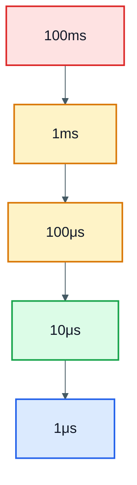
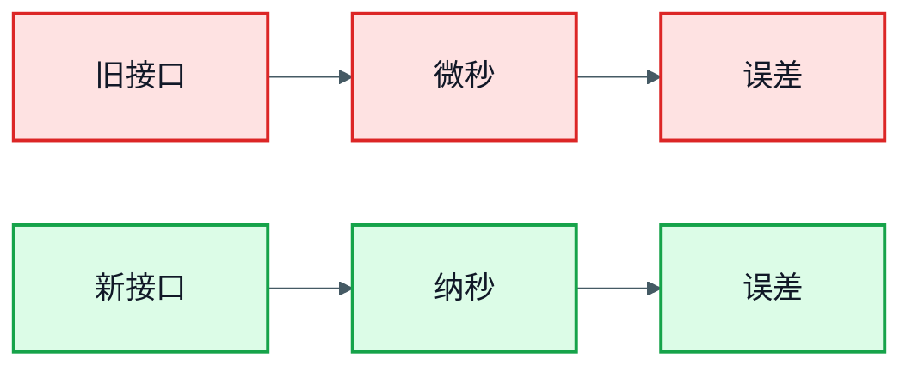

# PTP 精度优化：从毫秒到微秒，哪些杠杆真的有用

> **概述：** PTP 精度不是靠一个参数调出来的。代码里的时间结构、数据通路的缓冲对齐、网卡和 PHY 的时间戳能力、丢包环境下的恢复能力、长时间运行后的 socket 状态，都会把最终误差拉高或压低。本文把五类工程杠杆的真实效果、代价和适用条件拆开，回答“哪些必须做，哪些是噪音”。

本文基于一套车载传感器平台的实测。主时钟是 Linux 侧的 `ptp4l`，从时钟是传感器里的 PTP 进程，链路经过普通交换机，时间戳以硬件时间戳为主、软件时间戳作对照。平台细节做了脱敏，但精度数字、缓冲区大小和长稳现象保持原样。

阅读时先记住一件事：**精度是一个分布，不是一个均值。** 均值 13 μs、偶尔跳到 5 ms 的链路，比均值 20 μs、最大 30 μs 的链路更危险。

## 1. 精度目标：均值、p99 和最坏值

先把目标说清楚。不同精度区间对应不同的硬件和软件方案，不能拿一个“微秒级”口号概括所有场景。

| 精度区间 | 典型来源 | 适用场景 |
| --- | --- | --- |
| 100 ms 至 10 ms | 操作系统调度抖动、软件时间戳 | 日志、低速状态上报 |
| 10 ms 至 1 ms | 软中断延迟、普通网卡 | 低频传感器、事件回溯 |
| 1 ms 至 100 μs | 软件时间戳 + 普通 PHY | 入门级多传感器对齐 |
| 100 μs 至 1 μs | 硬件时间戳 + 良好 PHY | 主流车载传感器 |
| 1 μs 以下 | 硬件时间戳 + 透明时钟 + 高精度 PHY | 高精度测量、部分激光雷达 |

这套平台记录到两组数字：软件时钟直连、均值约 13 μs；主时钟用硬时钟、链路走二层直传、从时钟侧仍由系统时钟维持，均值约 1.5 μs。后者依赖主时钟、PHY、拓扑和负载，不能直接写成产品规格。



图中从左到右，硬件要求逐级提高：软件时间戳、普通网卡、硬件时间戳、良好 PHY、透明时钟。每往右走一格，成本和调试难度都会上升。

验收指标至少要有三个：

- **p50**：典型误差，判断大部分时间是否正常。
- **p99**：尾部误差，判断业务 worst case 是否可接受。
- **最大值和失锁次数**：判断是否会出现偶发跳变。

只看均值，很容易把“偶尔跳 5 ms”优化成“均值好看，但业务不可用”。

## 2. 代码层：timeval 到 timespec

### 2.1 微秒结构丢掉了纳秒

早期 `ptp4l` 代码用 `timeval` 保存时间：

```c
struct timeval {
    time_t      tv_sec;   /* 秒 */
    suseconds_t tv_usec;  /* 微秒 */
};
```

硬件时间戳本身是纳秒级，但一旦转成 `timeval`，微秒以下的位就被截掉。后续计算 offset 时，误差会被放大，尤其是在主从偏差很小、链路抖动也很小的时候。

### 2.2 换成纳秒结构

把 `timeval` 换成 `timespec`，用 `clock_gettime(CLOCK_REALTIME, &ts)` 取代 `gettimeofday(&tv, NULL)`：

```c
struct timespec {
    time_t tv_sec;   /* 秒 */
    long   tv_nsec;  /* 纳秒 */
};
```

```c
struct timespec ts;

if (clock_gettime(CLOCK_REALTIME, &ts) == -1) {
    /* 记录错误，不要静默继续 */
}
```

收益很直接：

- 内部计算的精度天花板从 1 μs 提升到 1 ns。
- 端到端 offset 均值通常能从两位数微秒压到一位数微秒。
- 代价接近零，现代 Linux 上 `clock_gettime` 走 vDSO（用户态直接读取），不会每次陷入内核。



这一步属于“零代价的精度提升”，但它只解决计算精度，不解决时间戳来源。硬件时间戳本身不准，换成纳秒结构也只是把错误算得更细。

### 2.3 什么时候不值得改

如果系统本来就用软件时间戳，误差在几百微秒到毫秒级，`timeval` 的 1 μs 截断不是主要矛盾。先把时间戳路径、PHY 和队列问题解决，再回来改结构，收益更明显。

## 3. 数据流层：DMA 缓冲全链路对齐

### 3.1 一个“性能优化”引发的 PTP 抖动

这套平台出现过一次很难解释的现象：PTP 状态在锁定和未锁定之间来回跳，`offset` 偶尔冲到毫秒级。PTP 配置没改，主时钟也没动。

根因不在 PTP 协议栈，而在数据通路：

- 点云服务把读取粒度从 128 KB 改成 64 KB，想降低单次处理延迟。
- 传感器侧的 DMA 缓冲区仍然是 128 KB。
- 每次只读 64 KB，剩下 64 KB 触发下一次读取和重试。
- CPU 被拖在数据面，PTP 报文处理被挤占。
- 同步状态开始跳变，offset 抖动到毫秒级。

把 DMA 缓冲区也改成 64 KB 后，读取对齐，重试消失，PTP 状态恢复稳定，offset 均值回到 13 μs。


### 3.2 为什么影响这么大

PTP 报文本身很小，但它需要稳定的 CPU 时间片和低排队延迟。数据面每次读取只拿一半，会触发额外的中断、重试和缓存失效；这些开销不一定体现在 PTP 进程的 CPU 占用上，却会把 PTP 线程的调度延迟拉长。

这类问题很难从 PTP 日志里直接看出来，因为日志只会告诉你“offset 变大了”，不会告诉你“数据面在反复读半个缓冲”。

### 3.3 全链路对齐原则

改数据通路的任何一段，都要检查下面这些地方是否同步：

- DMA 缓冲区大小。
- 应用读取粒度。
- 共享内存布局。
- 寄存器宽度和帧头长度。
- 队列深度和满队列策略。

只改一处，其他层仍按旧尺寸工作，就会出现“优化了 A，结果 B 变差”的现象。

## 4. 调度与硬件：优先级、PHY 和硬件时间戳

### 4.1 提高进程优先级，通常不是第一步

一个常见假设是：把 PTP 进程优先级提到最高，报文处理更快，精度就会更好。这套平台的实测是否定的：

| 优先级 | 同步方式 | 主时钟 | offset 均值 |
| --- | --- | --- | --- |
| 20（默认） | 软时钟 | 硬时钟主时钟 | 13 μs |
| -46（高） | 软时钟 | 硬时钟主时钟 | 14 μs |

差异在噪声范围内。原因不复杂：已经使用硬件时间戳时，报文在网卡侧就打上了时间，进程调度只影响“什么时候读到这个时间戳”，不影响时间戳本身。PHY 和链路带来的抖动，往往比调度延迟更大。

优先级在两类场景下仍然有用：

- 使用软件时间戳（例如 `-S` 模式），时间戳由进程读取，调度延迟直接进入误差。
- 多核竞争激烈，PTP 线程会被数据面或日志线程挤占。

### 4.2 硬件时间戳是数量级的杠杆

软件时间戳的误差包含中断响应、协议栈排队和线程调度；硬件时间戳在 MAC 或 PHY 侧记录报文进出时刻，绕开了这些软件路径。

先确认网卡能力：

```bash
ethtool -T eth0
```

输出里应能看到 `hardware-transmit`、`hardware-receive` 和 `hardware-raw-clock`。只有软件时间戳时，不要承诺微秒级绝对精度。

硬件时间戳的上限还受 PHY 和链路影响：

- PHY 的收发延迟是否对称。
- 线缆和变压器是否引入固定偏差。
- 交换机是否支持透明时钟，能否补偿驻留时间。
- 网卡驱动是否真的把硬件时间戳传给了应用。

### 4.3 透明时钟和传输方式

普通交换机只转发报文，不修正驻留时间；透明时钟会把报文在交换机内排队的时间写进修正字段。多级交换、车载以太网、多从时钟场景，透明时钟的价值更明显。

传输方式也会影响精度：二层直传绕开 IP 协议栈，路径更短；UDP 单播适合跨网段，但经过的协议层更多。选型要看现场网络，不要只看实验室数字。

## 5. 鲁棒性与长稳：丢包、socket ack 和 31 小时

### 5.1 先让系统在丢包下不崩

精度优化的另一面是鲁棒性。一个在理想环境 1 μs、丢包就崩溃的系统，不如一个在 20% 丢包下仍能保持 100 μs 的系统。

可以用一台 Linux 中转机做网桥，在 `FORWARD` 链上模拟丢包：

```bash
brctl addbr br0
brctl addif br0 eno1
brctl addif br0 enxf8e43b7483ab
ip addr add 10.42.0.50/24 dev br0
ip link set up dev br0

iptables -I FORWARD -s 10.42.0.101 \
    -m statistic --mode random --probability 0.2 -j DROP
```

至少测 1%、5%、20% 三档丢包，记录：

- PTP 从失锁到恢复的时间。
- offset 的 p99 和最大值。
- 业务时间戳的异常比例。
- LOST 告警是否在合理时间内触发。

### 5.2 31 小时才复发的 socket 问题

这套平台还遇到过一个长稳问题：运行 30 多小时后，PTP 报 LOST，重启 `ptp4l` 才能恢复。

排查发现，`ptp4l` 每秒向本地应用发 8 次请求，应用每次回 6 字节的 `done\n\n`。旧代码只发送、不接收应答，ack 在 TCP 接收队列里持续累积：

```text
8 次/秒 × 6 字节 = 48 字节/秒
5.23 MB ÷ 48 字节/秒 ≈ 31 小时
```

Recv-Q 满了以后，应用回复失败，`ptp4l` 不再发新请求，授时中断。修复是显式接收 ack：

```c
char buf[16];
ssize_t n = recv(sock, buf, sizeof(buf), MSG_DONTWAIT);

if (n <= 0 || strncmp(buf, "done\n\n", 6) != 0) {
    reset_socket();
}
```


修复后把请求频率提高到 1024 次/秒，跑了 1700 万次，Recv-Q 始终为 0；同时把两个 CPU 核打到 95% 负载，PTP 仍然正常。

这类 bug 的特点是“短测发现不了”。1 小时、24 小时、72 小时三档长稳，是发现累积型问题的基本手段。

## 6. 组合拳：优先级、反模式与验收清单

### 6.1 杠杆优先级

| 杠杆 | 成本 | 收益 | 建议 |
| --- | --- | --- | --- |
| timeval 改 timespec | 低 | 中 | 必做 |
| 硬件时间戳 | 高 | 高 | 必做（硬件支持时） |
| DMA 缓冲对齐 | 中 | 高 | 必做 |
| socket ack 处理 | 低 | 高 | 必做 |
| 进程优先级 | 低 | 低 | 可选 |
| 丢包环境模拟 | 中 | 高 | 必做 |
| 透明时钟 | 高 | 中 | 视拓扑 |
| 单播/多播选择 | 中 | 中 | 视现场 |


### 6.2 四个反模式

- **只追最低均值**：从 13 μs 压到 11 μs，可能换来更大的尾部抖动。
- **只看均值不看分布**：偶尔跳到 5 ms，比均值稍差但分布稳定更危险。
- **只测理想环境**：不搭丢包、不搭高 CPU、不搭多从时钟，等于在真空里做设计。
- **优化时不看抓包**：报文丢了 5%、时间戳跳了 10 μs，看数字会误判。

### 6.3 验收清单

1. 时间结构已经用 `timespec`，不是 `timeval`。
2. `ethtool -T` 确认硬件时间戳能力；没有硬件时间戳时，规格书不写微秒级。
3. DMA 缓冲、读取粒度、共享内存布局已经对齐。
4. PTP 线程在单核竞争或软件时间戳场景下有足够优先级。
5. 丢包 1%、5%、20% 下都测过恢复时间和 p99。
6. socket ack 有显式 `recv`，Recv-Q 不会持续增长。
7. 24 小时和 72 小时长稳通过。
8. 记录 p50、p99、最大值和失锁次数。
9. 每次优化前后都有 baseline，配置和版本可追溯。
10. 业务时间戳的质量字段能反映 `OK`、`DEGRADED`、`INVALID`。

PTP 精度优化没有单一开关。先把时间戳来源和数据通路修好，再谈调度和参数；先把鲁棒性和长稳做出来，再追更小的均值。顺序对了，微秒级才有意义。

### 参考资料

- [linuxptp 文档](https://linuxptp.nwtime.org/documentation/)
- [Linux kernel: Timestamping](https://docs.kernel.org/networking/timestamping.html)
- [Linux kernel: PTP hardware clock infrastructure](https://docs.kernel.org/driver-api/ptp.html)
- [IEEE 1588-2019 标准概述](https://standards.ieee.org/ieee/1588/6825/)

### 相关文章

- [PTP 网络模块设计：车载传感器的授时链路](https://deguiliu.github.io/tech-notes/posts/architecture/ptp_network_module_design/)
- [GNSS 与 PTP 时间同步原理：嵌入式软件工程师视角](https://deguiliu.github.io/tech-notes/posts/architecture/gnss_ptp_time_sync_principles/)
- [QNX 上的 PTPD 授时精度验证：从 8 ms 时间戳台阶到百微秒级](https://deguiliu.github.io/tech-notes/posts/performance/qnx_ptpd_time_sync_accuracy/)
