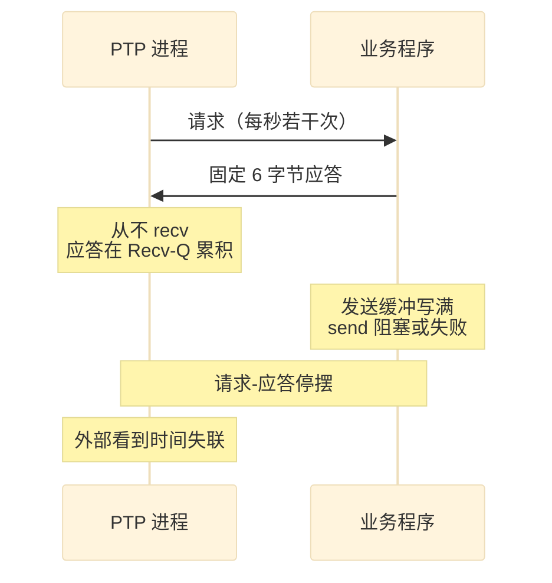
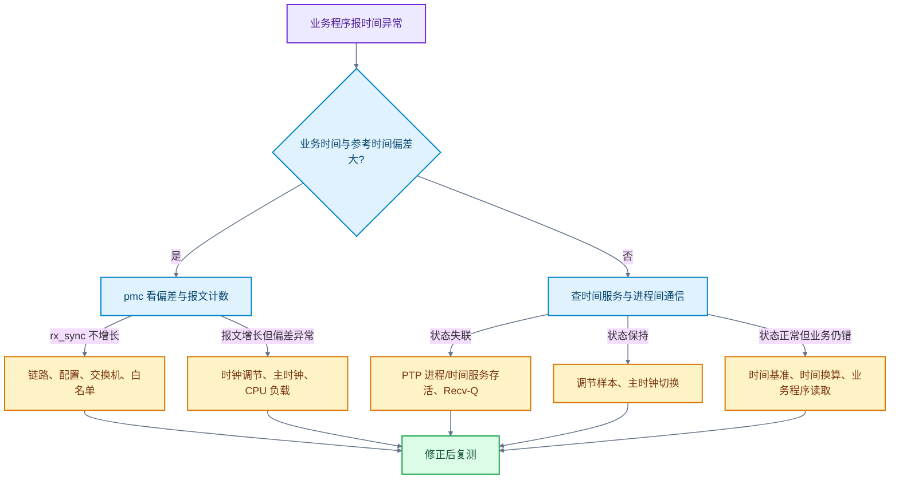
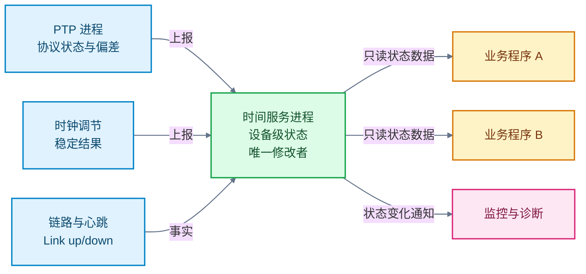
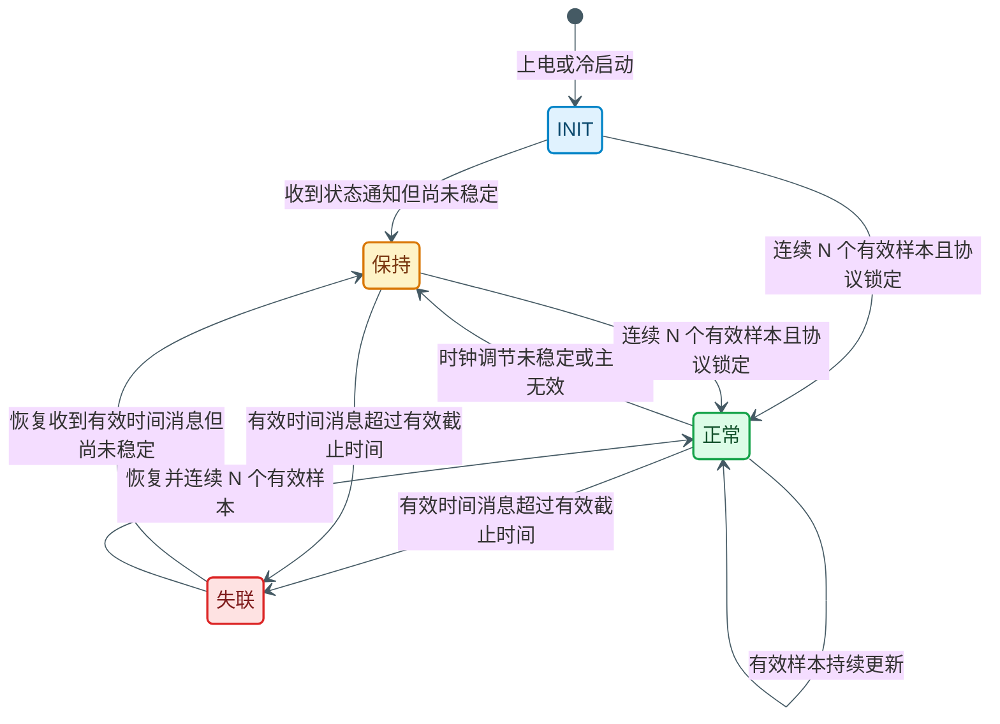

# PTP 时间同步排查：状态正常，业务时间为什么仍不可用

> **概述：** 设备显示“PTP 已锁定”，采样时间戳却仍有偏差；抓包能看到 Sync 和 Follow_Up，业务程序却报告时间失联。这两种现象都说明：**同步状态** 和 **时间可用性** 不是同一个判断。本文先交代一台示例设备的授时链路，再用三个现场案例说明怎样分段排查，最后讨论状态和跨进程状态管理应该怎么改。本文把应用层状态归成“正常、保持、失联”三类；你的设备可能叫 `SYNC_OK`、`TIME_VALID`、`HOLDOVER`，名称不同，判断链路是一样的。

这套示例设备是一台嵌入式传感器，内部至少运行三个进程：PTP 进程、时间服务进程、业务程序。PTP 进程负责收报文和估计偏差；时间服务进程负责把时间发给业务程序；业务程序用时间给采样数据打时间戳。三个进程之间的状态并不天然一致，现场问题也往往出在这里。

先统一几个叫法，后面不再反复解释：

- **PTP 进程**：指 `ptp4l`、`ptpd2` 这类负责收 PTP 报文、算偏差的后台程序。
- **时间服务进程**：指把时间发给业务程序的那个进程。
- **业务程序**：指最终用时间给采样数据打戳的程序。
- **完整状态数据**：指一次读走的一整份状态，避免读到一半被别的进程改掉。
- **时钟调节**：指根据主从偏差调整本地时钟的频率和相位。

下面把带时间和偏差的消息叫 **时间消息**，把只报告锁定状态、主时钟信息的消息叫 **状态通知**。不同实现的命名不同，按这个语义对应即可。

## 1. 现象：同步状态和时间可用性不是一回事

现场常见两类互相矛盾的现象：

| 现象 | 设备看到的状态 | 业务看到的结果 |
| --- | --- | --- |
| 状态正常，时间仍有偏差 | `SYNC_OK` 或 `TIME_VALID` | 采样时间戳偏几十微秒到几毫秒 |
| 报文正常，业务却报失联 | PTP 报文计数在增长 | 时间服务不再更新，业务停用时间戳 |

第一类问题说明：状态只能回答“时间服务认为能不能用”，不能回答“业务拿到的时间准不准”。第二类问题说明：网络授时和设备内部的时间传递是两段链路，前一段正常，不代表后一段正常。

本文把应用层状态归成三类：

| 状态 | 含义 | 业务上怎么用 |
| --- | --- | --- |
| `正常` | 协议锁定，时间可用 | 时间戳可用，但仍要看偏差和连续性 |
| `保持` | 暂未锁定，本地时钟短时继续走 | 慎用，时间可观察，但主从可能已经不同步 |
| `失联` | 没有有效时间消息 | 不可用，采样时间戳不可信 |

这三类不是 IEEE 1588 的状态编号，而是给业务判断“能不能用”的最小集合。协议层和时钟调节层还有更细的状态，后面会说明为什么没有全部暴露出来。

### 1.1 为什么只归成三种状态

三种状态的划分标准是业务可用性，不是协议完整性：

- **正常**：协议已锁定，时钟调节稳定，状态数据没有过期，业务可以正常使用时间。
- **保持**：协议暂时没有锁定，或者主时钟正在切换；本地时钟还能短时继续走，业务可以读时间，但不应该无条件信任。
- **失联**：超过有效时间没有收到有效时间消息，本地时间已经不能代表时间源，业务必须停用。

协议层实际有 `INIT`、`LISTENING`、`UNCALIBRATED`、`SLAVE`、`MASTER`、`FAULTY` 等状态，时钟调节层也有“样本不足、正在稳定、发生跳变”等细分状态。把它们全部暴露给业务，业务很难判断该不该用时间。工程上常见的做法是：内部保留细状态，对外只发布“正常、保持、失联”，具体原因放进原因字段。

如果设备需要在启动、切主、保持、故障之间做更细的控制，可以在内部多拆几种状态；对外仍然可以归并成这三类。三种不是标准答案，而是本文建议的最小对外集合。

先问三个问题，后面的排查才有落点：

1. 设备说的“同步正常”是哪一层的判断，协议层、时钟调节层，还是业务接口？
2. 业务程序读的是系统时间、网卡硬件时钟，还是时间服务进程发布的另一份完整状态数据？
3. 网络报文正常时，设备内部的时间通道是否也在正常更新？

## 2. 示例设备：PTP 在做什么，时间怎么送到业务

在画链路之前，先补三块背景：PTP 在算什么、时间戳在哪打、Linux 下几个程序怎么分工。

### 2.1 PTP 在算什么

主时钟是网络里被选为时间源的设备，其他设备是从时钟。PTP 不是把主时钟的时间直接抄给从设备。报文在路上要花时间，主从时钟走得也不一样快。PTP 要估计两件事：

- 当前差多少，也就是偏差（offset）。
- 走得快慢差多少，也就是频率偏差。

以常见的双步（Follow_Up 携带发送时刻）、端到端（E2E）测量为例，主从之间交换四个时刻：

| 时刻 | 事件 | 谁记录 |
| --- | --- | --- |
| `t1` | 主时钟发出 Sync | 主时钟 |
| `t2` | 从设备收到 Sync | 从时钟 |
| `t3` | 从设备发出 Delay_Req | 从时钟 |
| `t4` | 主时钟收到 Delay_Req | 主时钟 |

忽略上下行路径不对称时，偏差可以写成：

```text
offset = [(t2 - t1) - (t4 - t3)] / 2
```

所以时间戳准不准、上下行延迟是否对称，都会进入结果。PTP 进程会持续采样，不是收到一帧就锁定；这也解释了后面为什么“样本不足”会让状态回到“保持”。

### 2.2 时间戳在哪打

| 时间戳来源 | 记录的时刻 | 工程上要注意 |
| --- | --- | --- |
| 应用读当前时间 | 应用处理报文的时刻 | 不是报文到达网卡的时刻，排队和调度会算进去 |
| 内核软件时间戳 | 内核或驱动处理报文时 | 比应用读早，但仍在软件路径里 |
| MAC/PHY 硬件时间戳 | 报文实际进出网卡 | 最接近链路，需要网卡和驱动支持 |

支持硬件时间戳的网卡通常带一个硬件时钟，也就是 PHC（PTP Hardware Clock）。PTP 进程用 PHC 记录报文时刻并调整它；`phc2sys` 可以把 PHC 同步到系统时间；`pmc` 用来查询状态；`date` 读的是系统时间。这四条路径不是一回事。

如果业务程序读系统时间，而 `phc2sys` 没跑或没同步，PTP 显示锁定也不代表 `date` 对。排查时先确认业务程序读的是哪一个时钟，再看对应的工具。

### 2.3 示例设备的原状


图 1　示例设备的原状。网络授时和设备内时间传递是两段链路，PTP 进程与业务程序之间还有一条自定义请求-应答通道。

这张图是示例设备的原状，不是推荐架构；推荐的状态管理方式放在第 5 章。

第一段是网络授时：主时钟发 Sync、Follow_Up 等报文，网卡或 PHY 记录报文进出时刻，PTP 进程估计主从偏差，调整网卡硬件时钟或系统时间。硬件时间戳、软件时间戳和 `phc2sys` 的部署方式不同，这一段的具体路径也不同。

第二段是设备内传递：PTP 进程把状态、偏差和时间交给时间服务进程，时间服务进程再发给业务程序。业务程序不一定直接读系统时间；在这台示例设备里，业务程序读的是时间服务进程发布的一份完整状态数据，另外还有一条请求-应答通道用于状态交互。

把两段分开看，就能解释很多“报文正常但业务失联”的现象：`pmc` 能读到偏差，只证明第一段和 PTP 进程还在工作；业务程序是否拿到时间，还要看第二段。

所以，“网络对时正常”只说明第一段正常。业务程序仍可能因为时间服务状态没更新、进程间通信积压或业务程序退出而拿不到时间；排查时不要把 `pmc` 正常当成整条链路正常。

### 2.4 观测点

| 观测点 | 在哪执行 | 能证明什么 | 不能证明什么 |
| --- | --- | --- | --- |
| `date` | 设备系统 | 系统时间与参考时间的偏差量级 | PTP 协议是否锁定 |
| `pmc port_stats_np` | PTP 进程 | 报文是否到达 PTP 进程 | 时间服务进程是否收到完整状态数据 |
| `pmc time_status_np` | PTP 进程 | PTP 进程看到的偏差和主时钟信息 | 业务程序拿到的时间是否可用 |
| 状态查询接口 | 时间服务进程 | 时间服务进程对外发布的状态 | PTP 协议层内部的真实原因 |
| `tcpdump` | 网卡或交换机镜像口 | 链路上有没有 PTP 报文 | 报文有没有被 PTP 进程处理 |
| `Recv-Q` / 重连计数 | PTP 进程与业务程序之间 | 内部通道是否积压 | PTP 报文是否丢失 |

## 3. 三个现场案例

每个案例都按同一顺序展开：原来怎么连接，最先观察到什么，哪项检查缩小了范围，修改后怎么验证。

### 3.1 缓冲读写粒度不一致：状态在“正常”和“保持”之间跳

**原来怎么连接。** 处理端从采集端的 DMA 缓冲读取数据，PTP 进程和处理任务共享 CPU。处理端把单次读取粒度减半，但采集端的缓冲仍按原大小配置。

**最先观察到什么。** PTP 状态在“正常”和“保持”之间以百毫秒级周期跳变；PTP 进程日志里，时钟调节算法频繁报样本不足；相邻 Sync 的间隔大约翻倍；CPU 占用明显波动。

**哪项检查缩小了范围。** PTP 参数没有改动，改回缓冲配置后状态恢复，说明问题不在协议参数，而在业务读取路径。处理端每次只读一半，剩余数据触发重试，重试占用 CPU，PTP 进程的报文处理被延迟，时钟调节算法拿不到足够样本，状态被压回“保持”。

**修改后怎么验证。** 把 DMA 缓冲和读取粒度同步调整后，状态稳定在“正常”，现场记录的平均偏差在十微秒量级。这个数值只对应这套测试条件，不能当成所有平台的通用精度。当时没有采集线程调度跟踪，所以“PTP 进程抢不到 CPU”是合理解释，不是已经证实的完整因果链；已确认的是缓冲配置不一致，以及修改后状态恢复。

这个案例的教训不是“所有缓冲大小必须相等”，而是：**读写双方对格式、边界和单次读取大小的约定要一起改。**

### 3.2 授上了，但固定偏 37 秒

UTC 和 TAI 是两套时间尺度：UTC 有闰秒，TAI 没有。到目前为止，TAI − UTC = 37 秒。PTP 报文可以携带 UTC 偏移；如果主时钟和从设备对“当前用哪套时间尺度”理解不一致，就会出现固定整数秒的偏差。

**原来怎么连接。** 主时钟通过 PTP 给设备授时，业务程序读系统时间。现场同时能看到 PTP 状态“正常”和 `pmc` 显示的小偏差。

**最先观察到什么。** 设备 `date` 显示的时间和主时钟的 UTC 时间固定差 37 秒，不是随机漂移。

**哪项检查缩小了范围。** `clockdiff` 显示固定整数秒偏差，基本可以排除网络抖动。继续查时间基准：系统时间按 UTC 理解，网卡硬件时钟可能按 TAI 计时。announce 是主时钟周期性广播自身状态和 UTC 偏移的报文；如果它携带 UTC 偏移 37，而从设备又按这个值做补偿，就可能把 37 秒重复加一次。

**修改后怎么验证。** 让两端使用同一套时间基准：确认 `ptpTimescale` 是 UTC 还是 TAI，检查 `ptp4l` 启动参数是否带 `-O 0`，再把 `utc_offset` 配成与主时钟一致的值。修改后 `clockdiff` 不再出现固定 37 秒，业务使用的时间与主时钟一致。

这里要区分两个对象：设备时间指 `date` 或业务程序读到的系统时间，主时钟时间指主时钟的 UTC 时间。`pmc` 的偏差小，只说明主从协议估计接近；如果时间基准定义不同，业务使用的时间仍可能整秒偏差。

### 3.3 运行约 30 小时后失联：Recv-Q 慢慢涨满

TCP 是字节流。`Recv-Q` 表示已经到达、但应用还没读走的字节数。发送方只发不读，接收队列就会一直涨；队列满后，对端的 `send` 会阻塞或失败，形成背压。

**原来怎么连接。** 除了标准 PTP 报文，示例设备的 PTP 进程还维护一条本机请求-应答通道，用来和业务程序交换时间与状态。这条通道不是标准 PTP 报文。

**最先观察到什么。** 现场运行 30 多小时后报 PTP 失联，必须下电或重启 PTP 进程才能恢复。`pmc get port_stats_np` 正常，说明 PTP 报文交互没有断；`netstat -ant` 显示 PTP 进程与业务程序之间的 TCP socket 的 `Recv-Q` 持续增长，最大到数 MB。

**哪项检查缩小了范围。** PTP 报文正常，排除网络和主时钟；`Recv-Q` 增长，把问题指向进程间通信。PTP 进程只发请求、不读应答，应答在自己的接收队列里累积；队列满后，业务程序的 `send` 阻塞或失败，停止处理新请求；PTP 进程的发送队列随后也满，停止发送，时间通道整体停摆。



图 2　应答未读取导致的长时失联。PTP 报文正常，不代表 PTP 进程与业务程序之间的时间通道正常。

**修改后怎么验证。** 在 PTP 进程里显式读取业务程序的应答，并处理“一次读到半条或多条应答”的情况；缓冲区写满时丢弃无法识别的数据并重新同步。修复后把同步频率提高到约 1000 次/秒做加速测试，累计千万次，`Recv-Q` 始终为 0；再给 CPU 加上接近满负载的压力，时间传递仍然正常。加速测试不能代替长时间运行、温度变化和偶发断链测试。

## 4. 通用排查：先分段，再选工具

### 4.1 三段判断

| 段 | 先看什么 | 在哪执行 | 正常长什么样 | 异常指向 |
| --- | --- | --- | --- | --- |
| 网络与协议 | `pmc port_stats_np` | PTP 进程 | Sync 计数（`rx_sync`）持续增长 | 链路、配置、交换机、白名单 |
| 时钟调节 | `pmc time_status_np` | PTP 进程 | 主从偏差（`master_offset`）小且稳定 | 主时钟、调节样本、CPU 负载 |
| 设备内传递 | 状态查询接口、`Recv-Q` | 时间服务进程 / 进程间通信 | 状态持续更新，队列不增长 | 时间服务、业务程序、进程间通信 |

常用命令和判读如下。命令旁边的“在哪执行”比命令本身更重要：

`pmc` 是 linuxptp 自带的管理工具，用来向 PTP 进程查询状态；`clockdiff` 用来比较两台机器的时间差；`ss`/`netstat` 用来看 socket 队列。

| 命令 | 在哪执行 | 看什么 | 典型异常 |
| --- | --- | --- | --- |
| `date` | 设备系统 | 当前系统时间 | 明显不是当前时间，先别调 PTP 参数 |
| `pmc -u -b1 -f <ptp-config> 'get port_stats_np'` | PTP 进程 | `rx_sync` 等计数 | 计数不增长，先查链路和配置 |
| `pmc -u -b1 -f <ptp-config> 'get time_status_np'` | PTP 进程 | `master_offset`、主时钟信息 | 偏差很大，或多次采样不变 |
| `clockdiff <sensor-ip>` | 主时钟侧或设备侧 | 与对端的偏差形态 | 固定整数秒、毫秒级跳动、`down` |
| `ss -tanp` / `netstat -ant` | PTP 进程所在设备 | `Recv-Q`、连接状态 | 队列持续增长，连接反复重建 |
| `tcpdump -i eth0 -nn 'ether proto 0x88f7'` | 网卡或镜像口 | Sync、Follow_Up、Delay_Req | 只有单向报文，或完全没有报文 |
| 状态查询接口 | 时间服务进程 | 应用层状态、原因、最后更新时间 | 状态长期不变，或与 `pmc` 矛盾 |

`0x88F7` 是 PTP 的以太网类型；PTP 走 UDP 时使用 319 和 320 端口。抓包前先确认现场用的是二层还是 UDP 封装，别抓错过滤器。

### 4.2 判断路径



图 3　从业务现象回到链路的判断路径。业务程序报告失联、但协议偏差正常时，直接走“时间服务与进程间通信”分支。

### 4.3 八种症状先看哪一段

| 症状 | 先看哪段 | 下一步 |
| --- | --- | --- |
| 完全授不上时 | 网络与协议 | `pmc port_stats_np` 看 `rx_sync` 是否增长 |
| 授上但偏 37 秒 | 时间基准 | `clockdiff` 看是否为固定整数秒 |
| 授上但偏 8 小时 | 时间基准 | 查 UTC 与本地时区是否混用 |
| 授上但抖动到毫秒 | 时钟调节/负载 | 看偏差分布、CPU 占用和报文间隔 |
| 长时间运行后偶发失联 | 设备内传递 | 看 `Recv-Q`、重连计数和业务时间更新 |
| `rogue peer delay response` 后静默 | 网络 | 抓 `0x88F7`，查交换机是否支持 gPTP |
| `received ... without timestamp` | 网络/驱动 | 查网卡初始化和上下电时序 |
| 多从设备建立同步超过 1 分钟 | 网络 | 抓 pdelay 报文，查交换机转发 |

## 5. 状态设计改进：只让一个进程改状态

三个案例暴露的不只是 PTP 参数问题，还有状态管理问题。案例原有实现有四个典型缺陷：

| 原实现的问题 | 现象 | 后果 |
| --- | --- | --- |
| 时间消息和状态通知都能改同一个状态 | 一个把状态拉回“正常”，另一个又压回“保持” | 状态抖动，日志无法解释 |
| 状态只有一个字段 | 协议、时钟调节、链路、进程间通信的状态被压在一起 | 看到“保持”或“失联”不知道先查哪层 |
| 状态没有有效期和启动批次 | 进程重启或通道积压后仍可能沿用旧值 | 业务程序拿着过期时间继续打戳 |
| 业务程序各自判断状态 | PTP 进程、时间服务、业务程序各有一份判断 | 监控页面和业务实际使用的时间不一致 |

改动方向不是把所有状态塞进一个巨大的状态机，而是分层：

- 各模块只上报自己看到的情况：协议是否锁定、时钟调节是否稳定、链路是否通、进程心跳是否正常。
- 时间服务进程统一汇总、防抖、判超时和恢复，只有它能改设备级状态。
- 业务程序只读时间服务进程发布的一份完整状态数据，不自己拼状态。



图 4　只让一个进程改状态。各模块只上报自己看到的情况，时间服务进程统一汇总，业务程序只读完整状态数据。

建议规则要写清楚，不能和原实现混着解释：

| 状态 | 原实现 | 建议规则 |
| --- | --- | --- |
| `正常` | 收到有效时间消息，映射建立 | 协议锁定、时钟调节稳定、连续 `N` 个有效样本、状态数据未过期 |
| `保持` | 协议报告未锁定，时间消息可能仍在更新 | 短时保持或正在稳定，时间仍可观察，但业务不应无条件信任 |
| `失联` | 超过 30 秒没有 PTP 数据 | 有效时间消息超过有效截止时间 |

建议规则里，“保持”同时承担短时保持（holdover）和正在稳定的角色。没有保持能力的平台可以把保持时间设为 0，链路断开就直接进入“失联”；有保持能力时，先让业务程序知道“时间还在，但不可信”，超过有效截止时间再停用。



图 5　建议规则下的应用层状态机。“正常”需要连续 `N` 个有效样本，“失联”只由有效时间消息超过有效截止时间触发。

图中的 `N` 不是 1。单条消息只能说明链路还在，不能说明时钟已经稳定；`N` 由同步周期和调节算法决定。启动阶段如果没有有效时间消息，也要按有效截止时间进入“失联”；状态通知只更新原因，不能把设备从“失联”拉回来。

这套设计不需要另外做一套投票或选主。PTP 协议自己会选主时钟，设备级状态只需要一个本地汇总者。

## 6. 边界与结论

“正常”不是精度证书，“保持”也不是“完全不可用”。前者只表示时间服务进程认为状态数据可用，后者表示协议层还没确认锁定但时间消息可能仍在更新。两者都不能替代偏差分布和业务使用时间的验收，也不能用同一条告警规则处理“保持”和“失联”。

30 秒是应用层阈值，不是 PTP 标准。阈值可以按产品需求调整，但要留出数个同步周期和重传、恢复的时间。不同实现、不同配置模式的状态路径也不同，监控规则要基于实际配置、通知路径和超时参数，不能拿一个现场的经验直接套到另一个现场。

性能优化要全链路对齐。DMA 缓冲、读取粒度、共享内存布局、寄存器宽度，任何一处改动都可能改变 PTP 的报文处理节奏。约 30 小时才复发的 `Recv-Q` 问题，靠 1 小时测试发现不了；改完一项，至少复测状态稳定性和时间传递，并安排覆盖已知故障周期的长稳测试。

## 附录 A：工业设备常见的时间同步位置

| 场景 | 常见同步方式 | 传感器侧做什么 | 状态怎么暴露 |
| --- | --- | --- | --- |
| 工业以太网端站 | IEEE 802.1AS / gPTP | PHY 或 MAC 附近打时间戳，端站参与同步 | 同步状态、主时钟标识、偏差 |
| PROFINET IRT 设备 | PROFINET 专用时间同步 | 按周期同步，诊断上报 | 同步丢失、设备诊断 |
| EtherCAT 从站 | Distributed Clocks | 本地时钟与参考时钟对齐 | 工作时钟与同步状态 |
| IO-Link 传感器 | 通常由 master 打时间戳 | 传感器本身不跑 PTP | master 或 PLC 记录时间 |
| 普通模拟量/数字量传感器 | 采集模块打时间戳 | 传感器不参与网络对时 | 采集模块状态 |

共同点不是状态名称相同，而是三层分离：时间戳尽量靠近硬件生成，协议栈负责估计偏差，应用只读一个带有效期的状态。小体积传感器通常把时间戳放在采集端或主站，而不是在传感器里跑完整 PTP。

## 附录 B：状态数据字段与进程间通信读取要点

时间服务进程发布的一份完整状态数据至少要有这些字段：

| 字段 | 作用 |
| --- | --- |
| `seq` | 版本号，判断读取期间状态数据有没有被改写 |
| `state` | `正常/保持/失联`，由协议状态、时钟调节状态和数据新鲜度共同决定 |
| `reason` | 原因码，例如无主时钟、调节样本不足、链路断开、通道超时 |
| `since` | 进入当前状态的单调时刻 |
| `epoch` | 时间服务启动或时钟源切换的启动批次号 |
| `last_time_msg_at` | 最后一条有效时间消息的单调时刻；状态通知不刷新它 |
| `valid_until` | `last_time_msg_at + timeout`，超过后进入“失联” |

进程间通信读取有三条底线：

1. `recv` 前先检查缓冲区是否已满，避免把 `recv(..., 0, ...)` 的返回值 0 误判成对端关闭。
2. 一次读取可能拿到半条或多条应答，必须按完整帧解析；缓冲区写满且无法识别时，丢弃并重新同步。
3. `EAGAIN`/`EWOULDBLOCK`、`EINTR`、连接关闭和真正的错误要分开处理；生产代码建议使用环形缓冲区。

### 参考资料

- [LinuxPTP: ptp4l](https://linuxptp.nwtime.org/documentation/ptp4l/)，端口状态、时钟调节配置和时间戳选项。
- [LinuxPTP: pmc](https://linuxptp.nwtime.org/documentation/pmc/)，`time_status_np`、`port_stats_np` 等管理查询。
- [IEEE 1588-2019](https://standards.ieee.org/ieee/1588/6825/)，PTP 协议标准与状态定义。
- [IEEE 802.1AS](https://www.ieee802.org/1/pages/802.1as.html)，时间敏感网络中的 gPTP 时间同步。
- [IEC/IEEE 60802](https://1.ieee802.org/tsn/iec-ieee-60802/)，工业自动化 TSN 配置与时间同步选项。
- [Linux kernel: Timestamping](https://docs.kernel.org/networking/timestamping.html)，硬件时间戳与软件时间戳的生成和获取方式。

### 延伸阅读

- [PTP 网络模块设计：车载传感器的授时链路](https://deguiliu.github.io/tech-notes/posts/architecture/ptp_network_module_design/)
- [GNSS 与 PTP 时间同步原理](https://deguiliu.github.io/tech-notes/posts/architecture/gnss_ptp_time_sync_principles/)
- [QNX 上的 PTPD 授时精度验证](https://deguiliu.github.io/tech-notes/posts/performance/qnx_ptpd_time_sync_accuracy/)
- [PTP 授时精度优化：时间戳、链路不对称与系统干扰](https://deguiliu.github.io/tech-notes/posts/performance/ptp_precision_optimization/)
