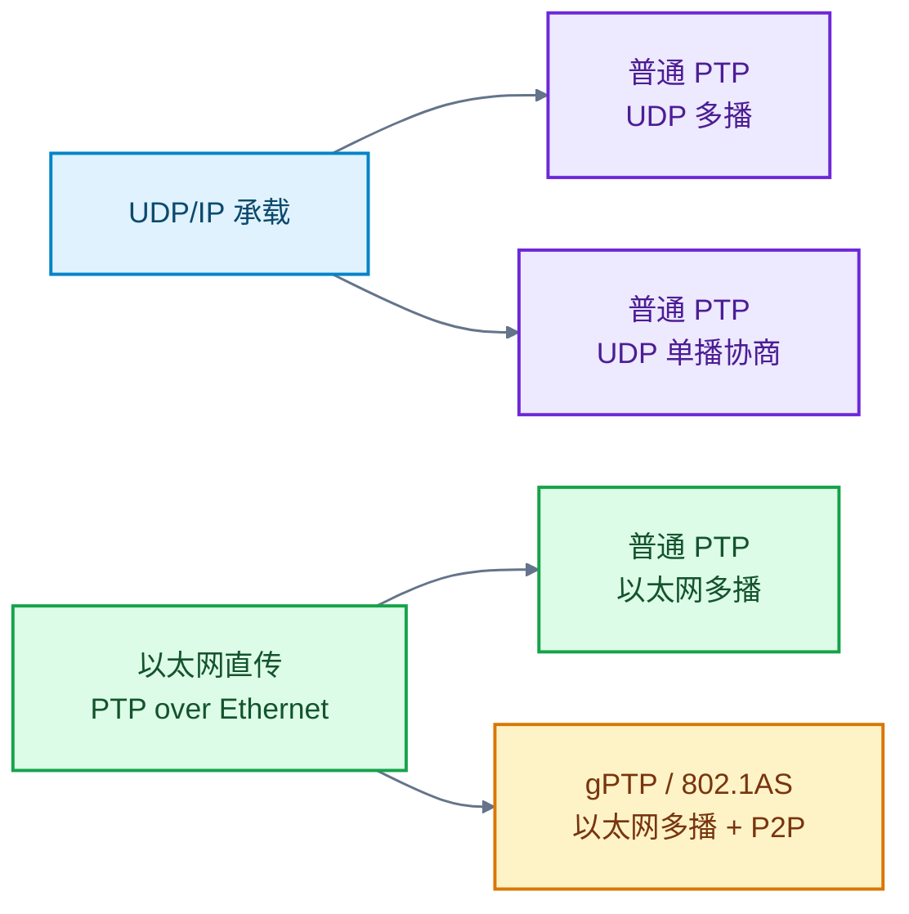
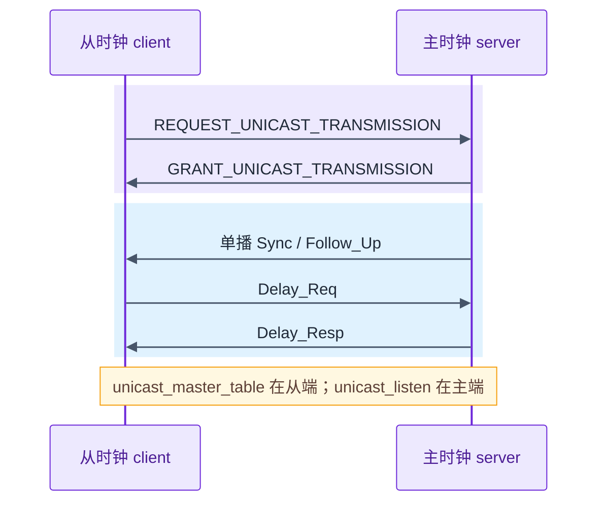
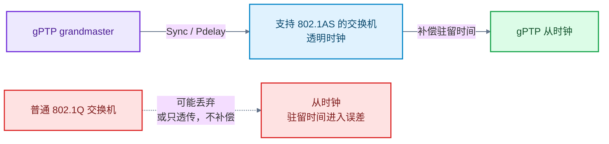
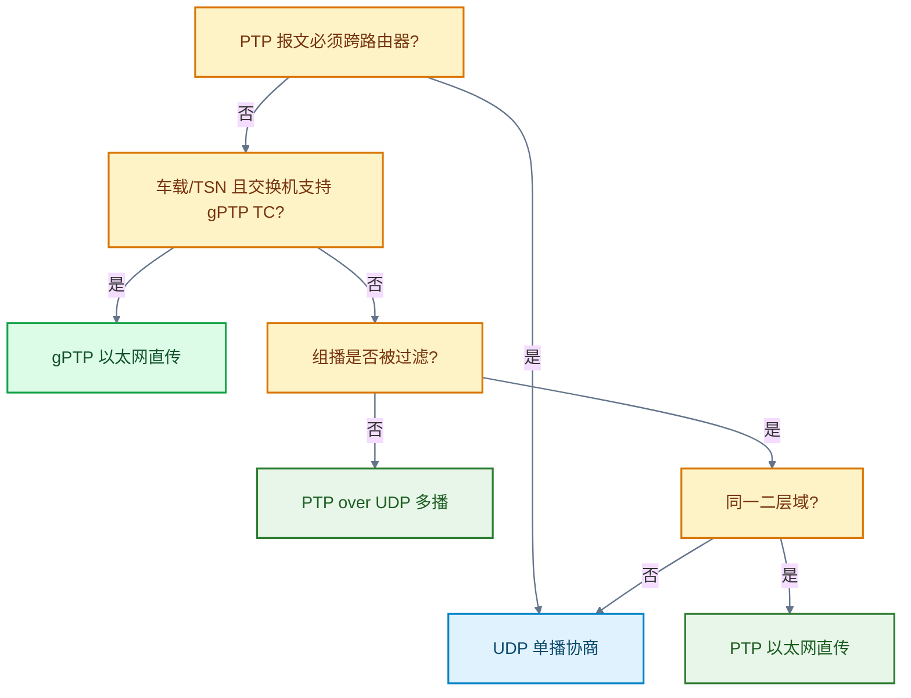

# PTP 传输模式怎么选：单播、gPTP 与以太网直传

> **概述：** 单播、gPTP、以太网直传（常被简写成 L2）经常被并列成三种“模式”，但它们不在同一层：单播/多播是寻址方式，UDP/IP 与以太网直传是承载方式，gPTP 是 IEEE 802.1AS profile。选型先看网络能不能转发 PTP 报文、是否跨路由、交换机是否支持透明时钟，再看时间戳和精度要求。本文用四个实测场景说明各选项的边界，重点不是给协议排高低。

目标读者是熟悉 C/Linux、做过嵌入式网络或时间同步的工程师。文中配置以 LinuxPTP 的 `ptp4l` 为例，地址使用文档保留网段，实际部署时替换为现场地址。

## 1. 先把三个词拆开

“PTP 单播”“PTP 以太网直传（PTP over Ethernet，常简写 L2）”“gPTP”经常混在一起说，实际分别回答不同问题：

先解释本文里的 L2：它指 OSI 第二层（数据链路层），在这里特指 **PTP 报文直接装进以太网帧，不经过 IP 和 UDP**。更直观的叫法是“以太网直传”或“PTP over Ethernet”。下面第一次出现时写“以太网直传（L2）”，之后简称“以太网直传”。

| 维度 | 选项 | 影响 |
| --- | --- | --- |
| 承载方式 | UDP/IPv4、UDP/IPv6、以太网直传（L2） | 能否跨路由、经过哪些协议栈、受哪类过滤规则影响 |
| 寻址与发现 | 多播、单播协商 | 交换机是否放行、主时钟是否要为每个从时钟维护状态 |
| PTP profile | 普通 PTP、gPTP（802.1AS） | 延迟测量机制、透明时钟行为、BMCA 和互操作要求 |

因此，不能说“以太网直传比单播准”或“gPTP 一定比普通 PTP 准”。以太网直传只是承载方式；gPTP 也不是普通以太网直传的加速版。gPTP 规定了 P2P 延迟测量、透明时钟和车载/TSN 网络中的角色行为。

两种封装的区别可以直观看成：

| 封装方式 | 以太网帧里有什么 | 能否跨路由 | 抓包过滤 |
| --- | --- | --- | --- |
| PTP over UDP/IPv4 | 以太网头 + IP 头 + UDP 头 + PTP 报文 | 可以 | `udp port 319 or udp port 320` |
| PTP 以太网直传 | 以太网头 + PTP 报文 | 不可以 | `ether proto 0x88f7` |

这里说的“二层域”，指同一个广播域：报文不经过路由器，只经过交换机或直连。



图 1　承载方式（UDP/IP 或以太网直传）、寻址方式和 PTP profile 的关系。实际部署通常选择一条组合，不是三个互斥选项。

普通 PTP 以太网直传和 gPTP 都走以太网多播，但目的 MAC、延迟机制和交换机要求不同。普通 PTP 以太网直传默认使用 `01:1B:19:00:00:00`；gPTP 使用 `01:80:C2:00:00:0E`，并以 P2P 延迟测量和透明时钟为主。`01:1B:19` 通常会被普通网桥转发，`01:80:C2` 属于 IEEE 802.1 保留地址，普通 802.1Q 网桥可能直接丢弃。

举个现场例子：交换机只放行指定 UDP 端口，PTP 组播被 ACL 丢弃；这时即使 gPTP 的逐跳机制更合适，报文到不了从端也没有意义。反过来说，交换机允许多播、网络只有一个二层域，选以太网直传也不会自动获得更高精度，仍然要检查时间戳来源。

选型时先画网络边界：哪些设备在同一二层域，PTP 帧经过哪些交换机，哪些设备需要跨路由。边界画清楚，单播、以太网直传、gPTP 的适用条件就基本确定了。

把组合画出来后，选型问题就变成两个：报文能不能到，以及网络设备能不能补偿时间。协议名字本身不提供答案。

## 2. 单播 PTP：先解决报文能不能到

### 2.1 什么时候需要单播

单播适合两类网络：组播被交换机或防火墙过滤，或者主时钟和从时钟跨网段，需要经过路由器。单播把 PTP 报文从“发给同一组播组”改成“按地址发给指定对端”，代价是主时钟要维护每个从时钟的会话。

单播不会自动提高时间戳精度。单播改变的是报文送达路径和过滤条件；时间戳仍然取决于 MAC/PHY 硬件、驱动和本地时钟。

如果现场只是过滤 UDP 端口，但允许以太网帧，PTP 以太网直传也可能比单播更直接。前提仍是同一二层域，并且交换机放行 PTP 的 EtherType 和目的 MAC。

单播的代价不在协议本身，而在运维：地址表、授权时长、主时钟切换都要有确定的维护方式。设备数量少时这不是问题，几十个从端时就会变成配置管理问题。

### 2.2 协商过程

LinuxPTP 的单播发现由从时钟发起。从时钟在 `[unicast_master_table]` 中列出候选主时钟，主时钟通过 `unicast_listen` 接受请求并授权；之后 Sync、Announce、Delay_Resp 可以按授权周期走单播。

使用单播后，每个从端要知道需要找哪个主时钟，主端要知道允许谁请求。地址变化、NAT 或主时钟切换时，配置和状态都要同步更新。授权还有期限，`unicast_req_duration` 到期前要续约，否则单播流会中断。



图 2　单播协商的关键角色。候选主时钟表放在从时钟侧，主时钟只负责接受请求和授权。

### 2.3 配置要点

主时钟需要允许单播请求。下面的片段只保留与单播有关的选项：

```ini
[global]
serverOnly                 1
unicast_listen             1
hybrid_e2e                 1
inhibit_multicast_service  1
```

从时钟需要列出候选主时钟，并在端口上引用这张表：

```ini
[global]
clientOnly                 1
unicast_req_duration       60
hybrid_e2e                 1

[unicast_master_table]
table_id                   1
UDPv4                      192.0.2.10

[eth0]
unicast_master_table       1
```

这里最容易写反：`unicast_master_table` 是**从时钟的候选主时钟表**，不是主时钟的客户端列表。主时钟如果没有 `unicast_listen 1`，从时钟发来的请求不会被授权，现象通常是“配置看起来没问题，但一直收不到单播 Sync”。

`hybrid_e2e` 和 `inhibit_multicast_service` 也不是一回事。`hybrid_e2e` 让 Delay_Req/Delay_Resp 使用单播地址；`inhibit_multicast_service` 禁止多播发送。只打开一个选项，可能只完成了一半的单播改造。

### 2.4 代价

- 主时钟要为每个从时钟维护授权状态，客户端数量受内存和实现限制；
- 配置比多播多，主从两端都要对齐地址、角色和版本；
- 跨路由时还要处理 NAT、防火墙和端口可达性；
- 精度收益取决于时间戳路径，不能把“改成单播”当成精度优化。

| 维度 | 多播 | 单播 |
| --- | --- | --- |
| 发现方式 | 主时钟发 Announce，从端监听 | 从端查 `unicast_master_table` 并请求 |
| 主端状态 | 不按客户端维护 | 按从端维护授权 |
| 网络边界 | 通常同一子网 | 可跨路由，需处理端口和 NAT |
| 配置量 | 较少 | 较多，主从两端要对齐 |
| 精度 | 由时间戳和链路决定 | 同样由时间戳和链路决定 |

## 3. gPTP：为车载和 TSN 网络准备的 profile

### 3.1 它解决什么

gPTP（IEEE 802.1AS）是一个 PTP profile。gPTP 使用以太网多播、P2P 延迟测量和透明时钟（TC），让交换机在转发 PTP 报文时补偿驻留时间。车载以太网和时间敏感网络（TSN）采用 gPTP，是因为网络设备也参与时间传递，而不只是两端终端对时。

802.1AS 默认通过 BMCA 选择 grandmaster；部分车载 profile 会关闭 BMCA，改用静态主从角色，减少启动时的选举时间。透明时钟转发报文时，把驻留时间写入 correctionField，从端计算偏差时再扣除。普通交换机没有这一步，排队时间就会进入误差。

P2P 只测相邻节点之间的链路，端到端误差由每一跳累加；TC 的作用是把每跳驻留时间记下来，而不是让终端时间戳自动变准。



图 3　gPTP 的逐跳时间传递。透明时钟补偿驻留时间；普通 802.1Q 网桥可能丢弃保留组播帧，即使透传也不补偿。

gPTP 网络里常见两类设备：端节点和桥接设备。TC 只补偿驻留时间，不终结 PTP 会话；BC（Boundary Clock）终结并重新生成报文。选交换机时先确认设备类型：TC、BC 还是普通转发，三者行为不同。

### 3.2 配置要点

gPTP 的关键不是把 `network_transport` 改成 `L2`，而是同时选对 profile 规定的选项。配置里的 `L2` 是 linuxptp 的取值名，含义就是“PTP 走以太网帧”：

```ini
[global]
network_transport         L2
delay_mechanism           P2P
transportSpecific         0x1
ptp_dst_mac               01:80:C2:00:00:0E
neighborPropDelayThresh   800000
```

`neighborPropDelayThresh` 的单位是纳秒。不同 profile 和链路假设会用不同门限，例如 800（0.8 μs）或 800000（0.8 ms）；linuxptp 的默认值也随版本和配置而变，部署前应查对应版本的 `ptp4l(8)`，不要直接照搬。

gPTP 的配置项多，但不要把所有选项都打开。先确认网络是固定主从还是 BMCA 选举，再决定角色和 `syncReceiptTimeout` 等超时；否则容易把启动慢误判为链路故障。

### 3.3 代价

- 多跳网络需要支持 gPTP/TC 的交换机；普通 802.1Q 网桥可能直接丢弃 `01:80:C2` 帧，即使透传也不会补偿驻留时间；
- 不支持 gPTP 的交换机可能带来 rogue peer delay response、静默重试或多从时钟互相干扰；
- 配置项比普通 PTP 多，主从角色、BMCA、P2P 和 MAC 地址要一起核对；
- gPTP 不会自动把终端时间戳变成硬件时间戳，终端侧能力仍然要单独确认。

| 条件 | 结果 |
| --- | --- |
| 交换机支持 802.1AS/TC | 驻留时间可补偿，多跳误差更容易控制 |
| 普通 802.1Q 交换机 | 可能丢弃保留组播帧；若透传也不补偿，驻留时间进入误差 |
| 终端没有硬件时间戳 | 终端误差仍可能主导 |
| 非车载/TSN 网络 | gPTP 的配置和交换机成本可能高于收益 |

## 4. PTP 以太网直传：不经过 IP 的传输

PTP 以太网直传（常写作 PTP over Ethernet，linuxptp 配置里叫 `L2`）只是把 PTP 报文直接装进以太网帧。普通 PTP 报文使用多播 MAC `01:1B:19:00:00:00`，gPTP 使用 `01:80:C2:00:00:0E`。延迟机制仍可选普通 PTP 的 E2E 或 P2P；以太网直传不是 gPTP 的同义词。

适合的场景很明确：同一二层域、没有 IP 协议栈、或者 IP 层过滤规则难以绕开。以太网直传不经过 IP 层，能避开一部分 iptables/路由问题，但仍然受交换机 MAC、EtherType 和 VLAN 配置影响。它不能跨路由器，这是选型时必须先确认的边界。

抓包时不能只看 UDP 319/320；以太网直传要用 `tcpdump ether proto 0x88F7`。如果网络有 VLAN，还要确认 PTP 帧的 VLAN 标记和交换机转发策略。

少一层 IP 协议栈不等于自动更准。如果时间戳仍在应用层读取，省下的协议栈延迟可能远小于调度抖动。

以太网直传也不等于没有配置。VLAN 划分、优先级标记和交换机 ACL 都会影响 PTP 帧；如果现场有路由器、NAT 或三层隔离，先确认 PTP 帧能否通过。两端直连、没有交换机时，以太网直传的路径最简单；一旦加入多级交换，就要重新评估驻留时间和交换机能力。

```ini
[global]
network_transport         L2
delay_mechanism           E2E
```

一组实测中，硬件主时钟、从设备软件时间戳、直连、PTP 以太网直传的 `offset` 均值约为 1.5 μs。这个数字不能单独归因于以太网直传：主时钟是硬件时间戳，链路是直连，从设备仍是软件时间戳。三个条件一起决定了结果。把 1.5 μs 和另一组“硬件主从 + gPTP 交换机”的 100 μs 量级直接比较，会得出错误结论。

## 5. 四个实测场景能说明什么

| 场景 | 主/从时间戳 | 网络 | 模式 | 观测结果 |
| --- | --- | --- | --- | --- |
| A | 软/软 | 普通交换机 | PTP over UDP 多播 | 1 ms 量级 |
| B | 软/软 | 普通交换机 | PTP over UDP 单播 | 与 A 相当 |
| C | 硬/硬 | gPTP 交换机 | gPTP | 100 μs 量级 |
| D | 硬/软 | 直连 | PTP 以太网直传 | 约 1.5 μs |

这四组是部署场景，不是一组严格控制变量的实验。

A 和 B 的主从设备、时间戳和网络相同，只改变寻址方式，可以用来说明“单播没有带来可见的精度提升”。C 和 D 同时改变了时间戳、拓扑和传输模式，不能把 D 的优势全部归给以太网直传。

如果要做受控比较，至少固定主从时间戳、链路拓扑、交换机能力和负载，一次只改变寻址方式或承载层。否则得到的只是“这套部署的观测值”，不能直接外推到模式本身。

记录条件至少包括主从时间戳、链路拓扑、交换机能力、业务负载和测试时长。缺少这些条件，1 ms、100 μs、1.5 μs 只能当作某次部署的观测值。

对比的目的不是给模式排名，而是确认某个改动是否解决了当前网络的具体问题。

真正能下的结论是：单播解决可达性，gPTP 解决逐跳驻留时间补偿，以太网直传解决同一二层域内不依赖 IP 的传输。三者都能工作，但解决的问题不同。

## 6. 选型顺序



图 4　PTP 传输模式的选型顺序。先判断网络边界，再判断交换机能力。

把现场条件代入下表：

| 现场条件 | 优先选择 | 先确认 |
| --- | --- | --- |
| 同一二层域，多播可达 | PTP over UDP 多播 | 交换机 ACL、IGMP |
| 多播被过滤，仍在同一二层域 | PTP 以太网直传或 UDP 单播 | EtherType/MAC、地址 |
| 必须跨路由 | UDP 单播协商 | 端口、NAT、路由 |
| 车载、TSN、需要逐跳补偿 | gPTP 以太网直传 | 交换机支持 802.1AS/TC |
| 没有 IP 协议栈 | PTP 以太网直传 | 交换机 MAC、VLAN |

先确认网络边界，再看交换机能力，最后看终端时间戳。传输模式不能替代硬件时间戳。

## 7. 常见配置错误

排查时先抓包确认报文是否存在，再看单播是否授权，再看 gPTP 交换机是否补偿驻留时间，最后才检查时间戳和 servo。顺序反了，容易把网络问题当成时钟算法问题。

| 错误 | 现象 | 修正 |
| --- | --- | --- |
| 把 `unicast_master_table` 配在主时钟 | 从时钟没有候选主时钟，单播会话建立不起来 | 表放在从端，主端开 `unicast_listen` |
| 主时钟没有 `unicast_listen 1` | 请求没有授权，收不到单播 Sync | 在主时钟端口打开单播监听 |
| 只开 `hybrid_e2e` 就认为已是纯单播 | 发现或部分报文仍可能走多播 | 明确多播策略，必要时打开 `inhibit_multicast_service` |
| 把以太网直传当成 gPTP | 没有 P2P、TC 或 gPTP 的 MAC/角色配置 | 选普通 PTP 的 E2E/P2P，或完整配置 gPTP profile |
| gPTP 网络里混用普通交换机 | 驻留时间未补偿，出现抖动或静默重试 | 换支持 gPTP/TC 的交换机，或退回普通 PTP |
| 跨 profile 照搬 `neighborPropDelayThresh` | 端口被判为不具备 802.1AS 能力，或门限过宽 | 先确认 profile；标准 802.1AS 常用 800000 ns，部分 automotive profile 用 800 ns |
| 让以太网直传跨路由器 | 报文无法到达对端 | 改用 UDP 单播或边界时钟 |

## 8. 结论

- 网络允许多播时，普通 PTP over UDP 多播是默认起点，配置和维护成本最低。
- 单播用于过滤组播或跨网段的网络，价值在可达性和可控性，不在精度。
- gPTP 用于车载、TSN 或需要逐跳透明时钟补偿的网络，前提是交换机支持 802.1AS/TC。
- PTP 以太网直传适合同一二层域和不依赖 IP 的节点，不能跨路由器。
- 1 ms、100 μs、1.5 μs 这些结果都带着时间戳、拓扑和设备条件；换一组条件，排序可能完全不同。
- 网络拓扑或交换机能力变化后，原来的选型结论要重新验证。

### 术语

- **BMCA**：Best Master Clock Algorithm，主时钟选举算法。
- **E2E**：End-to-End，端到端延迟测量。
- **P2P**：Peer-to-Peer，邻居到邻居延迟测量。
- **TC**：Transparent Clock，透明时钟交换机，补偿报文驻留时间。
- **gPTP**：IEEE 802.1AS profile，不等同于“任意 PTP 以太网直传”。

### 参考资料

- [LinuxPTP：ptp4l 配置](https://linuxptp.nwtime.org/documentation/ptp4l/)
- [LinuxPTP：单播从时钟示例](https://www.linuxptp.org/documentation/configs/unicast-slave)
- [Linux kernel：Timestamping](https://docs.kernel.org/networking/timestamping.html)
- [LinuxPTP：phc2sys](https://linuxptp.nwtime.org/documentation/phc2sys/)

### 延伸阅读

- [PTP 网络模块设计：车载传感器的授时链路](https://deguiliu.github.io/tech-notes/posts/architecture/ptp_network_module_design/)
- [GNSS 与 PTP 时间同步原理](https://deguiliu.github.io/tech-notes/posts/architecture/gnss_ptp_time_sync_principles/)
- [PTP 授时精度优化：时间戳、链路不对称与系统干扰](https://deguiliu.github.io/tech-notes/posts/performance/ptp_precision_optimization/)
- [PTP 时间同步排查：状态正常，业务时间为什么仍不可用](https://deguiliu.github.io/tech-notes/posts/performance/ptp_state_machine_field_troubleshooting/)
