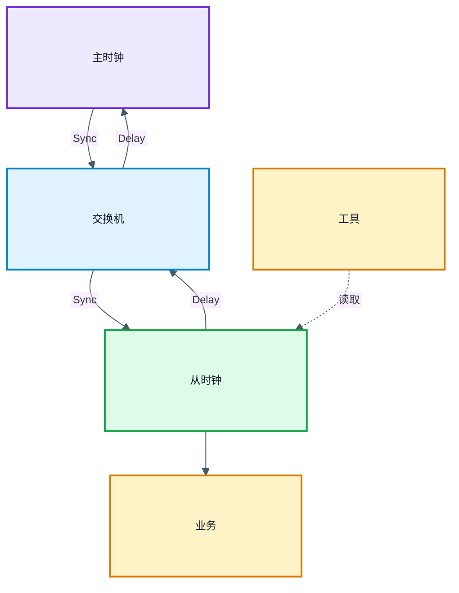
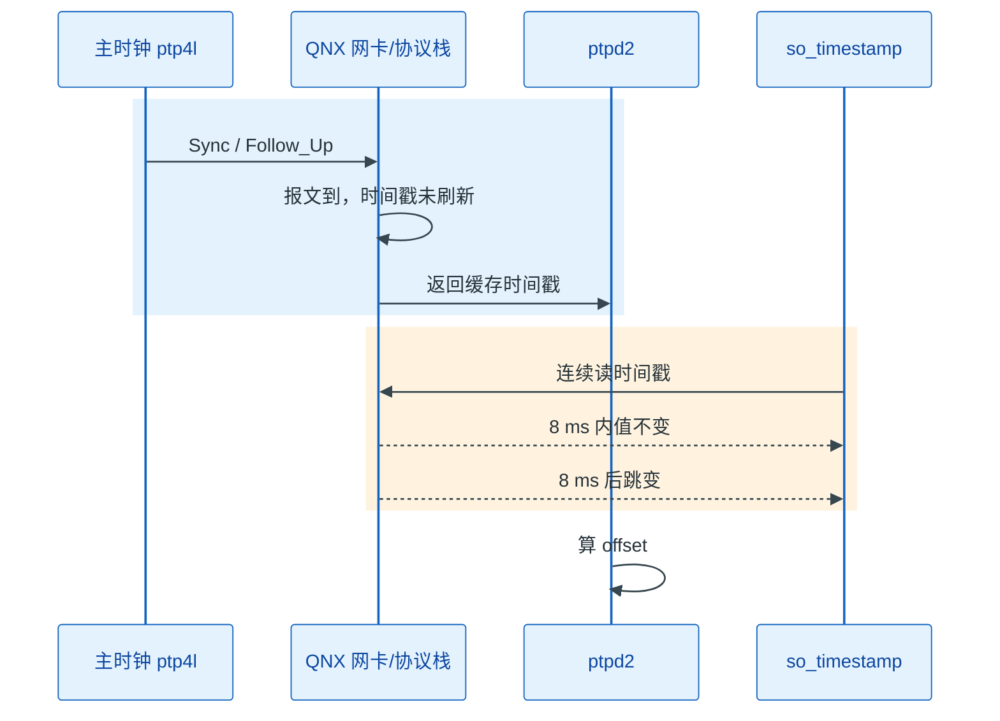
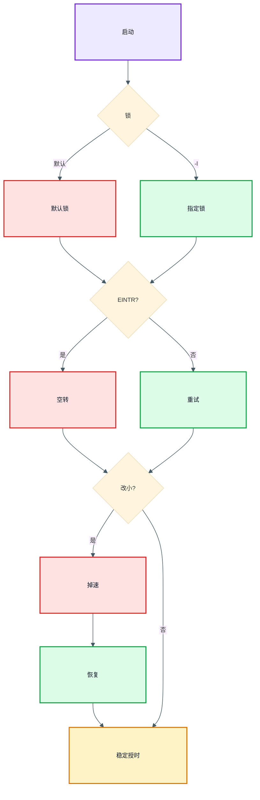
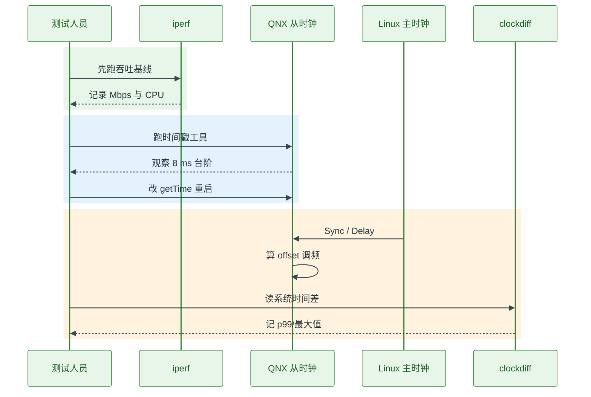
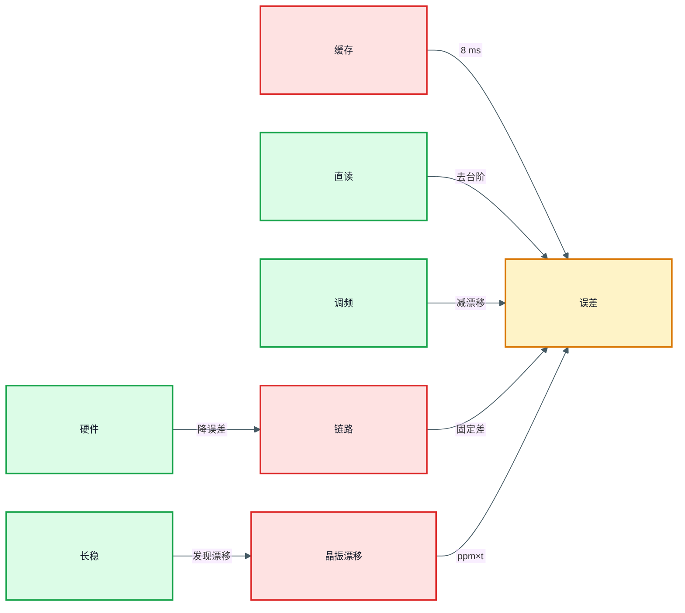

# QNX 上的 PTPD 授时精度验证：从 8 ms 时间戳台阶到微秒级

> **概述：** QNX 上跑 `ptpd2` 做 PTP 从时钟，协议显示锁定，不代表时间戳可信。这套平台的原生 socket 时间戳大约每 8 ms 才更新一次，`offset` 会走成台阶；把事件报文的时间戳改成直接读 `CLOCK_REALTIME`，再修掉文件锁、`select` 被信号打断和 `ClockPeriod` 的副作用，`clockdiff` 可以落到几十到几百微秒。本文给出完整的验证方法、误差分解和上线检查表。

本文基于一套车载传感器平台的实测：Linux 侧的 `ptp4l` 当主时钟，QNX 侧的 `ptpd2` 当从时钟，延迟测量使用端到端模式（E2E）。平台细节做了脱敏，但命令、代码路径和误差量级保持原样。

阅读前只需要知道：PTP 用来让主从时钟对齐；`ptpd2` 是 QNX 上运行的从时钟进程；`ClockAdjust` 和 `ClockPeriod` 是 QNX 提供的时钟与内核节拍接口。

## 1. 平台与问题：为什么不能照搬 Linux 经验

这套验证的目标不是“让 `ptpd2` 进程跑起来”，而是回答三个问题：

1. 从时钟收到的时间戳，究竟是报文到达网卡的时刻，还是应用程序读取系统时钟的时刻。
2. 协议锁定后，绝对误差有多大，误差是时间戳、调度、网络还是晶振造成的。
3. 调整 QNX 时钟和内核节拍后，精度与网络吞吐能不能同时保住。

平台角色如下：

| 角色 | 平台 | 作用 |
| --- | --- | --- |
| 主时钟 | Linux + `ptp4l` | 提供基准时间，周期发送 Sync/Follow_Up |
| 从时钟 | QNX + `ptpd2` | 接收对时报文，调整本地时钟 |
| 被测业务 | QNX 应用 | 读取时间、记录事件、验证误差 |
| 测量工具 | `clockdiff`、`so_timestamp`、`iperf` | 看时间差、时间戳台阶和网络吞吐 |



图中 Sync 包含 Follow_Up，Delay 包含 Delay_Req/Delay_Resp；工具指 clockdiff 和 iperf。

QNX 与 Linux 的差异，最后都落在四个地方：

- 文件系统权限：QNX 的 `/var/run` 不一定允许普通用户写，`ptpd2` 的默认锁文件会卡住启动。
- 信号与系统调用：QNX 的定时器和信号更容易打断 `select`，不处理 `EINTR` 就会“看起来在监听，实际不收包”。
- 内核节拍：QNX 的网络栈和 `ClockPeriod` 耦合，改小 tick 会影响吞吐。
- 时间戳路径：QNX 的 socket 时间戳有更新周期，不是每次 `recv` 都能拿到“刚刚”的时间。

## 2. 时间戳路径：8 ms 台阶从哪里来

### 2.1 原生路径：从 socket 拿时间戳

原生 `ptpd2` 通过 socket 时间戳路径获取事件报文的收发时刻。QNX 上这条路径不是“报文一到就更新”，而是由内核按固定周期刷新。实测中，`so_timestamp.c` 连续读取同一个 socket 的时间戳，看到的现象是：一段时间内返回值不变，大约每 8 ms 跳一次。



这条路径的问题不是“时间戳有噪声”，而是“时间戳被量化成 8 ms 的台阶”。PTP 每次 Sync 都会算一次 offset；时间戳不变时，offset 看起来稳定，时间戳一跳，offset 跟着跳。伺服算法看到的是锯齿波，容易做出过大的频率修正，严重时直接触发 step。

### 2.2 直接读取系统时钟

这套平台把事件报文的时间戳改成在 `getTime()` 里直接读系统时钟：

```c
void getTime(TimeInternal *time)
{
    struct timespec tp_now;

    if (clock_gettime(CLOCK_REALTIME, &tp_now)) {
        perror("clock_gettime");
        exit(EXIT_FAILURE);
    }

    time->seconds = tp_now.tv_sec;
    time->nanoseconds = tp_now.tv_nsec;
}
```

这段代码解决的是“socket 时间戳缓存太旧”的问题：每次处理事件报文时，时间戳至少是当前时刻，不会再出现 8 ms 内固定不变的值。

但它不是硬件时间戳。`getTime()` 在 `ptpd2` 处理报文时执行，仍然包含中断响应、协议栈排队和线程调度延迟。它适合用来消除 QNX 的 8 ms 缓存台阶，不能用来宣称“已经达到硬件时间戳精度”。如果 MAC/PHY 支持硬件时间戳，优先使用硬件时间戳；没有硬件时间戳时，再考虑直接读系统时钟。

### 2.3 台阶对伺服的影响


图中 0、8ms、跳变、16ms 表示同一个时间戳值从保持到跳变的过程。

在这套平台的原始路径下，最佳条件也看到约 10 ms 量级的最小误差。8 ms 是时间戳更新周期，10 ms 是叠加调度和网络后的结果，两者不矛盾。改造后，`clockdiff` 记录的偏差落到几十到几百微秒，不超过 1 ms。

## 3. 三个移植坑：文件锁、EINTR、ClockPeriod

### 3.1 文件锁路径无权限

现象很直接：`ptpd2` 在 Linux 上能启动，交叉编译到 QNX 后卡在“初始化文件锁”。原因是 `ptpd2` 默认把锁文件放在 `/var/run/ptpd.lock`，而 QNX 上运行用户对 `/var/run` 没有写权限。

修复是启动时用 `-l` 指定可写路径：

```bash
/tmp/ptpd2 -C -E -s -V -i eth0 -l /mnt/ptpd.lock
```

参数含义：

- `-C`：前台运行，方便看日志。
- `-E`：端到端延迟测量。
- `-s`：只做从时钟。
- `-V`：详细日志。
- `-i eth0`：指定网卡。
- `-l /mnt/ptpd.lock`：把锁文件放到可写分区。

在 QNX 上，`/mnt` 往往是用户可写的持久化分区。启动脚本里要写绝对路径，不要依赖当前工作目录。

### 3.2 select 被信号打断

第二个坑更隐蔽：进程在运行，日志停在“监听”，主时钟报文到了网卡，但 `ptpd2` 不处理。

`ptpd` 的主循环会走到 `netSelect()`，里面调用 `select()` 等报文。QNX 的信号和定时器可能让 `select()` 返回 `-1`，`errno = EINTR`。旧代码遇到 `EINTR` 直接 `return 0`，上层以为“这次没有报文”，主循环继续空转，于是永远拿不到包。

修复是重试：

```c
int netSelect(...)
{
    fd_set readfds;
    int rv;

    do {
        FD_ZERO(&readfds);
        FD_SET(sock_fd, &readfds);
        rv = select(sock_fd + 1, &readfds, NULL, NULL, NULL);
    } while (rv < 0 && errno == EINTR);

    if (rv < 0) {
        return -1;
    }
    return rv;
}
```

判断标准很简单：如果日志一直停在监听、`tcpdump` 能看到 Sync、但 `ptpd2` 没有处理记录，先查 `EINTR`，不要先怀疑主时钟。

### 3.3 ClockPeriod 影响网络吞吐

第三个坑是副作用：改小 QNX 的 `ClockPeriod` 可以提高时间戳分辨率，但也会改变网络栈的节拍。

现象是 `iperf` 从 600+ Mbps 掉到 500+ Mbps，关掉 PTP 后恢复。单独跑一个只调用 `ClockPeriod` 的 demo，也能复现掉速；把周期改回 1 ms，吞吐恢复。

```c
struct _clockperiod period = {0};

period.nsec = 100000;  /* 100 us */
period.fract = 0;
ClockPeriod(CLOCK_REALTIME, &period, NULL, 0);
```

根因不复杂：tick 变小，定时器中断更频繁，网卡驱动的轮询和网络栈 batching 变短，CPU 占用上升，吞吐下降。修复有四个方向：

- 只在 PTP 关键区临时调整 `ClockPeriod`，平时恢复 1 ms。
- 用硬件时间戳，绕开对 tick 的依赖。
- 与网卡驱动协商，让网络栈适配更小的 tick。
- 如果精度目标允许，保留 1 ms tick，接受较小的分辨率。



图中“默认锁”指 `/var/run/ptpd.lock`，“指定锁”指 `-l /mnt/ptpd.lock`。

## 4. 精度验证：工具、步骤与结果

只跑一次 `clockdiff` 不够。验证要同时看“时间戳是否跳台阶”“协议是否锁定”“系统时间差多少”“调频后是否稳定”“网络吞吐有没有被拖垮”。

| 工具 | 看什么 | 局限 |
| --- | --- | --- |
| `so_timestamp` | socket 时间戳是否每 8 ms 跳一次 | 只能证明时间戳路径，不证明绝对精度 |
| `ptpd2` 日志 | 是否锁定、offset、step/slew | 日志精度受打印和采样周期影响 |
| `clockdiff` | 主从系统时间差 | 走 ICMP，分辨率有限，不能替代硬件测量 |
| `tcpdump` | Sync/Follow_Up/Delay 报文是否成对 | 只能看报文，不能看时钟 |
| `iperf` / `iperf3` | `ClockPeriod` 改动后的吞吐 | 需要固定测试条件 |
| PPS + 示波器/计数器 | 秒边沿和事件时刻的真实偏差 | 需要硬件接口和夹具 |

验证要分三层看，不能只盯一个 `clockdiff` 数字：

| 验证层次 | 观察对象 | 工具 | 通过标准 |
| --- | --- | --- | --- |
| 时间戳层 | 时间戳是否长时间不变 | `so_timestamp` | 不再出现 8 ms 固定值 |
| 协议层 | 是否锁定、是否异常 step | `ptpd2` 日志 | 状态稳定，step 可解释 |
| 应用层 | 系统时间差、事件时间差 | `clockdiff`、PPS、示波器 | p99 和最大值在预算内 |

验证顺序建议固定下来：

1. 先跑 `iperf` 基线，记录吞吐和 CPU。
2. 用 `so_timestamp` 看原始时间戳台阶，确认 8 ms 现象。
3. 改 `getTime()`，再跑 `clockdiff` 和 `ptpd2` 日志。
4. 打开 `ClockAdjust`，观察 offset 是否从台阶变成平滑调整。
5. 做 24 小时和 72 小时长稳，记录 p99、最大值和失锁次数。



这套平台改造后的结果：

| 阶段 | 观测 | 结论 |
| --- | --- | --- |
| 原始 socket 时间戳 | 8 ms 内不变，8 ms 跳一次；最佳条件约 10 ms 误差 | 时间戳缓存是主因 |
| 直接读 `CLOCK_REALTIME` | `clockdiff` 几十到几百微秒，不超过 1 ms | 台阶消失，但仍有调度误差 |
| 加 `ClockAdjust` | offset 更平滑，长时间漂移减小 | 频率修正要配合伺服 |
| `ClockPeriod` 改 100 μs | iperf 600+ 降到 500+ Mbps | tick 与网络栈耦合 |
| 恢复 1 ms 或临时调整 | 吞吐恢复 | 精度与吞吐要取舍 |

`clockdiff` 的数字不要只看平均值。至少记录 p50、p99 和最大值；如果 p99 是几百微秒、最大值偶尔到几毫秒，说明还有调度或网络抖动，不能因为平均值好看就上线。

## 5. 误差分解与修正：从时间戳到调频

把误差拆开，比追求一个“总精度”数字更有用：

| 误差源 | 典型量级 | 怎么发现 | 怎么处理 |
| --- | --- | --- | --- |
| socket 时间戳缓存 | 0 至 8 ms | `so_timestamp` 看台阶 | 直接读时钟或硬件时间戳 |
| 中断/调度/协议栈 | 几十至几百微秒 | 日志、p99、负载测试 | 绑核、优先级、减少锁 |
| QNX 内核 tick | 100 μs 至 1 ms | `ClockPeriod` 对比、iperf | 权衡 tick 与吞吐 |
| 网络链路不对称 | 几十纳秒至几微秒 | PPS、示波器、TC 交换机 | 校准、硬件时间戳、TC |
| 晶振漂移 | ppm × 时间 | 长稳、holdover | `ClockAdjust`、温补、OCXO |
| 测量工具误差 | 几十微秒至毫秒 | 与 PPS/示波器对照 | 不把 `clockdiff` 当唯一标准 |

可以写成一句工程近似：

```text
总误差 ≈ 时间戳量化 + 调度/协议栈 + 网络不对称 + 晶振漂移 + 伺服残差
```

`ClockAdjust` 只能解决一部分问题。它改变的是时钟走快还是走慢，不改变时间戳在什么时候被采样。8 ms 缓存台阶已经进入了 offset，调频只能让伺服反应更平滑，不能把错误的时间戳变正确。正确顺序是先修时间戳路径，再用 `ClockAdjust` 收敛频率误差。

QNX 的 `ClockAdjust` 用来调整时钟频率。它和 Linux 的 `clock_adjtime` 不是同一套接口，能调的范围和粒度受系统限制。示例代码只展示调用位置，参数要按 QNX 文档填写：

```c
struct _clockadjust adj;

/* 按 QNX 文档设置 adj 的字段，示意如下 */
if (ClockAdjust(CLOCK_REALTIME, &adj, NULL) == -1) {
    fprintf(stderr, "ClockAdjust failed: %s\n", strerror(errno));
}
```

调频不是“把表拨过去”。`ClockAdjust` 改变的是时钟走快还是走慢，适合让伺服慢慢收敛；大偏差仍然需要 step。step 会让时间跳变，业务侧要冻结时间映射、递增映射代次，避免同一帧跨 step 换算。



调优顺序建议按“先大后小”：

1. 先修时间戳路径，解决 8 ms 台阶。
2. 再修文件锁和 `EINTR`，保证进程真的在收包。
3. 再用 `ClockAdjust` 减小频率误差。
4. 然后才考虑 CPU 绑核、线程优先级和 tick。
5. 最后用 PPS/示波器或硬件时间戳校准固定偏差。

## 6. 工程结论与上线检查表

这套 QNX + `ptpd2` 的验证，可以归纳为六点：

- 协议锁定不等于时间戳可信。先确认时间戳是在哪里打的，再看 offset。
- QNX 的 socket 时间戳有更新周期，这套平台约 8 ms；它会把 offset 变成台阶。
- 直接读 `CLOCK_REALTIME` 能去掉缓存台阶，但不是硬件时间戳，仍然包含调度延迟。
- 文件锁、`EINTR`、`ClockPeriod` 是三个非协议坑，任何一个都能让“看起来运行”的从时钟失效。
- `ClockAdjust` 适合调频，不适合替代 step；step 要让业务时间映射跟着切换。
- 精度和吞吐要一起测。tick 改小可能提高分辨率，也可能把网络吞吐拉下来。

上线前检查：

1. `ptpd2` 的锁文件路径在目标文件系统可写。
2. `select`/`poll` 的 `EINTR` 处理已加入，日志不会“假监听”。
3. 事件报文时间戳路径已确认，不再依赖 8 ms 缓存。
4. `ClockAdjust` 参数有范围限制和失败处理。
5. `ClockPeriod` 改动前后都跑过 `iperf`。
6. `clockdiff`、`ptpd2` 日志、`so_timestamp` 三种观测能互相对上。
7. 记录了 p50、p99、最大值，不只看平均值。
8. 做过主时钟停止、网线拔插、交换机重启和 CPU 满载。
9. 24 小时和 72 小时长稳通过，漂移和失锁次数有记录。
10. 时间戳和日志能追溯到具体版本、配置和测试条件。

边界也要写清楚：`clockdiff` 不是计量级工具；没有硬件时间戳时，不要承诺微秒级绝对精度；QNX 版本、网卡驱动和 `ClockPeriod` 配置不同，8 ms 这个数字也可能变化。本文给出的是这套平台的实测路径和排查方法，不是所有 QNX 系统的固定参数。

### 参考资料

- [QNX 7.1 文档](https://www.qnx.com/developers/docs/7.1/)
- [linuxptp 文档](https://linuxptp.nwtime.org/documentation/)
- [QNX 系统中运行 PTPD 实现 gPTP 同步的问题及解决方案](https://blog.csdn.net/stallion5632/article/details/140743575)
- [IEEE 1588-2019 标准概述](https://standards.ieee.org/ieee/1588/6825/)

### 相关文章

- [PTP 网络模块设计：车载传感器的授时链路](https://deguiliu.github.io/tech-notes/posts/architecture/ptp_network_module_design/)
- [GNSS 与 PTP 时间同步原理：嵌入式软件工程师视角](https://deguiliu.github.io/tech-notes/posts/architecture/gnss_ptp_time_sync_principles/)
- [Linux 编程：嵌入式 ARM 平台 Linux 网络实时性能优化](https://deguiliu.github.io/tech-notes/posts/performance/arm_linux_network_optimization/)
