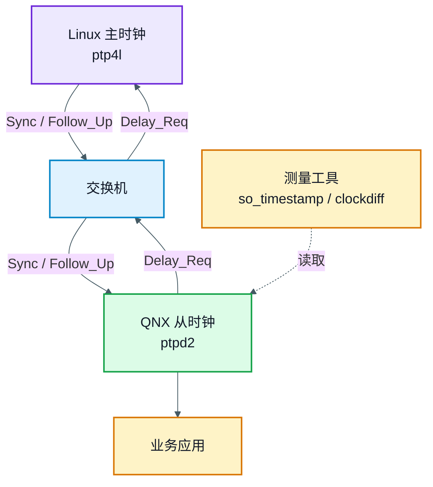
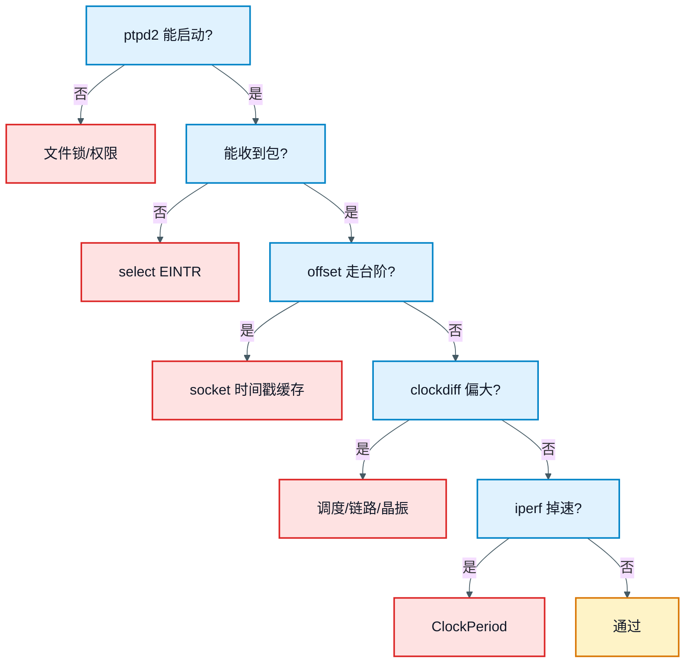
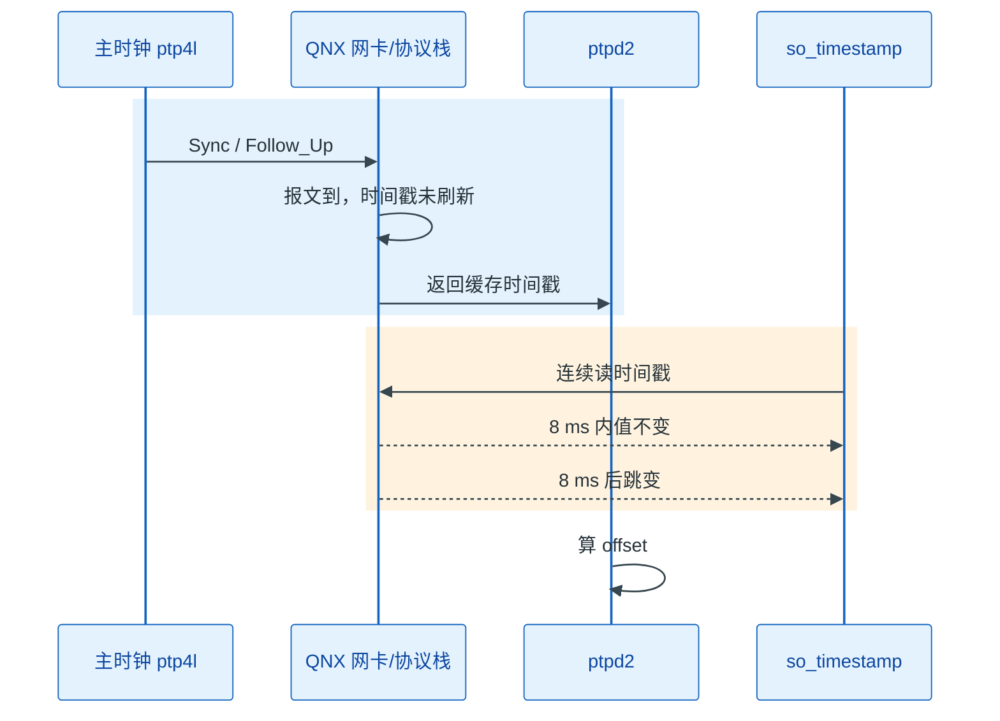

# QNX 上的 PTPD 授时精度验证：从 8 ms 时间戳台阶到百微秒级

> **概述：** QNX 上跑 `ptpd2` 做 PTP 从时钟，协议显示锁定，不代表时间戳可信。这套平台的原生 socket 时间戳约 8 ms 更新一次，offset 会走台阶；把事件报文改成直接读 `CLOCK_REALTIME`，再处理 `ClockAdjust`、文件锁、`EINTR` 和 `ClockPeriod`，`clockdiff` 可以落到百微秒级。

本文基于一套车载传感器平台的实测：Linux 侧的 `ptp4l` 当主时钟，QNX 侧的 `ptpd2` 当从时钟，延迟测量使用端到端模式（E2E）。平台细节做了脱敏，但命令、代码路径和误差量级保持原样。

## 1. 引言

这套平台的主线不是“让 `ptpd2` 跑起来”，而是“证明它给出的时间可信”。顺序应该是：

1. 先确认报文的时间戳在哪里打；
2. 再确认 `ptpd2` 真的在收包、协议真的锁定；
3. 然后才调 `ClockAdjust` 和 `ClockPeriod`；
4. 最后用时间戳层、协议层、应用层三组指标验收。

实测结果如下：

| 阶段 | 观测 | 结论 |
| --- | --- | --- |
| 原始 socket 时间戳 | 8 ms 内值不变，8 ms 跳一次；最佳条件约 10 ms 误差 | 时间戳缓存是主因 |
| 直接读 `CLOCK_REALTIME` | `clockdiff` 几十到几百微秒，最大不超过 1 ms | 台阶消失，但仍有调度误差 |
| 加 `ClockAdjust` | offset 更平滑，长时间漂移减小 | 频率修正要配合伺服 |
| `ClockPeriod` 改 100 μs | `iperf` 从 600+ Mbps 降到 500+ Mbps | tick 与网络栈耦合，精度和吞吐要一起验收 |

适用范围：

- 本文按 QNX 7.x + `io-pkt` 风格的网络栈叙述；
- QNX 8.0 的 `ClockPeriod` 行为和 `io-sock` 的 PTP 驱动接口不同，见 5 节的版本边界；
- 没有硬件时间戳时，不要承诺微秒级绝对精度；本文的“百微秒级”指这套软件时间戳平台的 `clockdiff` 结果。

测试条件至少要记录这些项，否则 8 ms 和“几十到几百微秒”都不可复现：

| 项目 | 本文条件 |
| --- | --- |
| 主时钟 | Linux + `ptp4l`，E2E |
| 链路 | 交换机 |
| 从时钟 | QNX + `ptpd2`，只做 slave |
| 被测业务 | QNX 应用读取时间、记录事件 |
| 网络负载 | `iperf` 基线 |
| 观测工具 | `so_timestamp`、`ptpd2` 统计日志、`clockdiff` |



现场排查可以先看这张表：

| 症状 | 先查 | 处理 |
| --- | --- | --- |
| `ptpd2` 启动卡住 | 文件锁路径权限 | `-l /mnt/ptpd.lock` |
| 日志停在监听，`tcpdump` 有 Sync | `select` 是否被 `EINTR` 打断 | 重试 `select` |
| 协议锁定，但 offset 走台阶 | socket 时间戳缓存 | 直读时钟或硬件时间戳 |
| offset 平滑，但 `clockdiff` 很大 | 调度、链路不对称、晶振 | 看 p99、PPS、误差分解 |
| 精度改善，但 `iperf` 掉速 | `ClockPeriod` | 恢复 tick 或临时调整 |



## 2. 8 ms 台阶从哪里来

原生 `ptpd2` 通过 socket 时间戳路径获取事件报文的收发时刻。这套 QNX 平台上，这条路径由内核按固定周期刷新，并非报文一到就更新。连续读取同一个 socket 的时间戳，会看到一段时间内返回值不变，大约每 8 ms 跳一次。

`so_timestamp` 是本文配套的采样工具，不是 QNX 自带命令：它循环调用 `recvmsg()`，从 `SCM_TIMESTAMP` 取接收时间戳，并按固定间隔打印当前缓存值。它只回答一个问题：时间戳是不是长时间不变。

核心读取逻辑可以简化成：

```c
recvmsg(fd, &msg, 0);

for (cmsg = CMSG_FIRSTHDR(&msg); cmsg != NULL; cmsg = CMSG_NXTHDR(&msg, cmsg)) {
    if (cmsg->cmsg_level == SOL_SOCKET && cmsg->cmsg_type == SCM_TIMESTAMP) {
        struct timeval *tv = (struct timeval *)CMSG_DATA(cmsg);
        printf("%ld.%06ld\n", tv->tv_sec, tv->tv_usec);
    }
}
```

外层再用定时器按固定间隔采样，才能看到“值保持不变、然后跳变”的台阶。

| 采样时刻 | socket 时间戳 | 与上次差值 |
| --- | --- | --- |
| 0 ms | T | — |
| 1 ms | T | 0 |
| 2 ms | T | 0 |
| … | … | … |
| 8 ms | T + 8 ms | +8 ms |

表中是示意值。真正要关注的是“值会保持、再跳变”这个行为，8 ms 只是这套平台的实测周期。



这条路径的问题在于时间戳被量化成台阶，不只是有噪声。每次 Sync 都会算一次 offset；时间戳不变时，offset 看起来稳定，时间戳一跳，offset 跟着跳。时钟调节（servo）看到的是一段段锯齿，容易做出过大的频率修正，严重时直接触发 step。

8 ms 与 QNX 的 `ClockPeriod` 不是一回事。8 ms 是这套平台测到的时间戳更新周期。QNX 文档给出的默认 tick 是 1 ms 或 10 ms，`ptpd` 的 QNX 说明也提到 PCAP/socket 时间戳只能精确到几毫秒。判断 8 ms 与 tick 的关系，可以这样做：

1. 用 `ClockPeriod(CLOCK_REALTIME, NULL, &old, 0)` 或 `clock_getres()` 读当前 tick；
2. 在允许的范围内改变 tick，再跑一次 `so_timestamp`；
3. 如果台阶不变，主因通常在 socket 时间戳缓存或驱动路径，不在 tick。

这套平台把事件报文的时间戳改成在 `getTime()` 里直接读系统时钟：

```c
void getTime(TimeInternal *time)
{
    struct timespec tp_now;

    if (clock_gettime(CLOCK_REALTIME, &tp_now)) {
        perror("clock_gettime");
        exit(EXIT_FAILURE);
    }

    time->seconds = tp_now.tv_sec;
    time->nanoseconds = tp_now.tv_nsec;
}
```

这段代码解决的是“socket 时间戳缓存太旧”的问题：每次处理事件报文时，时间戳至少是当前时刻，不会再出现 8 ms 内固定不变的值。

但它不是硬件时间戳。`getTime()` 在 `ptpd2` 处理报文时执行，仍然包含中断响应、协议栈排队和线程调度延迟。它适合用来消除 QNX 的缓存台阶，不能用来宣称“已经达到硬件时间戳精度”。

改 `getTime()` 之前还要确认调用点。`ptpd2` 里 `getTime()` 不只服务事件报文，也可能被 servo、日志或管理路径使用。全局替换会让所有时间读取都走同一条路径；更稳妥的做法是只在事件报文收发处替换，或者用平台钩子把 QNX 的路径单独隔开。

如果不想维护本地补丁，可以先看 `ptpd` 的 QNX 实验选项：`--enable-experimental-options`。它的说明是，在 QNX 上会用 CPU clock counter + IRQ0 的 `clock_gettime` 近似，并忽略 PCAP/socket 时间戳。它仍然是实验特性，但至少是上游提供的路径，适合和本地 `getTime()` 补丁做对照。

确认台阶后，先别调 servo。先确认 `ptpd2` 真的在收包，否则调的是一个没有输入的控制环。

## 3. 先让 ptpd2 真正工作

文件锁和 `EINTR` 这两个问题会让 `ptpd2` 看起来在运行，实际上没有进入对时。先看三个现象：

| 现象 | 检查 | 修复 |
| --- | --- | --- |
| 启动卡在初始化文件锁 | `/var/run` 对运行用户是否可写 | `-l /mnt/ptpd.lock` 指定可写路径 |
| 日志停在监听，`tcpdump` 能看到 Sync | `select()` 是否返回 `EINTR` | 用 `do-while` 重试，直到不是 `EINTR` |
| 日志有包，但没有 Delay 响应 | 主从端口、E2E 配置、网络过滤 | 回到报文和配置排查 |

QNX 的信号和定时器比 Linux 更容易打断 `select()`。旧代码遇到 `EINTR` 直接返回 0，上层会以为“这次没有报文”，主循环继续空转，于是永远拿不到包。判断方法很简单：日志停在监听、`tcpdump` 有 Sync、`ptpd2` 没有处理记录，先查 `EINTR`，不要先怀疑主时钟。

修复方式是在等待报文的循环里重试：

```c
int netSelect(...)
{
    fd_set readfds;
    int rv;

    do {
        FD_ZERO(&readfds);
        FD_SET(sock_fd, &readfds);
        rv = select(sock_fd + 1, &readfds, NULL, NULL, NULL);
    } while (rv < 0 && errno == EINTR);

    return rv;
}
```

启动命令可以先用前台模式，把锁文件放到可写分区：

```bash
/tmp/ptpd2 -C -E -s -V -i eth0 -l /mnt/ptpd.lock
```

`-C` 前台运行，`-E` 端到端模式，`-s` 只做从时钟，`-V` 输出详细日志，`-i` 指定网卡，`-l` 指定锁文件。参数含义不复杂，真正容易忽略的是：启动脚本里的路径必须是目标文件系统上的绝对路径。

进程能收包、协议能锁定，才轮到时间戳路径和时钟调整。

## 4. 再让时间戳可信

时间戳路径有三种选择：原生 socket 时间戳、直接读系统时钟、硬件时间戳。三者解决的问题不同。

| 方案 | 做法 | 解决什么 | 局限 |
| --- | --- | --- | --- |
| 原生 socket 时间戳 | 默认路径 | 实现简单 | QNX 上可能被缓存成 8 ms 台阶 |
| `getTime()` 直读 | 在事件报文处理时读 `CLOCK_REALTIME` | 去掉缓存台阶 | 仍是软件时间戳，含调度延迟 |
| 实验选项 | `--enable-experimental-options` | 用 CPU counter + IRQ0 近似 | 实验特性，忽略 socket/PCAP |
| 硬件时间戳 | MAC/PHY 在报文进出时打戳 | 最接近线缆 | 依赖网卡驱动和校准 |

直读之后，才轮到 `ClockAdjust`。QNX 的 `ClockAdjust` 并不直接拨表，它按 tick 逐步调整：`tick_nsec_inc` 是每个 tick 的调整量，`tick_count` 是持续的 tick 数，总调整量是两者乘积。它适合让伺服慢慢收敛，大偏差仍然需要 step。

```c
struct _clockadjust adj = {0};

/* 示意：参数要按 tick 周期和实际误差计算，不要照抄 */
adj.tick_nsec_inc = 100;
adj.tick_count = 10000;

if (ClockAdjust(CLOCK_REALTIME, &adj, NULL) == -1) {
    fprintf(stderr, "ClockAdjust failed: %s\n", strerror(errno));
}
```

`ClockAdjust` 需要超级用户权限，`tick_nsec_inc` 也不要超过当前 `ClockPeriod`，否则时钟可能被调得倒退。step 会让时间跳变，业务侧要冻结时间映射、递增映射代次，避免同一帧跨 step 换算。

`ClockPeriod` 改的是系统 tick，与时间戳缓存无关。改小 tick 可以提高 timer 分辨率，但会增加中断负载，并影响网络栈 batching。QNX 7.x 上设置它需要 `PROCMGR_AID_CLOCKPERIOD` 能力，最小可到 10 μs；QNX 8.0 已经不再使用 `ClockPeriod()` 的 `new` 参数动态改 tick，而是通过 `procnto -C` 配置 tick 频率。换版本时，这段代码不能直接照搬。

```c
struct _clockperiod period = {0};

period.nsec = 100000;  /* 100 us，示意 */
period.fract = 0;

if (ClockPeriod(CLOCK_REALTIME, &period, NULL, 0) == -1) {
    fprintf(stderr, "ClockPeriod failed: %s\n", strerror(errno));
}
```

调优按这个顺序走：修时间戳路径，修文件锁和 `EINTR`，用 `ClockAdjust` 减小频率误差，最后才考虑 CPU 绑核、线程优先级和 tick。顺序反了，容易把时间戳错误当成伺服参数问题。

时间戳和调频改完，就可以验收了。验收看三组指标：时间戳是否还走台阶、协议是否稳定、应用层误差是否在预算内。

## 5. 精度验证与误差分解

只跑一次 `clockdiff` 不够。验证要同时看时间戳、协议和应用三层：

| 验证层次 | 观察对象 | 工具 | 通过标准 |
| --- | --- | --- | --- |
| 时间戳层 | 时间戳是否长时间不变 | `so_timestamp` | 不再出现 8 ms 固定值 |
| 协议层 | 是否锁定、是否有异常 step | `ptpd2` 统计日志 | 状态稳定，step 可解释 |
| 应用层 | 系统时间差、事件时间差 | `clockdiff`、PPS、示波器 | p99 和最大值在预算内 |

`ptpd2` 的统计日志不要只看一行 offset。QNX 文档给出的字段包括：

| 字段 | 看什么 |
| --- | --- |
| `State` | 是否进入 `slv` |
| `Offset From Master` | 主从偏差，伺服的主要输入 |
| `One Way Delay` | 路径延迟，长期为零通常说明 Delay 响应没收到 |
| `Observed Drift` | 频率漂移，稳定后说明时钟收敛 |
| `Last Packet Received` | 是否有 `S` 和 `D`，判断 Sync/Delay 是否成对 |
| `raw delayMS` / `raw delaySM` | 未滤波的原始值，用来看异常值和滤波效果 |

`clockdiff` 可以作为应用层粗检：

```bash
clockdiff <master-ip>
```

它走 ICMP，分辨率有限，不能替代 PPS/示波器。本文记录的结果是：原生 socket 时间戳约 10 ms 误差；改 `getTime()` 后落到几十到几百微秒，最大不超过 1 ms；加 `ClockAdjust` 后 offset 更平滑；`ClockPeriod` 改 100 μs 后 `iperf` 从 600+ Mbps 降到 500+ Mbps。

误差要拆开看。只追一个“总精度”数字，容易把固定偏差和随机抖动混在一起：

| 误差源 | 典型量级 | 怎么发现 | 怎么处理 |
| --- | --- | --- | --- |
| socket 时间戳缓存 | 0 至 8 ms | `so_timestamp` 看台阶 | 直读时钟或硬件时间戳 |
| 中断/调度/协议栈 | 几十至几百微秒 | 日志、p99、负载测试 | 绑核、优先级、减少锁 |
| QNX 内核 tick | 100 μs 至 1 ms | `ClockPeriod` 对比、`iperf` | 权衡 tick 与吞吐 |
| 网络链路不对称 | 几十纳秒至几微秒 | PPS、示波器、TC 交换机 | 校准、硬件时间戳、TC |
| 晶振漂移 | ppm × 时间 | 长稳、holdover | `ClockAdjust`、温补、OCXO |
| 测量工具误差 | 几十微秒至毫秒 | 与 PPS/示波器对照 | 不把 `clockdiff` 当唯一标准 |

验证按这个顺序走：

1. 先跑 `iperf` 基线，记录吞吐和 CPU；
2. 用 `so_timestamp` 看原始时间戳台阶；
3. 改 `getTime()`，再跑 `clockdiff` 和 `ptpd2` 日志；
4. 打开 `ClockAdjust`，观察 offset 是否从台阶变成平滑调整；
5. 做 24 小时和 72 小时长稳，记录 p99、最大值和失锁次数。

### 版本边界

| 版本/栈 | `ClockPeriod` | 硬件时间戳 |
| --- | --- | --- |
| QNX 7.x + `io-pkt` | 动态设置，需要 `PROCMGR_AID_CLOCKPERIOD`，最小 10 μs | `SO_TS_CLOCK` 可请求；硬件时钟需要驱动支持 |
| QNX 8.x + `io-sock` | `new` 参数不再生效，tick 频率由 `procnto -C` 配置 | PTP 驱动接口由网卡驱动实现 |

`clockdiff` 不是计量级工具；没有硬件时间戳时，不要承诺微秒级绝对精度；8 ms 是这套平台的实测值，不是所有 QNX 系统的固定参数。这套方法只适用于同类的 QNX 7.x + `io-pkt` 平台，换版本或换驱动要重新测。

## 参考资料

- [QNX 7.1 ClockPeriod](https://qnx.com/developers/docs/7.1/com.qnx.doc.neutrino.lib_ref/topic/c/clockperiod.html)
- [QNX ClockAdjust](https://www.qnx.com/developers/docs/7.1/com.qnx.doc.neutrino.lib_ref/topic/c/clockadjust.html)
- [QNX getsockopt / SO_TS_CLOCK](https://www.qnx.com/developers/docs/7.1/com.qnx.doc.neutrino.lib_ref/topic/g/getsockopt.html)
- [ptpd INSTALL（QNX 时间戳说明）](https://github.com/glanch/ptpd/blob/master/INSTALL)
- [QNX ptpd2 统计日志字段](https://qnx.com/developers/docs/7.1/com.qnx.doc.neutrino.utilities/topic/p/ptpd2.html)
- [QNX 8.0 ClockPeriod 变更](https://foundry27.com/support/knowledgebase.html?id=501OI00000FFW5S)

### 相关文章

- [PTP 网络模块设计：车载传感器的授时链路](https://deguiliu.github.io/tech-notes/posts/architecture/ptp_network_module_design/)
- [GNSS 与 PTP 时间同步原理：嵌入式软件工程师视角](https://deguiliu.github.io/tech-notes/posts/architecture/gnss_ptp_time_sync_principles/)
- [Linux 编程：嵌入式 ARM 平台 Linux 网络实时性能优化](https://deguiliu.github.io/tech-notes/posts/performance/arm_linux_network_optimization/)
