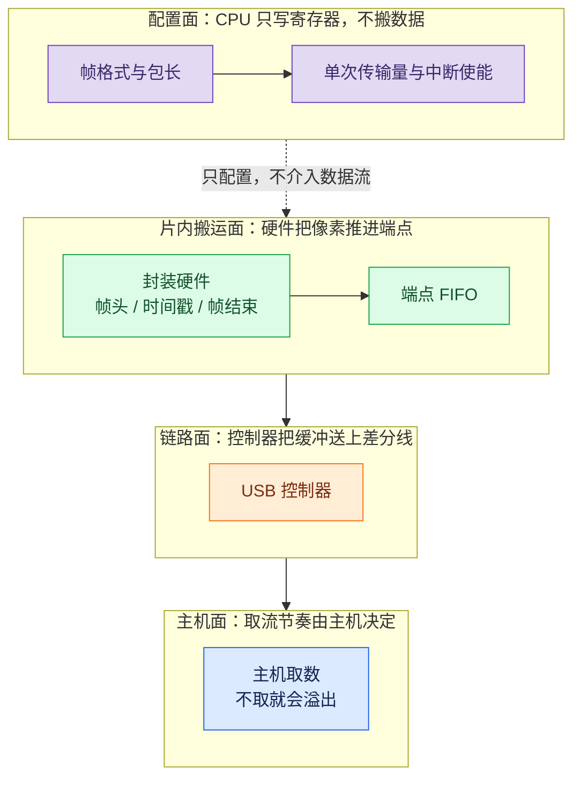
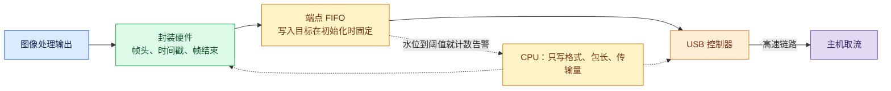

USB 视频这类输出，最容易踩的坑是把“搬数据”当成软件的事。实际上在这类 SoC 上，画面从头到尾不经过 CPU：封装硬件把像素组织成 UVC 帧，直接写进 USB 控制器的端点 FIFO，CPU 只写配置、收中断。

本文讲的是片内封装硬件直写端点这条形态；由外接桥接芯片完成 UVC 成帧的形态，见已发的 [UVC 与 CSI-2 图像输出通路](/tech-notes/posts/architecture/uvc_vs_csi2_output_paths/)。

这也是上一张总图上的第二个出口。总图见 [图像 SoC 的视频流架构](/tech-notes/posts/architecture/video_stream_pipeline_architecture/)；与走协议封包的 [MIPI CSI-2 发送端配置](/tech-notes/posts/architecture/mipi_csi_tx_output_path/) 相比，这条路不做 CSI-2 那样的包组织，而是把数据直接推进端点缓冲。

## 1. 通路怎么搭起来



这条通路的关键只有一个动作：初始化时把封装模块的输出目标设成 USB 端点的缓冲地址，之后硬件按自己的节奏推进，软件不再介入。需要 CPU 做的配置如下：

| 动作 | 谁做 | 说明 |
|---|---|---|
| 加协议头、时间戳、帧结束标志 | 封装硬件 | 裸图数据被组织成 UVC 帧 |
| 写端点 FIFO | 硬件直写 | 封装模块的输出地址在初始化时就指向端点缓冲 |
| 设帧格式、包长、单次传输量 | CPU | 只写寄存器，不搬数据 |
| 溢出计数 | CPU 收中断 | 不介入数据流 |

通路一旦搭好，帧率和分辨率的变化只影响寄存器参数，不影响数据路径的结构。



## 2. 为什么必须硬件直写

算一下带宽就清楚了。USB 2.0 高速模式的理论速率是 480 Mbps，跑 bulk 传输、扣掉协议开销并按半双工算，可用吞吐的经验值大约 40 MB/s。下面按 1 MB = 10⁶ 字节算，一路 640×480 的 16 位灰度图，30 帧每秒需要：

```
640 × 480 × 2 B × 30 = 18 432 000 B/s ≈ 18.4 MB/s
```

已经占掉可用带宽的四成多；两路同样的流加起来就是九成左右，基本没有余量。换成 1080p 的 16 位灰度，按同一口径算是 1920×1080×2×30 ≈ 124 MB/s，直接超出可用带宽。已发的 [UVC 与 CSI-2 图像输出通路](/tech-notes/posts/architecture/uvc_vs_csi2_output_paths/) 里有更完整的带宽对照表。

如果走“软件搬帧”，同一份数据要先经总线搬进内存，再由 CPU 读出来、拷到端点缓冲：两次搬运加一次内存往返，而 CPU 占用会随帧率线性上升，帧率越高越撑不住。硬件直写把这段开销整个去掉，代价是数据路径被固定下来，出了问题可以调整的余地比软件方案小。

这条通路在硬件上分成两级：封装模块负责组织帧，USB 控制器负责把端点缓冲里的数据送上链路。它们各自有寄存器和中断，但在数据流上是一体的。

## 3. 出现丢帧时先看哪一层

就 USB 出口这一段而言，因为通路上没有软件搬帧，溢出只可能发生在 FIFO 水位这一层：主机取数的节奏跟不上硬件产生的速度，端点缓冲被写满。判断依据也很直接：硬件在 FIFO 写到阈值以上时会触发溢出中断并计数，把水位阈值和溢出计数放在一起看，就能确认问题出在端点这一层。

这只排除了软件搬帧这一种可能，不等于所有丢帧都出在 USB 侧。若现象是整帧丢失、帧长不对或者画面周期性断裂，还要往链路更前面查：图像处理侧写入的长度是否和输出节拍一致、输出重组是否按正确的边界成帧、数据源选择是否在切换过程中生效。上游的成帧问题会在这一层表现为“帧数对不上”，很容易被误判成主机取数慢。

判断顺序因此是：先看溢出计数与水位，确认问题是否发生在端点这一层；如果这一层干净，再逐级往上游比对写入长度和成帧边界。两层各有各的判据，不要合并成一句结论。

## 4. 分工与适用边界

| 项 | 当前边界 |
|---|---|
| 适用场景 | 单路或双路的连续视频输出，带宽在可用范围内 |
| 不适用 | 需要在输出前插入软件步骤（重编码、软后处理）的场景；裁剪与叠加由上游硬件节点在装配阶段完成，与本通路不冲突 |
| CPU 职责 | 只在初始化和参数变更时写寄存器，以及处理溢出中断 |
| 帧率与分辨率 | 由寄存器参数决定，改动不需要重建数据路径 |
| 溢出处理 | 当前实现只计数和告警，不在数据路径上做补偿 |
| 与主机的关系 | 取数节奏由主机决定，设备侧不能主动推送 |

一路或多路共用一个 USB 设备时的枚举、双路带宽分配与描述符组织，见已发的 [嵌入式双路 USB 视频输出](/tech-notes/posts/architecture/embedded_usb_dual_video_output/)。

到这里，这张总图上的两个出口就都拆开了：一个走协议封包、按字段和接收端对齐；一个不做封包、把数据直接推进端点缓冲。下一篇回到这些通路之前的一层：芯片从复位到调度器启动，走的是哪些步骤。
